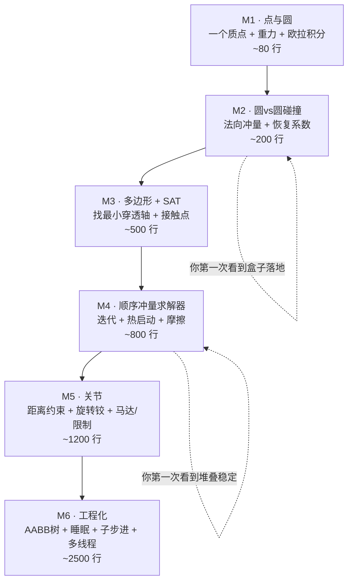

# 00 · 学习路线图：从"看不懂"到"写得出"

> 这一章给你一张**可执行的时间表**和**6 个里程碑练习**。
> 如果你只有 90 分钟，就按"速通路线"读；如果你打算真写一个引擎，就按"里程碑"练。

---

## 一、90 分钟速通路线

```mermaid
gantt
    title 90 分钟读懂 Box2D
    dateFormat mm
    axisFormat %M 分
    section 建骨架
    主循环 = b2World_Step         :done, a1, 00, 12
    对象模型 = Body/Shape/Contact :done, a2, 12, 22
    section 看懂数据
    碰撞检测 broad→narrow         :active, b1, 22, 42
    约束求解 = 顺序冲量           :b2, 42, 68
    section 收尾
    并行与优化 = 图着色/SIMD      :c1, 68, 82
    睡眠/CCD/事件 = 边角料        :c2, 82, 90
```



| 时间 | 做什么 | 打开哪几个文件 |
|---|---|---|
| 0–12 min | 读 `b2World_Step`（894 行开始），只记 5 个阶段名 | `physics_world.c:894-1055` |
| 12–22 min | 搞清 `b2Body` / `b2BodySim` / `b2BodyState` 三者分工 | `body.h:68-208` |
| 22–42 min | 碰撞：胖 AABB → manifold → 接触点 id | `broad_phase.c`、`manifold.c:702-1030` |
| 42–68 min | **重点**：`b2SolveContacts_Overflow` 标量版，逐行手算 | `contact_solver.c:217-402` |
| 68–82 min | 图着色 + SIMD 宽版本（对比标量版看差异） | `constraint_graph.c`、`contact_solver.c:2012` |
| 82–90 min | 岛、睡眠、CCD、事件 | `island.c`、`solver.c:384-557` |

> **最重要的建议**：第 42–68 分钟那 185 行代码（`b2SolveContacts_Overflow`），
> 请**拿纸笔手算一遍**。它包含了 Box2D 全部的核心数学。看懂它，其他都是它的变体。

---

## 二、6 个里程碑：从零写出自己的 2D 引擎

这条线是[第 05 章](./05-从零打造2D物理引擎.md)的详细展开。先在这里给你全局视图：



| 里程碑 | 关键收获 | 验收标准 |
|---|---|---|
| **M1** | 半隐式欧拉为什么比显式欧拉稳 | 一个球自由落体，能量不发散 |
| **M2** | 冲量公式 `P = -(1+e)·vn / (1/mA+1/mB)` | 两个球对撞，动量守恒；静止球落地后停在地面 |
| **M3** | SAT + 参考面/入射面裁剪 | 一个盒子斜落在地面上，两个接触点，不穿模 |
| **M4** | 顺序冲量 + 累积冲量裁剪 + 热启动 | **10 个盒子叠起来能稳定不塌**（这是分水岭） |
| **M5** | 雅可比矩阵 + 软约束 | 做一个能跑的车（轮子 = wheel joint + motor） |
| **M6** | 数据结构与并行 | 5000 个物体，60 FPS |

> **M4 是分水岭**。如果堆叠会塌、会抖、会陷进去，说明你的求解器还没入门。
> 这一关过不去，后面加再多关节都是沙上建塔。

---

## 三、读代码前必须建立的 5 个心智模型

### 模型 1：一切都用"逆"表示

Box2D 里到处是 `invMass`、`invInertia`。为什么？

因为静态物体质量是"无穷大"，但**浮点里没有无穷大**。用 `invMass = 0` 表示无穷大质量，
于是所有公式天然统一：

```
静态地面：  invMass = 0,  invI = 0
动态箱子：  invMass = 1,  invI = 0.83
```

冲量公式 `Δv = invMass * P` 对静态物体自动得到 `Δv = 0` —— 完美。
**不需要任何 if 分支**。这是 Box2D 最优雅的设计之一。

### 模型 2：锚点 `r` 永远是"从质心到接触点"

```
        ┌─────────┐
        │         │
        │    × ←──┼── 质心 C
        │    │    │
        └────┼────┘
             │
             ●  ← 接触点 P
             ↑
             r = P - C  （世界系，但每子步用 deltaRotation 旋转）
```

接触点的速度不是 `v`，而是 **`v + ω × r`**。
所有力和冲量作用在这个点上，会同时产生线速度变化和角速度变化：

```
Δv = invM · P
Δω = invI · cross(r, P)
```

记住这对公式，Box2D 里它出现了上百次。

### 模型 3：约束 = 一条关于速度的方程

任何约束都能写成：

```
J · V + bias = 0
```

- `J` 是**雅可比**（Jacobian）：描述"这个约束关心哪个方向的速度"
- `V` 是所有刚体速度拼成的大向量 `[vA.x, vA.y, wA, vB.x, vB.y, wB]`
- `bias` 是**偏移量**：用来修正位置误差，或者驱动马达

举例（接触不可穿透，法向 n）：
```
J = [ -n.x, -n.y, -cross(rA,n),  n.x, n.y, cross(rB,n) ]
J·V = dot(vB + ωB×rB - vA - ωA×rA, n) = vn   （相对法向速度）
约束： vn + bias ≥ 0
```

**冲量方向永远是 `Jᵀ`**：`P = λ · Jᵀ`，λ 是"冲量大小"（Lagrange 乘子）。

### 模型 4：有效质量（Effective Mass）

给了冲量 `P = λ·Jᵀ`，速度变化多少？代入牛顿定律：

```
Δvn = J · (M⁻¹ · Jᵀ) · λ  ≡  K · λ
```

`K = J·M⁻¹·Jᵀ` 就叫**有效质量**（标量）。要"把 vn 改变 Δvn"，需要：

```
λ = Δvn / K        （记 normalMass = 1/K）
```

对接触点展开就是那个经典公式（`contact_solver.c:125`）：

```c
float rnA = b2Cross( rA, normal );
float rnB = b2Cross( rB, normal );
float kNormal = mA + mB + iA*rnA*rnA + iB*rnB*rnB;
cp->normalMass = kNormal > 0.0f ? 1.0f / kNormal : 0.0f;
```

**四项的含义**（按贡献拆解）：

```
kNormal =  mA              ← A 的平移贡献
         + mB              ← B 的平移贡献
         + iA · (rA×n)²    ← A 的旋转贡献（力臂 rA×n 越长，转动越"吃"冲量）
         + iB · (rB×n)²    ← B 的旋转贡献
```

### 模型 5：位置误差靠 bias 修，不靠"挪位置"

很多初学者引擎会在求解后**直接把物体位置拉开**（position projection）。Box2D v3 **不做这个**。
它把位置误差 `s`（穿透深度，负数）转换成一个**速度偏置**塞进约束里：

```
bias = softness.biasRate · s        （s < 0 时 bias < 0，把物体往外推）
目标： vn + bias ≥ 0  →  即 vn ≥ -bias > 0  →  物体以一定速度分开
```

好处：**位置修正和速度求解统一在一次迭代里**，不会引入新的能量，也不会破坏关节。
这就是所谓的 **Soft Constraint（软约束）**，详见 [04 章](./04-约束与求解器.md#四软约束-b2makesoft)。

---

## 四、Box2D 的"反直觉"设计清单（踩坑预警）

| 反直觉之处 | 直觉以为是 | 实际是 | 在哪 |
|---|---|---|---|
| manifold 的 separation 可以为正 | 重叠才算接触 | 提前 2cm 就建接触（推测接触） | `B2_SPECULATIVE_DISTANCE` |
| 接触点数量是 2 | 越多越好 | 2D 里 2 个足够（一条边的两端） | `b2Manifold.points[2]` |
| 求解器不改位置 | 求解完要挪位置 | **只改速度**，位置靠积分 | `solver.c` |
| 摩擦用**当前**法向冲量 | 摩擦用上帧法向冲量 | `maxFriction = friction * cp->normalImpulse`（本帧已更新的值） | `contact_solver.c:374` |
| 恢复只在"松弛"阶段做 | 恢复在求解阶段 | `useBias == false` 的 relax 阶段才应用 | `contact_solver.c:302` |
| 关节的 localFrame 相对物体原点 | 相对质心 | 相对**物体原点**（否则改形状会破坏关节） | `types.h:593-596` |
| kinematic 物体有 invMass=0 | 但会被求解器写 | 有 `b2BodyState`，但用 `b2_dynamicFlag` 保护不被写 | `body.h:43-47` |
| 岛屿只用来睡觉 | 岛屿是求解单位 | **求解靠图着色**，岛屿只管睡眠 | `constraint_graph.c:15` |
| 接触复用会跳过材质更新 | 复用只省几何 | 确实会跳过——复用时连摩擦系数都不更新 | `physics_world.c:583-585` |

---

## 五、调试物理引擎的 6 个土办法

当你自己写的引擎出问题时，按这个顺序排查：

1. **画法线和接触点**。90% 的问题是法线方向反了或者接触点位置错了。
2. **关掉摩擦和恢复**。如果还抖，问题在法向约束；如果不抖了，问题在摩擦裁剪。
3. **把时间步调小 10 倍**（`dt = 1/600`）。如果稳定了，说明是积分误差/大步长问题。
4. **打印累积冲量**。堆叠时底层盒子的 `normalImpulse` 应该从上到下**递增**（近似等差）。不是递增 → 热启动或迭代次数有问题。
5. **单步 + 打印速度**。看第一次迭代后速度是否已经合理，如果第一次就差很远，是有效质量算错了。
6. **检查 `r` 的符号**。`cross(r, P)` 的符号搞反是最常见的 bug，表现为"物体被撞后反向旋转"。

---

## 六、延伸阅读（Erin Catto 的原始资料）

Box2D 作者 Erin Catto 每年在 GDC 有一场演讲，这些 PDF 是理解设计动机的第一手资料：

| 年份 | 主题 | 对应本仓库章节 |
|---|---|---|
| 2006 | Iterative Dynamics with Temporal Coherence（热启动） | [04 章 §6](./04-约束与求解器.md#六热启动-warm-starting) |
| 2009 | Modeling and Solving Constraints | [04 章 §1-4](./04-约束与求解器.md) |
| 2011 | Soft Constraints | [04 章 §4](./04-约束与求解器.md#四软约束-b2makesoft) |
| 2013 | Numerical Methods | [02 章](./02-物理定律与数值积分.md) |
| 2014 | How Box2D Works（架构） | [01 章](./01-整体框架.md) |
| 2015 | Continuous Collision | [03 章 §6-7](./03-碰撞检测.md) |
| 2020 | Solver2D（各求解器对比） | [05 章](./05-从零打造2D物理引擎.md) |

> 源码里 `constraint_graph.c:16` 直接引用了图着色的论文：
> *"High-Performance Physical Simulations on Next-Generation Architecture with Many Cores"*。

---

**下一步** → [01 · 整体框架：一座物理工厂](./01-整体框架.md)
