# 01 · 整体框架：一座物理工厂

> 把 Box2D 想象成**一座汽车工厂**。这一章带你参观厂房，认识每个车间干什么、工件怎么流转。
> 读完你应该能回答：*一个 `b2World_Step` 里，数据到底经过了哪些结构？*

---

## 一、全局俯瞰：World 里到底装了什么

`b2World` 是唯一的**上帝对象**。所有东西都以**数组 + 整数索引**的形式存在里面（没有 `new`、没有指针链表）。

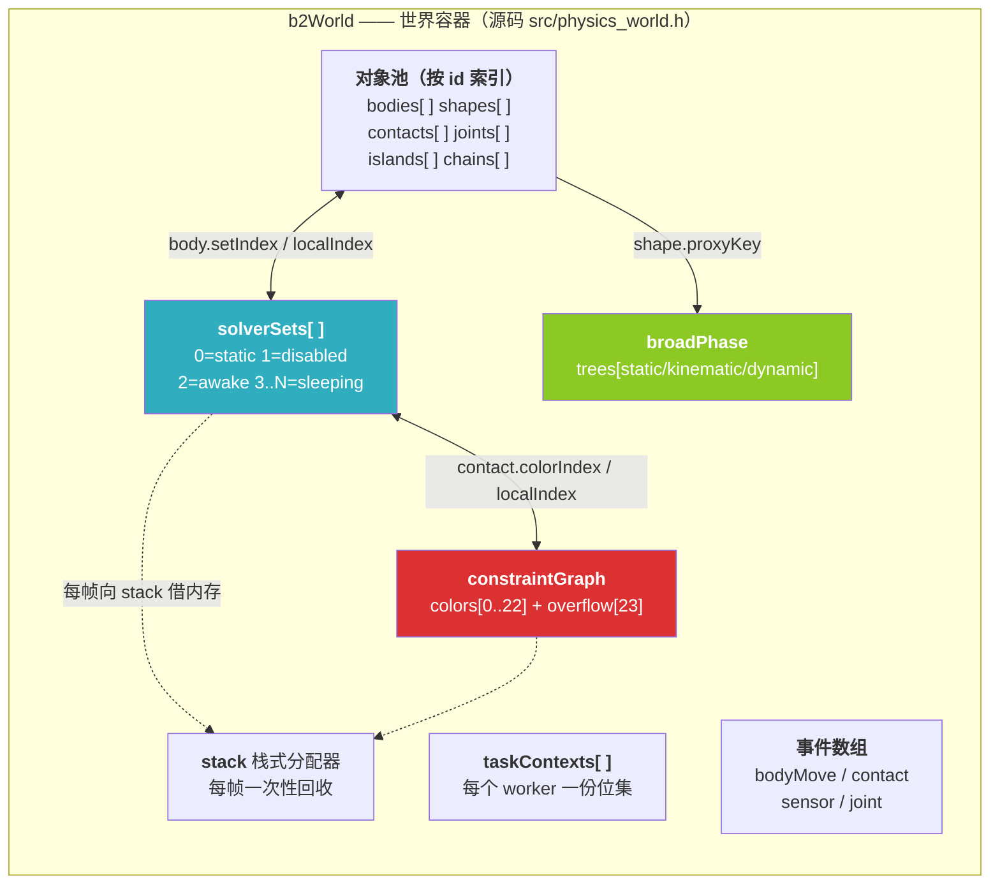

### 为什么全是数组和索引？

**三个理由**：

1. **缓存友好**：求解器要遍历上千个接触，连续内存 + 预取 >> 指针跳转。
2. **可序列化 / 可确定性重放**：整帧状态就是一堆数组，可以直接 hash、存盘、回放（见 `src/recording*.c`）。
3. **可增长**：数组增长时对象在内存里搬家，但只要索引不变，外部持有的 `b2BodyId` 就还有效。

### ID 系统：为什么 `index1 = index + 1`？

```c
// include/box2d/id.h
typedef struct b2BodyId
{
    int32_t index1;       // 真实索引 + 1
    uint16_t world0;      // 世界 id - 1
    uint16_t generation;  // 代数（防悬挂）
} b2BodyId;
```

- `index1 = index + 1`：**0 表示无效 id**，这样 `b2BodyId id = {0}` 天然是"空"。
- `generation`：对象槽位被回收再利用时 +1。你手里拿着旧 id 去查，generation 对不上 → 立刻报错，而不是**静默地操作了另一个物体**。

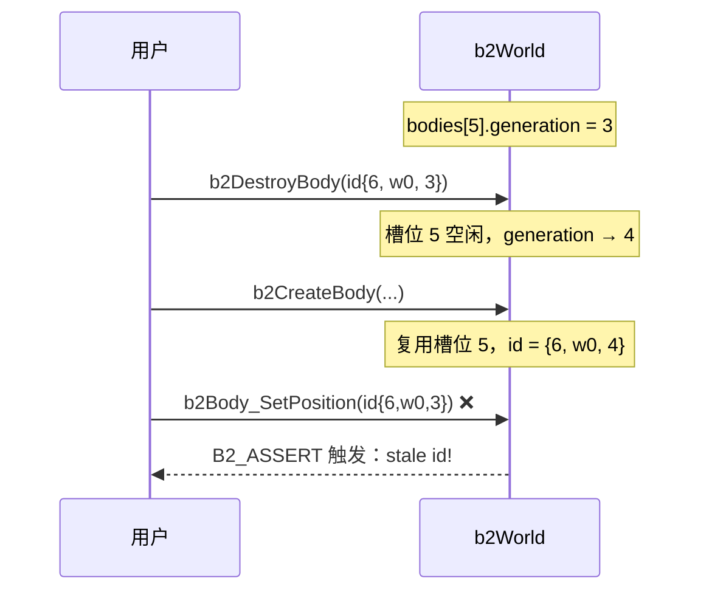

> **这就是 Box2D 相比 v2 最大的 API 改进**：v2 用裸指针，删了物体后指针变成野指针；v3 用 id + generation，立即能检测。

---

## 二、五个核心对象及它们的关系

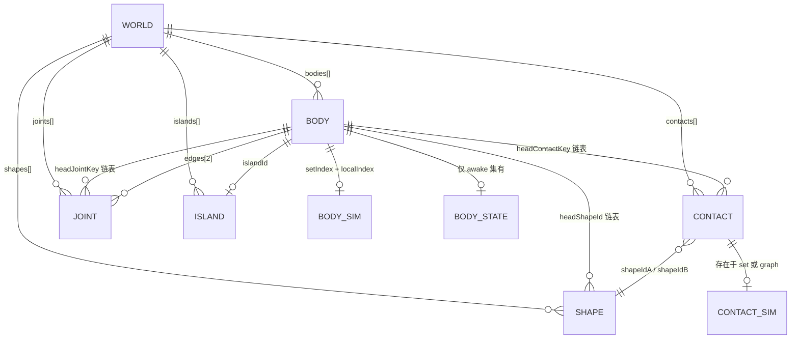

用大白话说：

| 对象 | 一句话 | 生命周期 |
|---|---|---|
| **b2World** | 工厂 + 仓库 | 手动创建/销毁 |
| **b2Body** | 一个刚体（有质量、位置、速度） | 手动创建/销毁 |
| **b2Shape** | 贴在刚体上的一块形状（圆/胶囊/多边形/线段） | 挂在 body 上 |
| **b2Contact** | 两个 shape 的 AABB 重叠时**自动**产生的一对 | 自动增删 |
| **b2Joint** | 用户手动加的约束（铰链、弹簧、马达…） | 手动创建/销毁 |
| **b2Island** | 一群通过接触/关节连在一起的刚体（**只为睡眠服务**） | 自动合并/分裂 |

> ⚠️ **重要**：接触（Contact）**不是**你创建的，是引擎根据 AABB 重叠自动创建/销毁的。
> 这个观念转变很重要：Box2D 里"接触"是**一等公民数据**，会跨帧持久化（为了热启动）。

---

## 三、一个刚体被拆成了三份

这是理解 Box2D v3 数据结构设计的**钥匙**。

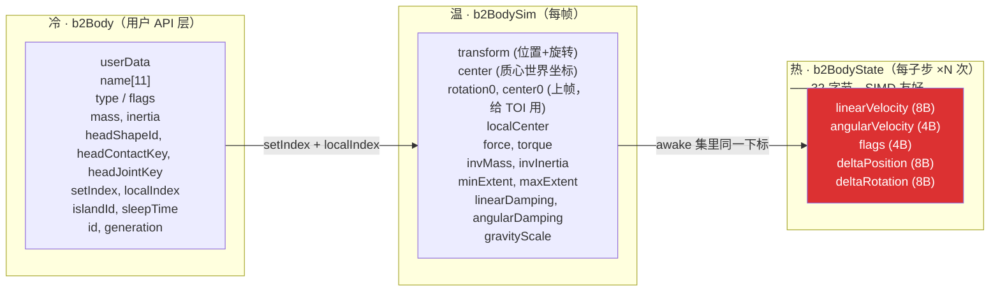

### 为什么要这么拆？

**答案：缓存行。** 一个缓存行 64 字节。

- `b2BodyState` 恰好 **32 字节** → 一个缓存行装 2 个，SIMD gather 一次能取 4~8 个。
- 求解器一个子步里要访问同一个 body 的 `v/w` 好几次（热启动、N 次求解、松弛、积分）。
  如果和 `userData`、`name` 混在一起，每次访问都要多拉几个缓存行，**几万倍地放大**。

### `b2BodyState` 里为什么是 delta 而不是绝对位置？

```c
typedef struct b2BodyState
{
    b2Vec2  linearVelocity;
    float   angularVelocity;
    uint32_t flags;
    b2Vec2  deltaPosition;   // ← 增量，不是绝对位置
    b2Rot   deltaRotation;   // ← 增量，(c,s) = (1,0) 表示没转
} b2BodyState;
```

**三个理由**（源码 `body.h:126-151` 有详细注释）：

1. **静态/运动学物体没有 state**。求解器对它们用一个"哑元 state"：`{v=0, w=0, Δp=0, Δq=(1,0)}`。
   用增量 → 哑元天然是"没动"，不需要任何分支。
2. **远离原点时精度高**。`deltaPosition` 是小量，绝对位置可能几千米（float 精度只有 ~7 位有效数字）。
   位置更新在帧末用 `b2OffsetPos`（双精度大世界模式）一次性加上去。
3. **避免多线程写冲突**。静态物体的 state 被多个线程同时读，如果大家都写同一个绝对位置（哪怕写同样的值），
   会引起缓存行乒乓（false sharing）。用哑元 + `b2_dynamicFlag` 判断，写操作被完全跳过。

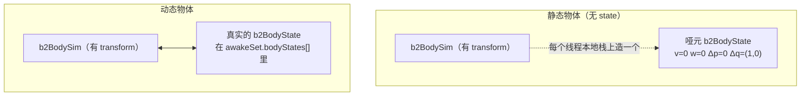

---

## 四、求解集（Solver Set）：物体的"工位分区"

这是 v3 相对 v2 的重大重构。**世界被切成若干个"集合"，每个集合是一份完整的 sim 数据**。

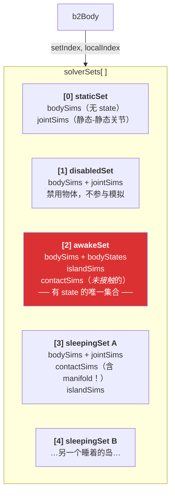

**关键设计点**：

1. **只有 awakeSet 有 `bodyStates`**。睡着的物体不需要速度。
2. **只有 awakeSet 的接触存在约束图里**；睡着的接触躺在自己的 set 里（带着 manifold 和冲量，醒来时直接继续）。
3. **每个睡眠岛一个 set** → 唤醒单个岛是 O(1)：把 set 内容搬到 awakeSet 就行，不用遍历世界。

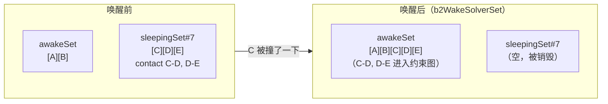

> 源码：`src/solver_set.c` 的 `b2WakeSolverSet` / `b2TrySleepIsland` / `b2MergeSolverSets`。

---

## 五、约束图（Constraint Graph）：求解器的"工位排班表"

求解约束最大的障碍是**数据竞争**：两个约束碰同一个刚体就不能并行。
Box2D 的解法是**图着色**（Graph Coloring）——经典算法问题，这里用来做并行调度。

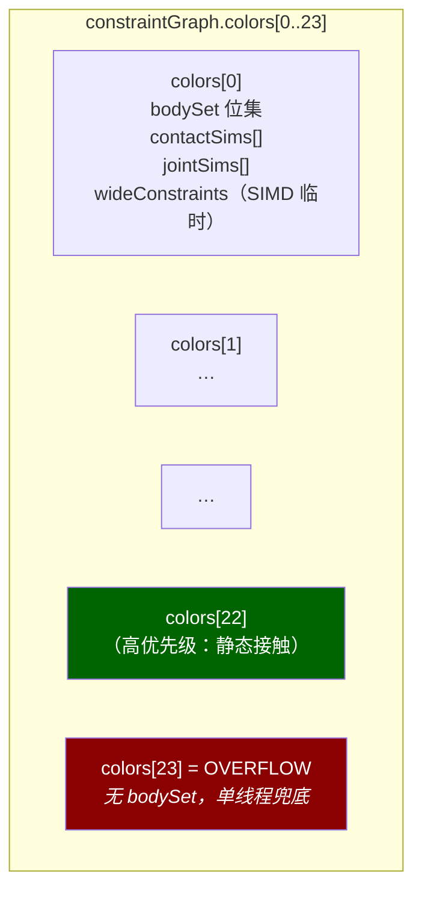

### 染色算法（`constraint_graph.c:67-135`）

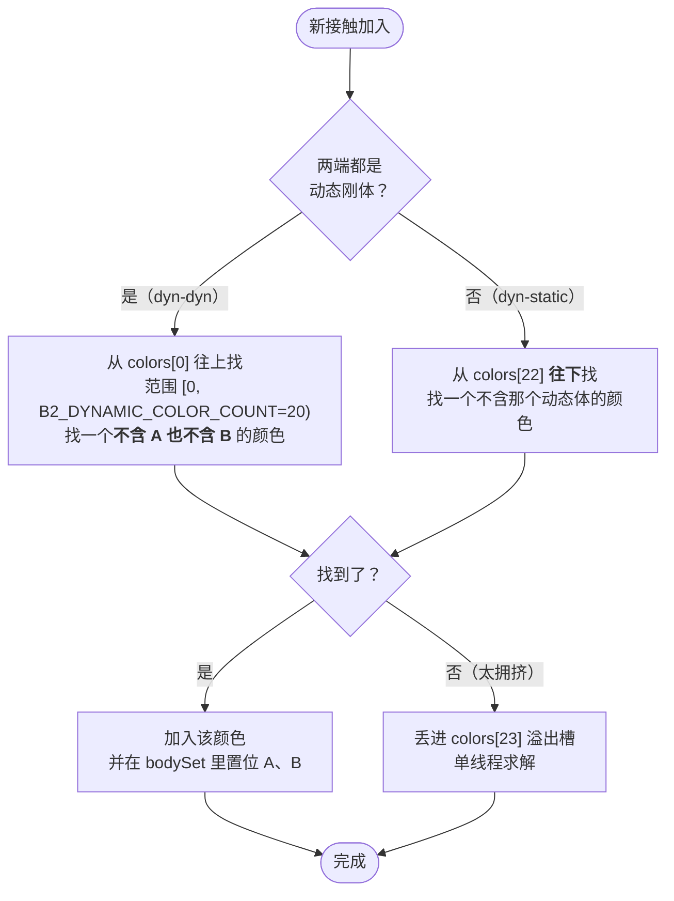

**为什么静态接触从后往前分配、动态接触从前往后？**

```
colors:  [0 ... 19]           [20][21][22]   [23]
          ↑dyn-dyn 用           ↑dyn-static 用  overflow
          （优先级低）           （优先级高）
```

求解时按颜色 **0 → 22** 顺序执行，所以静态约束**最后算**。
原因（源码注释 `constraint_graph.h:22-24`）：

> *"This keeps constraints involving two dynamic bodies at a lower solver priority than constraints involving a dynamic and static bodies. This reduces tunneling due to push through."*

人话：**先让物体之间互相推挤，最后再统一压到地面上**。如果反过来，地面先把物体压住，物体之间的挤压就来不及解决，容易被挤穿地面。

---

## 六、一帧的完整流水线

这是本章的**核心图**，请记牢。

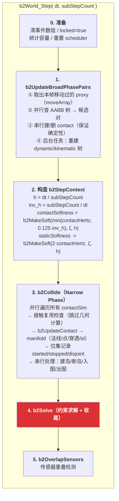

> ⚠️ **容易误解**：`b2FinalizeBodies`（写 transform / AABB / 睡眠 / 触发 CCD）、
> `refit BVH`、`bullet CCD`、`传感器命中`、`岛屿睡眠`、`事件归约` 全都发生在 **`b2Solve` 内部**
> （`solver.c:1255` 之后），而不是 `b2World_Step` 的独立阶段。上面为了可读性才画成两块。

`b2Solve` 的内部顺序（严格串行）：

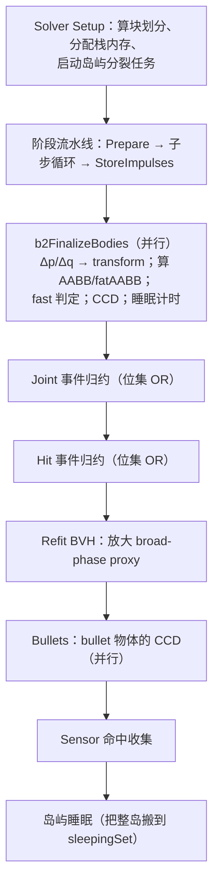

### 阶段 4 的内部（子步进循环）

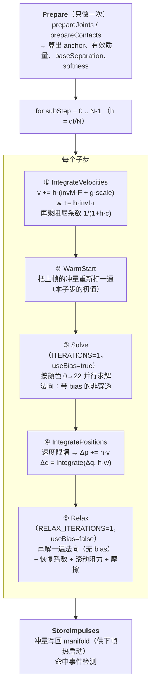

**注意顺序的玄机**：

- **摩擦和恢复放在"松弛"阶段**（⑤），而不是和法向一起（③）。
  因为摩擦力的上限依赖法向力 `μ·Fn`，必须等法向冲量收敛了才算得准。
- **恢复系数（restitution）只在松弛阶段**（`useBias==false`）。
  这是 Box2D v3 的做法：先确保不穿模（③），再考虑弹跳（⑤）。

---

## 七、并行模型：任务、块、同步位

Box2D v3 的多线程模型有点特别（受 BepuPhysics2 启发，源码 `solver.h:1-48` 有长注释）。

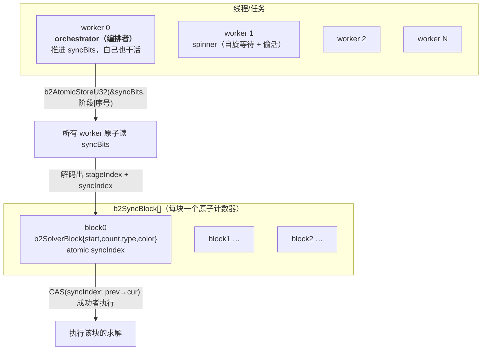

### 三个巧妙之处

**① 每块一个原子计数器，而不是全局计数器**

```
❌ 全局 fetch_add：所有线程抢同一个缓存行 → 缓存行乒乓
✅ 每块独立 syncIndex：每个线程 CAS 自己的目标，落在自己的 L1
```

**② syncIndex 单调递增**

同一个 block 数组在多个子步/迭代中被复用。syncIndex 每轮 +1，
worker CAS `(prev, prev+1)`，所以主线程在迭代之间**完全不需要重置任何状态**，
也避免了 ABA 问题（`solver.h:216-221` 注释）。

**③ 起始偏移按 worker 编号错开 → L2 亲和性**

```
blocks:   [0] [1] [2] [3] [4] [5] [6] [7]
           ^           ^           ^   ^
           W0          W1          W2  W3   ← 起始偏移
```

W0 领 0→1→2→3，W1 领 4→5…… 负载均衡时每个 worker 每轮都命中同一段 block，
这段热数据就一直待在它的 L2 里。**CAS 失败说明邻居已经领走了，偷活者就停手**——
在轻微不均时保持局部性，同时还能排空队列。

### 块的类型（`b2SolverBlockType`）

```
一个颜色阶段的块布局：
   +------+------+------+------+------+------+
   |  J0  |  J1  |  C0  |  C1  |  C2  |  C3  |
   +------+------+------+------+------+------+
   ← graphJointBlocks →← graphContactBlocks →

类型标签在<b>块</b>上（不是阶段上）→ 关节块和接触块可以<b>在同一阶段并发跑</b>，中间不需要屏障。
```

---

## 八、岛屿（Island）：现在只为睡眠服务

v2 时代岛屿是**求解单位**（每个岛独立求解一次）。v3 改成了图着色求解，
**岛屿只剩下两个用途：睡眠判定和唤醒传播**。

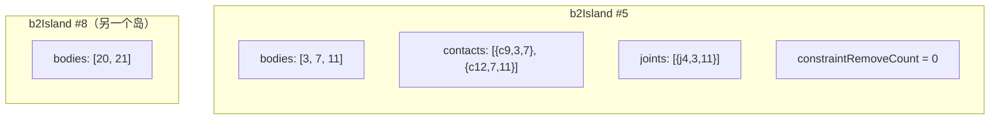

**睡眠规则**（`solver.c:644-702` + `solver_set.c: b2TrySleepIsland`）：

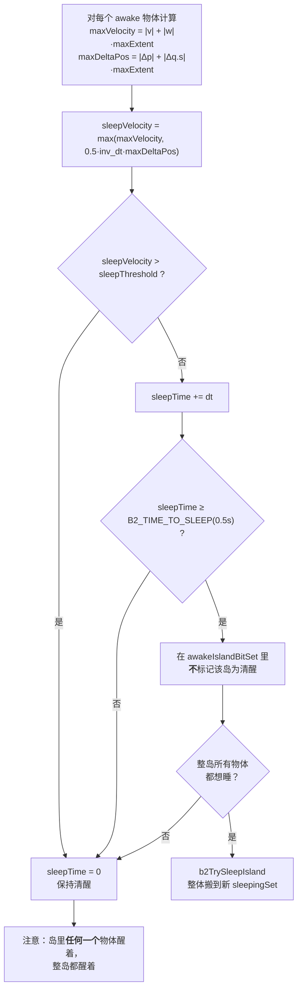

> `0.5·inv_dt·maxDeltaPos` 这一项的意思是：**把"位置修正量"折算成一个等效速度**。
> 否则一个本该睡着的物体，因为求解器还在慢慢把它推出穿透，会一直被判定为"在动"。

### 岛屿分裂（`b2SplitIsland`）

如果一个岛里某个接触断了，岛可能已经**裂成两半**了。Box2D 不会立刻分裂（太贵），
而是：

1. 断接触时 `island->constraintRemoveCount++`
2. 睡眠时如果 `sleepTime ≥ 0.5s` 且 `constraintRemoveCount > 0` → 记录为**分裂候选**
3. **下一帧**在求解器启动前，用一个独立任务（`b2SplitIslandTask`）做并查集（union-find）重新划分

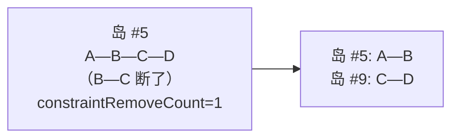

> 源码 `island.c: b2SplitIsland`，用 `b2ContactLink{bodA,bodB}` 缓存，
> 让并查集过程完全不碰 `b2Contact`/`b2Joint`（缓存友好）。

---

## 九、内存管理：栈式分配器

每帧需要大量临时内存（约束数组、块数组、配对结果…）。Box2D 用**栈式分配器**（arena）：

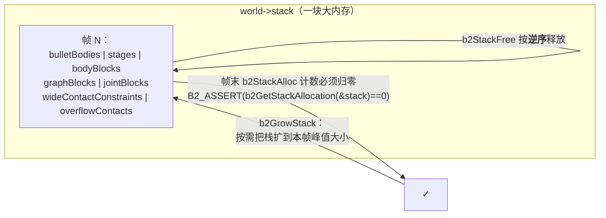

**规则**：必须**后进先出**释放。好处是分配就是一次指针加法，O(1)，无碎片，无锁（每线程可以独立栈，或主线程统一分配）。

---

## 十、本章小结 + 源码索引

### 一句话记忆

> **World 是仓库，Set 是分区，Graph 是工位，State 是流水线上的在制品，Island 是"这批可以下班了"。**

### 源码索引

| 想看什么 | 打开 |
|---|---|
| 一帧主流程 | `src/physics_world.c:894` `b2World_Step` |
| 并行求解调度 | `src/solver.c:1008` `b2SolverTask` |
| 求解前的块划分 | `src/solver.c:1255` `b2Solve` |
| 速度/位置积分 | `src/solver.c:66` / `:114` |
| 刚体三件套定义 | `src/body.h:68` / `:153` / `:175` |
| 求解集定义 | `src/solver_set.h:14-63` |
| 约束图与染色 | `src/constraint_graph.h:26-51`、`constraint_graph.c:67` |
| 岛屿与睡眠 | `src/island.h:49-76`、`src/solver_set.c` `b2TrySleepIsland` |
| ID 与 generation | `include/box2d/id.h`、`src/id_pool.c` |
| 世界结构定义 | `src/physics_world.h` |

### 自测题（能答出来说明本章过关）

1. 为什么 `b2BodyState` 只有 32 字节，且只存在于 awakeSet？
2. `b2BodySim::center0` 和 `rotation0` 是干什么用的？（提示：想想 CCD）
3. 一个动态物体 A 同时接触静态地面 G 和动态物体 B，这两个接触分别会被染成什么颜色？为什么？
4. 为什么唤醒一个睡眠岛是 O(岛大小) 而不是 O(世界大小)？
5. 求解器为什么不直接修改 `b2BodySim::transform`，而是用 `deltaPosition`？

---

**下一步** → [02 · 物理定律与数值积分](./02-物理定律与数值积分.md)
