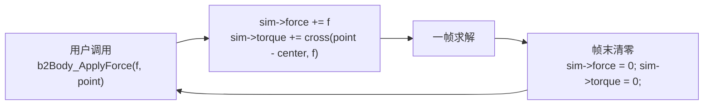
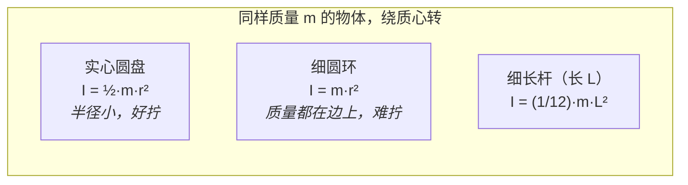
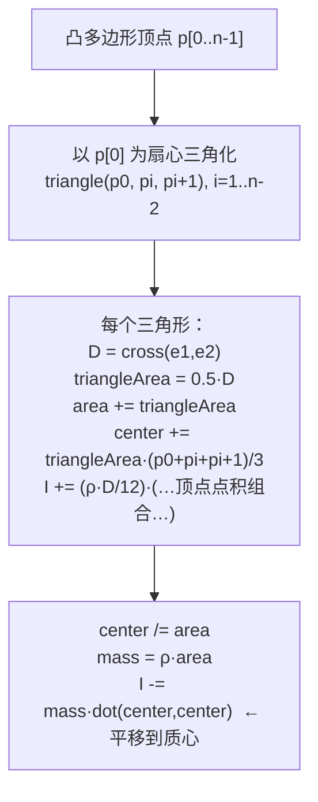
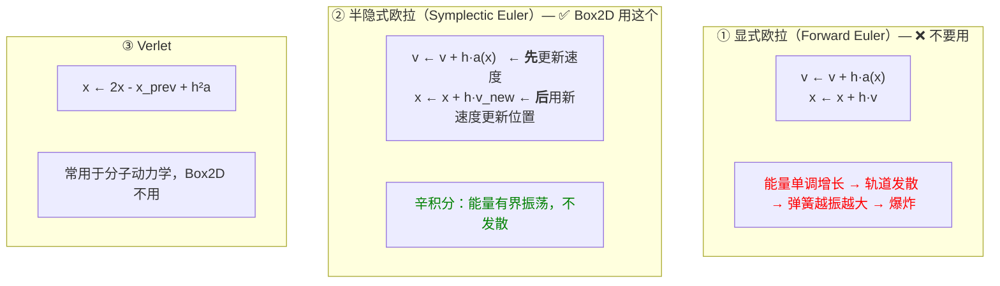
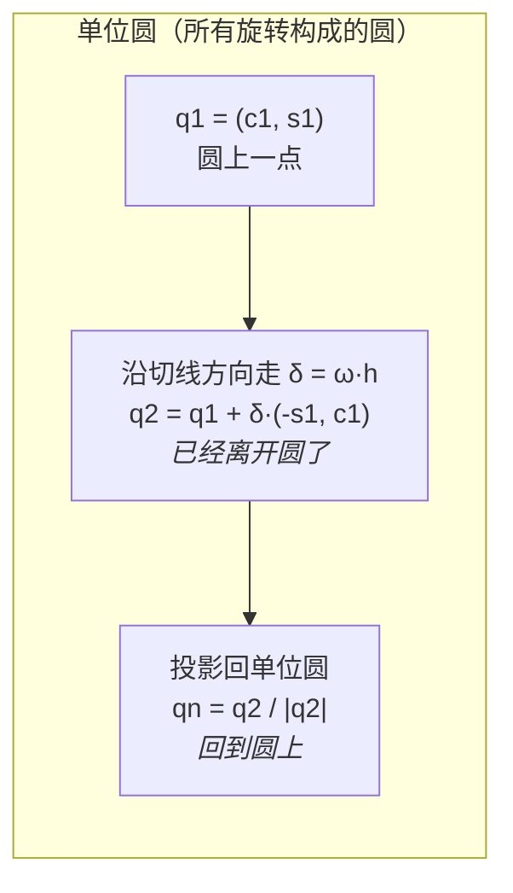
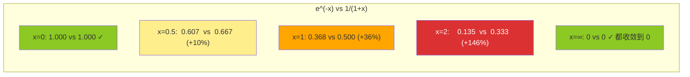
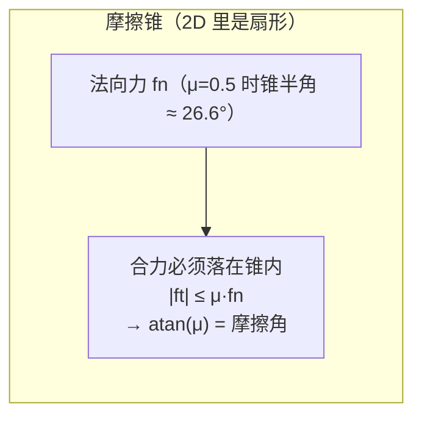
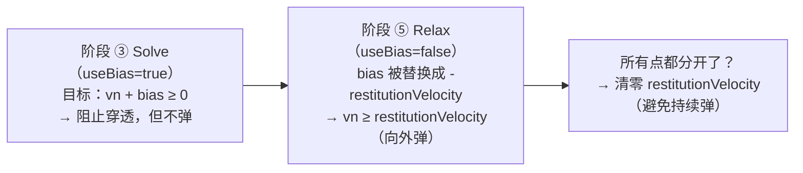
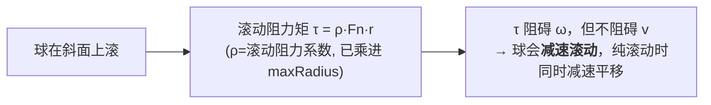
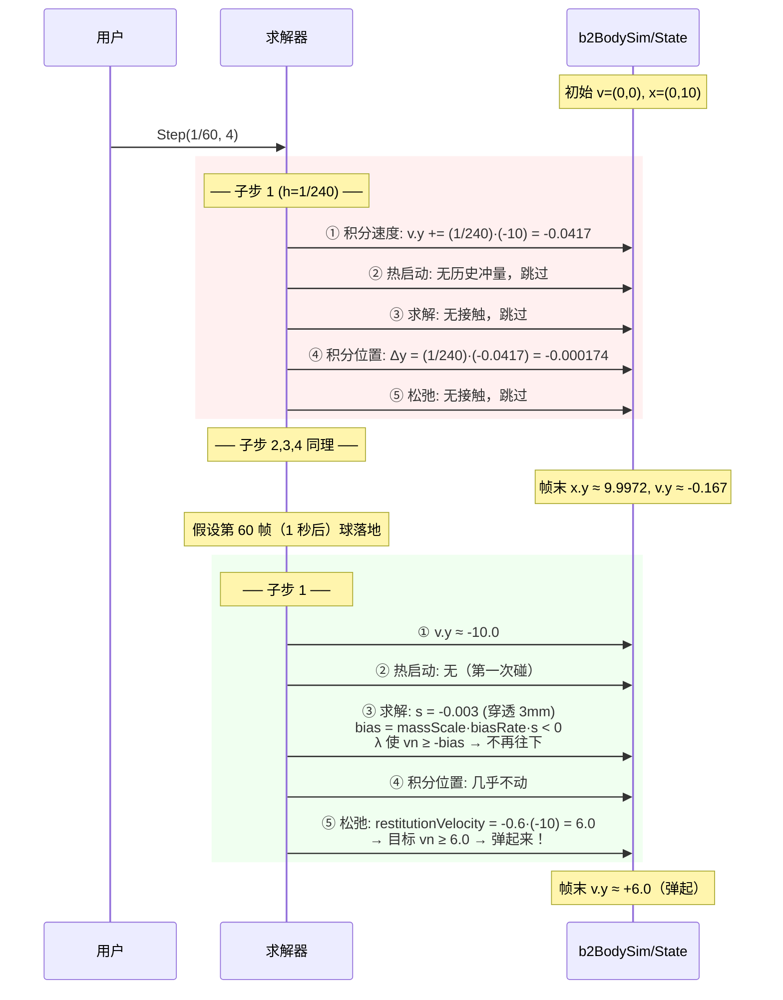

# 02 · 物理定律与数值积分

> Box2D 用到的**物理定律其实非常少**——大学物理第一学期就够。
> 真正的难点在**数值方法**：怎么把这些定律在计算机里离散化而不炸掉。
> 这一章把"物理"和"数值技巧"分开讲，你会发现 Box2D 的很多"魔法"只是工程妥协。

---

## 一、Box2D 用到的全部物理定律（完整清单）

先给你一颗定心丸：**真的只有这 6 条**。

| # | 定律 | 公式 | 在 Box2D 里的位置 |
|---|---|---|---|
| 1 | 牛顿第二定律（平动） | `F = m·a` | `solver.c:101` |
| 2 | 牛顿第二定律（转动） | `τ = I·α` | `solver.c:102` |
| 3 | 万有引力（简化为匀强场） | `F = m·g` | `solver.c:101` |
| 4 | 动量定理 / 冲量 | `Δp = P`，`Δv = P/m` | 到处都是 |
| 5 | 角冲量定理 | `ΔL = cross(r,P)`，`Δω = I⁻¹·cross(r,P)` | 到处都是 |
| 6 | 库仑摩擦定律 | `|f_t| ≤ μ·f_n` | `contact_solver.c:374` |

**不在**经典力学体系内、属于工程近似的：

| 项 | 公式 | 说明 |
|---|---|---|
| 恢复系数（弹性） | `v⁺ = -e · v⁻` | 不是守恒律，是唯象模型 |
| 线性/角度阻尼 | `dv/dt = -c·v` | 空气阻力/内摩擦的简化 |
| 滚动阻力 | `|τ| ≤ ρ·F_n` | 模拟轮胎形变损耗 |
| 软约束（弹簧-阻尼） | 二阶 ODE | 用户可调的"软硬" |

---

## 二、平动：牛顿第二定律

### 源码长什么样

```c
// src/solver.c:66  b2IntegrateVelocitiesTask
b2Vec2 linearVelocityDelta = b2Add(
    b2MulSV( h * sim->invMass, sim->force ),        // h · (1/m) · F
    b2MulSV( h * gravityScale, gravity ) );         // h · g
v = b2MulAdd( linearVelocityDelta, linearDamping, v );
```

翻译成数学：

```
v ← v·damping + h·(F/m) + h·gravityScale·g
```

### 为什么重力那一项不乘 invMass？

```
a = F_gravity / m = (m·g) / m = g
```

**重力加速度与质量无关**（伽利略比萨斜塔）。所以直接加 `h·g`，不需要 `invMass`。

但代码里有一句精妙的判断：

```c
// Gravity scale will be zero for kinematic bodies
float gravityScale = sim->invMass > 0.0f ? sim->gravityScale : 0.0f;
```

- 静态/运动学物体 `invMass == 0` → `gravityScale` 强制为 0 → 不受重力。
- 但 `gravityScale` 字段本身还保留着，用户可以给"失重物体"设 `gravityScale = 0` 而不影响别处。

### 力的累加与清零



`b2Body_ApplyForce` 的力矩部分（`src/body.c`）：

```
τ = cross(point - centerOfMass, force)
```

> ⚠️ 常见坑：`ApplyForce` 的点必须是**世界坐标**，而且力会在下一个 `b2World_Step` 后被自动清零。
> 想持续施力（比如火箭推进），必须**每帧都调**。

---

## 三、转动：转动惯量

### 什么是转动惯量 I

平动里质量 `m` 衡量"推动有多难"；转动里 `I` 衡量"**拧动**有多难"。
关键区别：**I 取决于形状，也取决于你绕哪儿拧**。



平行轴定理（Box2D 内部用）：
```
I_about_point = I_about_com + m · d²        (d = 点到质心距离)
```

### Box2D 怎么算质量属性

`b2ComputePolygonMass`（`src/geometry.c:274`）的注释就是一篇小论文：

```
mass     = ρ · ∫ dA
centroid = (1/mass) · ρ · ∫ r dA
I        = ρ · ∫ (x² + y²) dA
```

**做法**：把凸多边形三角化（以第一个顶点为扇心），每个三角形用重心坐标 (u,v) 做变量替换：

```
x = x0 + e1x·u + e2x·v
y = y0 + e1y·u + e2y·v
约束： 0 ≤ u, 0 ≤ v, u + v ≤ 1
雅可比： D = cross(e1, e2)
```

然后 `∫∫ du dv` 在三角形区域上积分。作者直接说"剩下的推导演算交给计算机代数了"——
结果是一组硬编码的系数累加：



> 最后那步 `I -= mass·dot(center,center)` 就是**平行轴定理的逆用**——
> 先算的是绕原点的 I，要搬到质心去。

### 圆角和圆角多边形怎么处理

```c
// src/geometry.c:323-336
if ( radius > 0.0f )
{
    float sqrt2 = 1.412f;
    for ( int i = 0; i < count; ++i )
    {
        b2Vec2 mid = b2Normalize( b2Add( n1, n2 ) );   // 两邻边法线的角平分线
        vertices[i] = b2MulAdd( shape->vertices[i], sqrt2 * radius, mid );
    }
}
```

**偷懒但很聪明**：不去真积分圆角的面积，而是把每个顶点沿角平分线外推 `√2·r`。
`√2` 来自于：圆角处多出来的面积 ≈ 一个 `r×r` 的正方形的一半左右。这是个经验近似，
对物理表现无影响（没人能看出 1% 的惯量差别）。

---

## 四、数值积分：从连续到离散

### 连续世界的方程

```
dx/dt = v
dv/dt = F/m
```

### 三种离散化方法对比



**差别只有"用旧速度还是新速度更新位置"这一行**，但稳定性天差地别：

```
单摆自由摆动 100 秒（h = 1/60）：

显式欧拉：  振幅 1.0 → 3.7  💥
半隐式欧拉：振幅 1.0 → 1.02  ✓  （有微小周期性涨落，但长期有界）
```

**为什么？** 半隐式欧拉是**辛变换**（symplectic），它保持相空间体积。
能量不是严格守恒，而是在真值附近**周期性振荡**，不会漂移。

### Box2D 的实现

```c
// src/solver.c:114  b2IntegratePositionsTask
state->deltaPosition = b2MulAdd( state->deltaPosition, h, state->linearVelocity );
state->deltaRotation = b2IntegrateRotation( state->deltaRotation, h * state->angularVelocity );
```

注意：**速度已经在前面的约束求解里更新过了**，这里直接用最新的 `v`。
这就是半隐式欧拉。

---

## 五、旋转的积分：一个漂亮的技巧

2D 旋转只有一个自由度 θ。Box2D **不存角度**，而是存 `(cos θ, sin θ)`：

```c
typedef struct b2Rot { float c; float s; } b2Rot;   // c=cos, s=sin
```

**好处**：避免 `sin/cos` 调用，避免角度回绕（wrap-around）问题，旋转向量就是两次乘加。

### 一阶展开 + 归一化

```c
// include/box2d/math_functions.h:388
B2_INLINE b2Rot b2IntegrateRotation( b2Rot q1, float deltaAngle )
{
    // dc/dt = -ω·sin(t) = -ω·s
    // ds/dt =  ω·cos(t) =  ω·c
    // c2 = c1 - ω·h·s1
    // s2 = s1 + ω·h·c1
    b2Rot q2 = { q1.c - deltaAngle * q1.s, q1.s + deltaAngle * q1.c };
    float mag = sqrtf( q2.s * q2.s + q2.c * q2.c );
    float invMag = mag > 0.0f ? 1.0f / mag : 0.0f;
    b2Rot qn = { q2.c * invMag, q2.s * invMag };
    return qn;
}
```

几何意义：



**误差分析**：一阶展开，局部误差 O(δ²)。但因为最后归一化，不会累积漂移。
Box2D 限制了单帧最大转角 `B2_MAX_ROTATION = 0.25π`（45°），
此时 δ = 0.785，一次积分的误差约 `δ²/2 ≈ 0.31 rad`——**这看起来很大！**

但注意：这是**每子步**的 δ。若 `subStepCount = 4`，每子步 δ = 0.196，误差 `≈ 0.019 rad ≈ 1.1°`。
而且帧末 `b2FinalizeBodies` 里还有一次 `b2NormalizeRot` 兜底。**子步进是这里的关键**。

> **实践建议**：如果你的物体转得很快（比如轮子），要么加大 `subStepCount`，要么给物体开
> `allowFastRotation`（Box2D 会跳过角速度限幅，此时必须保证 δ 很小）。

---

## 六、阻尼：Pade 近似

### 物理模型

```
dv/dt + c·v = 0         （c 是阻尼系数）
```

精确解：`v(t) = v0 · e^(-c·t)`

一步之后：
```
v(t+h) = v(t) · e^(-c·h)
```

### 为什么不直接算 exp？

`expf()` 很贵（几十个周期），而阻尼要对**每个物体每子步**算。

### Pade 近似（1,0）

```
e^(-x) ≈ 1 / (1 + x)
```



**关键性质**：

1. 小 x 时很准（`1 - x` 的一阶泰勒一致）。
2. **永远为正**：`1/(1+c·h) > 0`，所以**永远不会把速度变号**（不会"反弹"）。
   如果用显式 `v -= h·c·v`，当 `h·c > 1` 时速度会**变负并指数爆炸**。
3. 无条件和稳定。

### 源码

```c
// src/solver.c:88-95
// Differential equation: dv/dt + c * v = 0
// Solution: v(t) = v0 * exp(-c * t)
// Time step: v(t + dt) = v0 * exp(-c * (t + dt)) = v0 * exp(-c * t) * exp(-c * dt) = v(t) * exp(-c * dt)
// v2 = exp(-c * dt) * v1
// Pade approximation:
// v2 = v1 * 1 / (1 + c * dt)
float linearDamping  = 1.0f / ( 1.0f + h * sim->linearDamping );
float angularDamping = 1.0f / ( 1.0f + h * sim->angularDamping );
```

配合完整更新：
```c
v = b2MulAdd( linearVelocityDelta, linearDamping, v );   // v = Δv + damping·v
w = angularVelocityDelta + angularDamping * w;
```

> 注意顺序：**先加外力产生的 Δv，再整体乘阻尼**。
> 这意味着阻尼也会衰减本帧新加的力——严格说应该只衰减旧速度，但差别很小，而且这样写更简单。

### 阻尼参数的物理意义

```
c = 0    → 无阻尼，物体永远飘
c = 1    → 时间常数 1 秒，速度 1 秒衰减到 37%
c = 5    → 时间常数 0.2 秒，很"黏"
```

Box2D 文档的建议（`types.h:218-227`）：

> *"Generally linear damping is undesirable because it makes objects move slowly as if they are floating."*

**不要用阻尼模拟空气阻力**（除非你真的想要"太空漂浮"感）。真实的空气阻力是
`F = -½·ρ·C·A·|v|·v`（与速度**平方**成正比），而 Box2D 的阻尼是线性的。

---

## 七、冲量：碰撞的数学

这是整个引擎的**核心公式**，务必手推一遍。

### 一维推导（两个质点）

```
碰撞前：  mA 以 vA 向右，mB 以 vB 向右（vA > vB，正在接近）
碰撞后：  相对速度反转并按恢复系数 e 衰减
```

定义相对速度 `vn = vB - vA`（沿法线，**接近时为负**）。

条件（恢复系数定义）：
```
vn⁺ = -e · vn⁻
```

设冲量 `P` 作用在 B 上（`-P` 作用在 A 上）：
```
vB⁺ = vB⁻ + P/mB
vA⁺ = vA⁻ - P/mA
vn⁺ = (vB⁻ + P/mB) - (vA⁻ - P/mA) = vn⁻ + P·(1/mA + 1/mB)
```

解出：
```
P = -(1 + e) · vn⁻ / (1/mA + 1/mB)
```

### 加上旋转（刚体）

接触点有偏置 `rA`（从 A 质心到接触点）、`rB`。冲量 `P = λ·n`：

```
ΔvA = -mA · P                    ΔωA = -iA · cross(rA, P)
ΔvB = +mB · P                    ΔωB = +iB · cross(rB, P)
```

接触点速度：`v_point = v + ω × r`，2D 里 `ω × r = ω · perp(r) = ω·(-r.y, r.x)`。

相对法向速度：
```
vn = dot( vB + ωB×rB - vA - ωA×rA , n )
```

代入后（`contact_solver.c:125`，就是那个经典公式）：
```
K = mA + mB + iA·cross(rA,n)² + iB·cross(rB,n)²
λ = -(1+e)·vn / K
```

```mermaid
flowchart TB
    K["有效质量 K = mA + mB + iA·(rA×n)² + iB·(rB×n)²"]
    K --> T1["mA + mB<br/><i>平动：整体被推</i>"]
    K --> T2["iA·(rA×n)²<br/><i>A 的转动：力臂越长，越"卸力"</i>"]
    K --> T3["iB·(rB×n)²<br/><i>B 的转动</i>"]
    T2 --> Ex["极端例子：<br/>rA ⊥ n 且 rA 很长 → iA·(rA×n)² 很大<br/>→ K 很大 → λ 很小<br/>→ 冲量大部分变成了<b>旋转</b>而不是反弹<br/><b>（这就是打台球"扎杆"的原理）</b>"]
```

### 不等式形式（Box2D 实际用的）

碰撞是**单侧约束**：只能推，不能拉。所以：

```
λ ≥ 0                    （冲量非负 = 只能推开）
vn + bias ≥ 0            （相对速度不再接近）
λ · (vn + bias) = 0      （互补：要么没接触 λ=0，要么刚好停住 vn+bias=0）
```

这就是**线性互补问题（LCP）**。Box2D 用**投影高斯-赛德尔（PGS）**迭代：

```c
// contact_solver.c:309-314
float impulse = -cp->normalMass * ( massScale * vn + velocityBias ) - impulseScale * cp->normalImpulse;

// clamp the accumulated impulse
float newImpulse = b2MaxFloat( cp->normalImpulse + impulse, 0.0f );   // ← 投影到 λ ≥ 0
impulse = newImpulse - cp->normalImpulse;                             // ← 取增量
cp->normalImpulse = newImpulse;
```

**累积冲量裁剪**是关键：不是裁剪本次增量，而是裁剪**累积值**，然后把增量取出来。
这样保证 `normalImpulse` 永远 ≥ 0，且施加的是"修正量"。

---

## 八、摩擦：库仑模型

```
|f_t| ≤ μ · f_n
```

- 静摩擦：切向速度能被完全消除（物体不滑）
- 动摩擦：切向冲量被限制在 `μ · 法向冲量`

### 源码

```c
// contact_solver.c:368-384
float vt = b2Dot( b2Sub( vrB, vrA ), tangent ) - constraint->tangentSpeed;

// incremental tangent impulse
float impulse = cp->tangentMass * ( -vt );

// clamp the accumulated force
float maxFriction = friction * cp->normalImpulse;      // ← 用本帧已更新的法向冲量
float newImpulse = b2ClampFloat( cp->tangentImpulse + impulse, -maxFriction, maxFriction );
impulse = newImpulse - cp->tangentImpulse;
cp->tangentImpulse = newImpulse;

b2Vec2 P = b2MulSV( impulse, tangent );
vA = b2MulSub( vA, mA, P );
wA -= iA * b2Cross( rA, P );
vB = b2MulAdd( vB, mB, P );
wB += iB * b2Cross( rB, P );
```

### 摩擦锥的可视化



**摩擦系数混合规则**（默认）：
```c
friction = sqrt( frictionA * frictionB );    // 几何平均
restitution = max( restitutionA, restitutionB );  // 取大者（更弹）
```

可以用 `b2WorldDef::frictionCallback` / `restitutionCallback` 自定义。

### `tangentSpeed`：传送带

```c
float vt = b2Dot( b2Sub( vrB, vrA ), tangent ) - constraint->tangentSpeed;
```

`tangentSpeed` 让接触点"期望"有一个切向相对速度，于是摩擦力会**驱动**物体跟上。
这就是传送带的原理（材质里设 `tangentSpeed`）。

---

## 九、恢复系数（弹性）

### 什么时候弹？

```c
// physics_world.c:551
if ( mp->totalNormalImpulse > 0.0f && mp->normalVelocity < -world->restitutionThreshold )
{
    mp->restitutionVelocity = -contactSim->restitution * mp->normalVelocity;
}
else
{
    mp->restitutionVelocity = 0.0f;
}
```

**两个条件**：
1. `totalNormalImpulse > 0` —— 这个点**真的发生了碰撞**（推测接触点可能压根没碰到）
2. `normalVelocity < -restitutionThreshold` —— 接近速度超过阈值（默认 1 m/s）

### 为什么要有阈值？

否则**堆叠会永远抖动**。一个盒子静止在地上，重力每帧给它一点向下的速度，
如果有恢复系数，它就会一直弹。`restitutionThreshold = 1 m/s` 就是"多慢才算在弹"的分界线。

### 应用时机：只在松弛阶段

```c
// contact_solver.c:301-306
// Restitution in the relax phase only.
if ( useBias == false && cp->restitutionVelocity > 0.0f )
{
    velocityBias = b2MinFloat( velocityBias, -cp->restitutionVelocity );
    stopRestitution = stopRestitution && s > 0.0f;
}
```



**设计意图**：先保证不穿模（③ 的优先级最高），再考虑弹（⑤）。
如果放在同一阶段，弹跳的冲量会和防穿透的冲量打架。

---

## 十、滚动阻力

库仑摩擦只阻止**滑动**，不阻止**滚动**。一个完美的圆在斜面上会永远滚下去。
真实世界里轮胎会形变、地面会形变，产生阻力矩。

```c
// contact_solver.c:340-350
float deltaLambda = -constraint->rollingMass * ( wB - wA );      // 想消除相对角速度
float lambda = constraint->rollingImpulse;
float maxLambda = constraint->rollingResistance * totalNormalImpulse;   // 上限 = ρ·Fn
constraint->rollingImpulse = b2ClampFloat( lambda + deltaLambda, -maxLambda, maxLambda );
deltaLambda = constraint->rollingImpulse - lambda;

wA -= iA * deltaLambda;
wB += iB * deltaLambda;
```

有效质量：
```c
float k = iA + iB;
constraint->rollingMass = k > 0.0f ? 1.0f / k : 0.0f;
```

**物理图像**：



注意 `rollingResistance` 在 `contact.c:564` 里**乘了半径**：
```c
contactSim->rollingResistance = max(rrA, rrB) * maxRadius;
```
这样 `ρ` 就是无量纲的（0~1），物理上是"滚阻系数 × 力臂"。

---

## 十一、速度限幅：最后的保险丝

```c
// solver.c:139-153
// Clamp to max linear speed
if ( b2Dot( v, v ) > maxLinearSpeedSquared )
{
    float ratio = maxLinearSpeed / b2Length( v );
    v = b2MulSV( ratio, v );
    state->flags |= b2_isSpeedCapped;
}

// Clamp to max angular speed
if ( w * w > maxAngularSpeedSquared && ( state->flags & b2_allowFastRotation ) == 0 )
{
    float ratio = maxAngularSpeed / b2AbsFloat( w );
    w *= ratio;
    state->flags |= b2_isSpeedCapped;
}
```

| 限制 | 默认值 | 理由 |
|---|---|---|
| `maximumLinearSpeed` | 400 m/s | 比音速还快，纯粹防止数值爆炸 |
| 最大角速度 | `B2_MAX_ROTATION / dt` = 0.25π·60 ≈ 47 rad/s (≈7.5 转/秒) | 防止旋转积分失效、破坏 CCD |

> `b2_allowFastRotation` 是给轮子用的：轮子可以转得飞快（因为它是圆的，转多快都不影响碰撞）。
> 但**只有圆形物体**能用这个 flag，否则旋转积分误差会让碰撞出错。

---

## 十二、完整一帧的物理量演化图

把所有东西串起来，看一个自由落体 + 弹跳的球：



---

## 十三、本章小结 + 源码索引

### 一页纸总结

| 环节 | 公式 | 源码 |
|---|---|---|
| 重力 | `v += h·g·gravityScale` | `solver.c:101` |
| 外力 | `v += h·invM·F` | `solver.c:101` |
| 力矩 | `w += h·invI·τ` | `solver.c:102` |
| 阻尼 | `v *= 1/(1+h·c)` | `solver.c:94-95` |
| 位置积分 | `Δp += h·v` | `solver.c:157` |
| 旋转积分 | `c -= δ·s; s += δ·c; 归一化` | `math_functions.h:388` |
| 冲量→速度 | `Δv = invM·P; Δω = invI·cross(r,P)` | 到处 |
| 有效质量 | `K = mA+mB+iA(rA×n)²+iB(rB×n)²` | `contact_solver.c:125` |
| 摩擦 | `|λt| ≤ μ·λn` | `contact_solver.c:374` |
| 恢复 | `vn⁺ = -e·vn⁻`（vn⁻ < -1m/s 时） | `physics_world.c:553` |
| 滚阻 | `|τ| ≤ ρ·Fn·r` | `contact_solver.c:344` |

### 自测题

1. 为什么半隐式欧拉比显式欧拉稳？两者的代码差别是什么？
2. `1/(1+c·h)` 这个阻尼公式，为什么能保证速度不变号？
3. 一个很长的杆子横着落地，和竖着落地，哪个更容易被"弹起来"？用有效质量公式解释。
4. 静止在地面上的盒子，为什么不会因为恢复系数而一直微弹？
5. 为什么滚动阻力要乘以半径？

---

**下一步** → [03 · 碰撞检测：从 AABB 到接触点](./03-碰撞检测.md)
