# 03 · 碰撞检测：从 AABB 到接触点

> 碰撞检测是一个**三级漏斗**：先把 10000 个物体筛成 50 对，再算这 50 对的精确接触点。
> 这一章把三级漏斗每一层都拆开讲，包括那些"为什么这样做"的取舍。

---

## 〇、三级漏斗总览

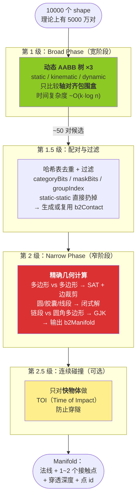

---

## 一、Broad Phase：动态 AABB 树

### 1.1 什么是 AABB

**A**xis-**A**ligned **B**ounding **B**ox —— 轴对齐包围盒。就是一个"不管怎么转都用水平/垂直边框住"的矩形。

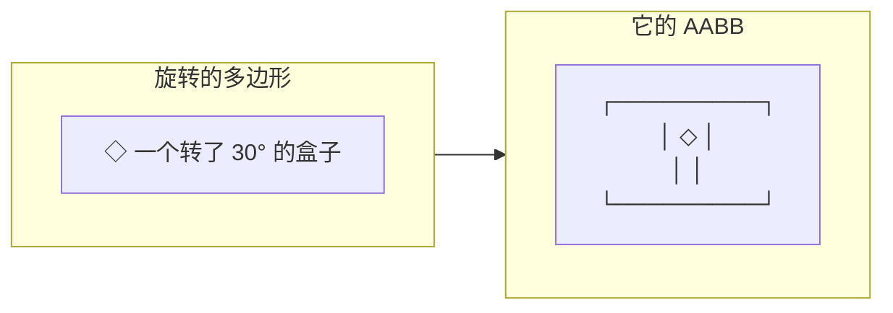

优点：**重叠测试只要 4 次比较**：
```c
bool overlap = (a.lower.x <= b.upper.x) && (a.lower.y <= b.upper.y)
            && (b.lower.x <= a.upper.x) && (b.lower.y <= a.upper.y);
```

缺点：不精确（斜着的细长杆 AABB 巨大）。

### 1.2 为什么用"胖"AABB（Fat AABB）

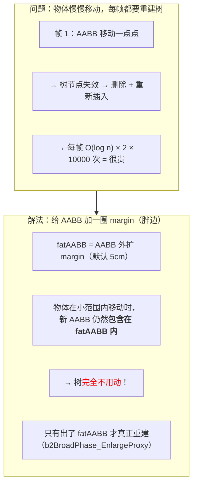

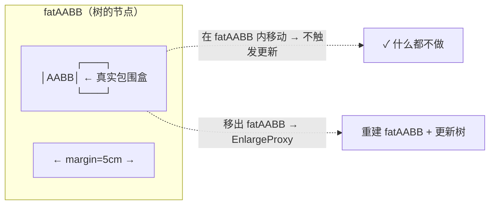

**margin 怎么算**（`constants.h`）：
```
margin = min( 0.05m, 0.125 × maxExtent )
```
小物体用更小的 margin，避免"胖边比物体本身还大"。

### 1.3 三棵树的分工

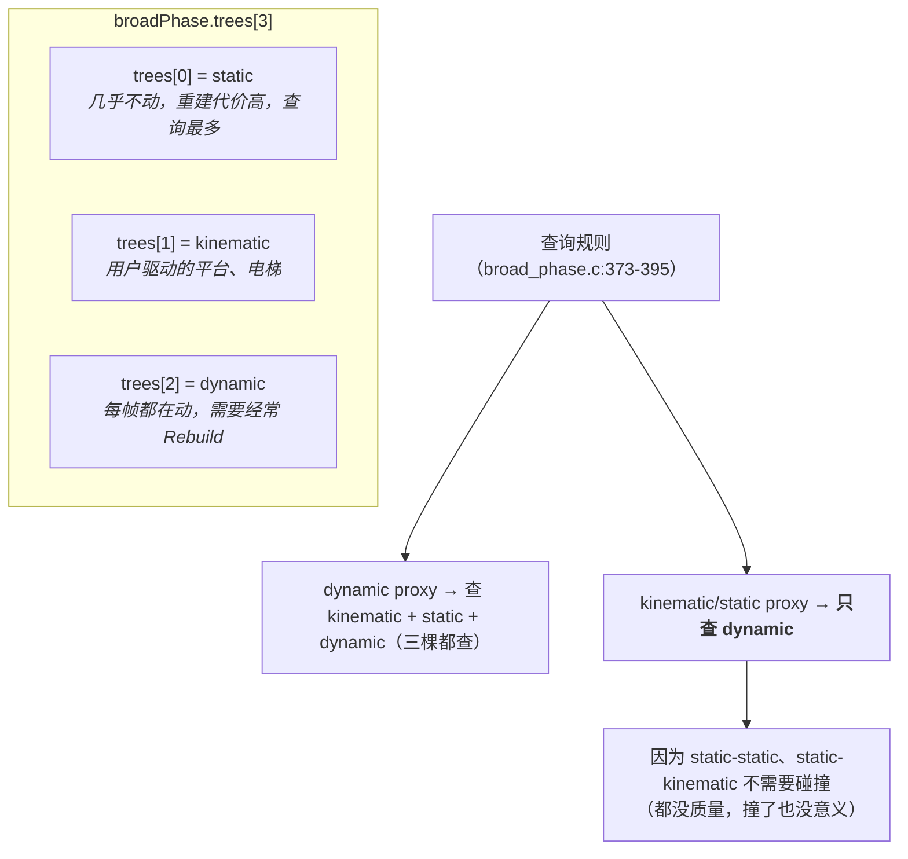

### 1.4 树的结构与旋转（Rotation）

Box2D 的动态树源自 Nathanael Presson 的 `btDbvt`（Bullet 里那个）。

```c
// include/box2d/collision.h:692
typedef struct b2TreeNode
{
    b2AABB    aabb;          // 16B 节点包围盒（=子节点并集）
    uint64_t  categoryBits;  // 8B  子节点 categoryBits 的并集（快速过滤！）
    union {
        b2TreeNodeChildren children;  // 内部节点：两个子节点
        uint64_t           userData;  // 叶节点：用户数据
    };                                // 8B
    union {
        int32_t parent;   // 已分配：父节点
        int32_t next;     // 空闲：free list 下一个
    };                                // 4B
    uint16_t height;      // 2B
    uint16_t flags;       // 2B   allocated / enlarged / leaf
} b2TreeNode;             // 总计 40 字节
```

**`categoryBits` 存在内部节点上是个很棒的优化**：查询时如果
`(maskBits & node->categoryBits) == 0`，整棵子树直接跳过，连 AABB 测试都不用做。

#### 节点插入

```mermaid
flowchart TB
    Start(["插入新叶节点 L"])
    Start --> Empty{"树是空的？"}
    Empty -->|是| Root["L 成为根"]
    Empty -->|否| Find["从根开始下降：<br/>选"加入 L 后面积增长最小"的子节点"]
    Find --> Descend["直到叶节点 S"]
    Descend --> Fork["创建一个新内部节点 P<br/>P 的父 = S 的父<br/>P 的子 = {S, L}"]
    Fork --> Up["自底向上重算 aabb、categoryBits、height"]
    Up --> Bal["从 P 的父开始<br/>执行树平衡（旋转）"]
    Bal --> End(["完成"])
```

#### 旋转（Rotation / AVL 风格的平衡）

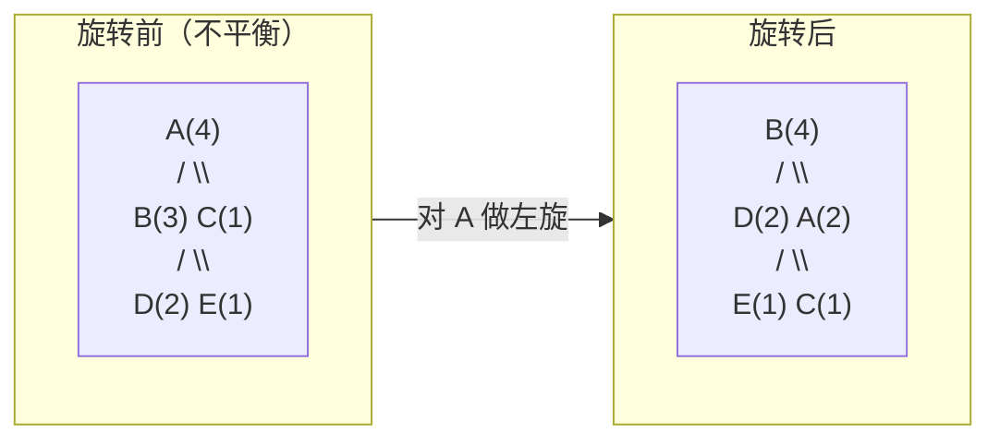

目的：保持树**近似平衡**，避免退化成链表（那样查询就是 O(n) 了）。
判据是比较子树的 `height`，代价函数用**表面积启发式（SAH）**。

#### 重建（Rebuild）

动态树长时间增量更新后会"散架"。Box2D 每帧在后台任务里重建 dynamic/kinematic 树：

```c
// broad_phase.c:401
static void b2UpdateTreesTask( void* context )
{
    b2DynamicTree_Rebuild( world->broadPhase.trees + b2_dynamicBody, false );
    b2DynamicTree_Rebuild( world->broadPhase.trees + b2_kinematicBody, false );
}
```

> `false` = **增量重建**（保留没变过的子树），不是全量重建。
> 这是"任务并行"的绝佳例子：重建树和 narrow phase **同时跑**，因为此时树已经不再被访问。

### 1.5 配对流程

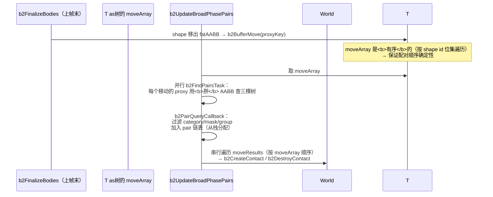

**为什么"用胖 AABB 查询"？**
```c
// broad_phase.c:365-367
// We have to query the tree with the fat AABB so that
// we don't fail to create a contact that may touch later.
```
用真实 AABB 会漏掉"现在还差一点点、下帧就会碰上"的对，导致**接触建立得太晚**（表现为"抖动"或"第一帧穿模"）。

---

## 二、过滤：谁能和谁撞

```c
// include/box2d/types.h:298
typedef struct b2Filter
{
    uint64_t categoryBits;   // 我属于哪些类别
    uint64_t maskBits;       // 我接受哪些类别
    int      groupIndex;     // 组：负=永不撞，正=永远撞，0=无影响
} b2Filter;
```

判定逻辑（`b2ShouldShapesCollide`）：
```
1. groupIndex != 0 且相同：
     正 → 一定撞
     负 → 一定不撞
   （groupIndex 优先于 mask bits）
2. 否则：(catA & maskB) && (catB & maskA)
3. 还要过 body 层过滤：两个 body 被 filter joint 连着 → 不撞；
   static-static 不撞；同 body 的 shape 不撞。
```

---

## 三、Narrow Phase 的产出：Manifold

不管什么形状，最终都输出同一个结构：

```c
// include/box2d/collision.h:575
typedef struct b2Manifold
{
    b2Vec2  normal;              // 世界空间单位法线，从 A 指向 B
    float   rollingImpulse;      // 滚动阻力累积冲量
    b2ManifoldPoint points[2];   // 最多 2 个接触点
    int     pointCount;          // 0、1 或 2
} b2Manifold;
```

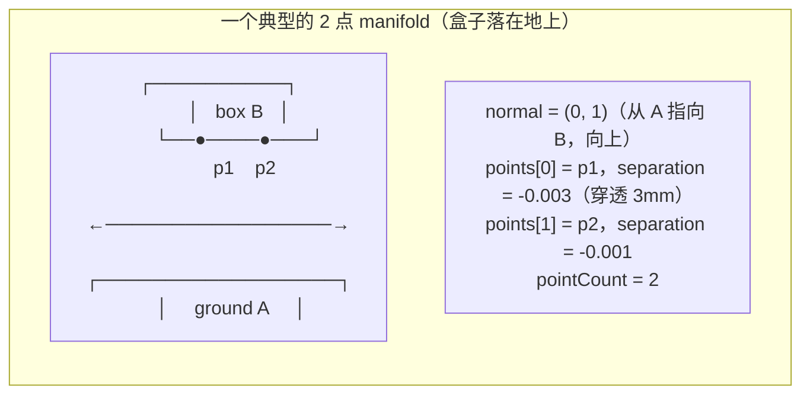

### 为什么 2D 只需要 2 个点？

**因为两个凸形状重叠，重叠区域一定是凸的，而 2D 中一段"接触边"由两个端点决定。**

```
一个盒子平放在地上 → 接触是一条线段 → 2 个端点 → 2 个点 ✓
一个盒子斜着落地  → 接触是一个角  → 1 个点     ✓
两个圆的接触      → 1 个点        ✓
永远是 1 或 2 个。
```

> 3D 里需要最多 4 个点（因为接触区域是面）。

### `b2ManifoldPoint` 的每个字段

```c
typedef struct b2ManifoldPoint
{
    b2Vec2  anchorA;         // 接触点相对 A 质心（世界朝向，非位置）
    b2Vec2  anchorB;         // 接触点相对 B 质心
    float   separation;      // 分离距离，<0 表示穿透。<b>可以为正</b>（推测接触）
    float   normalImpulse;        // 法向累积冲量
    float   tangentImpulse;       // 切向累积冲量
    float   restitutionVelocity;  // 恢复目标速度（上帧算的）
    float   totalNormalImpulse;   // 整帧（跨子步）法向总冲量
    float   normalVelocity;       // 求解前的相对法向速度（用于 hit 事件）
    float   baseSeparation;       // 缓存的基准分离（子步进用）
    uint16_t id;             // 接触点唯一 id（跨帧匹配用）
    bool    persisted;       // 这个点上帧存在吗
} b2ManifoldPoint;
```

**`anchorA`/`anchorB` 为什么存"相对质心的向量"而不是世界坐标？**

```
世界坐标 = 质心 + anchor
```

存相对量有两个好处：
1. 物体移动时，只要质心更新了，接触点位置自动正确（不需要重算 manifold）
2. 子步进时，用 `deltaRotation` 旋转 anchor 就能得到"当前"的锚点

### 接触点 id：跨帧追踪

```c
// manifold.c:14
#define B2_MAKE_ID( A, B ) ( (uint8_t)( A ) << 8 | (uint8_t)( B ) )
```

> 顶点/边索引各占 8 位，所以最多区分 256 个特征——对 `B2_MAX_POLYGON_VERTICES = 8` 绰绰有余。

每个接触点由"来自哪个顶点/边"的组合唯一标识。例如多边形裁剪出的点：
```c
cp->id = B2_MAKE_ID( i11, i22 );   // A 的第 i11 个顶点 + B 的第 i22 个顶点
```

**用途**：新一帧算出 manifold 后，用 id 和上一帧的点配对，把 `normalImpulse`/`tangentImpulse`
抄过来 → **热启动**。这是堆叠稳定的关键。

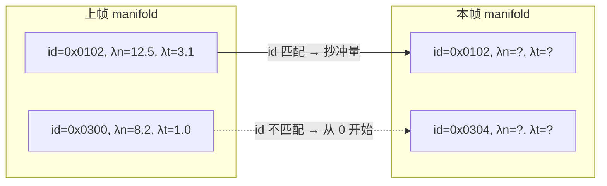

---

## 四、多边形 vs 多边形：SAT + 边裁剪

这是最复杂也最经典的 narrow phase。源码 `manifold.c:702 b2CollidePolygons`。

### 4.1 分离轴定理（SAT）

**定理**：两个凸形状不相交 ⟺ 存在一条直线（分离轴），使得两者在该轴上的投影不重叠。

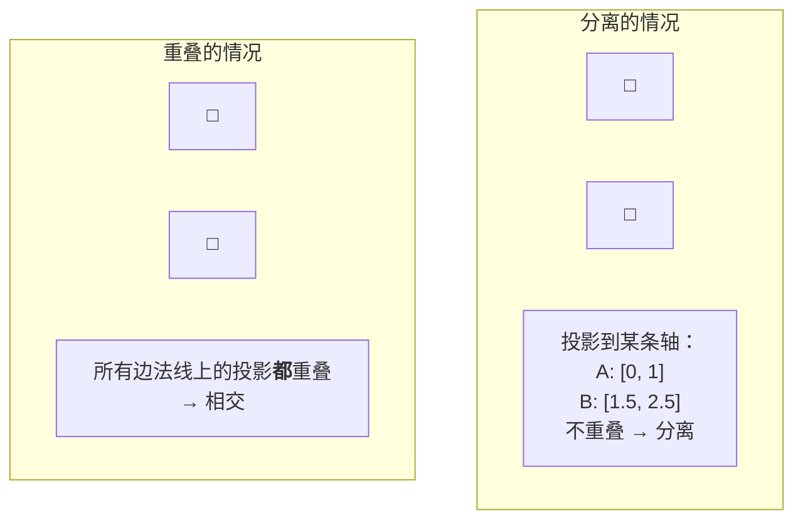

**2D 凸多边形的关键简化**：只需检查**两个多边形各自的边法线**（共 n+m 条），
不需要检查所有角度。这是凸多边形的性质。

### 4.2 Box2D 的 SAT：`b2FindMaxSeparation`

```c
// manifold.c:646
static float b2FindMaxSeparation( int* edgeIndex, const b2Polygon* poly1, const b2Polygon* poly2 )
{
    int bestIndex = 0;
    float maxSeparation = -FLT_MAX;
    for ( int i = 0; i < count1; ++i )
    {
        b2Vec2 n = n1s[i];              // poly1 的第 i 条边的外法线
        b2Vec2 v1 = v1s[i];             // 该边的起点

        // 找 poly2 上沿 -n 方向最远的点（support point）
        float si = FLT_MAX;
        for ( int j = 0; j < count2; ++j )
        {
            float sij = b2Dot( n, b2Sub( v2s[j], v1 ) );
            if ( sij < si ) si = sij;   // 最小的投影 = poly2 在 n 上的"最深处"
        }

        if ( si > maxSeparation )       // 我们要"分离得最开"的那条轴
        {
            maxSeparation = si;
            bestIndex = i;
        }
    }
    *edgeIndex = bestIndex;
    return maxSeparation;
}
```

**为什么找 `max` 而不是 `min`？**

- `si` = 在轴 i 上，poly1 的边到 poly2 最近点的**有符号距离**
- 如果任何一个 `si > 0` → 存在分离轴 → **不相交**
- 我们要找**最大的** `si`，因为它对应"最可能的分离轴"

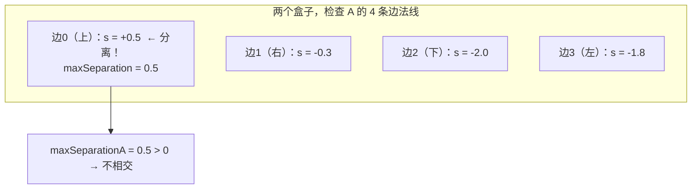

### 4.3 主流程

```mermaid
flowchart TB
    S(["b2CollidePolygons(A, B, xf)"])
    S --> Shift["① 平移到 A 的局部原点<br/>（减少远距离时的舍入误差）"]
    Shift --> SAT1["② separationA = FindMaxSeparation(A→B) → edgeA"]
    SAT1 --> SAT2["③ separationB = FindMaxSeparation(B→A) → edgeB"]
    SAT2 --> Early{"④ separationA 或 separationB<br/>> speculativeDistance + radius ?"}
    Early -->|是| Miss["返回空 manifold（离得远）"]
    Early -->|否| Ref{"⑤ separationA ≥ separationB ?"}

    Ref -->|是| RefA["参考面 = A 的 edgeA<br/>法线 = A.normals[edgeA]<br/>flip = false"]
    Ref -->|否| RefB["参考面 = B 的 edgeB<br/>法线 = -B.normals[edgeB]<br/>flip = true"]
    RefA --> Inc
    RefB --> Inc

    Inc["⑥ 找<b>入射面</b>（incident edge）<br/>在另一个多边形上找<b>法线与参考法线点积最小</b>的边<br/>即"最正对着撞过来"的那条边"]
    Inc --> Dist{"⑦ 分离度 > 0.1·linearSlop ?"}

    Dist -->|是（快接触上了）| Closest["⑧a 算参考边与入射边的<b>最近点对</b><br/>b2SegmentDistance<br/>→ 点-点接触（1 个点）"]
    Dist -->|否（已经重叠）| Clip["⑧b 边裁剪<br/>b2ClipPolygons → 2 个点"]

    Closest --> Out(["输出 manifold"])
    Clip --> Out
```

### 4.4 边裁剪：`b2ClipPolygons`

这是把"入射边"裁剪到"参考边的两侧边界内"的过程。经典的 Sutherland-Hodgman 的 1D 版本。

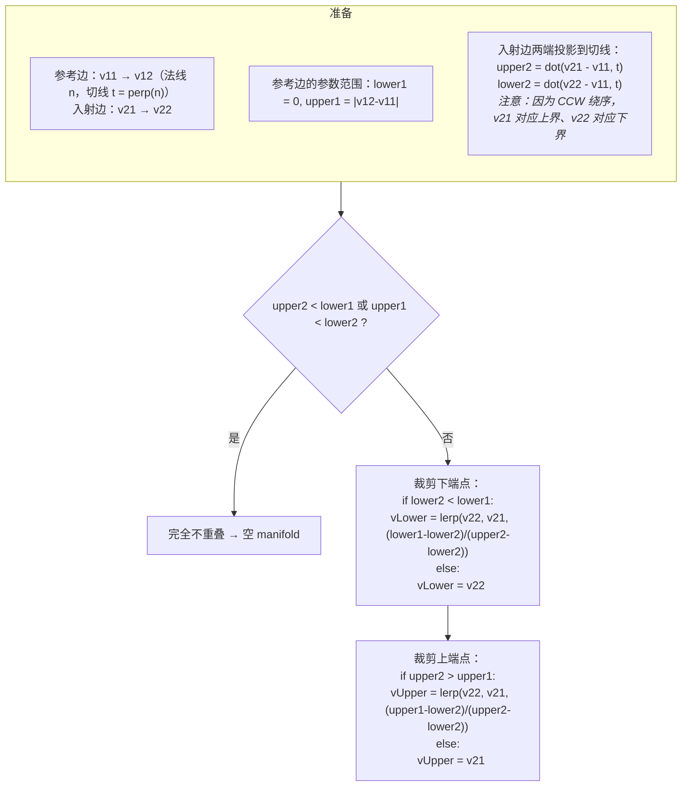

图形化：

```
切线 t 方向 →

参考边:  |===============|                    (v11 ────────── v12)
         lower1=0        upper1=L

入射边(裁剪前):      |===========================|
                     lower2                      upper2
                     ↑超出左边界                  ↑超出右边界

裁剪后:              |===============|
                     vLower          vUpper
                     (被截到 L=0)     (被截到 L=upper1)
```

然后：
```c
float separationLower = b2Dot( b2Sub( vLower, v11 ), normal );
float separationUpper = b2Dot( b2Sub( vUpper, v11 ), normal );

// 把接触点放在两个表面的中点（考虑圆角半径）
vLower = b2MulAdd( vLower, 0.5f * ( r1 - r2 - separationLower ), normal );

float radius = r1 + r2;
cp->separation = separationLower - radius;
```

**接触点放在中点**：因为两个形状都可能有圆角（`radius`），真实的接触点在两个"核心形状"表面的中间。

### 4.5 圆角（Rounded Polygon）

Box2D v3 的**每一个**多边形都可以有圆角（`b2Polygon::radius`）。
这让所有多边形碰撞都统一走"圆角"逻辑：

```
separation = 核心多边形的分离距离 - (radiusA + radiusB)
```

好处：**法线连续变化**，物体滑过顶点时不会突然"跳"一下（这就是 v2 时代"幽灵碰撞"的来源）。

---

## 五、其他形状对的碰撞

Box2D 用一个**函数注册表**（`s_registers[shapeTypeA][shapeTypeB]`）分发：

```c
// contact.c:536
b2ManifoldFcn* fcn = s_registers[shapeA->type][shapeB->type].fcn;
b2LocalManifold local = fcn( shapeA, shapeB, relativeTransform, &contactSim->cache );
```

| 形状对 | 算法 | 备注 |
|---|---|---|
| circle-circle | 闭式解 | 最简单，1 个点 |
| capsule-circle | 点到线段最近点 + 半径 | |
| polygon-circle | 找最近的边/顶点 | 可能 1 或 2 个点 |
| polygon-polygon | SAT + 裁剪 | §4 |
| capsule-capsule | 线段最近点对 + 半径 | |
| segment-× | 线段作为特殊退化情形 | 双侧碰撞 |
| chainSegment-× | **GJK** | 因为链段有 ghost 顶点，几何不规则 |

### 圆-圆（最简版本）

```c
// manifold.c:36
b2LocalManifold b2CollideCircles( const b2Circle* circleA, const b2Circle* circleB, b2Transform xf )
{
    b2Vec2 pA = circleA->center;
    b2Vec2 pB = b2TransformPoint( xf, circleB->center );   // B 在 A 的坐标系里
    b2Vec2 d = b2Sub( pB, pA );
    float distSqr = b2Dot( d, d );
    float r = circleA->radius + circleB->radius;
    // ...
    float dist = sqrtf( distSqr );
    b2Vec2 normal = dist > 0 ? b2MulSV( 1.0f / dist, d ) : (b2Vec2){ 0.0f, 1.0f };
    // 接触点在中点
    b2Vec2 p = b2Lerp( pA, pB, 0.5f + 0.5f * ( circleA->radius - circleB->radius ) / dist );
    cp->separation = dist - r;   // <0 表示重叠
}
```

> 退化处理：两圆心重合（`dist == 0`）时，法线默认取 `(0, 1)`。

### 链段（Chain Segment）为什么要用 GJK

链段有 **ghost 顶点**（`ghost1 → point1 → point2 → ghost2`），目的是消除相邻段之间的"幽灵碰撞"：

```
         ghost1
           ●
            \
             ●━━━━━━━━●      ← 实际的碰撞段 point1→point2
            point1    point2   \
                                ●
                              ghost2
```

碰撞计算时，如果最近点落在 ghost 区域，就把接触点**投影回真实段**。
这使得几何判定不是"标准凸形状"，所以用通用的 GJK。

---

## 六、GJK 算法（距离计算）

GJK（Gilbert-Johnson-Keerthi）用于计算**任意凸形状**之间的最近距离。
源码 `distance.c:424 b2ShapeDistance`。

### 核心思想：闵可夫斯基差

```
两个凸形状 A、B 的距离 = 闵可夫斯基差 C = A ⊖ B 到原点的距离
```

```
C = { a - b | a ∈ A, b ∈ B }
```

如果 **原点在 C 内部** → A、B 相交。

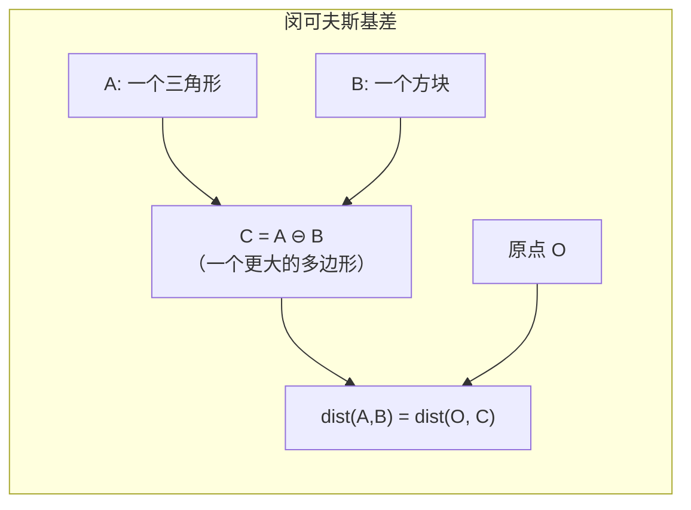

### 支撑函数（Support Function）

不需要真的构造 C！只需要能在任意方向 `d` 上找到 C 的**最远点**：

```
support_C(d) = support_A(d) - support_B(-d)
```

对点集（Box2D 的 `b2ShapeProxy`）：
```c
static int b2FindSupport( const b2ShapeProxy* proxy, b2Vec2 direction )
{
    int bestIndex = 0;
    float bestValue = b2Dot( proxy->points[0], direction );
    for ( int i = 1; i < proxy->count; ++i )
    {
        float value = b2Dot( proxy->points[i], direction );
        if ( value > bestValue ) { bestValue = value; bestIndex = i; }
    }
    return bestIndex;
}
```

### 单纯形迭代

在 2D 里，单纯形（simplex）最多 3 个点（三角形）。

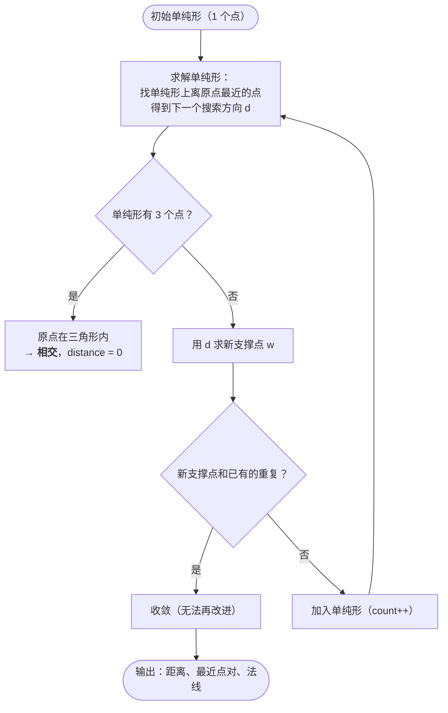

2D 的单纯形求解（3 种情况）：

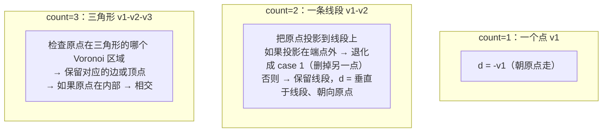

### 终止条件

```c
const int maxIterations = 20;
// Check for duplicate support points. This is the main termination criteria.
bool duplicate = false;
for ( int i = 0; i < saveCount; ++i )
{
    if ( vertex->indexA == saveA[i] && vertex->indexB == saveB[i] )
    {
        duplicate = true;
        break;
    }
}
```

**"找到重复的支撑点"** 是主终止判据：说明再迭代也不会有新的顶点加入，已经收敛。
比"距离变化小于阈值"更鲁棒。

### 热启动的单纯形缓存

```c
typedef struct b2SimplexCache
{
    uint16_t count;
    uint8_t  indexA[3];
    uint8_t  indexB[3];
} b2SimplexCache;
```

上一帧的单纯形顶点索引存下来，下一帧直接用它做初始单纯形。
对于连续几帧几乎不动的接触，可以**第一轮就命中**。

---

## 七、连续碰撞检测（CCD）与 TOI

### 7.1 穿隧问题

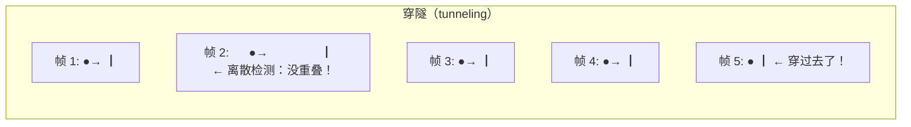

一个 1cm 的球以 100 m/s 飞行，一帧（1/60 秒）移动 1.67 米，**远大于任何墙的厚度**。

### 7.2 Box2D 的两级防御

```mermaid
flowchart TB
    subgraph L1["第一级：推测接触（默认开启，几乎免费）"]
        A1["在还差 2cm 时就建立接触"]
        A2["约束：这一帧结束时距离 ≥ 0"]
        A3["→ 能挡住"中速"物体"]
    end
    subgraph L2["第二级：TOI + 子步进（只对快物体）"]
        B1["判定 fast：maxMotion > safetyFactor × minExtent"]
        B2["bullet 物体 → 存进 bulletBodies，最后单独处理"]
        B3["非 bullet 的快物体 → 在 b2FinalizeBodies 里<br/>立即 b2SolveContinuous（对静态树扫掠）"]
    end
    subgraph L3["第三级：子步进"]
        C1["subStepCount = 4 → 每步只走 1/4 距离"]
        C2["等价于把"一帧移动 1.67m"变成"每子步 0.42m""]
    end
```

### 7.3 fast 判定

```c
// solver.c:649-667
float safetyFactor = body->safetyFactor;                  // 默认 0.5
float maxMotion = b2MaxFloat( maxDeltaPosition, maxVelocity * timeStep );
if ( body->type == b2_dynamicBody && enableContinuous && maxMotion > safetyFactor * sim->minExtent )
{
    body->flags |= b2_isFast;
    if ( sim->flags & b2_isBullet )
    {
        // bullet：推迟到专门阶段（可以撞动态物体）
        int bulletIndex = b2AtomicFetchAddInt( &stepContext->bulletBodyCount, 1 );
        stepContext->bulletBodies[bulletIndex] = simIndex;
    }
    else
    {
        // 普通快物体：立刻做连续碰撞（只撞静态）
        b2SolveContinuous( world, simIndex, taskContext, stepContext->dt );
    }
}
```

**`minExtent` 是什么？** 形状的最小"厚度"。一个薄的板子 `minExtent` 小，所以更容易被判定为 fast。
这是对的——薄的东西更容易被穿。

### 7.4 TOI 算法

`b2TimeOfImpact`（`distance.c:1148`）—— 保守推进（Conservative Advancement）的 Box2D 变体。

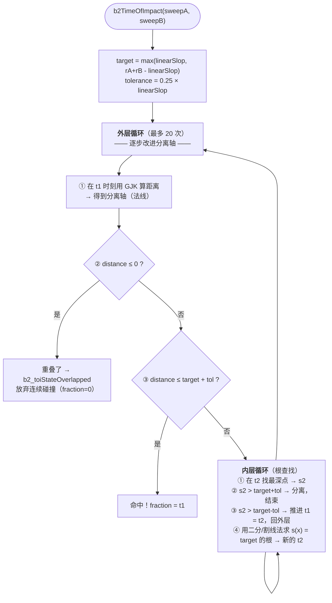

**关键概念：分离函数（Separation Function）**

一旦 GJK 给出分离轴上的"见证点"（witness points，即 A 上和 B 上的最近点），
就可以把问题简化成**一维**：

```
s(t) = dot( pB(t) - pA(t), n )        n 固定不动
```

然后求 `s(t) = target` 的根。

```mermaid
flowchart LR
    subgraph Graph["s(t) 曲线"]
        direction TB
        G["s ↑<br/>  │＼<br/>  │  ＼___<br/>  │       ＼＿＿＿  target<br/>  │<br/>  └─────────────→ t<br/>  0           1"]
    end
    G --> Root["根 t* 就是 TOI"]
```

**为什么不直接用 GJK 二分？** 因为 GJK 每次调用很贵（20 次迭代）。
用"固定分离轴 + 一维根查找"可以一次外层迭代走很长一段路。

### 7.5 TOI 后的处理

```c
// solver.c:454-474
if ( context.fraction < 1.0f )
{
    // 把物体推进到撞击时刻
    b2Rot q = b2NLerp( sweep.q1, sweep.q2, context.fraction );
    b2Vec2 c = b2Lerp( sweep.c1, sweep.c2, context.fraction );
    fastBodySim->transform.q = q;
    fastBodySim->center = b2OffsetPos( base, c );

    // "时间损失"：撞停之后剩下的时间没有重力作用
    // Timeloss means there is a lost gravity contribution.
    float timeLoss = ( 1.0f - context.fraction ) * dt;
    fastBodyState->linearVelocity = b2MulSub( v, timeLoss * fastBodySim->gravityScale, world->gravity );
}
```

**"时间损失"补偿**：物体在 fraction=0.3 处撞停了，剩下 0.7 帧的时间里它其实应该继续受重力。
这里直接把这部分重力补回去（`v -= timeLoss · g`），让下一帧的物理更连续。

### 7.6 对链段的特殊早退优化

```c
// solver.c:258-282  快速平行移动经过链段时提前退出
if ( shape->type == b2_chainSegmentShape )
{
    // ...
    float coreDistance = B2_CORE_FRACTION * fastBodySim->minExtent;   // 0.25 × minExtent
    if ( separation1 < 0.0f || ( separation1 - separation2 < coreDistance && separation2 > coreDistance ) )
    {
        return true;   // 最小裁剪，跳过
    }
}
```

防止高速物体"从内部"撞到链的某一段（那会导致错误的法线和卡住）。

---

## 八、推测接触（Speculative Contact）

这是 Box2D "不抖"的核心，单独讲。

### 传统做法的问题

```mermaid
sequenceDiagram
    participant B as 盒子
    participant G as 地面
    Note over B,G: 传统引擎
    B->>G: 帧1: 没重叠，自由落体
    B->>G: 帧2: 重叠 5mm！
    G->>B: 求解器：推出去 + 给一个向外的速度
    Note over B: 飞起来了（+0.3 m/s）
    B->>G: 帧3: 又落下来，又重叠
    Note over B,G: 💥 永远在抖
```

### Box2D 的做法

```mermaid
sequenceDiagram
    participant B as 盒子
    participant G as 地面
    Note over B,G: Box2D（推测距离 2cm）
    B->>G: 帧1: 距离 1.5cm → <b>建立接触</b>，separation = +0.015
    Note over G: 约束：vn ≥ -s/h = -0.015/(1/240) = -3.6 m/s
    B->>G: 帧2: 距离 0.5cm，v.y = -2.0（< 3.6，还允许）
    B->>G: 帧3: 距离 0cm，v.y = 0（刚好停住）✓
    Note over B,G: 😴 稳定，无抖动
```

### 数学

```c
// contact_solver.c:283-294
if ( s > 0.0f )
{
    // speculative bias - positive
    velocityBias = s * inv_h;      // ← 关键
}
else if ( useBias )
{
    // overlap bias - negative
    velocityBias = b2MaxFloat( softness.massScale * softness.biasRate * s, -contactSpeed );
    massScale = softness.massScale;
    impulseScale = softness.impulseScale;
}
```

约束目标：`vn + bias ≥ 0`

- 当 `s > 0`：目标 `vn ≥ -s/h`
  → **"你这一子步结束时的接近速度，不能超过 s/h"**
  → 换算成位移：`vn·h ≤ s` → **正好在接触时停下，不会过冲**

- 当 `s < 0`（已经穿透）：`bias` 为负 → `vn ≥ |bias|` → 被推出去

```mermaid
flowchart LR
    subgraph Spec["推测：s > 0"]
        direction TB
        SP["约束 vn ≥ -s/h<br/>→ 允许以恰好 s/h 的速度接近<br/>→ 一个子步后刚好接触"]
    end
    subgraph Over["重叠：s < 0"]
        direction TB
        OV["约束 vn ≥ softness·|s|<br/>→ 被推出来，速度上限 contactSpeed"]
    end
```

**注意 `massScale` 和 `impulseScale` 的差异**：
```c
b2FloatW pointMassScale   = b2BlendW( massScale,   oneW,  separated );  // 分离时=1
b2FloatW pointImpulseScale = b2BlendW( impulseScale, zeroW, separated ); // 分离时=0
```
**推测接触是"硬"的**（massScale=1, impulseScale=0），**重叠恢复是"软"的**。
这样推测阶段精确地停住，重叠阶段柔和地推开。

---

## 九、接触复用（Contact Recycling）

### 动机

narrow phase 不便宜（SAT 是 O(n·m)，裁剪还有分支）。
但**绝大多数接触每一帧几乎没变化**（想想地上躺着的 1000 个箱子）。

### 判据

```c
// physics_world.c:510-534
if ( isFast == false && recycleDistance > 0.0f &&
     ( contactSim->simFlags & b2_simRelativeTransformValid ) &&
     ( contactSim->simFlags & b2_contactRecycleFlag ) )
{
    b2Rot   cachedQA = contactSim->cachedRotationA;
    b2Rot   cachedQB = contactSim->cachedRotationB;
    b2Transform xfc  = contactSim->cachedRelativePose;
    b2Transform xf   = b2InvMulWorldTransforms( transformA, transformB );

    float cosA = b2RelativeCos( transformA.q, cachedQA );   // = cos(ΔθA)
    float cosB = b2RelativeCos( transformB.q, cachedQB );
    float minCos = b2MinFloat( cosA, cosB );

    float maxExtent = max( maxExtentA, maxExtentB );
    float distance = b2Distance( xf.p, xfc.p );             // 相对平移量
    b2Rot qr = b2InvMulRot( xf.q, xfc.q );                  // 相对旋转

    float tolerance = wasTouching ? recycleDistance : recycleDistanceNonTouching;

    if ( minCos > B2_CONTACT_RECYCLE_COS_ANGLE &&            // Δθ < ~11.5°
         distance + maxExtent * b2AbsFloat( qr.s ) < tolerance )
    {
        // ← 复用！
    }
}
```

**这个度量来自"保守推进"理论**：

```
相对运动中，物体上最远点移动的距离 ≈ |Δ平移| + maxExtent · |sin(Δθ)|
```

（因为 `qr.s = sin(Δθ) ≈ Δθ` 当角度小）

如果这个距离 < 容差（默认 5cm），说明 manifold 几乎没变，**跳过几何计算**。

### 复用时做什么？

```c
b2Rot dqA = b2MulRot( transformA.q, b2InvertRot( cachedQA ) );
b2Rot dqB = b2MulRot( transformB.q, b2InvertRot( cachedQB ) );
b2Vec2 dc = b2SubPos( bodySimB->center, bodySimA->center );

for ( int i = 0; i < contactSim->manifold.pointCount; ++i )
{
    b2ManifoldPoint* mp = contactSim->manifold.points + i;
    // 保持 anchor，只更新 separation（和子步进完全一样的公式）
    b2Vec2 rA = b2RotateVector( dqA, mp->anchorA );
    b2Vec2 rB = b2RotateVector( dqB, mp->anchorB );
    b2Vec2 dp = b2Add( dc, b2Sub( rB, rA ) );
    mp->separation = mp->baseSeparation + b2Dot( dp, normal );

    // 顺便更新恢复速度
    if ( mp->totalNormalImpulse > 0.0f && mp->normalVelocity < -world->restitutionThreshold )
        mp->restitutionVelocity = -contactSim->restitution * mp->normalVelocity;
    else
        mp->restitutionVelocity = 0.0f;

    // 更新 normalVelocity（用于 hit 事件）
    mp->normalVelocity = b2Dot( normal, b2Sub( vrB, vrA ) );
    mp->persisted = true;
}
```

**注意副作用**（源码注释 `physics_world.c:583-585`）：
> *"Contact is recycled. This also skips updating other aspects of the contact such as material parameters."*

复用时会跳过**材质参数更新**（摩擦、恢复系数）。如果你在运行时改了材质，这些接触会延迟更新。
对角色控制器（character mover）建议关掉 `enableContactRecycling`，避免"幽灵碰撞"。

---

## 十、接触的生命周期

```mermaid
stateDiagram-v2
    [*] --> NonTouching: b2CreateContact<br/>(AABB 重叠了)
    NonTouching --> Touching: b2UpdateContact 返回<br/>pointCount > 0
    Touching --> NonTouching: pointCount 变 0<br/>（b2_simStoppedTouching）
    NonTouching --> [*]: b2_simDisjoint<br/>(AABB 不再重叠 → 销毁)

    note right of NonTouching
        存在 awakeSet.contactSims
        colorIndex = NULL
        <b>不参与求解</b>
    end note

    note right of Touching
        b2LinkContact → 加入 island
        b2AddContactToGraph → 进约束图
        <b>参与求解</b>
    end note
```

关键函数：

| 事件 | 函数 | 效果 |
|---|---|---|
| AABB 重叠 | `b2CreateContact` | 建 `b2Contact` + `b2ContactSim`（未接触态） |
| 开始接触 | `b2LinkContact` + `b2AddContactToGraph` | 建岛连接 + 染色入图 |
| 停止接触 | `b2UnlinkContact` + `b2RemoveContactFromGraph` | 断开岛 + 出图 |
| AABB 分离 | `b2DestroyContact` | 整个销毁 |

**为什么"未接触"的 contact 也要留着？**

因为 AABB 重叠是"胖"的（有 5cm 余量），真正接触可能只有几帧。
如果每次 AABB 一重叠就建 manifold、一分开就销毁，会有大量的创建/销毁开销。
留着 `b2Contact` 只更新它的 manifold，开销小得多。

---

## 十一、本章小结 + 源码索引

### 一次碰撞检测的完整路径

```mermaid
flowchart LR
    A["shape 移动"] --> B["移出 fatAABB？"]
    B -->|是| C["b2BufferMove"]
    C --> D["b2UpdateBroadPhasePairs<br/>并行查 3 棵树"]
    D --> E["b2CreateContact（如需要）"]
    E --> F["b2Collide → b2CollideTask"]
    F --> G{"接触复用？"}
    G -->|是| H["只更新 separation"]
    G -->|否| I["b2UpdateContact<br/>→ 注册表分发<br/>→ SAT/GJK/闭式解"]
    H --> J["manifold"]
    I --> J
    J --> K["状态变化？"]
    K -->|"开始接触"| L["入岛 + 入图"]
    K -->|"停止接触"| M["出岛 + 出图"]
    K -->|"AABB 分离"| N["销毁"]
```

### 源码索引

| 内容 | 位置 |
|---|---|
| Broad phase 主流程 | `src/broad_phase.c:429` `b2UpdateBroadPhasePairs` |
| 并行配对 | `src/broad_phase.c:333` `b2FindPairsTask` |
| 动态树 | `src/dynamic_tree.c`（1996 行，插入/删除/旋转/重建/查询） |
| Narrow phase 调度 | `src/physics_world.c:687` `b2Collide` |
| 单个接触更新 | `src/physics_world.c:449` `b2CollideTask` |
| manifold 生成与冲量继承 | `src/contact.c:525` `b2UpdateContact` |
| 多边形 vs 多边形 | `src/manifold.c:702` `b2CollidePolygons` |
| SAT | `src/manifold.c:646` `b2FindMaxSeparation` |
| 边裁剪 | `src/manifold.c:511` `b2ClipPolygons` |
| GJK 距离 | `src/distance.c:424` `b2ShapeDistance` |
| 线性 shape cast | `src/distance.c:614` `b2ShapeCast` |
| TOI | `src/distance.c:1148` `b2TimeOfImpact` |
| 连续碰撞 | `src/solver.c:384` `b2SolveContinuous` |
| 凸包 | `src/hull.c` `b2ComputeHull` |
| 质量属性 | `src/geometry.c:274` `b2ComputePolygonMass` |

### 自测题

1. 为什么 AABB 要"胖"？如果 margin = 0 会怎样？如果 margin = 10 米会怎样？
2. SAT 里为什么只检查两个多边形各自的边法线，而不是所有角度？
3. `b2FindMaxSeparation` 里为什么找**最大**的 `si`，而不是最小的？
4. 2D 的 manifold 为什么最多 2 个点？3D 呢？
5. 推测接触的 bias 为什么是 `s·inv_h`？推导一下。
6. 接触复用的判据 `distance + maxExtent·|sin Δθ| < tolerance` 是怎么来的？
7. 为什么 bullet 物体要单独放到最后处理，而不是和普通快物体一起？

---

**下一步** → [04 · 约束：物理引擎的灵魂](./04-约束与求解器.md)
