# 04 · 约束：物理引擎的灵魂

> 如果说碰撞检测是"眼睛"，约束求解就是"大脑"。
> 本章是**整套文档最重的一章**——Box2D 的 80% 智慧在这里。
> 建议你打开 `src/contact_solver.c:217-402`（标量版接触求解）对照着读，那 185 行是全部精华。

---

## 一、约束的统一数学形式

### 1.1 一切都是 `J·V + bias = 0`

无论接触、铰链、马达还是限制，在 Box2D 里都写成同一个形式：

```
J · V + bias = 0          （等式约束，如关节）
J · V + bias ≥ 0          （不等式约束，如接触、限位）
```

- `V = [vA.x, vA.y, ωA, vB.x, vB.y, ωB]ᵀ` — 6 维速度向量
- `J` — 1×6（或 2×6）**雅可比矩阵**，描述"这个约束关心什么方向的速度"
- `bias` — 偏移量，用于**位置误差修正**或**驱动马达**

### 1.2 常见约束的雅可比

| 约束 | 物理要求 | `J·V` 展开 |
|---|---|---|
| **接触法向** | 不互相穿入 | `dot(vB + ωB×rB - vA - ωA×rA, n)` |
| **接触切向（摩擦）** | 不相对滑动 | `dot(vB + ωB×rB - vA - ωA×rA, t)` |
| **距离约束** | 两点距离不变 | `dot(vB + ωB×rB - vA - ωA×rA, u)`，`u` 是连线方向 |
| **旋转铰（平动部分）** | 两点重合 | `[vB + ωB×rB - vA - ωA×rA]`（2 行！） |
| **旋转铰（角度限制）** | 角度 ≥ θ_min | `ωB - ωA` |
| **马达** | 相对速度 = 目标 | `ωB - ωA - motorSpeed` |
| **焊接** | 相对位姿不变 | 3 行：2 个平动 + 1 个转动 |

### 1.3 冲量方向：`P = λ · Jᵀ`

约束力的方向**不是任意的**，它必须沿 `Jᵀ`（虚功原理）。

对接触法向约束（2D）：
```
J  = [ -n.x, -n.y, -cross(rA,n),  n.x, n.y, cross(rB,n) ]
Jᵀ = 转置后是 6×1
```

作用在 A 上的冲量 = `-λ·n`（法线的反方向，把 A 推开）
作用在 B 上的冲量 = `+λ·n`
作用在 A 上的冲量矩 = `-λ·cross(rA, n)`
作用在 B 上的冲量矩 = `+λ·cross(rB, n)`

代码里就这四行（`contact_solver.c:322-328`）：
```c
b2Vec2 P = b2MulSV( impulse, normal );
vA = b2MulSub( vA, mA, P );          // vA -= mA * P
wA -= iA * b2Cross( rA, P );
vB = b2MulAdd( vB, mB, P );          // vB += mB * P
wB += iB * b2Cross( rB, P );
```

> **记忆口诀**：`Δv = invM · P`，`Δω = invI · cross(r, P)`。A 取负号，B 取正号。

---

## 二、从约束到冲量：有效质量

### 2.1 推导

施加冲量 `P = λ·Jᵀ` 后，`J·V` 变化多少？

```
ΔV = M⁻¹ · Jᵀ · λ
Δ(J·V) = J · M⁻¹ · Jᵀ · λ ≡ K · λ
```

`K = J·M⁻¹·Jᵀ` 就是**有效质量**（Effective Mass，标量或 2×2 矩阵）。

我们要让 `J·V` 从 `vn` 变成 `-bias`（满足约束），即 `Δ(J·V) = -(vn + bias)`：

```
λ = -(vn + bias) / K
```

### 2.2 接触法向的完整展开

```
M⁻¹ = diag(mA, mA, iA, mB, mB, iB)
J   = [ -n.x, -n.y, -cross(rA,n),  n.x, n.y, cross(rB,n) ]

K = mA·n.x² + mA·n.y² + iA·cross(rA,n)² + mB·n.x² + mB·n.y² + iB·cross(rB,n)²
  = mA + mB + iA·cross(rA,n)² + iB·cross(rB,n)²     ← 因为 |n| = 1
```

```c
// contact_solver.c:123-126
float rnA = b2Cross( rA, normal );
float rnB = b2Cross( rB, normal );
float kNormal = mA + mB + iA * rnA * rnA + iB * rnB * rnB;
cp->normalMass = kNormal > 0.0f ? 1.0f / kNormal : 0.0f;
```

```mermaid
flowchart TB
    K["K = mA + mB + iA·(rA×n)² + iB·(rB×n)²"]

    K --> T1["<b>mA + mB</b><br/>纯平移：整体被推走<br/><i>两个都越轻，越容易被推开</i>"]
    K --> T2["<b>iA·(rA×n)²</b><br/>A 绕质心转动的"卸力"效果<br/>rA×n = 有效力臂"]

    T2 --> Ex1["rA ∥ n（力穿过质心）→ rA×n = 0<br/>→ 不产生转动，K 最小，冲量最有效"]
    T2 --> Ex2["rA ⊥ n 且长 → rA×n 大<br/>→ K 大 → λ 小<br/>→ <b>大部分冲量变成了旋转</b>"]

    Ex2 --> Pool["🎱 台球"扎杆"：<br/>击打球心正上方 → 球先滑后滚<br/>击打边缘 → 球强烈旋转但跑得慢"]
```

### 2.3 2×2 有效质量（旋转铰的平动约束）

当约束有 2 行（比如"两点必须重合"），`K` 是 2×2 矩阵：

```c
// revolute_joint.c:470-475
b2Mat22 K;
K.cx.x = mA + mB + rA.y * rA.y * iA + rB.y * rB.y * iB;
K.cy.x = -rA.y * rA.x * iA - rB.y * rB.x * iB;
K.cx.y = K.cy.x;                                        // 对称
K.cy.y = mA + mB + rA.x * rA.x * iA + rB.x * rB.x * iB;
b2Vec2 b = b2Solve22( K, b2Add( Cdot, bias ) );         // 解 2×2 线性系统
```

展开就是：

```
     [ mA+mB+iA·rA.y²+iB·rB.y²      -(iA·rA.x·rA.y + iB·rB.x·rB.y) ]
K =  [        同上(对称)             mA+mB+iA·rA.x²+iB·rB.x²        ]
```

> 对称是必然的（因为 `M⁻¹` 对称，`K = J M⁻¹ Jᵀ` 必对称）。
> 非对角项存在意味着：**x 方向的冲量会产生 y 方向的速度变化**（通过旋转耦合）。

---

## 三、顺序冲量法（Sequential Impulses, PGS）

### 3.1 为什么要迭代

一个场景有 1000 个约束，它们**互相耦合**（改 A 的速度会影响 A 的所有其他约束）。
一次性解出来需要求解一个巨大的线性系统（太贵）。

**顺序冲量（也叫投影高斯-赛德尔 PGS）**的做法：

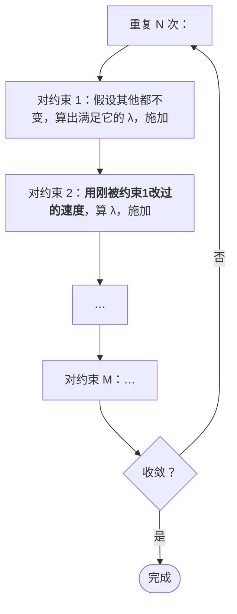

**Gauss-Seidel 的精髓**：每个约束求解时使用的是**最新的**速度（而不是本轮开始时的），
所以收敛比 Jacobi 快得多。

### 3.2 累积冲量裁剪（关键！）

```c
// contact_solver.c:309-315
float impulse = -cp->normalMass * ( massScale * vn + velocityBias ) - impulseScale * cp->normalImpulse;

// clamp the accumulated impulse ← 注意：裁剪的是<b>累积</b>值
float newImpulse = b2MaxFloat( cp->normalImpulse + impulse, 0.0f );
impulse = newImpulse - cp->normalImpulse;      // 取增量
cp->normalImpulse = newImpulse;                // 更新累积
cp->totalNormalImpulse += impulse;
```

```mermaid
flowchart LR
    subgraph Wrong["❌ 错误做法（裁剪增量）"]
        W1["impulse = max(impulse, 0)"]
        W2["→ 累积值可能仍为负<br/>→ 接触会"吸住"物体"]
    end
    subgraph Right["✅ Box2D 做法（裁剪累积）"]
        R1["newImpulse = max(old + impulse, 0)<br/>impulse = newImpulse - old"]
        R2["→ 累积值恒 ≥ 0<br/>→ 施加的永远是"净修正量""]
    end
```

### 3.3 摩擦必须在法向之后

```c
float maxFriction = friction * cp->normalImpulse;    // 用<b>本帧已更新</b>的法向冲量
```

摩擦上限依赖法向力，所以：
1. 先解所有法向约束（让 `normalImpulse` 收敛）
2. 再解摩擦

在 Box2D 里，法向在 **Solve 阶段（③）**，摩擦在 **Relax 阶段（⑤）**，中间还隔了位置积分。

---

## 四、软约束：b2MakeSoft

这是 Box2D v3 最精妙的部分。把"弹簧-阻尼"用**频率 + 阻尼比**参数化，
再离散化成"质量缩放 + 冲量缩放 + 偏置率"三个数。

### 4.1 起点：阻尼弹簧

```
C̈ + 2ζω·Ċ + ω²·C = 0
```
- `ω = 2π·f`（f = 频率，Hz）
- `ζ` = 阻尼比（0 = 无阻尼，1 = 临界阻尼，>1 = 过阻尼）

**用"频率 + 阻尼比"而不是"刚度 k + 阻尼 c"的好处**：
- 频率是**直观的物理量**（"这个关节每秒振动 5 次"）
- 对质量不敏感（同样的 hertz，重物轻物表现一致）

### 4.2 离散化

用隐式欧拉离散化，整理后得到（`solver.h:238-280`）：

```c
static inline b2Softness b2MakeSoft( float hertz, float zeta, float h )
{
    if ( hertz == 0.0f )
        return (b2Softness){ .biasRate = 0.0f, .massScale = 0.0f, .impulseScale = 0.0f };

    float omega = 2.0f * B2_PI * hertz;
    float a1 = 2.0f * zeta + h * omega;
    float a2 = h * omega * a1;
    float a3 = 1.0f / ( 1.0f + a2 );

    return (b2Softness){
        .biasRate     = omega / a1,
        .massScale    = a2 * a3,
        .impulseScale = a3,
    };
}
```

### 4.3 三个数的含义

最终的冲量公式变成：

```c
impulse = -normalMass * ( massScale * vn + biasRate * C ) - impulseScale * normalImpulse;
```

| 参数 | 作用 | 物理意义 |
|---|---|---|
| `biasRate` | 位置误差 → 速度偏置的**增益** | 弹簧"想回去"的力度 |
| `massScale` | 缩放速度项 | **软化**：约束不再 100% 满足速度要求 |
| `impulseScale` | 阻尼项：衰减已有冲量 | **阻尼**：防止过冲振荡 |

**恒等式**（源码注释 `solver.h:272-273`）：
```
massScale + impulseScale == 1
```

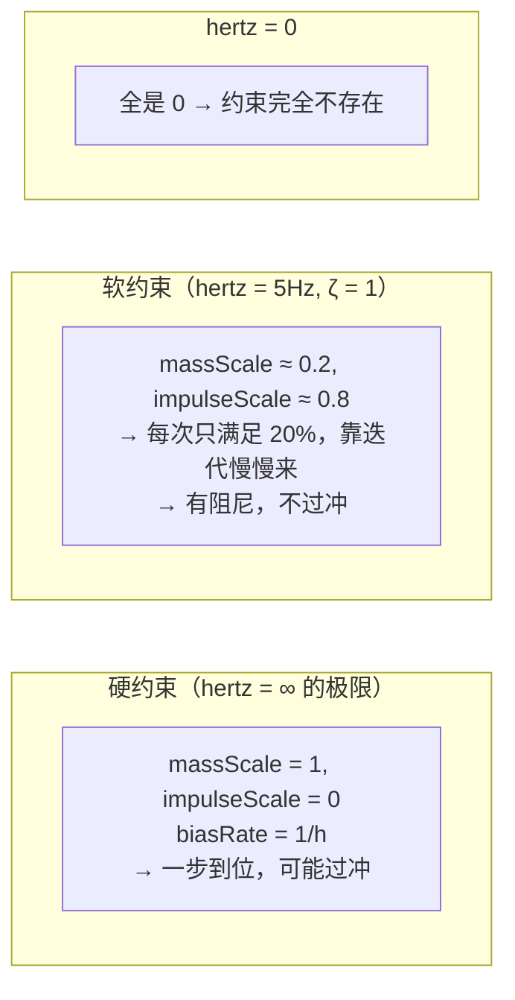

### 4.4 直观理解：为什么要"软化"

```mermaid
flowchart TB
    subgraph Hard["硬约束（massScale=1）"]
        direction TB
        H1["一个 100kg 的箱子压在 1kg 的箱子上"]
        H2["硬约束要求：接触点相对速度 = 0"]
        H3["→ 求解器给 1kg 箱子的冲量巨大"]
        H4["→ 1kg 箱子被弹飞 💥<br/>（因为约束传播需要多次迭代，<br/>单次迭代的"精确解"是错的）"]
    end
    subgraph Soft2["软约束（massScale 小）"]
        direction TB
        S_1["同样的场景"]
        S_2["软约束只要求"朝正确方向走一小步""]
        S_3["→ 冲量温和"]
        S_4["→ 多次迭代后逐步收敛 ✓<br/>（类似"梯度下降" vs "牛顿法"）"]
    end
```

### 4.5 接触的软度参数

```c
// physics_world.c:977-980
// Hertz values get reduced for large time steps
float contactHertz = b2MinFloat( world->contactHertz, 0.125f * context.inv_h );
context.contactSoftness = b2MakeSoft( contactHertz, world->contactDampingRatio, context.h );
context.staticSoftness  = b2MakeSoft( 2.0f * contactHertz, world->contactDampingRatio, context.h );
```

两个细节：

1. **`contactHertz` 被 `0.125·inv_h` 截断**：
   `inv_h = subStepCount/dt`。60fps、4 子步 → `inv_h = 240` → 上限 = 30 Hz。
   正好等于默认值。**超过这个频率，离散化就不准了**，所以截断。

2. **静态接触的刚度是动态的 2 倍**：
   ```c
   // contact_solver.c:39
   // Stiffer for static contacts to avoid bodies getting pushed through the ground
   ```
   静态接触（dyn-static）更硬，因为地面是"权威"的，物体不能陷进去。

---

## 五、接触约束的完整求解

### 5.1 准备阶段（`b2PrepareContacts_*`）

每帧只做一次，把 manifold 转成"求解器友好的"布局：

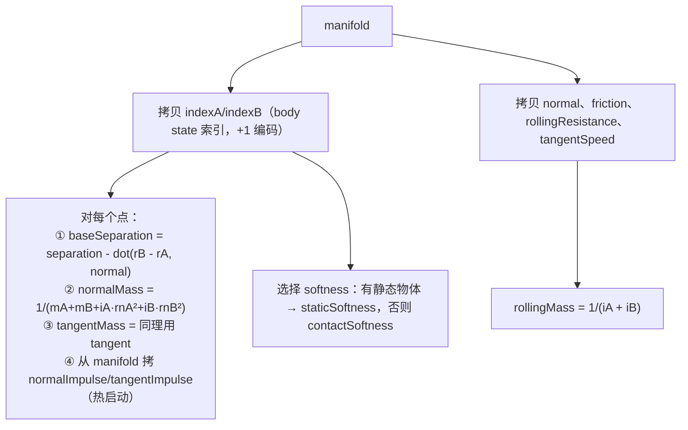

**`baseSeparation` 为什么要减去 `dot(rB - rA, n)`？**

```c
cp->baseSeparation = mp->separation - b2Dot( b2Sub( rB, rA ), normal );
```

因为子步进时，分离度用增量计算（`contact_solver.c:15-22` 的注释）：

```
s = s0 + dot(cB + rB - cA - rA, n)
  = s0 + dot(cB0 - cA0, n) + dot(ΔpB - ΔpA + rot(ΔqB, rB0) - rot(ΔqA, rA0), n)
      └──── baseSeparation ────┘   └────────── 每子步增量计算 ──────────┘
```

所以 `baseSeparation` 里要**扣掉**初始的 `rB - rA` 项，避免重复计算。

### 5.2 每子步的分离度更新

```c
// contact_solver.c:275-278
b2Vec2 ds = b2Add( dp, b2Sub( b2RotateVector( dqB, rB ), b2RotateVector( dqA, rA ) ) );
float s = cp->baseSeparation + b2Dot( ds, normal );
```

其中 `dp = ΔpB - ΔpA`，`dqA/dqB` 是本子步累积的增量旋转。

> 注意：**anchor 本身不旋转**（`rA = cp->anchorA` 是固定的），
> 只把 deltaRotation 作用在它上面去算分离度。这是 Box2D 的刻意选择：
> 源码注释 `body.h:147-150` 说，旋转接触 anchor 会让圆形物体**更不稳定**，
> 但旋转**关节** anchor 能显著提升稳定性。所以两者用了不同策略。

### 5.3 法向求解（`useBias = true`，阶段③）

```c
// contact_solver.c:280-328
float velocityBias = 0.0f;
float massScale = 1.0f;
float impulseScale = 0.0f;

if ( s > 0.0f )
{
    velocityBias = s * inv_h;                                    // 推测：精确停在接触面
}
else if ( useBias )
{
    velocityBias = b2MaxFloat( softness.massScale * softness.biasRate * s, -contactSpeed );  // 重叠：柔和推开
    massScale = softness.massScale;
    impulseScale = softness.impulseScale;
}

// 相对法向速度
b2Vec2 vrA = b2Add( vA, b2CrossSV( wA, rA ) );
b2Vec2 vrB = b2Add( vB, b2CrossSV( wB, rB ) );
float vn = b2Dot( b2Sub( vrB, vrA ), normal );

// 恢复系数（只在 relax 阶段）
if ( useBias == false && cp->restitutionVelocity > 0.0f )
{
    velocityBias = b2MinFloat( velocityBias, -cp->restitutionVelocity );
    stopRestitution = stopRestitution && s > 0.0f;
}

// 冲量
float impulse = -cp->normalMass * ( massScale * vn + velocityBias ) - impulseScale * cp->normalImpulse;
float newImpulse = b2MaxFloat( cp->normalImpulse + impulse, 0.0f );
impulse = newImpulse - cp->normalImpulse;
cp->normalImpulse = newImpulse;
cp->totalNormalImpulse += impulse;

// 施加
b2Vec2 P = b2MulSV( impulse, normal );
vA = b2MulSub( vA, mA, P );
wA -= iA * b2Cross( rA, P );
vB = b2MulAdd( vB, mB, P );
wB += iB * b2Cross( rB, P );
```

完整决策图：

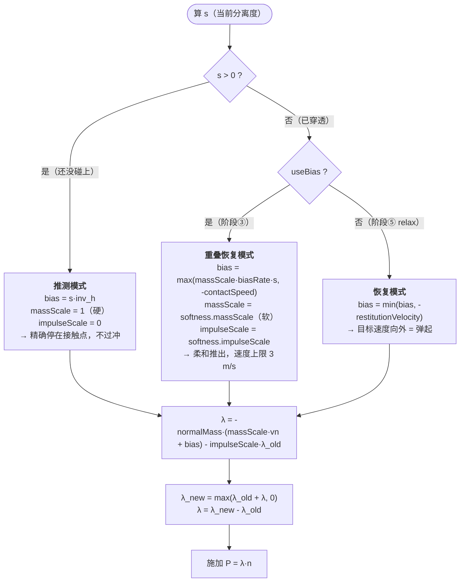

### 5.4 松弛阶段（`useBias = false`，阶段⑤）—— 摩擦和恢复

```c
if ( useBias == false )
{
    // ① 所有点都分开了？→ 停止恢复
    if ( stopRestitution )
    {
        constraint->points[0].restitutionVelocity = 0.0f;
        constraint->points[1].restitutionVelocity = 0.0f;
    }

    // ② 滚动阻力
    float deltaLambda = -constraint->rollingMass * ( wB - wA );
    float maxLambda = constraint->rollingResistance * totalNormalImpulse;
    constraint->rollingImpulse = b2ClampFloat( lambda + deltaLambda, -maxLambda, maxLambda );
    // ...

    // ③ 摩擦
    for ( int j = 0; j < pointCount; ++j )
    {
        float vt = b2Dot( b2Sub( vrB, vrA ), tangent ) - constraint->tangentSpeed;
        float impulse = cp->tangentMass * ( -vt );
        float maxFriction = friction * cp->normalImpulse;
        float newImpulse = b2ClampFloat( cp->tangentImpulse + impulse, -maxFriction, maxFriction );
        impulse = newImpulse - cp->tangentImpulse;
        cp->tangentImpulse = newImpulse;
        // 施加切向冲量
    }
}
```

**顺序很重要**：恢复 → 滚阻 → 摩擦。
因为滚阻上限依赖 `totalNormalImpulse`，摩擦上限依赖 `normalImpulse`。

### 5.5 一帧的完整时序

```mermaid
gantt
    title 一个子步内接触约束的时序
    dateFormat X
    axisFormat %s
    section 阶段
    Prepare（仅首帧前）        :done, p, 0, 1
    ① 积分速度                 :done, a, 1, 2
    ② 热启动（重放旧冲量）     :done, b, 2, 3
    ③ Solve（法向，带 bias）   :crit, c, 3, 4
    ④ 积分位置                 :done, d, 4, 5
    ⑤ Relax（恢复+滚阻+摩擦）  :crit, e, 5, 6
    Store（仅末帧后）          :done, f, 6, 7
```

---

## 六、热启动（Warm Starting）

### 6.1 原理

顺序冲量收敛速度取决于"初始猜测"有多好。如果每帧从 0 开始，
10 个盒子堆叠需要几十次迭代才能稳定（因为力要从底往上传递）。

**热启动**：把上一帧收敛的冲量直接作为本帧的初值。

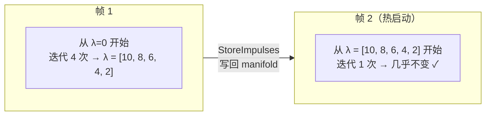

### 6.2 实现

```c
// contact_solver.c:140  b2WarmStartContacts_Overflow
b2Vec2 P = b2Add( b2MulSV( cp->normalImpulse, normal ), b2MulSV( cp->tangentImpulse, tangent ) );
cp->totalNormalImpulse += cp->normalImpulse;

wA -= iA * b2Cross( rA, P );
vA = b2MulAdd( vA, -mA, P );
wB += iB * b2Cross( rB, P );
vB = b2MulAdd( vB, mB, P );
```

```c
// contact_solver.c:112-113  准备时从 manifold 拷贝
cp->normalImpulse  = warmStartScale * mp->normalImpulse;
cp->tangentImpulse = warmStartScale * mp->tangentImpulse;
```

> `warmStartScale = world->enableWarmStarting ? 1.0f : 0.0f;` — 一键关闭，便于对比调试。

### 6.3 为什么热启动是"免费"的

热启动看起来是"多了一次冲量施加"，但它**替代了原本需要的多次迭代**。
Erin Catto 的 GDC 2006 演讲证明：热启动 + 少量迭代 >> 冷启动 + 大量迭代。

**代价**：需要跨帧持久化 manifold（用接触点 id 匹配），也就是为什么 `b2ContactSim`
里要存 `manifold` 而不是每帧重算。

### 6.4 子步内的热启动

热启动在**每个子步**开头都做一次（`solver.c:1098`）。
所以如果 `subStepCount = 4`，会热启动 4 次。
这是对的——每个子步都是一个新的"小时间步"。

---

## 七、9 种关节：同一套三板斧

所有关节都实现 **prepare / warmStart / solve** 三个函数，结构完全一致。

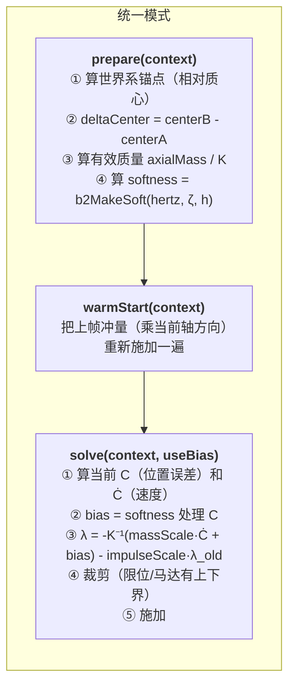

### 7.1 旋转铰（Revolute Joint）

**约束**：A 上的一点和 B 上的一点**重合**，但可以相对转动。

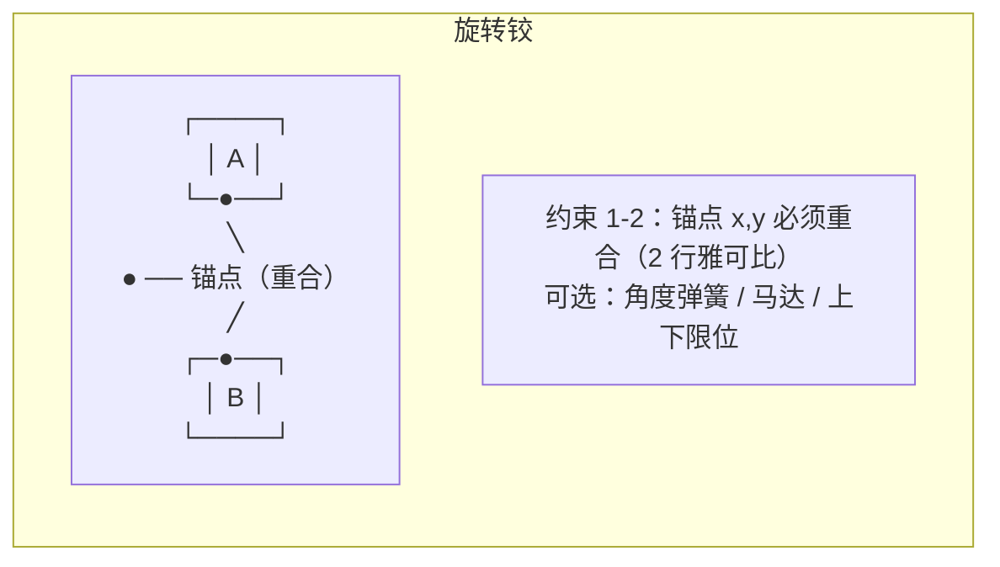

**平动部分**（`revolute_joint.c:443-487`）：
```c
// J = [-I -r1_skew I r2_skew]
b2Vec2 Cdot = b2Sub( b2Add( vB, b2CrossSV( wB, rB ) ), b2Add( vA, b2CrossSV( wA, rA ) ) );

// 位置误差 → bias
if ( useBias )
{
    b2Vec2 separation = b2Add( b2Add( b2Sub( dcB, dcA ), b2Sub( rB, rA ) ), joint->deltaCenter );
    bias = b2MulSV( base->constraintSoftness.biasRate, separation );
    massScale = base->constraintSoftness.massScale;
    impulseScale = base->constraintSoftness.impulseScale;
}

// 2×2 有效质量，解 2×2 系统
b2Mat22 K; /* 见 §2.3 */
b2Vec2 b = b2Solve22( K, b2Add( Cdot, bias ) );

b2Vec2 impulse;
impulse.x = -massScale * b.x - impulseScale * joint->linearImpulse.x;
impulse.y = -massScale * b.y - impulseScale * joint->linearImpulse.y;
joint->linearImpulse.x += impulse.x;
joint->linearImpulse.y += impulse.y;
```

**关节软度从哪来**（`b2JointDef`，默认值在 `src/joint.c:23`）：
```c
def.constraintHertz        = 60.0f;   // 关节约束频率
def.constraintDampingRatio = 2.0f;    // 过阻尼，防止抖动
def.forceThreshold         = FLT_MAX;
def.torqueThreshold        = FLT_MAX;
```

每帧在 `b2PrepareJoint` 里生成（`src/joint.c:1406-1410`）：
```c
// Clamp joint hertz based on the time step to reduce jitter.
float hertz = b2MinFloat( joint->constraintHertz, 0.25f * context->inv_h );
joint->constraintSoftness = b2MakeSoft( hertz, joint->constraintDampingRatio, context->h );
```

> 注意关节的频率上限是 `0.25·inv_h`，比接触的 `0.125·inv_h` **宽松一倍**。
> 60fps + 4 子步 → `inv_h = 240` → 上限 60 Hz，正好等于默认值。

运行时可用 `b2Joint_SetConstraintHertz`（`joint.c:1349`）调整。

**限位（Limit）** —— 注意它用**推测式**处理：
```c
// revolute_joint.c:383-408
float C = jointAngle - joint->lowerAngle;
float bias = 0.0f;
float massScale = 1.0f;
float impulseScale = 0.0f;

if ( C > 0.0f )
{
    // speculation —— 还没到限位，先精确停下
    bias = C * context->inv_h;
}
else if ( useBias )
{
    // 已经超过限位了，柔和推回
    bias = base->constraintSoftness.biasRate * C;
    massScale = base->constraintSoftness.massScale;
    impulseScale = base->constraintSoftness.impulseScale;
}

float Cdot = wB - wA;
float oldImpulse = joint->lowerImpulse;
float impulse = -massScale * joint->axialMass * ( Cdot + bias ) - impulseScale * oldImpulse;
joint->lowerImpulse = b2MaxFloat( oldImpulse + impulse, 0.0f );   // 限位是单侧的！
```

> **推测式限位**和推测接触是同一个思想：快到限位时先减速，精确停在限位上，不撞。

**上限位为什么符号翻转**（`revolute_joint.c:411-440`）：
```c
float C = joint->upperAngle - jointAngle;    // 翻转，使"满足约束时 C > 0"
// ...
float Cdot = wA - wB;                        // 翻转
// ...
wA += iA * impulse;                          // 翻转施加方向
wB -= iB * impulse;
```
目的（源码注释）：*"signs are flipped to keep C positive when the constraint is satisfied.
This also keeps the impulse positive when the limit is active."*
→ 两个限位都能用 `max(λ, 0)` 这一种裁剪逻辑。

**马达（Motor）**：
```c
float Cdot = wB - wA - joint->motorSpeed;
float impulse = -joint->axialMass * Cdot;                     // 注意：没有 bias，没有 softness！
float maxImpulse = context->h * joint->maxMotorTorque;        // 力 → 冲量：× h
joint->motorImpulse = b2ClampFloat( joint->motorImpulse + impulse, -maxImpulse, maxImpulse );
```

> **马达是"硬"的**（无 softness），因为它就是要精确控制速度。
> 它的"软"体现在 `maxMotorTorque` 上限——达不到就达不到。

### 7.2 距离约束（Distance Joint）

**约束**：两点距离 = L（可选弹簧、马达、限位）。

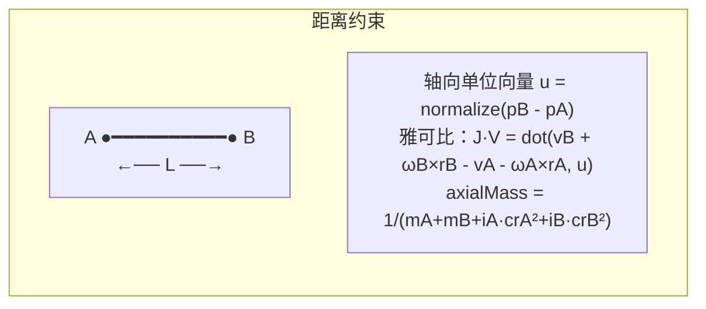

**刚性与弹簧的取舍**（`distance_joint.c:386-389`）：
```c
// joint is soft if
// - spring is enabled
// - and (joint limit is disabled or limits are not equal)
if ( joint->enableSpring && ( joint->minLength < joint->maxLength || joint->enableLimit == false ) )
{
    if ( joint->hertz > 0.0f )  { /* 弹簧求解 */ }
    if ( joint->enableMotor )   { /* 马达 */ }
}
else
{
    // 刚性距离约束：直接求解，无弹簧
}
```

弹簧部分：
```c
b2Vec2 vr = b2Add( b2Sub( vB, vA ), b2Sub( b2CrossSV( wB, rB ), b2CrossSV( wA, rA ) ) );
float cdot = b2Dot( axis, vr );
float c    = length - joint->length;                       // 长度误差
float bias = joint->distanceSoftness.biasRate * c;

float m = joint->distanceSoftness.massScale * joint->axialMass;
float impulse = -m * ( cdot + bias ) - joint->distanceSoftness.impulseScale * oldImpulse;

// 裁剪到弹簧力上下限（力→冲量要 × h）
joint->impulse = b2ClampFloat( joint->impulse + impulse,
                               joint->lowerSpringForce * h,
                               joint->upperSpringForce * h );
```

> **注意 `lowerSpringForce · h`**：弹簧力上限是"力"（牛顿），要变成冲量必须乘时间步。
> 所有"力/力矩上限"都有这个转换（`maxMotorForce·h`、`maxMotorTorque·h`…）。

### 7.3 九种关节一览

| 关节 | 约束内容 | 典型用途 |
|---|---|---|
| **distance** | 两点距离（可弹簧/马达/限位） | 绳子、弹簧、摆锤 |
| **revolute** | 一点重合 + 可选角度弹簧/马达/限位 | 铰链、门、车轮轴 |
| **prismatic** | 沿一条轴滑动 + 角度锁定 + 可选马达/限位 | 活塞、升降台 |
| **wheel** | 沿轴滑动（悬挂弹簧）+ 自由旋转 + 马达 | 汽车轮子 |
| **weld** | 平动 + 转动全锁（可软） | 软体、可破坏结构 |
| **motor** | 直接控制相对线速度 + 角速度 | 俯视角摩擦、角色 |
| **mover** | x/y 方向独立速度控制（不影响旋转） | 平台游戏角色 |
| **pogo** | 沿法线的弹簧，有拉伸/压缩力上限 | 角色跳跃、弹簧腿 |
| **filter** | 无约束！只用来禁止两个 body 碰撞 | 布娃娃自碰撞 |

### 7.4 关节 vs 接触：一张对照表

| | 接触约束 | 关节约束 |
|---|---|---|
| 谁创建 | 引擎自动 | 用户手动 |
| 生命周期 | 随重叠自动增删 | 手动创建销毁 |
| 约束方向 | 单侧（只能推） | 通常双侧（能推能拉） |
| 摩擦 | 有（切向） | 无（除非 motor joint） |
| 恢复 | 有 | 无 |
| 软度来源 | `world.contactHertz` | `joint.constraintHertz` 或各自的 `hertz` |
| 位置修正 | 通过 separation | 通过 C（角度/长度/位移误差） |
| 求解顺序 | 同颜色内一起 | 同颜色内，**关节块在接触块之前** |

---

## 八、并行：图着色

### 8.1 为什么能并行

约束求解是 Gauss-Seidel（顺序相关）。但**两个不共享任何刚体的约束，顺序无关**。

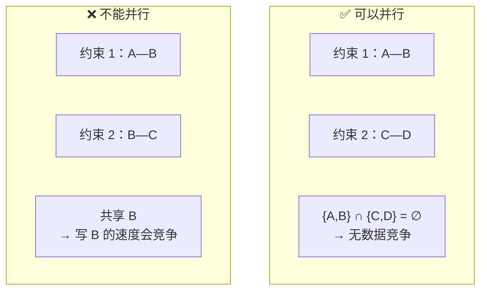

### 8.2 染色

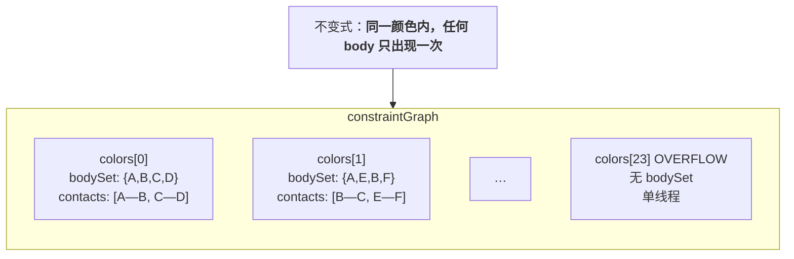

`bodySet` 是一个**位集**（bitset），按 `bodyId` 索引。
加入约束时检查两个物体的位是否已被占用（`constraint_graph.c:92`）。

### 8.3 颜色分配的优先级

```
   [0 ──────────── 19]  [20][21][22]  [23]
    ↑                     ↑             ↑
    dyn-dyn（低优先级）    dyn-static    overflow
                          （高优先级）
```

- dyn-dyn：从 0 往上找空位
- dyn-static：从 22 往下找空位

**求解顺序 0→22**，所以静态接触**最后算**。

理由（`constraint_graph.h:22-24`）：
```c
// This keeps constraints involving two dynamic bodies at a lower solver priority than constraints
// involving a dynamic and static bodies. This reduces tunneling due to push through.
```

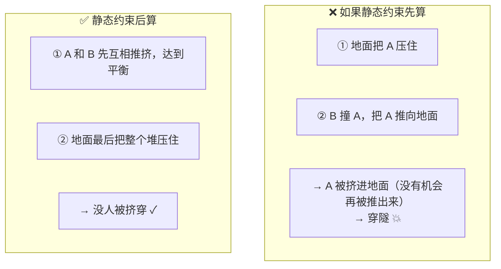

### 8.4 溢出槽

如果一个刚体接触了太多其他刚体（比如一个巨大物体压着 100 个小物体），
24 种颜色不够用 → 丢进 `colors[23]`，**单线程求解**。

```c
#define B2_OVERFLOW_INDEX ( B2_GRAPH_COLOR_COUNT - 1 )     // 23
#define B2_DYNAMIC_COLOR_COUNT ( B2_GRAPH_COLOR_COUNT - 4 ) // 20
```

溢出槽的求解**没有 bodySet**（不需要染色），且在每轮迭代里**最先执行**（优先级最低）：

```c
// solver.c:1116-1118
// Overflow constraints have lower priority. Typically these are dynamic-vs-dynamic.
b2SolveJoints_Overflow( context, useBias );
b2SolveContacts_Overflow( context, useBias );
```

### 8.5 块级并行

在同一个颜色内，约束被切成若干 **block**（每块 4 个约束起步），
worker 用 CAS 抢块。详见 [01 章 §7](./01-整体框架.md#七并行模型任务块同步位)。

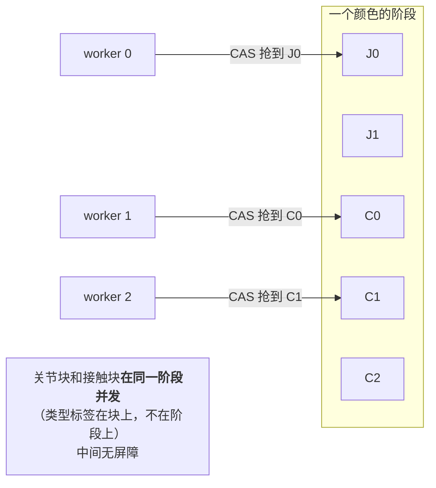

---

## 九、SIMD：宽约束

### 9.1 数据布局：AoS → SoA

标量版是一个 `b2ContactConstraint` 结构：
```c
typedef struct b2ContactConstraint {
    b2Vec2 normal; float invMassA; ... b2ContactConstraintPoint points[2];
} b2ContactConstraint;
```

SIMD 版把它**拆开**（Structure of Arrays），每个字段是一个 4/8 路向量：

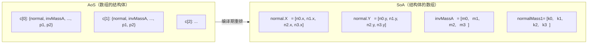

### 9.2 Gather / Scatter

刚体状态还是 AoS（在 `bodyStates[]` 数组里），所以要：

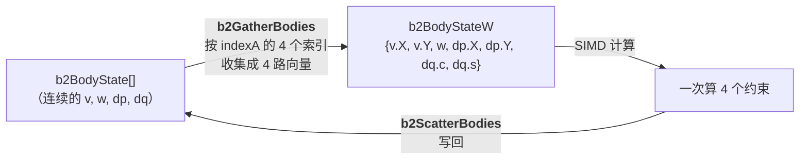

```c
// contact_solver.c:2034-2035, 2154-2155
b2BodyStateW bA = b2GatherBodies( states, c->indexA );
b2BodyStateW bB = b2GatherBodies( states, c->indexB );
/* ... SIMD 计算 ... */
b2ScatterBodies( states, c->indexA, &bA );
b2ScatterBodies( states, c->indexB, &bB );
```

### 9.3 静态物体的处理：`indexA` 编码

```c
// contact_solver.c:70-71
constraint->indexA = indexA + 1;      // 0 = null（静态）
constraint->indexB = indexB + 1;
```

`index - 1 = B2_NULL_INDEX(-1)` 时表示静态。
Gather 时会用这个索引取到**数组前一个元素**（一个专门的哑元槽），
这个哑元的 `v=0, w=0, dp=0, dq=(1,0)`。

然后 `b2SoftMaskW` 生成一个掩码，用于在动态/静态软度之间做 blend：
```c
b2FloatW softMask = b2SoftMaskW( c->indexA, c->indexB );
b2FloatW biasRate = b2BlendW( dynamicBiasRate, staticBiasRate, softMask );
```

**完全无分支**——这是 SIMD 的关键。

### 9.4 尾部处理

如果约束数不是 4 的倍数，最后一个宽槽有空位：
```c
// solver.c:1401-1405
if ( ( colorContactCount & ( B2_SIMD_WIDTH - 1 ) ) != 0 )
{
    memset( (uint8_t*)color->wideConstraints + ( colorContactCountW - 1 ) * wideContactConstraintByteCount, 0,
            wideContactConstraintByteCount );
}
```

把整个宽槽清零，空位的 `indexA/B` 会是 0 → 都指向哑元 → 计算结果是 0 冲量 → 无害。

---

## 十、完整求解流程（把一切串起来）

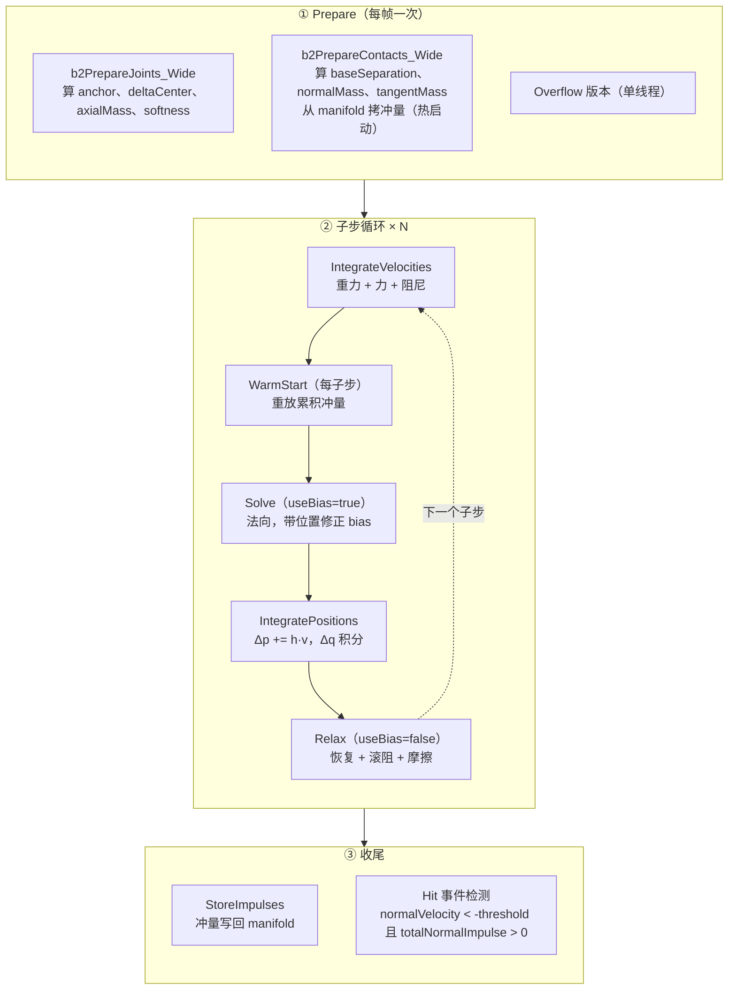

### 每个子步内的颜色循环

```
for color = 0 .. activeColorCount-1:
    执行该颜色的【关节块 + 接触块】（并行）
```

注意：**关节块在接触块之前**（`solver.c:1492-1496`），但它们是同一阶段的不同块，并发执行。

---

## 十一、调优指南

| 症状 | 可能原因 | 调整 |
|---|---|---|
| 堆叠抖动 | 推测距离太小 / 迭代不够 | 增大 `subStepCount`（首选！） |
| 物体陷入地面 | 静态软度不够硬 | 增大 `contactHertz` |
| 推开太慢 | `contactSpeed` 太小 | 增大 `contactSpeed`（默认 3 m/s） |
| 弹跳不自然 | 恢复阈值不对 | 调 `restitutionThreshold`（默认 1 m/s） |
| 关节软绵绵 | 关节软度太软 | 增大 `constraintHertz` 或设为 0（最硬） |
| 关节抖动/爆炸 | 太硬 + 大质量比 | 减小 `constraintHertz`，增大 `constraintDampingRatio` |
| 高速穿墙 | CCD 没生效 | 开 `enableContinuous`，减小 `safetyFactor`，设 `isBullet` |
| 性能差 | 颜色数不够（溢出多） | 减少单个物体的接触数；或调大 `B2_GRAPH_COLOR_COUNT` |
| 平行世界"幽灵碰撞" | 接触复用 | 关 `enableContactRecycling` |

**黄金法则**：
> **先加 `subStepCount`，再调其他参数。**
> `b2World_Step(dt, 4)` 几乎能解决 90% 的稳定性问题，代价只是 CPU。
> 只有在加不动子步时，才去动 `contactHertz` / `contactDampingRatio`。

---

## 十二、本章小结 + 源码索引

### 一页纸公式卡

```
有效质量（法向）  K = mA + mB + iA(rA×n)² + iB(rB×n)²
有效质量（切向）  Kt = mA + mB + iA(rA×t)² + iB(rB×t)²
有效质量（滚阻）  Kr = 1/(iA + iB)
有效质量（角度）  Ka = 1/(iA + iB)

软约束            ω = 2πf;  a1 = 2ζ + hω;  a2 = hω·a1;  a3 = 1/(1+a2)
                  biasRate = ω/a1;  massScale = a2·a3;  impulseScale = a3
                  （恒有 massScale + impulseScale = 1）

冲量              λ = -K⁻¹(massScale·Ċ + bias) - impulseScale·λ_old
裁剪              λ_new = clamp(λ_old + λ, lo, hi);  λ = λ_new - λ_old

施加              ΔvA = -mA·P;  ΔωA = -iA·cross(rA,P)
                  ΔvB = +mB·P;  ΔωB = +iB·cross(rB,P)

bias              s > 0（推测）: bias = s/h,        massScale=1, impulseScale=0
                  s < 0（重叠）: bias = max(ms·br·s, -contactSpeed)
                  恢复（relax）: bias = min(bias, -restitutionVelocity)

摩擦              |λt| ≤ μ·λn
滚阻              |λr| ≤ ρ·Σλn
马达力上限         maxImpulse = h · maxForce
```

### 源码索引

| 内容 | 位置 |
|---|---|
| **标量接触求解（必读！）** | `src/contact_solver.c:217-402` |
| SIMD 宽版本（push） | `src/contact_solver.c:2012` `b2PushContacts_Wide` |
| SIMD 宽版本（relax） | `src/contact_solver.c:2161` `b2SolveContacts_Wide` |
| 软约束 | `src/solver.h:238` `b2MakeSoft` |
| 旋转铰 | `src/revolute_joint.c:217/283/317` |
| 距离约束 | `src/distance_joint.c:250/315/354` |
| 图着色 | `src/constraint_graph.c:67` `b2AddContactToGraph` |
| 求解调度 | `src/solver.c:1008` `b2SolverTask` |
| 积分 | `src/solver.c:66` / `:114` |

### 自测题

1. 为什么 `massScale + impulseScale == 1`？这个恒等式的物理意义是什么？
2. 如果 `hertz = 0`，`b2MakeSoft` 返回什么？意味着约束变成什么样？
3. 旋转铰的上限位为什么要把 C 和 Ċ 都取反？
4. 静态接触的刚度为什么是动态接触的 2 倍？
5. 为什么溢出约束（overflow）要在每轮迭代**最先**求解？
6. 摩擦为什么必须在 relax 阶段而不是 solve 阶段？
7. `maxMotorForce * h` 里的 `h` 是子步长还是帧长？为什么？
8. 如果一个物体同时被 30 个约束共享，会发生什么？

---

**下一步** → [05 · 从零打造 2D 物理引擎](./05-从零打造2D物理引擎.md)
