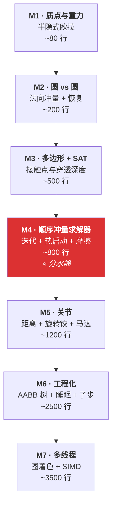
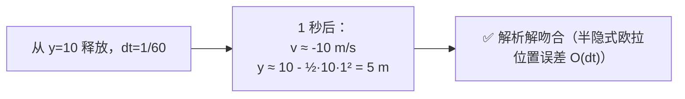
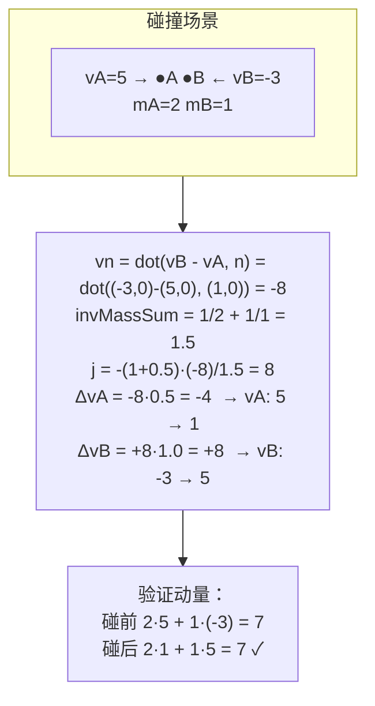
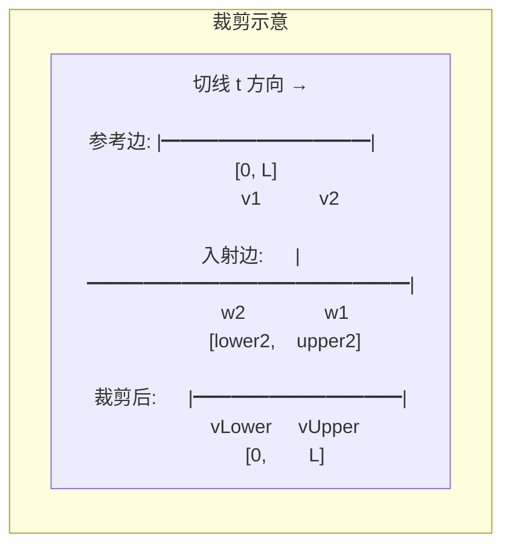
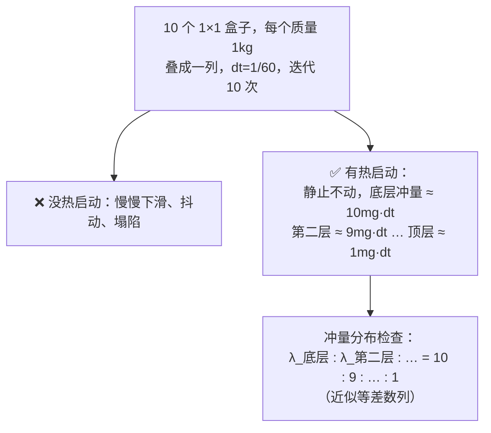
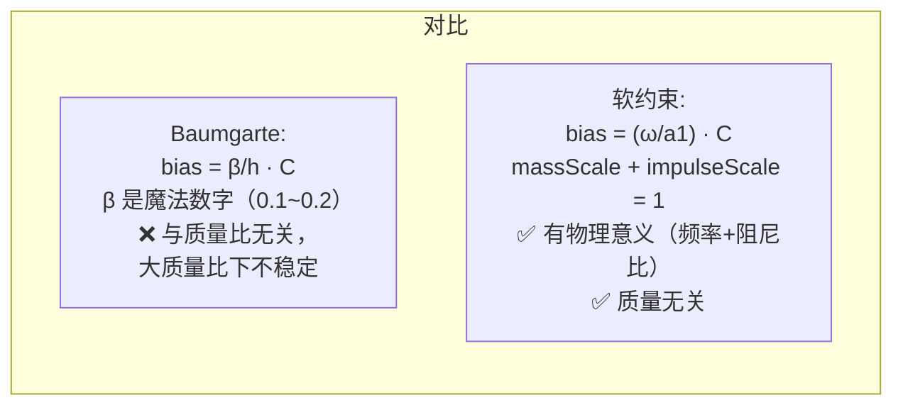
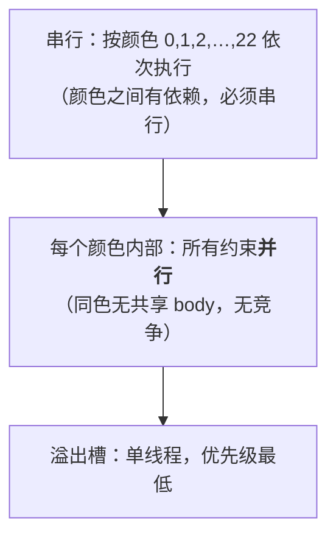

# 05 · 从零打造 2D 物理引擎

> 这一章是**实战**。跟着 7 个里程碑走，你会从"一个自由落体的点"一路写到"能堆叠、有关节、有多线程的引擎"。
> 代码用 C 风格伪代码（贴近 Box2D），你可以直接照抄成 C/C++/Rust/C#。

---

## 里程碑总览



---

## M1 · 质点与重力

**目标**：一个球自由落体，落到地面停住（先不管碰撞，只用"地面以下就把 y 钳制住"）。

### 数据结构

```c
typedef struct { float x, y; } Vec2;

typedef struct Body
{
    Vec2  position;
    Vec2  velocity;
    Vec2  force;
    float invMass;        // 0 = 静态（无穷大质量）
    float radius;
} Body;
```

### 主循环

```c
void Step( Body* bodies, int count, float dt )
{
    Vec2 gravity = { 0.0f, -10.0f };

    // ① 积分速度（半隐式欧拉：先 v 后 x）
    for ( int i = 0; i < count; ++i )
    {
        Body* b = bodies + i;
        if ( b->invMass == 0.0f ) continue;      // 静态物体

        b->velocity.x += dt * ( b->invMass * b->force.x + gravity.x );
        b->velocity.y += dt * ( b->invMass * b->force.y + gravity.y );

        b->force = (Vec2){ 0, 0 };               // 力每帧清零
    }

    // ② 积分位置
    for ( int i = 0; i < count; ++i )
    {
        Body* b = bodies + i;
        if ( b->invMass == 0.0f ) continue;

        b->position.x += dt * b->velocity.x;     // ← 用的是<b>新</b>速度
        b->position.y += dt * b->velocity.y;
    }
}
```

### 验收



> **试试改成显式欧拉**（先 x 后 v），跑一个弹簧振子，看它怎么爆炸。这个对比会让你终生难忘。

---

## M2 · 圆 vs 圆碰撞

**目标**：两个球对撞后正确反弹、动量守恒。

### 碰撞检测（闭式解）

```c
typedef struct Manifold
{
    Vec2  normal;      // 从 A 指向 B
    float separation;  // < 0 表示穿透
    Vec2  point;       // 接触点
} Manifold;

bool CollideCircles( const Body* A, const Body* B, Manifold* m )
{
    Vec2  d    = sub( B->position, A->position );
    float dist = length( d );
    float r    = A->radius + B->radius;

    m->separation = dist - r;
    if ( m->separation > 0.0f ) return false;    // 没碰上

    m->normal = dist > 1e-6f ? scale( d, 1.0f / dist ) : (Vec2){ 0, 1 };
    m->point  = add( A->position, scale( m->normal, A->radius ) );
    return true;
}
```

### 冲量求解

```c
void SolveContact( Body* A, Body* B, const Manifold* m, float restitution )
{
    // 相对速度（只考虑平动，还没旋转）
    Vec2 rv = sub( B->velocity, A->velocity );
    float vn = dot( rv, m->normal );

    if ( vn > 0.0f ) return;                    // 已经在分离，不用管

    // 有效质量
    float invMassSum = A->invMass + B->invMass;
    if ( invMassSum == 0.0f ) return;           // 两个都是静态

    // 冲量大小
    float j = -( 1.0f + restitution ) * vn / invMassSum;

    Vec2 impulse = scale( m->normal, j );

    A->velocity = sub( A->velocity, scale( impulse, A->invMass ) );
    B->velocity = add( B->velocity, scale( impulse, B->invMass ) );
}
```

### 公式图解



### 验收

- ✅ 两个球对撞，总动量守恒
- ✅ `restitution = 1` 时，能量也守恒（完全弹性）
- ✅ 一个球落在静态地面上（`invMass = 0`），`restitution = 0` 时停住

> **这里有个坑**：球会慢慢陷进地面。因为你只在 `separation < 0` 时才求解，
> 求解完 velocity 变成 0，但位置还在地面下面。下一帧又穿透一点……
> 这就是 M4 要用 bias 解决的问题。

---

## M3 · 多边形与 SAT

**目标**：一个盒子斜着落在地面上，能算出 1~2 个接触点。

### 数据结构

```c
typedef struct Polygon
{
    Vec2  vertices[8];
    Vec2  normals[8];     // 外法线，normals[i] 是边 (v[i], v[i+1]) 的法线
    int   count;
} Polygon;
```

**约定**：顶点按 **CCW（逆时针）** 排列，这样 `normals[i] = perp(v[i+1] - v[i])` 归一化后就是外法线。

```c
// 2D 的 perp：逆时针转 90°
Vec2 perp( Vec2 v ) { return (Vec2){ -v.y, v.x }; }
```

### SAT：找最大分离边

```c
float FindMaxSeparation( int* edgeIndex, const Polygon* A, const Polygon* B )
{
    int   bestIndex = 0;
    float maxSeparation = -FLT_MAX;

    for ( int i = 0; i < A->count; ++i )
    {
        Vec2 n = A->normals[i];
        Vec2 v = A->vertices[i];

        // 找 B 在 -n 方向上的支撑点
        float si = FLT_MAX;
        for ( int j = 0; j < B->count; ++j )
        {
            float sij = dot( n, sub( B->vertices[j], v ) );
            if ( sij < si ) si = sij;
        }

        if ( si > maxSeparation ) { maxSeparation = si; bestIndex = i; }
    }

    *edgeIndex = bestIndex;
    return maxSeparation;
}
```

### 主流程

```c
bool CollidePolygons( const Polygon* A, const Polygon* B, Manifold* out )
{
    int   edgeA; float sepA = FindMaxSeparation( &edgeA, A, B );
    int   edgeB; float sepB = FindMaxSeparation( &edgeB, B, A );

    if ( sepA > 0.0f || sepB > 0.0f ) return false;      // 分离

    // 选参考面：分离度更大的那个（"更浅"的穿透方向更可能是真法线）
    const Polygon *refPoly, *incPoly;
    int refEdge;
    bool flip;

    if ( sepA >= sepB ) { refPoly = A; incPoly = B; refEdge = edgeA; flip = false; }
    else                { refPoly = B; incPoly = A; refEdge = edgeB; flip = true;  }

    // 找入射边：法线与参考法线点积<b>最小</b>的边
    Vec2 refNormal = refPoly->normals[refEdge];
    int incEdge = 0;
    float minDot = FLT_MAX;
    for ( int i = 0; i < incPoly->count; ++i )
    {
        float d = dot( refNormal, incPoly->normals[i] );
        if ( d < minDot ) { minDot = d; incEdge = i; }
    }

    // 裁剪（见下）
    return Clip( refPoly, refEdge, incPoly, incEdge, flip, out );
}
```

### 边裁剪

```c
bool Clip( const Polygon* refPoly, int refEdge,
           const Polygon* incPoly, int incEdge,
           bool flip, Manifold* out )
{
    int i1 = refEdge;
    int i2 = ( refEdge + 1 ) % refPoly->count;
    Vec2 v1 = refPoly->vertices[i1];
    Vec2 v2 = refPoly->vertices[i2];

    int j1 = incEdge;
    int j2 = ( incEdge + 1 ) % incPoly->count;
    Vec2 w1 = incPoly->vertices[j1];
    Vec2 w2 = incPoly->vertices[j2];

    Vec2 n = refPoly->normals[i1];
    Vec2 t = perp( n );                          // 切线

    float lower1 = 0.0f;
    float upper1 = dot( sub( v2, v1 ), t );

    // CCW 绕序 → w1 是上界，w2 是下界
    float upper2 = dot( sub( w1, v1 ), t );
    float lower2 = dot( sub( w2, v1 ), t );

    if ( upper2 < lower1 || upper1 < lower2 ) return false;   // 不重叠

    // 裁剪下端点
    Vec2 vLower = ( lower2 < lower1 )
        ? lerp( w2, w1, ( lower1 - lower2 ) / ( upper2 - lower2 ) )
        : w2;

    // 裁剪上端点
    Vec2 vUpper = ( upper2 > upper1 )
        ? lerp( w2, w1, ( upper1 - lower2 ) / ( upper2 - lower2 ) )
        : w1;

    float sepLower = dot( sub( vLower, v1 ), n );
    float sepUpper = dot( sub( vUpper, v1 ), n );

    out->normal = flip ? negate( n ) : n;
    out->points[0] = vLower;  out->separations[0] = sepLower;
    out->points[1] = vUpper;  out->separations[1] = sepUpper;
    out->count = ( distance( vLower, vUpper ) > 1e-4f ) ? 2 : 1;
    return true;
}
```



### 验收

- ✅ 盒子平放在地上 → 2 个接触点
- ✅ 盒子一个角着地 → 1 个接触点（法线垂直于地面）
- ✅ 两个盒子完全分离 → 返回 false
- ✅ 把盒子旋转 45° 缓慢落下，接触点和法线**连续变化**（不跳变）

---

## M4 · 顺序冲量求解器 ⭐

**这是分水岭。** 目标：**10 个盒子叠起来能稳定**。

### 加上旋转

```c
typedef struct Body
{
    Vec2  position;
    float angle;
    Vec2  linearVelocity;
    float angularVelocity;
    Vec2  force;
    float torque;
    float invMass;
    float invInertia;      // 0 = 静态
    // 形状...
} Body;

// 点的速度：v + ω × r，2D 里 ω × r = ω · perp(r)
Vec2 VelocityAt( const Body* b, Vec2 r )
{
    return (Vec2){
        b->linearVelocity.x - b->angularVelocity * r.y,
        b->linearVelocity.y + b->angularVelocity * r.x
    };
}
```

### 有效质量

```c
typedef struct ContactConstraint
{
    int   bodyA, bodyB;
    Vec2  normal;
    Vec2  points[2];
    float separations[2];
    float normalMass[2];
    float tangentMass[2];
    float normalImpulse[2];    // 累积冲量
    float tangentImpulse[2];
    float friction;
    int   pointCount;
} ContactConstraint;

void Prepare( ContactConstraint* c, Body* bodies )
{
    Body* A = bodies + c->bodyA;
    Body* B = bodies + c->bodyB;
    Vec2  n = c->normal;
    Vec2  t = perp( n );

    for ( int i = 0; i < c->pointCount; ++i )
    {
        Vec2 rA = sub( c->points[i], A->position );       // 从质心到接触点
        Vec2 rB = sub( c->points[i], B->position );

        float rnA = cross( rA, n ), rnB = cross( rB, n );
        float kn = A->invMass + B->invMass
                 + A->invInertia * rnA * rnA
                 + B->invInertia * rnB * rnB;
        c->normalMass[i] = kn > 0.0f ? 1.0f / kn : 0.0f;

        float rtA = cross( rA, t ), rtB = cross( rB, t );
        float kt = A->invMass + B->invMass
                 + A->invInertia * rtA * rtA
                 + B->invInertia * rtB * rtB;
        c->tangentMass[i] = kt > 0.0f ? 1.0f / kt : 0.0f;
    }
}
```

### 求解（含 bias、摩擦、热启动）

```c
void Solve( ContactConstraint* c, Body* bodies, float inv_h, float slop )
{
    Body* A = bodies + c->bodyA;
    Body* B = bodies + c->bodyB;
    Vec2  n = c->normal;
    Vec2  t = perp( n );

    for ( int i = 0; i < c->pointCount; ++i )
    {
        Vec2 rA = sub( c->points[i], A->position );
        Vec2 rB = sub( c->points[i], B->position );

        // ① 相对速度
        Vec2 vr = sub( VelocityAt( B, rB ), VelocityAt( A, rA ) );
        float vn = dot( vr, n );

        // ② bias：把穿透变成"需要向外推的速度"
        float bias = 0.0f;
        if ( c->separations[i] < -slop )
            bias = -0.2f * inv_h * ( c->separations[i] + slop );   // Baumgarte 风格

        // ③ 法向冲量（累积裁剪！）
        float jn = -c->normalMass[i] * ( vn + bias );
        float oldN = c->normalImpulse[i];
        c->normalImpulse[i] = fmaxf( oldN + jn, 0.0f );            // ← 只能推
        jn = c->normalImpulse[i] - oldN;

        ApplyImpulse( A, B, rA, rB, scale( n, jn ) );

        // ④ 摩擦
        vr = sub( VelocityAt( B, rB ), VelocityAt( A, rA ) );       // 重新算（速度已变）
        float vt = dot( vr, t );
        float jt = -c->tangentMass[i] * vt;

        float maxF = c->friction * c->normalImpulse[i];              // ← 用更新后的法向冲量
        float oldT = c->tangentImpulse[i];
        c->tangentImpulse[i] = clampf( oldT + jt, -maxF, maxF );
        jt = c->tangentImpulse[i] - oldT;

        ApplyImpulse( A, B, rA, rB, scale( t, jt ) );
    }
}

void ApplyImpulse( Body* A, Body* B, Vec2 rA, Vec2 rB, Vec2 P )
{
    A->linearVelocity  = sub( A->linearVelocity,  scale( P, A->invMass ) );
    A->angularVelocity -= A->invInertia * cross( rA, P );
    B->linearVelocity  = add( B->linearVelocity,  scale( P, B->invMass ) );
    B->angularVelocity += B->invInertia * cross( rB, P );
}
```

### 迭代

```c
void SolveAll( ContactConstraint* cs, int count, Body* bodies, int iterations, float inv_h )
{
    for ( int c = 0; c < count; ++c ) Prepare( cs + c, bodies );

    for ( int it = 0; it < iterations; ++it )
        for ( int c = 0; c < count; ++c )
            Solve( cs + c, bodies, inv_h, 0.005f );
}
```

### 热启动（关键！）

```c
// 上一帧的 manifold 用 contact id 匹配，把冲量拷过来
// 然后在迭代<b>之前</b>统一施加一遍：
void WarmStart( ContactConstraint* c, Body* bodies )
{
    Body* A = bodies + c->bodyA, *B = bodies + c->bodyB;
    Vec2  n = c->normal, t = perp( n );

    for ( int i = 0; i < c->pointCount; ++i )
    {
        Vec2 rA = sub( c->points[i], A->position );
        Vec2 rB = sub( c->points[i], B->position );
        Vec2 P = add( scale( n, c->normalImpulse[i] ),
                      scale( t, c->tangentImpulse[i] ) );
        ApplyImpulse( A, B, rA, rB, P );
    }
}
```

### 验收标准



> **调试技巧**：打印每一层的 `normalImpulse`。
> 如果不符合"底层最大、往上递减"，说明力没有正确传递下去 —— 通常是迭代次数不够或没热启动。

### 常见问题对照表

| 症状 | 原因 | 修法 |
|---|---|---|
| 慢慢陷进去 | 只有速度约束，没有位置修正 | 加 bias（上面已加） |
| 抖动 | bias 太大（过冲） | 把 `0.2f` 降到 `0.1f`，或改用**软约束** |
| 堆叠塌 | 迭代不够 / 没热启动 | 加迭代、加热启动 |
| 摩擦力不够，盒子滑走 | 摩擦用了旧的法向冲量 | 摩擦必须在法向之后 |
| 物体被"吸住" | 裁剪了增量而不是累积值 | 见 M4 代码 `fmaxf(old + jn, 0)` |

---

## M5 · 关节

**目标**：能做一个车（车身 + 两个轮子）。

### 通用框架

```c
typedef struct Joint
{
    int   bodyA, bodyB;
    Vec2  localAnchorA, localAnchorB;    // 相对各自<b>物体原点</b>（不是质心！）
    // 累积冲量、软度参数…
} Joint;

void PrepareJoint ( Joint* j, Body* bodies, float h );
void WarmStartJoint( Joint* j, Body* bodies );
void SolveJoint    ( Joint* j, Body* bodies, float h, bool useBias );
```

> ⚠️ **Box2D 的 `localFrame` 是相对物体原点，不是质心**（`types.h:593-596`）。
> 原因：如果你加/删形状导致质心移动，相对质心的关节锚点会失效，
> 而相对原点的锚点永远稳定。

### 距离约束

```c
void PrepareDistanceJoint( Joint* j, Body* bodies, float h )
{
    Body* A = bodies + j->bodyA, *B = bodies + j->bodyB;

    // 世界系锚点（相对质心）
    j->rA = rotate( j->localAnchorA, A->angle );
    j->rB = rotate( j->localAnchorB, B->angle );

    Vec2 d = sub( add( B->position, j->rB ), add( A->position, j->rA ) );
    j->length = length( d );
    j->u      = normalize( d );

    float crA = cross( j->rA, j->u ), crB = cross( j->rB, j->u );
    float k = A->invMass + B->invMass
            + A->invInertia * crA * crA
            + B->invInertia * crB * crB;
    j->axialMass = k > 0.0f ? 1.0f / k : 0.0f;
}

void SolveDistanceJoint( Joint* j, Body* bodies, float h, bool useBias )
{
    Body* A = bodies + j->bodyA, *B = bodies + j->bodyB;

    Vec2 vr = sub( VelocityAt( B, j->rB ), VelocityAt( A, j->rA ) );
    float cdot = dot( vr, j->u );                    // 距离变化率

    float c    = j->length - j->restLength;          // 长度误差
    float bias = useBias ? j->biasRate * c : 0.0f;

    float lambda = -j->axialMass * ( cdot + bias );

    // 刚性距离约束：冲量无上下界（能推能拉）
    j->impulse += lambda;
    ApplyImpulse( A, B, j->rA, j->rB, scale( j->u, lambda ) );
}
```

### 旋转铰（平动部分）

```c
void SolveRevoluteJoint( Joint* j, Body* bodies, float h, bool useBias )
{
    Body* A = bodies + j->bodyA, *B = bodies + j->bodyB;

    // 2 行的雅可比 → 2×2 有效质量
    Vec2 Cdot = sub( VelocityAt( B, j->rB ), VelocityAt( A, j->rA ) );

    Vec2 biasVec = { 0, 0 };
    if ( useBias )
    {
        Vec2 dp    = sub( B->position, A->position );
        Vec2 C     = add( sub( add( dp, j->rB ), j->rA ), j->deltaCenter );
        biasVec    = scale( C, j->biasRate );
    }

    // K = [[k11, k12], [k12, k22]]
    float k11 = A->invMass + B->invMass + A->invInertia*j->rA.y*j->rA.y + B->invInertia*j->rB.y*j->rB.y;
    float k12 = -( A->invInertia*j->rA.x*j->rA.y + B->invInertia*j->rB.x*j->rB.y );
    float k22 = A->invMass + B->invMass + A->invInertia*j->rA.x*j->rA.x + B->invInertia*j->rB.x*j->rB.x;

    // 解 2×2 线性系统： K · x = -(Cdot + bias)
    Vec2 rhs = negate( add( Cdot, biasVec ) );
    Vec2 x   = Solve22( k11, k12, k22, rhs );        // Cramer 法则

    j->linearImpulse = add( j->linearImpulse, x );
    ApplyImpulse( A, B, j->rA, j->rB, x );
}

Vec2 Solve22( float k11, float k12, float k22, Vec2 b )
{
    float det = k11 * k22 - k12 * k12;
    if ( fabsf( det ) < 1e-12f ) return (Vec2){ 0, 0 };
    float invDet = 1.0f / det;
    return (Vec2){ invDet * ( k22 * b.x - k12 * b.y ),
                   invDet * ( k11 * b.y - k12 * b.x ) };
}
```

### 加入软约束（关键升级）

把 M4 里那个 `0.2f` 的 Baumgarte 系数换成 Box2D 的软约束：

```c
typedef struct Softness { float biasRate, massScale, impulseScale; } Softness;

Softness MakeSoft( float hertz, float zeta, float h )
{
    if ( hertz == 0.0f ) return (Softness){ 0, 0, 0 };

    float omega = 2.0f * PI * hertz;
    float a1 = 2.0f * zeta + h * omega;
    float a2 = h * omega * a1;
    float a3 = 1.0f / ( 1.0f + a2 );

    return (Softness){ omega / a1, a2 * a3, a3 };
}

// 求解时：
float lambda = -mass * ( soft.massScale * cdot + soft.biasRate * C )
               - soft.impulseScale * oldImpulse;
```



### 验收

- ✅ 一辆车（车身 + 2 个 wheel joint + motor）能跑能转向
- ✅ 一个摆锤（distance joint）摆动 100 秒不发散
- ✅ 一个链条（10 个 revolute joint）不会拉长

---

## M6 · 工程化

### 6.1 动态 AABB 树（Broad Phase）

**最简版本**（够用就行）：

```c
typedef struct Node
{
    AABB  aabb;          // 叶子：自己的盒子；内部：子节点的并集
    int   parent;
    union { int children[2]; int userData; };
    int   height;
    bool  isLeaf;
} Node;

typedef struct Tree
{
    Node* nodes;
    int   root;
    int   nodeCount, nodeCapacity;
    int   freeList;
} Tree;
```

关键操作：

| 操作 | 思路 |
|---|---|
| **插入** | 从根下降，选"加入后**面积增长最小**"的子节点，直到叶子，然后分叉 |
| **删除** | 用最后一个节点替换，自底向上更新祖先 AABB |
| **更新（移动）** | 如果新 AABB 仍在 fatAABB 内 → **什么都不做**；否则删除+重插 |
| **旋转** | 比较兄弟子树高度，做 AVL 风格的单旋/双旋 |
| **查询** | 递归：如果查询盒与节点 AABB 不重叠就剪枝 |

```c
void Query( const Tree* t, int nodeId, AABB box, int* results, int* count )
{
    const Node* n = t->nodes + nodeId;
    if ( !AABBOverlap( n->aabb, box ) ) return;          // 剪枝

    if ( n->isLeaf ) { results[( *count )++] = n->userData; return; }

    Query( t, n->children[0], box, results, count );
    Query( t, n->children[1], box, results, count );
}
```

### 6.2 睡眠

```c
typedef struct Island
{
    int*  bodies;
    int   bodyCount;
    float minSleepTime;      // 岛里所有 body 的 sleepTime 的最小值
} Island;

void UpdateSleep( Body* b, float dt )
{
    float speedSq = dot( b->linearVelocity, b->linearVelocity )
                  + b->angularVelocity * b->angularVelocity;      // 简化版

    if ( speedSq > b->sleepThreshold * b->sleepThreshold )
        b->sleepTime = 0.0f;
    else
        b->sleepTime += dt;

    b->isAwake = ( b->sleepTime < 0.5f );
}

// 岛里任何一个 body 醒着 → 整岛醒着
```

**一个 body 被碰了怎么唤醒整岛？**
用岛屿做一次 BFS/DFS，把整岛标为清醒。Box2D 用 `b2WakeSolverSet` 直接搬整个 set。

### 6.3 子步进

```c
void Step( World* w, float dt, int subSteps )
{
    float h = dt / subSteps;

    Collide( w );                               // narrow phase，只做一次

    PrepareConstraints( w );                    // 只做一次

    for ( int s = 0; s < subSteps; ++s )
    {
        IntegrateVelocities( w, h );
        WarmStart( w );
        for ( int it = 0; it < ITER; ++it ) Solve( w, h, /*useBias=*/true );
        IntegratePositions( w, h );
        for ( int it = 0; it < RELAX; ++it ) Relax( w, h, /*useBias=*/false );
    }

    StoreImpulses( w );
    FinalizeBodies( w, dt );
}
```

> **子步进是性价比最高的稳定性提升**。4 子步 + 1 次迭代 >> 1 大步 + 8 次迭代。

### 6.4 推测接触（消除抖动）

把碰撞检测的触发距离放宽到 `speculativeDistance`（默认 4 × slop）：

```c
// 不再要求 separation < 0，而是 separation < speculativeDistance
if ( sep > speculativeDistance ) return false;      // 太远，没接触

// 求解时：
float bias = ( s > 0.0f ) ? s * inv_h                // 还没碰上 → 精确停下
                          : softBias * s;            // 已经穿透 → 柔和推出
```

这一步会让你的引擎"脱胎换骨"——堆叠从此不抖。

---

## M7 · 多线程

### 图着色

```c
#define COLOR_COUNT 24

typedef struct Color
{
    BitSet       bodySet;          // 该颜色已占用哪些 body
    Constraint*  constraints;
    int          count;
} Color;

void AddConstraint( Color* colors, Constraint* c )
{
    for ( int i = 0; i < COLOR_COUNT - 1; ++i )
    {
        if ( BitSetGet( &colors[i].bodySet, c->bodyA ) ||
             BitSetGet( &colors[i].bodySet, c->bodyB ) )
            continue;                                    // 冲突，换下一个颜色

        BitSetSet( &colors[i].bodySet, c->bodyA );
        BitSetSet( &colors[i].bodySet, c->bodyB );
        colors[i].constraints[colors[i].count++] = *c;
        return;
    }

    // 溢出
    colors[COLOR_COUNT - 1].constraints[...] = *c;
}
```



### SIMD（可选但很值）

把约束数据从 AoS 转成 SoA，一次处理 4 个约束：

```c
// 4 个约束的法线打包
typedef struct { float X[4], Y[4]; } Vec2_4;

// 一次算 4 个 vn
float vn[4];
for ( int i = 0; i < 4; ++i )
    vn[i] = dx[i] * nx[i] + dy[i] * ny[i];
```

现代编译器配上 `-O3 -march=native` 会自动向量化一部分，
但 SoA 布局 + 显式 intrinsics 能再快 2~3 倍。

---

## 完整的最小可运行骨架（伪代码汇总）

```c
int main( void )
{
    World w = CreateWorld( (Vec2){ 0, -10 } );

    Body* ground = CreateBody( &w, STATIC,  (Vec2){ 0, 0 } );
    AddBoxShape( ground, 50.0f, 1.0f );

    for ( int i = 0; i < 10; ++i )
    {
        Body* b = CreateBody( &w, DYNAMIC, (Vec2){ 0, 2 + i * 1.1f } );
        AddBoxShape( b, 0.5f, 0.5f );
        b->friction = 0.6f;
    }

    float dt = 1.0f / 60.0f;
    while ( running )
    {
        Step( &w, dt, /*subSteps=*/4 );

        for ( each body b )
            DrawSprite( b->position, b->angle );
    }
}

void Step( World* w, float dt, int subSteps )
{
    // ── 1. Broad phase：找出所有可能碰撞的对
    w->pairs = BroadPhase( &w->tree );

    // ── 2. Narrow phase：算 manifold
    for ( each pair p )
    {
        Manifold m = Collide( p.a, p.b );
        Contact* c = FindOrCreateContact( w, p.a, p.b );
        c->manifold = m;
        MatchIdsAndCopyImpulses( &c->oldManifold, &c->manifold );   // 热启动
    }

    // ── 3. 准备约束（算有效质量、softness）
    PrepareContacts( w );
    PrepareJoints( w );

    // ── 4. 子步进求解
    float h = dt / subSteps;
    for ( int s = 0; s < subSteps; ++s )
    {
        IntegrateVelocities( w, h );          // 重力 + 力 + 阻尼
        WarmStartContacts( w ); WarmStartJoints( w );
        for ( int it = 0; it < 1; ++it ) { SolveJoints( w, h, true ); SolveContacts( w, h, true ); }
        IntegratePositions( w, h );
        for ( int it = 0; it < 1; ++it ) { SolveJoints( w, h, false ); RelaxContacts( w, h ); }
    }

    // ── 5. 收尾
    StoreImpulses( w );                        // 冲量写回 manifold
    FinalizeBodies( w, dt );                   // 写 transform、AABB、睡眠
    RefitTree( w );                            // 更新 broad phase
}
```

---

## 调优清单（上线前必查）

### 正确性

- [ ] 静止堆叠 10 个盒子，60 秒后位移 < 1mm
- [ ] 斜面上摩擦系数正确（`tan θ = μ` 时刚好不滑）
- [ ] 完全弹性碰撞（`e=1`）动能守恒误差 < 1%
- [ ] 恢复阈值以下不弹（`e` 很大的球轻放地面，不跳）
- [ ] 关节链拉不直时不会爆炸
- [ ] 大质量比（1000:1）堆叠不塌

### 性能

- [ ] 5000 个静态盒子 + 1000 个动态盒子，60 FPS
- [ ] 睡眠生效（静止 1000 个物体时，CPU 占用接近 0）
- [ ] broad phase 耗时 < 总时间的 20%
- [ ] 没有每帧的内存分配（用栈式分配器）

### 鲁棒性

- [ ] 物体不会被挤出世界边界
- [ ] 速度限幅生效（不会 NaN）
- [ ] 删除正在接触的物体不崩溃
- [ ] 极端 dt（1/10 或 1/240）不炸
- [ ] 相同输入 → 相同输出（确定性）

---

## 与 Box2D 的差距：还差什么？

写完 M1~M7，你已经有了一个**能用的**引擎。要做到 Box2D 的水平，还差：

| 缺失项 | Box2D 的做法 | 难度 |
|---|---|---|
| **推测接触** | 提前 2cm 建接触，精确停下 | ⭐⭐ 必做 |
| **接触复用** | 相对运动小则跳过几何计算 | ⭐⭐ |
| **接触点 id 匹配** | `B2_MAKE_ID(i1,i2)` 跨帧匹配 | ⭐⭐ |
| **圆角多边形** | 所有多边形带 `radius`，法线连续 | ⭐⭐⭐ |
| **链段 + ghost 顶点** | 消除幽灵碰撞 | ⭐⭐⭐ |
| **CCD / TOI** | 保守推进 + 分离轴根查找 | ⭐⭐⭐⭐ |
| **软约束统一框架** | `b2MakeSoft(hertz, ζ, h)` | ⭐⭐⭐ |
| **求解集 / 岛屿** | 高效睡眠与唤醒 | ⭐⭐⭐ |
| **图着色 + SIMD** | 24 色 + 4/8 路宽约束 | ⭐⭐⭐⭐ |
| **确定性保证** | 有序 moveArray、位集归约、固定顺序 | ⭐⭐⭐⭐ |
| **大世界（双精度）** | `b2Pos` 用 double，delta 用 float | ⭐⭐⭐ |

---

## 最后的建议

1. **先抄一遍 Box2D 的标量版接触求解**（`contact_solver.c:217-402`）。
   不要看 SIMD 版本，那个是为了性能牺牲了可读性。

2. **用 `printf` 调试，不要靠感觉**。物理引擎的 bug 在视觉上都是"好像有点抖"，
   但数值上可能是"冲量差了 3 倍"。打印 `λ`、`vn`、`s` 能省你三天。

3. **先求稳，再求快，最后求准**。
   一个抖但正确的引擎 >> 一个快但穿模的引擎。

4. **子步进是你的好朋友**。遇到任何稳定性问题，**先加子步**。

5. 读 Erin Catto 的 GDC 演讲（见 [00 章 §6](./00-学习路线图.md#六延伸阅读erin-catto-的原始资料)）。
   那里有 Box2D 每个设计的**动机**，比看代码快 10 倍。

---

**回到目录** → [README](./README.md)
