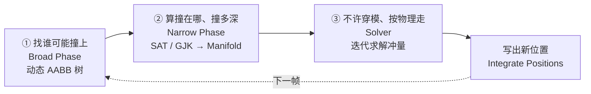
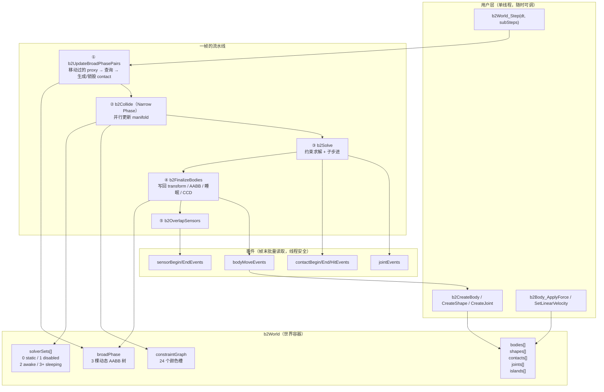

# Box2D v3 源码深度解析（图文版）

> 目标读者：想**真正读懂 Box2D 每一行代码**，并最终**从零写出自己的 2D 物理引擎**的人。
> 代码基线：Box2D v3.2.0（C99，`src/` + `include/box2d/`）。

---

## 一、这套文档怎么读

我按「**先见森林，再见树木，最后自己种树**」的顺序组织：

| 序号 | 文件 | 内容 | 对应源码 |
|---|---|---|---|
| 00 | [00-学习路线图](./00-学习路线图.md) | 90 分钟速通路线 + 6 个里程碑练习 | 全部 |
| 01 | [01-整体框架：一座物理工厂](./01-整体框架.md) | World / Body / Shape / Contact / Joint / Island / SolverSet / Graph 的分工 | `physics_world.c`、`body.h`、`shape.h` |
| 02 | [02-物理定律与数值积分](./02-物理定律与数值积分.md) | 牛顿定律、质量惯量、阻尼、显式/半隐式积分、旋转积分 | `solver.c`、`geometry.c`、`math_functions.h` |
| 03 | [03-碰撞检测：从 AABB 到接触点](./03-碰撞检测.md) | 动态 AABB 树、SAT、边裁剪、GJK、ShapeCast、TOI、CCD、接触点复用 | `broad_phase.c`、`dynamic_tree.c`、`manifold.c`、`distance.c` |
| 04 | [04-约束：物理引擎的灵魂](./04-约束与求解器.md) | 软约束数学、接触约束、摩擦/恢复/滚动阻力、9 种关节、图着色并行 | `contact_solver.c`、`*_joint.c`、`constraint_graph.c` |
| 05 | [05-从零打造 2D 物理引擎](./05-从零打造2D物理引擎.md) | 可执行的 7 步实现指南 + 最小可运行骨架 + 调优清单 | 自己写 |

**建议读法**：第一次按顺序读完 01→05（只看图 + 小标题，忽略推导）；第二遍带上源码，按每章末尾的「源码索引」逐个函数对照。

---

## 二、30 秒版本：Box2D 到底在干什么

一帧（一个 `b2World_Step`）里，Box2D 只做三件事：



用一句话概括核心思想：

> **Box2D 不求解"力"，它求解"冲量"。**
> 每一帧它问的是：*为了让所有接触点的相对法向速度不小于 0（也就是不继续穿进去），需要往每个接触点打多大的冲量？*
> 这是一个带不等式约束的线性互补问题（LCP），Box2D 用 **顺序冲量法（Sequential Impulses, SI）** 迭代逼近。

---

## 三、最容易劝退的 5 个概念，先给你直觉

### 1. 为什么是"冲量"不是"力"？

因为碰撞是**瞬时的**。两个箱子撞在一起，互相作用的时间极短、力极大，用 `F = m·a` 去积分会爆炸。
改用动量定理：`Δv = P / m`。冲量 `P` 是"一脚踹过去的动量"，单位是 `N·s`。
Box2D 的所有约束（接触、关节、马达、限制）最终都被翻译成"**往某个方向踹一脚，踹多大**"。

### 2. 为什么一个物体要拆成 `b2Body` / `b2BodySim` / `b2BodyState` 三个结构？

这是**冷热数据分离**（Data-Oriented Design）：

```
b2Body        = 冷数据，用户 API 用，含 userData / 名字 / 链表头 / id  → 一年改不了几次
b2BodySim     = 温数据，每帧读写：transform / force / invMass        → 每帧一次
b2BodyState   = 热数据，32 字节，求解器每子步读写 N 次：v, w, Δx, Δq  → 每秒几千次
```

`b2BodyState` 故意做成 **32 字节**，就是为了能被 SIMD 一次性 gather/scatter。
详见 [01-整体框架](./01-整体框架.md#三一个刚体被拆成了三份)。

### 3. 什么是"推测性接触"（Speculative Contact）？

普通引擎：等**穿进去了**再推开 → 抖动。
Box2D：在还差 **2cm**（`B2_SPECULATIVE_DISTANCE = 4 × B2_LINEAR_SLOP`）没碰上时，就先建一个接触点，然后约束"你这一帧结束时的距离 ≥ 0"。

```
  普通接触                      推测性接触
  ┌──┐                         ┌──┐
  │A │                         │A │ ← 距离 1.5cm，还没碰上
  └──┘                         └──┘
   ┬                            ┬
  ┌┴─┐  ← 已经重叠 0.5cm        ┌─┐
  │B │     推开 → 抖            │B│  约束：v·n ≤ s/h → 刚好停住，不抖
  └──┘                          └─┘
```

这是"不抖"的关键，也是 Box2D  manifold 的 `separation` 可以为**正数**的原因。

### 4. 约束图着色（Graph Coloring）是什么鬼？

要并行求解约束，但两个共享同一个刚体的约束不能同时写它的速度。
于是给约束"染色"：**同色约束绝不共享刚体** → 同色可以放心并行。

```
颜色0: [A—B]  [C—D]  [E—F]   ← 三条约束互不共享刚体，3 个线程同时算
颜色1: [B—C]  [D—E]          ← 同理
颜色2: [A—E]
溢出:  [X—Y1][X—Y2][X—Y3]... ← X 被太多约束共享，染不上色，单线程兜底
```
详见 [04-约束与求解器](./04-约束与求解器.md#八并行图着色)。

### 5. 子步进（Sub-stepping）为什么这么强？

一个 `b2World_Step(dt, 4)` 里，Box2D 内部跑 **4 个小步**，每小步 `h = dt/4`，每小步都执行：
`积分速度 → 热启动 → 求解 → 积分位置 → 松弛`。

这比"1 大步 + 8 次迭代"质量高得多：位置误差在**每个小步内**就被修正，不会积累一大坨再靠"位置修正"硬掰回来。
代价是 4 倍的约束准备/求解开销，但 SIMD + 图着色让这个代价变得可以接受。

---

## 四、全局数据流总览（先看这张图，再往下读）



---

## 五、关键常量速查表（`include/box2d/constants.h`）

这些数字是引擎的"手性"，改错一个就能让整个世界崩塌：

| 常量 | 值 | 含义 | 改了会怎样 |
|---|---|---|---|
| `B2_LINEAR_SLOP` | 0.005 m | 线性容差（0.5cm）。允许的穿透量 | 稳定性天差地别 |
| `B2_SPECULATIVE_DISTANCE` | 4×slop = 0.02 m | 推测距离（2cm） | 太小→抖；太大→性能差、物体"悬空" |
| `B2_MAX_AABB_MARGIN` | 0.05 m | AABB 胖边余量（迟滞，避免频繁重建树） | 性能 |
| `B2_AABB_MARGIN_FRACTION` | 0.125 | 小物体的 margin 上限 = 0.125 × maxExtent | 小物体性能 |
| `B2_MAX_ROTATION` | 0.25π rad/step | 单帧最大转角 | 超过 0.5π 会破坏 CCD |
| `B2_GRAPH_COLOR_COUNT` | 24 | 约束图颜色数（最后一个是溢出槽） | 并行度 |
| `B2_TIME_TO_SLEEP` | 0.5 s | 静止多久后睡眠 | 性能/误判 |
| `B2_CONTACT_RECYCLE_DISTANCE` | 10×slop = 0.05 m | 接触复用距离 | 性能 |
| `B2_CONTACT_RECYCLE_COS_ANGLE` | 0.98 (≈11.5°) | 接触复用角度阈值 | 性能 |
| `B2_MAX_POLYGON_VERTICES` | 8 | 凸多边形最大顶点数 | 改大→整体变慢 |

世界默认值（`src/types.c: b2DefaultWorldDef`）：

```c
gravity              = (0, -10) m/s²
restitutionThreshold = 1.0  m/s    // 低于此速度不弹
hitEventThreshold    = 1.0  m/s    // 高于此速度发 hit 事件
contactHertz         = 30.0 Hz     // 重叠恢复频率
contactDampingRatio  = 10.0        // 恢复阻尼比（>1 过阻尼，很稳）
contactSpeed         = 3.0  m/s    // 重叠恢复速度上限
maximumLinearSpeed   = 400 m/s     // 比音速还快
```

> **有趣**：`contactDampingRatio = 10` 是**严重过阻尼**。这是刻意的——宁可慢一点推开，也不要弹起来。

---

## 六、源码地图：70 个文件，其实只有 6 类

```
src/
├── 【世界与主循环】
│   ├── physics_world.c / .h   ★★★ b2World_Step 主流程（3704 行）
│   └── solver.c / .h          ★★★ 并行调度器 + 积分 + CCD（2058 行）
│
├── 【对象模型】
│   ├── body.c / body.h        刚体（b2Body / b2BodySim / b2BodyState）
│   ├── shape.c / shape.h      形状与质量属性
│   ├── contact.c / .h         接触（冷/热分离）
│   ├── joint.c / .h           关节基类与分发
│   └── sensor.c / .h          传感器
│
├── 【碰撞检测】
│   ├── broad_phase.c / .h     ★★ 三棵 AABB 树 + 配对
│   ├── dynamic_tree.c         ★★ 动态 AABB 树（插入/删除/旋转/重建/查询）
│   ├── manifold.c             ★★★ 所有形状对的 narrow phase（1641 行）
│   ├── distance.c             ★★ GJK 距离 / ShapeCast / TOI（1441 行）
│   ├── geometry.c             多边形/圆/胶囊几何 + 质量计算
│   └── hull.c                 凸包（Andrew's monotone chain）
│
├── 【约束求解】
│   ├── contact_solver.c / .h  ★★★ 接触约束（标量 + SIMD 宽版本）
│   ├── constraint_graph.c/.h  ★★ 图着色
│   ├── revolute_joint.c       旋转铰  ┐
│   ├── distance_joint.c       距离约束│
│   ├── prismatic_joint.c      棱柱   │ 9 种关节，
│   ├── wheel_joint.c          轮子   │ 每种都是同一套
│   ├── weld_joint.c           焊接   │ prepare/warmStart/solve 三板斧
│   ├── motor_joint.c          马达   │
│   ├── mover_joint.c          角色移动│
│   └── pogo_joint.c           弹簧腿 ┘
│
├── 【调度与内存】
│   ├── island.c / .h          ★★ 岛屿（仅用于睡眠）
│   ├── solver_set.c / .h      ★ 求解集（static/awake/disabled/sleeping）
│   ├── scheduler.c            内部线程池
│   ├── parallel_for.c         并行 for
│   └── arena_allocator.c      栈式分配器（每帧 O(1) 回收）
│
└── 【工具】
    ├── math_functions.c / .h  向量、旋转、b2MakeSoft 等
    ├── aabb.c / .h            AABB
    ├── bitset.c / .h          位集（图着色、事件收集）
    ├── table.c / .h           哈希表（配对去重）
    └── id_pool.c / .h         ID 分配（含 generation 防悬挂）
```

> 打 ★★★ 的 6 个文件吃透了，Box2D 就吃透了 80%。

---

## 七、一句话总结每一章

1. **[整体框架](./01-整体框架.md)** — Box2D 是一座**流水线工厂**：世界是厂房，刚体是工件，求解集是传送带，约束图是工位，岛屿是"这批活干完了可以下班"。
2. **[物理定律](./02-物理定律与数值积分.md)** — 只用了**牛顿第二定律 + 动量定理 + 库仑摩擦 + 恢复系数**，剩下的全是数值技巧（Pade 阻尼、半隐式欧拉、增量旋转）。
3. **[碰撞检测](./03-碰撞检测.md)** — 三级漏斗：**胖 AABB 树 → SAT/GJK → 边裁剪出 1~2 个接触点**，再用**推测距离**提前介入、用**接触复用**跳过重复计算。
4. **[约束求解](./04-约束与求解器.md)** — 一切约束统一成 `J·v + bias = 0`，用**软约束**（弹簧-阻尼的频率/阻尼比参数化）加 bias，用**顺序冲量**迭代，用**热启动**加速收敛。
5. **[从零实现](./05-从零打造2D物理引擎.md)** — 7 个里程碑，从"两个圆对撞"到"多线程软约束引擎"，每步都有可运行的最小代码。

---

开始阅读 → [00-学习路线图](./00-学习路线图.md)
