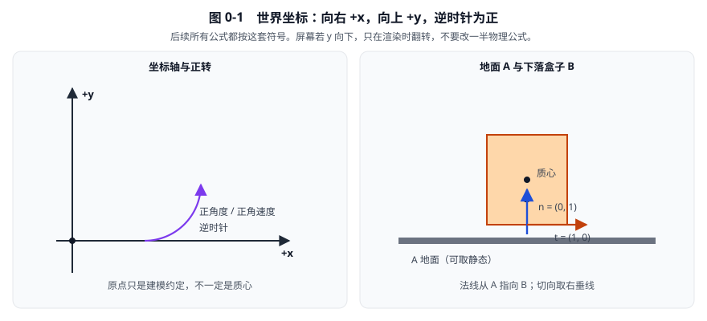
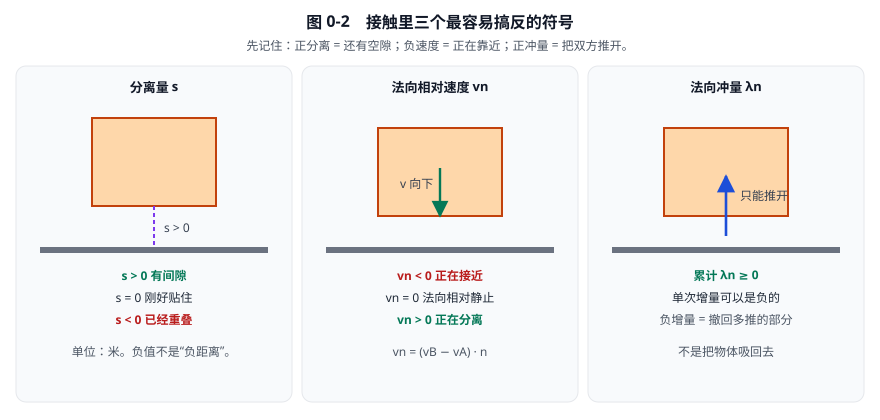

# 00 · 约定与学习路线：先知道自己正在计算什么

[返回总目录](./README.md)

> 本章目标：建立后续公式共用的词汇、单位和正负号。
> 不要求先懂矩阵、微积分或 SIMD；这些内容会在真正需要时展开。

## 1. 一次物理模拟究竟要回答哪些问题

假设把一个盒子放到地面上方。要得到下一时刻的状态，至少要回答：

1. **盒子是什么？** 形状、质量、质心、转动惯量。
2. **现在怎样运动？** 质心位置、朝向、线速度、角速度。
3. **外界怎样影响它？** 重力、用户施力、阻尼。
4. **会在哪里碰到地面？** 接触法线、接触锚点、表面分离量。
5. **接触允许怎样运动？** 可以离开地面，不可以继续穿进去。
6. **怎样修改速度才能近似满足这个条件？** 计算并施加约束冲量。
7. **速度决定怎样的位置变化？** 数值积分。
8. **哪些数据下次还能用？** 接触 ID、冲量缓存、几何缓存。

动态树、SIMD、图着色都不是这八个问题的物理答案。它们解决的是：当物体多时，如何更便宜地完成这些工作。

因此，本书先讲答案，再讲怎样减少计算。

## 2. 四层内容，不能混在一起

| 层次 | 回答的问题 | 典型例子 | 怎么验证 |
|---|---|---|---|
| 物理定律 | 连续世界中什么关系成立 | 动量定理、角动量定理 | 单位、守恒、物理前提 |
| 物理模型 | 用什么近似真实物体 | 刚体、库仑摩擦、恢复系数 | 模型适用范围与实验现象 |
| 数值方法 | 计算机如何用有限步逼近 | 半隐式欧拉、顺序冲量、软约束 | 收敛、误差、稳定区间 |
| 工程实现 | 如何存储和调度运算 | SolverSet、动态树、SIMD | 输出一致性、耗时、内存 |

例如“盒子稍微陷入地面后被推开”：

- 不穿透是刚体接触模型的目标。
- 用速度 bias 慢慢修复位置误差是数值方法。
- 把这条计算放入四路向量是工程实现。
- 它们都不能解释为自然界真的存在一个名叫 `biasRate` 的物理常数。

### 2.1 本书怎样标识教学简化

如果只研究一次法向碰撞，会明确说明“无摩擦、无外力、无软度、单接触点”。

这样的算例可能一次就满足法向约束。真实盒子存在两个接触点，摩擦又与旋转耦合，解完一条约束可能重新影响另一条。因此不能把单点结论推广为“整个世界一遍求解就精确”。

### 2.2 “源码如此”也不等于“物理只能如此”

本版 Box2D 选择了子步进、接触软度、Relax 和特定 CCD 调度。别的引擎可以采用不同的有效方案。

本书会先给朴素方案，再解释当前源码的选择；不会把某个实现细节包装成唯一正确的物理定律。

## 3. 坐标、方向与时间的统一约定

### 3.1 二维坐标

- 世界坐标：向右为正 x，向上为正 y。
- 逆时针旋转为正角度、正角速度。
- 屏幕坐标若 y 向下，在渲染时转换；不要因此只修改物理公式的一半符号。
- 接触法线 \(n\) 从 A 指向 B，并且是单位向量。
- 接触切向采用右垂线，与当前接触求解器一致。

**例：** 地面是 A，盒子是 B。朝向盒子的法线为 \(n=(0,1)\)，切向为 \(t=(1,0)\)。盒子向下运动时，法向相对速度为负。

若交换 A/B，法线也应翻转。保持整套符号一致，物理结果才能不变。

**看图：** 右上为正转。地面是 A、箱子是 B 时，法线竖直向上，切向水平向右。箱子向下掉，相对速度在法线上为负。

### 3.2 大步与子步

本书用：

- \(\Delta t\)：一次公开世界步进的总时间，单位秒。
- \(N\)：本次大步内的子步数，无量纲正整数。
- \(h\)：每个子步的时长，单位秒。

计算为：

\[
h=\frac{\Delta t}{N}.
\]

**作用：** 让若干小次积分总共推进同一段时间。

**代入：** 物理大步为 \(1/60\) 秒，子步数为 4，则：

\[
h=\frac{1/60}{4}=\frac1{240}\text{ s}\approx0.004166667\text{ s}.
\]

四次小步加起来仍是约 0.016666667 秒，不是把模拟速度变成四倍。

子步时长的倒数为：

\[
h^{-1}=240\text{ s}^{-1}.
\]

它用于把位置误差换算成速度，以及把**一个子步的冲量**换算成该子步的等效平均力。若统计的是整个大步的 `totalNormalImpulse`，则应除以 \(\Delta t\)，而不是 \(h\)。例如 4 个子步合计 0.2 N·s、大步 0.02 s，平均力是 10 N；误除以 0.005 s 会得到错误的 40 N。看到 `inv_h`，先想“每秒”，不要只想“一个优化除法的变量”。

对应源码：[`src/physics_world.c`](../src/physics_world.c)，`b2World_Step` 第 956–980 行。

### 3.3 帧、步、迭代不是同义词

- 渲染帧：画面刷新一次。
- 物理大步：调用一次 `b2World_Step`。
- 子步：大步内部真实推进一小段时间。
- 约束迭代：对约束再扫描一遍，未必推进时间。

一帧可以执行零次、一次或多次物理大步。把同一批固定几何约束扫四遍，不等于执行四个包含位置积分的子步。

## 4. 全书最常用的量

| 符号 | 含义 | 默认 SI 单位 | 常见源码名 |
|---|---|---|---|
| \(p\) | 刚体原点位置 | m | `transform.p` |
| \(c\) | 世界质心位置 | m | `center` |
| \(c_l\) | 相对刚体原点的局部质心 | m | `localCenter` |
| \(r\) | 质心到作用点的杆臂 | m | `anchorA`、`anchorB`，注意所在阶段 |
| \(v\) | 质心线速度 | m/s | `linearVelocity` |
| \(\omega\) | 角速度 | rad/s | `angularVelocity` |
| \(m\) | 质量 | kg | `mass` |
| \(I\) | 绕质心的转动惯量 | kg·m² | `inertia`；对其他质量数据还需检查参考点 |
| \(I^{-1}\) | 绕质心的逆转动惯量 | (kg·m²)⁻¹ | `invInertia` |
| \(F\) | 力 | N = kg·m/s² | `force` |
| \(\tau\) | 力矩 | N·m | `torque` |
| \(P\) | 线冲量向量 | N·s | 求解时的临时冲量向量 |
| \(\lambda_n\) | 累计法向冲量标量 | N·s | `normalImpulse` |
| \(\lambda_t\) | 累计切向冲量标量 | N·s | `tangentImpulse` |
| \(s\) | 有符号表面分离 | m | `separation` |
| \(K\) | 线性约束的逆有效质量 | 1/kg | `kNormal` 等局部变量 |
| \(m_{eff}\) | 有效质量 | kg | `normalMass`、`tangentMass` |
| \(b\) | 速度层的偏置项 | m/s | `velocityBias` |
| \(\mu\) | 库仑摩擦系数 | 无量纲 | `friction` |
| \(e\) | 恢复系数 | 无量纲 | `restitution` |
| \(f\) | 频率 | Hz = 1/s | `hertz` |
| \(\zeta\) | 阻尼比 | 无量纲 | `dampingRatio` |

注意三个名字陷阱：

1. 接触 `normalMass` 是有效质量，不是逆有效质量。
2. `b2ManifoldPoint.anchorA` 在求解准备时是世界方向、相对质心的杆臂，不是绝对世界点。
3. 密度、滚动阻力长度系数不要都用一个没有上下文的 \(\rho\)。各章会重新说明；材质滚阻输入与求解器内部乘上形状尺度后的系数也不是同一单位。

角约束的 Jacobian 与线性约束不同，因此其有效质量具有转动惯量的单位，不能直接套上表中的 kg。

## 5. 先用单位判断公式有没有写错

### 5.1 力作用一段时间才形成冲量

对于该时间内恒定的力：

\[
P=Fh.
\]

**变量：** \(F\) 是力，\(h\) 是作用时间，\(P\) 是冲量。

**作用：** 把连续的力作用转换成一步的动量变化。

**代入：** 12 N 的水平力作用 0.01 秒，产生：

\[
P=12\times0.01=0.12\text{ N·s}.
\]

对于 2 kg 的刚体，速度变化为：

\[
\Delta v=P/m=0.12/2=0.06\text{ m/s}.
\]

单位检查：N·s 除以 kg 正好是 m/s。如果把 12 N 直接当成 12 N·s，效果会大 100 倍；这是常见的“每帧施力太猛”错误。

### 5.2 为什么不直接把穿透长度加到速度上

假设误差长度为 0.01 m，希望在 0.02 秒的量级修正它。对应速度尺度是：

\[
u=\frac{0.01}{0.02}=0.5\text{ m/s}.
\]

长度必须除以时间，才能参与速度方程。但“怎样修、修多少、是否封顶”是数值设计，不由单位检查决定。第 11 章会推导软约束，不能看到这个式子就每步强制修完全部穿透。

### 5.3 一个检查有效质量的简单例子

仅考虑两个质点，质量分别为 2 kg 和 3 kg。单位方向冲量同时给 A 减速、给 B 加速，相对速度变化的比例为：

\[
K=1/2+1/3=5/6\text{ kg}^{-1}.
\]

所以：

\[
m_{eff}=1/K=6/5=1.2\text{ kg}.
\]

若需要增加 1 m/s 的相对分离速度，所需冲量是：

\[
\lambda=m_{eff}\times1=1.2\text{ N·s}.
\]

分别检查：A 的速度减少 0.6 m/s，B 的速度增加 0.4 m/s，相对速度总共增加 1 m/s。

这里没有转动；真正刚体还必须加上杆臂和转动惯量，见第 09 章。

## 6. 接触的三个符号要一次记对

### 6.1 分离量

- \(s>0\)：表面之间还有间隙。
- \(s=0\)：理想刚好接触。
- \(s<0\)：几何上已经重叠。

正分离的 manifold 不一定是错误：Box2D 会在一定邻近范围内预先建立推测接触。

### 6.2 法向相对速度

定义为 B 的接触点速度减去 A 的接触点速度，再投影到 A 指向 B 的法线。

因此：

- 负值：正在接近。
- 正值：正在分离。

例：静止地面法线朝上，盒子向下 4 m/s，法向相对速度就是 −4 m/s。

### 6.3 法向冲量

对于无黏附接触，累计法向冲量不能为负：接触只能推开，不能主动把物体吸回去。

但**单次增量可以为负**：它可能只是撤销前面多施加的一部分正冲量。第 10 章用数字解释为什么这不等于吸力。

### 6.4 用一个推测例子统一三个符号

只做一阶分离预测时：

\[
s_{next}\approx s+h v_n.
\]

**前提：** 子步内法线近似固定，运动按当前接触点法向速度线性预测。

**作用：** 判断这一小步是否会把正间隙消耗成穿透。

取 \(s=0.01\) m，\(h=0.01\) s：

- 若 \(v_n=-0.5\) m/s，预测间隙为 0.005 m，不必阻止。
- 若 \(v_n=-2\) m/s，预测间隙为 −0.01 m，需要约束。

不穿透条件可整理为：

\[
v_n+s/h\ge0.
\]

这里 \(s/h=1\) m/s，所以允许的接近速度不小于 −1 m/s。**不是只要有正间隙就把接近速度立刻变成零。**

**看图记三个符号：** 空隙用 \(s\)，靠近用负的 \(v_n\)，接触只能推开。后面 SAT、GJK、冲量公式都沿用这一套。

## 7. 默认尺度与参数：是容差，不是宇宙常数

下表按默认长度单位“1 单位 = 1 米”理解：

| 参数 | 基线值 | 学习时怎样理解 |
|---|---|---|
| `B2_LINEAR_SLOP` | 0.005 m | 数值容差量级，不代表每个位置修正公式都显式减它 |
| `B2_SPECULATIVE_DISTANCE` | 0.02 m | 有限推测接触距离，不是 CCD 的替代品 |
| `B2_CONTACT_RECYCLE_DISTANCE` | 0.05 m | 接触几何回收阈值之一，不是通用穿透许可 |
| `B2_CONTACT_RECYCLE_COS_ANGLE` | 0.98 | 角变化判据，实际还检查其他量 |
| `B2_MAX_AABB_MARGIN` | 0.05 m | 树代理余量上限，小形状还受尺寸比例限制 |
| `B2_TIME_TO_SLEEP` | 0.5 s | 持续满足睡眠判据的时间尺度 |
| `contactHertz` | 30 Hz | 输入接触软度频率，还会按子步长限制 |
| `contactDampingRatio` | 10 | 接触数值恢复采用强阻尼，不等于材质恢复系数 |
| `contactSpeed` | 3 m/s | 重叠修正速度尺度上限 |
| `restitutionThreshold` | 1 m/s | 很慢的接近不触发恢复目标 |

来源：[`include/box2d/constants.h`](../include/box2d/constants.h) 和 [`src/types.c`](../src/types.c) 的 `b2DefaultWorldDef` 第 8–25 行。

长度相关常量很多会乘 `b2GetLengthUnitsPerMeter()`；但不要假设所有输入都自动换算。例如此基线默认重力 y 值在代码中直接写为 −10。自定义单位时，用户仍须一致设置位置、速度、重力和密度等量。

**缩放例：** 若用厘米数值表示长度，1 m 对应 100 个长度单位，则 0.005 m 应表示为 0.5 个单位，0.02 m 表示为 2 个单位。重力 −10 m/s² 则应表示为 −1000 单位/s²，而不是原样 −10。

## 8. 读一段源码时，用六个问题拆开它

以接触准备为例：

1. **输入是什么？** 两个刚体质量、初始杆臂、manifold。
2. **坐标系是什么？** 杆臂的方向在世界坐标，长度相对各自质心。
3. **要输出什么？** 有效质量、基础分离、初始累计冲量。
4. **它改什么？** 准备约束数据，尚未施加接触冲量。
5. **多久执行一次？** 当前大步开始一次，而非每个子步完整重算。
6. **下一阶段怎样消费？** WarmStart 施加缓存，Solve 用有效质量计算新冲量。

遇到 `indexA` 时，先搞清是公开 ID、对象池索引、稠密数组索引，还是求解器的“下标加一”。不分清索引语义，容易把数据搬迁误读为物理变化。

## 9. 练习与答案

### 题 1：一个大步分成 8 个子步，世界是否快了 8 倍？

没有。若大步是 1/60 秒，每个子步是 1/480 秒，总时间仍为 1/60 秒。

### 题 2：盒子离地面 1 cm，接近速度 −0.2 m/s，子步为 1/100 秒，一定需要法向冲量吗？

在线性预测下，下一步间隙为 0.01−0.002=0.008 m，尚未穿透。存在接触记录不代表一定有非零冲量。

### 题 3：静态物体的逆质量为零，是因为浮点数不能表示无穷大吗？

不是。IEEE 浮点支持无穷大。使用零逆质量是为了统一“约束冲量不能改变其运动”的计算，也避免无穷大参与运算的特殊情况。

### 题 4：为什么“法向求解后没有穿透速度”还不能证明整个子步结束也如此？

因为随后另一个接触点、关节或摩擦可能改变同一个刚体的线速度与角速度。要看完整求解顺序和最终残差。

### 题 5：应该先读动态树还是标量接触求解器？

若目标是懂物理，先读标量接触求解器。动态树只筛候选，不决定碰撞冲量。

## 10. 接下来怎样学习

看图时先对符号，再代入该节数字例。总目录第 7 节有全部示意图索引；SAT 在第 06 章，GJK 在第 07 章，冲量在第 09 章。

下一章从二维向量开始，把“投影”和“转动”两件事讲清楚。之后每引入一种计算，都走完整链条：

**这个物理现象 → 需要什么量 → 怎么算这个量 → 数值代入 → 谁读写它 → 当前源码为何多出这些分支。**

[下一章：01 · 二维数学与坐标变换](./01-二维数学与坐标变换.md) · [返回总目录](./README.md)
