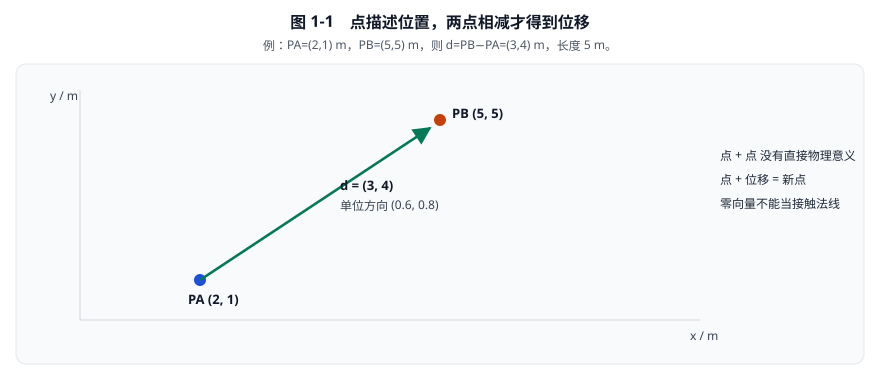
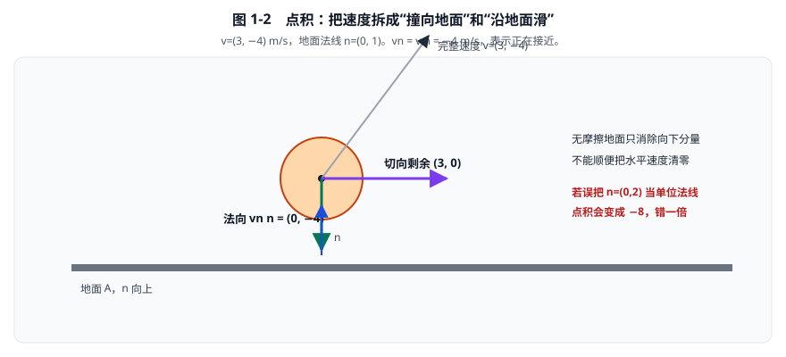
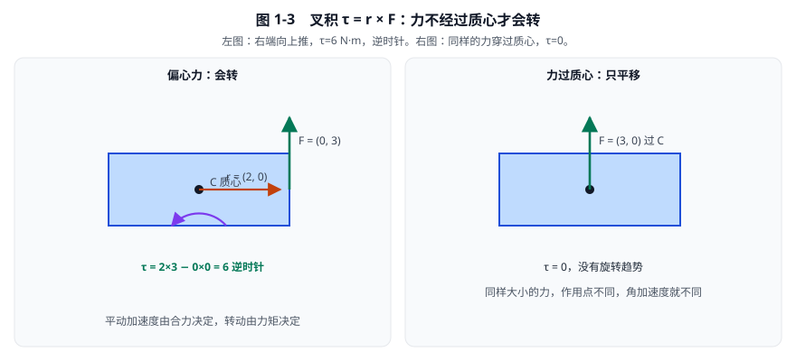
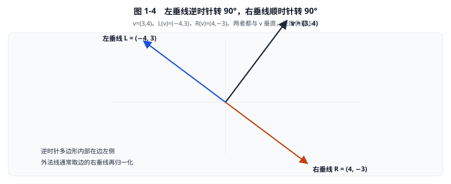
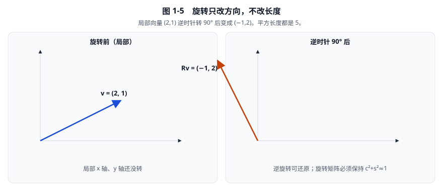
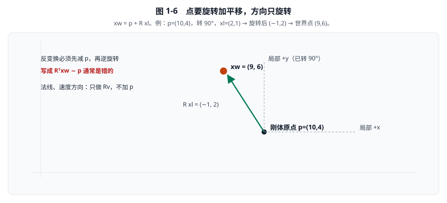
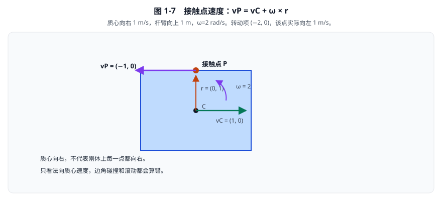

# 01 · 二维数学与坐标变换

[返回总目录](./README.md)

本章先建立能够手算的数学约定，再把每个约定落到当前源码。
后续碰撞、质量、力矩和约束，都只是这些运算的组合。
阅读时不要先背函数名：先问输入是什么、结果是什么、单位是否一致。

## 1. 点、向量和单位不能混为一谈

约定世界坐标向右为 \(+x\)，向上为 \(+y\)，逆时针旋转为正。
屏幕坐标可以向下，但那应是渲染转换，不应在一半物理公式里偷偷改号。
点描述位置，例如 \(P=(3,2)\,\mathrm m\)。
向量描述位移、速度或力，例如 \(d=(1,-2)\,\mathrm m\)。
二者可能都存成两个数，但物理意义不同。
两个点相减得到位移；点加位移得到新点；两个点相加通常没有直接物理意义。

\[
d=P_B-P_A=(x_B-x_A,y_B-y_A).
\]

若 \(P_A=(2,1)\)，\(P_B=(5,5)\)，则 \(d=(3,4)\,\mathrm m\)。
\(d\) 从 A 指向 B；颠倒减法得到 \(-d\)。
长度使用勾股定理：

\[
\lVert d\rVert=\sqrt{d_x^2+d_y^2}=\sqrt{9+16}=5\,\mathrm m.
\]

单位方向向量是：

\[
\hat d=\frac d{\lVert d\rVert}=(0.6,0.8).
\]

分子分母都有米，因此单位向量无量纲。
不要对零向量直接除以长度：\(0/0\) 不代表任意方向，而是未定义。
源码 `b2GetLengthAndNormalize` 会把极小向量的长度和方向都返回零。
这是数值防护，不是说零向量具有有效接触法线。
教学碰撞器遇到完全同心的圆，必须另外制定确定性备用方向或拒绝这种初始状态。
定位：[数学头文件](../include/box2d/math_functions.h)，`b2GetLengthAndNormalize`，361–374 行。



**看图：** \(P_A\) 到 \(P_B\) 的箭头才是向量。长度 5 m，单位方向 \((0.6,0.8)\) 没有单位。零长度没有方向，不能拿来当接触法线。

## 2. 点积：把一个运动投影到某个方向

定义：

\[
a\cdot b=a_xb_x+a_yb_y=\lVert a\rVert\lVert b\rVert\cos\theta.
\]

\(a,b\) 为同一坐标系中的向量；\(\theta\) 为二者夹角。
若 \(b=n\) 是单位法线，那么 \(a\cdot n\) 就是 \(a\) 沿法线的有符号分量。
正号表示同向，负号表示反向，零表示垂直。
点积结果的单位是两输入单位相乘。
速度与无量纲法线点积得到 \(\mathrm{m/s}\)；力与位移点积得到 \(\mathrm{N\cdot m}\)。

例如物体速度 \(v=(3,-4)\,\mathrm{m/s}\)，地面向上法线 \(n=(0,1)\)：

\[
v_n=v\cdot n=3\times0+(-4)\times1=-4\,\mathrm{m/s}.
\]

负号表示向地面运动，不是“速度长度为负”。
沿法线的速度向量为 \(v_n n=(0,-4)\)。
切向剩余速度为 \(v-v_n n=(3,0)\)。
因此无摩擦地面冲量应消除向下分量，而不能顺便把水平速度清零。



**看图：** 绿色箭头是“正在撞地”，紫色箭头是“沿地面滑”。无摩擦只处理绿色那一段。

### 2.1 为什么必须保证法线单位长度

如果误把 \(n=(0,2)\) 当单位法线，点积得到 \(-8\)，不是实际法向速度。
再次乘 \(n\) 得 \((0,-16)\)，误差进一步放大。
非单位向量上的正确投影为：

\[
\operatorname{proj}_b(a)=\frac{a\cdot b}{b\cdot b}b.
\]

分母不能省略，除非已知 \(b\cdot b=1\)。
求解器通常事先保存单位法线，避免每次求解再除一次。
这里的优化依赖前置不变量，不是任意删掉除法。
定位：[数学头文件](../include/box2d/math_functions.h)，`b2Dot`，204–207 行。

## 3. 叉积：二维中的有向面积和旋转趋势

把二维向量看成三维中的 \((a_x,a_y,0)\)。
三维叉积只有 z 分量不为零，因而二维可只保存这个标量：

\[
a\times b=a_xb_y-a_yb_x.
\]

从 \(a\) 转向 \(b\) 的较小有向角为逆时针时，通常得到正值。
例如 \((1,0)\times(0,1)=1\)，与逆时针为正的约定一致。
交换顺序会变号：\(b\times a=-(a\times b)\)。
若两向量共线，叉积为零；这既可能同向，也可能反向。

### 3.1 为什么叉积能算面积

以 \(a\) 为底的平行四边形高度为 \(\lVert b\rVert\sin\theta\)。
因此有向面积为：

\[
A_{\rm para}=\lVert a\rVert\lVert b\rVert\sin\theta=a\times b.
\]

三角形面积是它的一半。
取 \(a=(2,0)\,\mathrm m\)，\(b=(0,3)\,\mathrm m\)，得到 \(a\times b=6\,\mathrm{m^2}\)。
三角形面积为 \(3\,\mathrm{m^2}\)。
逆时针顶点顺序使这套面积求和为正。
顺时针顺序会给出负的有向面积，不能靠盲目对每一项取绝对值修复任意非法多边形。
后者可能掩盖自交、错误拓扑和错误三角剖分。

### 3.2 为什么叉积能算力矩

\[
\tau=r\times F=r_xF_y-r_yF_x.
\]

\(r\) 是从质心指向受力点的位移，单位米。
\(F\) 是力，单位牛顿；\(\tau\) 单位 \(\mathrm{N\cdot m}\)。
\(r=(2,0)\)，\(F=(0,3)\) 时，\(\tau=6\)：向右端施加向上的力，使物体逆时针转。
若 \(F=(3,0)\)，则 \(\tau=0\)：力的作用线穿过质心，没有旋转趋势。
同样大小的力，作用点不同，平动加速度相同，角加速度可能不同。
定位：[数学头文件](../include/box2d/math_functions.h)，`b2Cross`，210–213 行。



**看图：** 左图右端向上推，物体逆时针转；右图力穿过质心，只平移。这就是后面“边角碰撞会转、正撞不转”的几何原因。

## 4. 左垂线、右垂线，以及标量叉积的顺序

向量逆时针转 \(90^\circ\) 得左垂线：

\[
L(v)=(-v_y,v_x).
\]

顺时针转 \(90^\circ\) 得右垂线：

\[
R(v)=(v_y,-v_x).
\]

取 \(v=(3,4)\)，得到 \(L(v)=(-4,3)\)、\(R(v)=(4,-3)\)。
检查垂直性：\(v\cdot L(v)=3(-4)+4(3)=0\)。
检查长度：两个垂线都长 5，不会自动成为单位向量。
逆时针多边形的内部位于有向边左侧，因此外法线通常取边的右垂线再归一化。



**看图：** SAT 里多边形外法线就是边向量的右垂线。方向反了，分离量符号会整章跟着错。

标量 \(s\) 可视为三维 z 分量，则：

\[
s\times v=(-sv_y,sv_x)=sL(v),
\qquad
v\times s=(sv_y,-sv_x)=sR(v).
\]

两者互为相反数，不能只看“输入一个数和一个向量”就混用。
源码 `b2CrossSV` 是标量在前；`b2CrossVS` 是向量在前。

```216:225:include/box2d/math_functions.h
B2_INLINE b2Vec2 b2CrossVS( b2Vec2 v, float s )
{
	return B2_LITERAL( b2Vec2 ){ s * v.y, -s * v.x };
}

/// Perform the cross product on a scalar and a vector. In 2D this produces a vector.
B2_INLINE b2Vec2 b2CrossSV( float s, b2Vec2 v )
{
	return B2_LITERAL( b2Vec2 ){ -s * v.y, s * v.x };
}
```

定位：[数学头文件](../include/box2d/math_functions.h)，`b2CrossVS` / `b2CrossSV` / `b2LeftPerp` / `b2RightPerp`，216–237 行。

## 5. 旋转矩阵不是需要背诵的魔法

局部 x 轴 \((1,0)\) 旋转 \(\theta\) 后变为 \((\cos\theta,\sin\theta)\)。
局部 y 轴 \((0,1)\) 同时变为 \((-\sin\theta,\cos\theta)\)。
任意向量等于 \(v_x\) 倍 x 轴加 \(v_y\) 倍 y 轴。
把两个旋转后的轴按同样系数组合，即得：

\[
Rv=
\begin{pmatrix}
\cos\theta&-\sin\theta\\
\sin\theta&\cos\theta
\end{pmatrix}
\begin{pmatrix}v_x\\v_y\end{pmatrix}
=
\begin{pmatrix}cv_x-sv_y\\sv_x+cv_y\end{pmatrix}.
\]

这里 \(c=\cos\theta\)、\(s=\sin\theta\)，均无量纲。
旋转不应改变向量的长度和单位。
取 \(\theta=90^\circ\)，\((c,s)=(0,1)\)，\(v=(2,1)\) 变成 \((-1,2)\)。
平方长度从 \(2^2+1^2=5\) 变为 \((-1)^2+2^2=5\)。

因为旋转矩阵正交，逆矩阵等于转置：

\[
R^{-1}v=R^Tv=(cv_x+sv_y,-sv_x+cv_y).
\]

把 \((-1,2)\) 逆旋转 \(90^\circ\)，得到 \((2,1)\)，可作为实现单元测试。



源码用 `b2Rot` 保存 \((c,s)\)，而不是每次从角度计算三角函数。
但它依赖 \(c^2+s^2\approx1\)；若不归一化，变换会混入缩放。
定位：[数学头文件](../include/box2d/math_functions.h)，`b2Rot`，37–41 行；`b2RotateVector` / `b2InvRotateVector`，558–567 行。

## 6. 点变换要平移，方向变换不要平移

设刚体原点世界位置为 \(p\)，局部点为 \(x_l\)，姿态为 \(R\)。
先旋转局部位移，再放到原点：

\[
x_w=p+Rx_l.
\]

反变换必须先减原点，再逆旋转：

\[
x_l=R^T(x_w-p).
\]

例：\(p=(10,4)\)，\(R\) 为 \(90^\circ\)，\(x_l=(2,1)\)。
旋转结果 \((-1,2)\)，所以 \(x_w=(9,6)\)。
反算先得 \((9,6)-(10,4)=(-1,2)\)，再逆旋转得 \((2,1)\)。
如果逆变换写成 \(R^Tx_w-p\)，通常是错的，因为 \(p\) 也需要处在相同旋转关系中。
对局部速度方向或法线，只做 \(v_w=Rv_l\)，不能加位置 \(p\)。
定位：[数学头文件](../include/box2d/math_functions.h)，`b2TransformPoint` / `b2InvTransformPoint`，570–584 行。



**看图：** 橙色点是世界位置。法线这种“方向”只跟着旋转走，不要再加上 \(p\)。

### 6.1 两个变换如何合成

B 的局部点先进入 A，再进入世界：

\[
x_w=p_A+R_A(p_B+R_Bx_B)
=(p_A+R_Ap_B)+(R_AR_B)x_B.
\]

因此复合位置是 \(p_A+R_Ap_B\)，不是简单的 \(p_A+p_B\)。
复合旋转是 \(R_AR_B\)。

接下来改变已知量的定义：**假设 A、B 的变换都相对于世界**。此处 \(p_B,R_B\) 不再是上式的 B→A 局部变换，而是 B→世界变换。若要把 B 的点直接表达在 A 坐标中：

\[
x_A=R_A^T(p_B-p_A)+R_A^TR_Bx_B.
\]

这正是相对变换，碰撞检测常用它把两个形状放到一个近处坐标系。
定位：[数学头文件](../include/box2d/math_functions.h)，`b2MulTransforms` / `b2InvMulTransforms`，591–608 行。

## 7. 刚体原点不一定是质心

原点是建模约定；质心由质量分布决定。
设局部质心为 \(c_l\)，世界质心为 \(c_w\)，刚体原点世界位置为 \(p\)：

\[
c_w=p+Rc_l,
\qquad
p=c_w-Rc_l.
\]

动力学积分通常推进质心，而绘制、局部形状变换需要刚体原点。
二者相等仅在 \(c_l=(0,0)\) 时成立。
例：\(c_w=(10,4)\)，\(c_l=(2,0)\)，姿态 \(90^\circ\)。
旋转后的局部质心偏移为 \((0,2)\)，故原点 \(p=(10,2)\)。
若错误把原点直接设为质心，整个形状会平移错 2 米。

当前实现的落点：

```604:605:src/solver.c
		sim->center = b2OffsetPos( sim->center, state->deltaPosition );
		sim->transform.q = b2NormalizeRot( b2MulRot( state->deltaRotation, sim->transform.q ) );
```

随后 `b2FinalizeBodiesTask` 在 621 行用质心减去旋转后的 `localCenter`，重建 `transform.p`。
定位：[求解器](../src/solver.c)，`b2FinalizeBodiesTask`，604–621 行。

### 7.1 接触点速度为什么多一项

刚体上相对质心的世界位移为 \(r\)。
质心速度为 \(v_C\)，角速度为 \(\omega\)，单位 \(\mathrm{rad/s}\)。
刚体点的速度：

\[
v_P=v_C+\omega\times r=v_C+(-\omega r_y,\omega r_x).
\]

这里的 \(\times\) 是标量叉向量：\(\omega\) 是标量而不是平面向量，结果仍是向量，不是第 3 节向量叉乘得到的标量；原因见 7.2。
原因是 \(r=Rr_l\)，对时间求导得到 \(\dot r=\omega\times r\)。
角度的弧度在量纲上视为无量纲，因此 \(\omega r\) 单位是米每秒。
例：\(v_C=(1,0)\)，\(r=(0,1)\)，\(\omega=2\)。
转动部分为 \((-2,0)\)，故该点速度是 \((-1,0)\)。
质心向右运动，不代表刚体上每一点都向右运动。
接触求解若只看质心速度，就无法正确处理滚动和偏心碰撞。
定位：[接触求解器](../src/contact_solver.c)，`b2SolveContacts_Overflow`，296–299 行。



**看图：** 转动项 \(\omega\times r\) 把顶边点的速度拧向左边。第 09 章的接触速度就是这个公式。

### 7.2 为什么 \(\omega\times r\) 是向量，不是标量

第 3 节的 \(a\times b\) 得标量，这里却得向量，差别在操作数类型而不在符号本身。
二维的“×”有三种用法，结果类型由谁在平面内、谁在平面外决定：

| 写法 | 操作数 | 二维结果 | 典型单位 | 源码 |
|---|---|---|---|---|
| \(a\times b=a_xb_y-a_yb_x\) | 向量 × 向量 | 标量 | \(\mathrm{m^2}\)、\(\mathrm{N\cdot m}\) | `b2Cross` |
| \(\omega\times r=(-\omega r_y,\omega r_x)\) | 标量 × 向量 | 向量 | \(\mathrm{m/s}\) | `b2CrossSV` |
| \(r\times\omega=(\omega r_y,-\omega r_x)\) | 向量 × 标量 | 向量，与上一行反号 | \(\mathrm{m/s}\) | `b2CrossVS` |

补成三维 \((x,y,0)\) 最清楚。
角速度是三维向量 \((0,0,\omega)\) 的 z 分量，与 \(r=(r_x,r_y,0)\) 叉乘：

\[
(0,0,\omega)\times(r_x,r_y,0)=(-\omega r_y,\ \omega r_x,\ 0).
\]

z 分量恰好为零，剩下的就是二维保留的向量。
而两个平面向量叉乘：

\[
(a_x,a_y,0)\times(b_x,b_y,0)=(0,\ 0,\ a_xb_y-a_yb_x),
\]

只有 z 分量非零，于是缩成一个标量。
两个平面向量叉乘，结果被挤到 z 轴上；角速度本来就在 z 轴上，叉乘后 z 分量为零，结果留在平面内。

量纲也要求它是向量：\(\omega\) 为 \(\mathrm{rad/s}\)（弧度视为无量纲），\(r\) 为 \(\mathrm m\)，乘积为 \(\mathrm{m/s}\)，正好与 \(v_C\) 相加。
标量（如 \(\mathrm{m^2}\)）既没有方向，也不能与速度相加。

几何上 \(\omega\times r=\omega L(r)\)：把 \(r\) 逆时针转 \(90^\circ\) 再乘 \(|\omega|\)。
结果垂直于 \(r\)，沿该点绕质心转动的切线方向；\(\omega>0\) 时指向逆时针一侧。
它与 \(v_C\) 的性质不同：某一瞬间 \(v_C\) 与 \(\omega\) 对整块刚体是同一个值，而 \(r\) 取决于“问的是哪个点”，所以 \(\omega\times r\) 逐点变化，不是常量。
同一刚体上 \(r=(0,1)\) 与 \(r=(0,-1)\) 两点，转动项分别是 \((-\omega,0)\) 与 \((\omega,0)\)，大小相同、方向相反。
对确定点、确定瞬间，它是确定的向量；随点、随时间变化的是它的值，不是运算规则。

同一函数里两种叉积同时出现，返回类型就是最直接的判据：

```123:126:src/contact_solver.c
			float rnA = b2Cross( rA, normal );
			float rnB = b2Cross( rB, normal );
			float kNormal = mA + mB + iA * rnA * rnA + iB * rnB * rnB;
			cp->normalMass = kNormal > 0.0f ? 1.0f / kNormal : 0.0f;
```

```296:299:src/contact_solver.c
			// relative normal velocity at contact
			b2Vec2 vrA = b2Add( vA, b2CrossSV( wA, rA ) );
			b2Vec2 vrB = b2Add( vB, b2CrossSV( wB, rB ) );
			float vn = b2Dot( b2Sub( vrB, vrA ), normal );
```

`rA` 与 `normal` 都是平面向量，叉乘得 `float`，用于有效质量；
`wA` 是标量，与 `rA` 叉乘得 `b2Vec2`，用于接触点速度。
第 4 节已说明 \(s\times v\) 与 \(v\times s\) 反号：这里必须用标量在前的 `b2CrossSV`，若写成 `b2CrossVS( rA, wA )`，转动项整体反号。
第 09 章的恒等式 \(\mathbf n\cdot(\omega\times\mathbf r)=\omega(\mathbf r\times\mathbf n)\) 是这两种叉积的接口：左边先做标量叉向量得到向量、再与 \(\mathbf n\) 点积，右边直接做向量叉乘得到标量。

## 8. 先做朴素版，再处理大世界误差

教学初版可直接存世界位置和局部顶点，按前面的公式变换。
等出现“移到远处就抖动”时，再理解为什么改坐标表示。
单精度浮点数的有效二进制位有限，绝对值越大，相邻可表示数间距越大。
在 \(10^8\) 附近，float 的相邻数间距约为 8。
所以 \(100000000.00\) 与 \(100000000.25\) 先各自转成 float 后，很可能完全相等。
再相减时，原先 0.25 米的间距已经丢失，任何算法都无法从零恢复它。

正确策略之一是：世界位置用 double；先在 double 中相减；小差值再转 float。

\[
\operatorname{float}(100000000.25-100000000.00)=0.25.
\]

这不同于先转换两个绝对位置再相减。
本版 `BOX2D_DOUBLE_PRECISION` 开启时，`b2Pos` 的平移为 double；旋转、向量、求解仍主要为 float。
关闭时 `b2Pos` 是 `b2Vec2` 的别名，因此不能笼统说“本版全是双精度”。
该构建选项默认关闭，见 [构建配置](../CMakeLists.txt) 第67行。

```649:652:include/box2d/math_functions.h
B2_INLINE b2Vec2 b2SubPos( b2Pos a, b2Pos b )
{
	return B2_LITERAL( b2Vec2 ){ (float)( a.x - b.x ), (float)( a.y - b.y ) };
}
```

定位：[数学头文件](../include/box2d/math_functions.h)，类型定义50–70行；`b2SubPos` 649–652行；`b2InvMulWorldTransforms` 683–689行。

### 8.1 小增量是第二层保护，不是双精度的替代品

每个大步开始时设置 \(\Delta p=(0,0)\)，\(\Delta q=(1,0)\)。
子步中累加本大步的位移和旋转，最后一次写回世界位置。
小增量参与接触间距计算，可避免每次子步都对很大的绝对位置反复加减。
`b2BodyState` 专门保存这两项，见 [刚体内部结构](../src/body.h)，153–169行。
此外，多边形碰撞先把 B 变到 A 的坐标，并把 A 的第一个顶点附近作为局部原点。
定位：[流形生成](../src/manifold.c)，`b2CollidePolygons`，704–730行。

但局部偏移本身若很大，float 仍可能失精度。
相对坐标不是无限世界、任意大小物体、任意尺度混用的万能保证。
优化的目标是把高频计算的数值尽可能限制在物体尺度附近。

## 9. 手算题与验收

### 题一：点积与叉积

给定 \(a=(3,4)\)、\(b=(4,-3)\)，求点积、叉积和夹角性质。
答案：\(a\cdot b=12-12=0\)；\(a\times b=-9-16=-25\)。
它们垂直，b 是 a 的右垂线；叉积负号符合顺时针方向。

### 题二：原点和质心

局部质心 \((1,0)\)，世界质心 \((3,5)\)，姿态 \(90^\circ\)，求刚体原点。
答案：旋转偏移 \((0,1)\)，原点 \((3,4)\)。
若局部点为 \((2,0)\)，其世界坐标为 \((3,6)\)。

### 题三：点速度

\(v_C=(2,1)\,\mathrm{m/s}\)，\(\omega=-3\,\mathrm{rad/s}\)，\(r=(2,0)\,\mathrm m\)。
答案：\(\omega\times r=(0,-6)\)，所以 \(v_P=(2,-5)\,\mathrm{m/s}\)。
负角速度表示顺时针，右侧点向下运动，符合直观。

### 题四：辨认叉积的结果类型

\(\omega=2\,\mathrm{rad/s}\)，\(r=(3,0)\,\mathrm m\)，\(F=(0,5)\,\mathrm N\)。
\(r\times F\) 与 \(\omega\times r\) 各是什么类型、什么值、什么单位？
答案：\(r\times F=15\,\mathrm{N\cdot m}\) 是标量（力矩）；\(\omega\times r=(0,6)\,\mathrm{m/s}\) 是向量（点速度）。
若误写成 \(r\times\omega=(0,-6)\)，符号相反：标量在前的顺序不能换。

### 代码验收条件

- 非零向量归一化后平方长度接近1。
- 左右垂线与原向量点积接近0，且长度保持。
- 正变换后再逆变换，应在容差内恢复原点。
- 旋转应保持长度和点积。
- 平移世界中所有刚体，不应改变相对位移、碰撞法线和内部动力学。
- 完全同心、极小向量和非法旋转必须有明确策略，不能让 NaN 继续传播。

下一章先弄清转动惯量是什么、平方从哪来；随后第02章用积分算出具体形状的数值。第03章再把这些量用于力与积分。
[下一章：02a · 转动惯量的定义与由来](./02a-转动惯量的定义与由来.md) · [返回总目录](./README.md)
