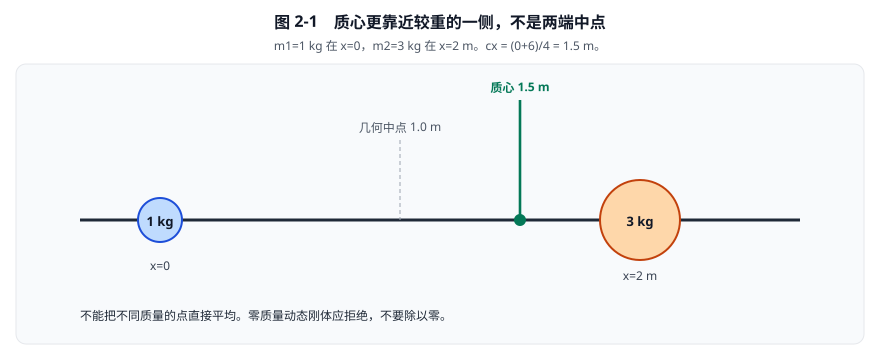
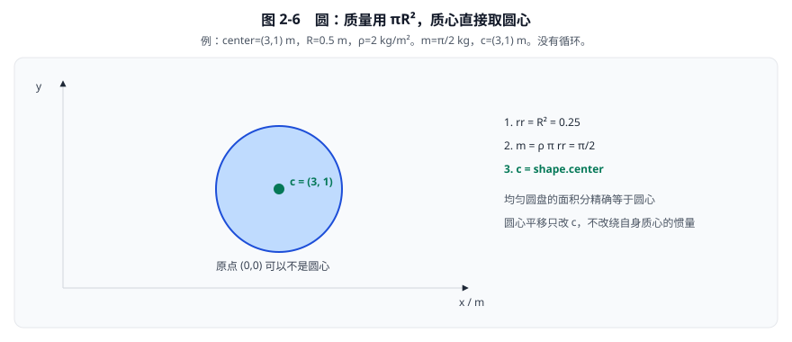
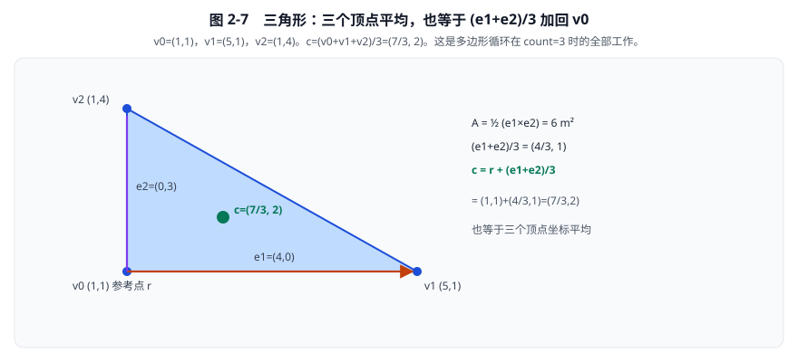
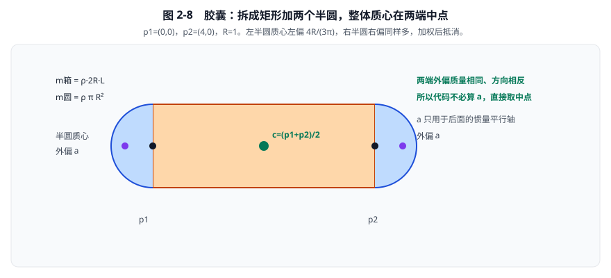
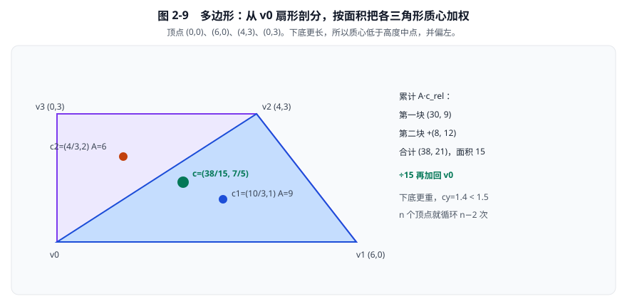
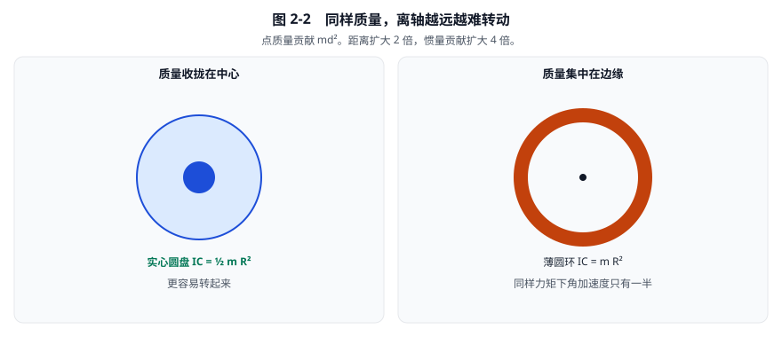
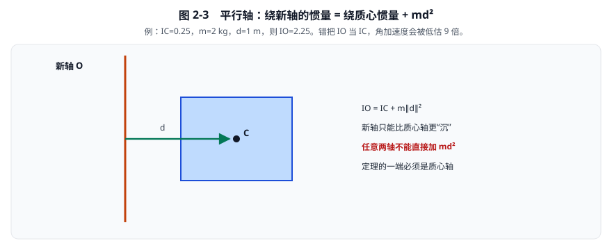
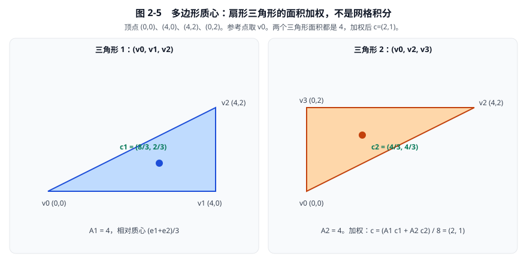

# 02 · 质量、质心与转动惯量

[返回总目录](./README.md)

第01章说明了怎样描述位置和旋转。
[02a · 转动惯量的定义与由来](./02a-转动惯量的定义与由来.md) 说明 \(I=\int r^2\,dm\) 为什么长这样、平方从动能来、以及惠更斯和欧拉怎样把它独立出来。
本章接着解释同样的力为什么让不同物体产生不同的加速度，以及为什么质量相同也可能难以转动；从第 3 节起直接用定义做形状积分，第 10 节把多块焊成一个刚体。
全部讨论采用二维均匀薄片模型，密度单位为 \(\mathrm{kg/m^2}\)，不是三维体密度。
除特别说明，惯量都指垂直于二维平面、穿过质心的 z 轴转动惯量。

## 1. 从许多小质量块开始，而不是先背公式

把刚体分成小块，第 i 块质量为 \(m_i\)，位置为 \(x_i\)。
总质量：

\[
m=\sum_i m_i.
\]

质量是平动惯性的尺度，单位千克。
同样的力作用下，质量越大，速度改变越慢。
质心是质量加权平均位置：

\[
c=\frac{\sum_i m_i x_i}{m}.
\]

分子单位为千克·米，除以千克，结果为米。
“加权”意味着重的一侧贡献更大，不能把不同质量的点直接平均。
例如左端 \(m_1=1\,\mathrm{kg}\)、\(x_1=0\)，右端 \(m_2=3\,\mathrm{kg}\)、\(x_2=2\,\mathrm m\)：

\[
m=4\,\mathrm{kg},\qquad c_x=\frac{1\times0+3\times2}{4}=1.5\,\mathrm m.
\]

质心更靠近较重的一侧，符合直观。



**看图：** 右边 3 kg 把质心从 1 m 拉到 1.5 m。后面刚体原点可以不是这个点；动力学积分推进的是质心。

若所有质量都为零，分母为零，质心公式不再定义一个唯一物理答案。
教学引擎应拒绝零质量动态刚体，或制定独立的明确约定，不要靠除以零处理。

## 2. 连续薄片：求和如何变为积分

面积微元为 \(dA\)，面密度为 \(\rho\)，微元质量：

\[
dm=\rho\,dA.
\]

因此：

\[
m=\int_A\rho\,dA,
\qquad
c=\frac1m\int_A x\rho\,dA.
\]

均匀形状中 \(\rho\) 为常量，可移到积分外。
质量等于密度乘面积；质心退化为面积加权中心。
多形状组成的刚体，各形状可以有不同密度，不能拿总面积中心直接代替总质心。
非均匀密度函数不属于本章简单形状公式的前提。

### 2.1 这个积分在 Box2D 里怎样变成数字

引擎**不会**对 \(\int x\rho\,dA\) 做网格求积，也不会随机撒点。
二维均匀密度下，连续积分恒等于有限块的质量加权平均：

\[
c=\frac1m\int_A x\rho\,dA
\quad\Longleftrightarrow\quad
c=\frac{\sum_i m_i c_i}{\sum_i m_i}.
\]

因此实现只做两件事：把形状拆成能闭式求质心的块，再按质量加权。
调度在 [`b2ComputeShapeMass`](../src/shape.c#L811)：圆、胶囊、多边形各走一条公式；线段和链段返回零质量，不进入质心。
第 2.2–2.6 节按圆、三角形、胶囊、多边形、多形状刚体把加减乘除逐步走完。

| 形状 | 质心怎么得到 | 源码 |
|---|---|---|
| 圆 | 直接取圆心 | `b2ComputeCircleMass` |
| 胶囊 | 两端圆心的中点 | `b2ComputeCapsuleMass` |
| 凸多边形 | 从第一个顶点扇形剖分，三角形面积加权 | `b2ComputePolygonMass` |
| 多形状刚体 | 各形状 \((m_i,c_i)\) 再质量加权 | `b2UpdateBodyMassData` |


**看图：** 左边圆心即质心；中间胶囊关于中心线对称，整体质心在两端中点；右边才真正“积分”，而且积的是三角形，不是像素。
具体数字步骤从第 2.2 节的圆开始，到第 2.5 节的梯形结束。

返回值 `b2MassData.center` 是形状局部坐标中的质心，单位米。
刚体再把它聚合成 `localCenter`，世界质心为 \(c_w=p+R c_l\)。
碰撞用的 `polygon.centroid` 是核心顶点的几何形心，创建多边形时就算好；质量路径在有圆角时会先外推顶点，二者不必逐位相同。

下面按**圆 → 三角形 → 胶囊 → 多边形**把源码里的加减乘除逐步走完。
惯量推导仍在第 5、7、8 节；本节只把质心算明白。

### 2.2 第一步：均匀圆，质心就是圆心

取

\[
\text{center}=(3,1)\,\mathrm m,\qquad R=0.5\,\mathrm m,\qquad \rho=2\,\mathrm{kg/m^2}.
\]

**步骤 1.** 半径平方：

\[
rr=R^2=0.25\,\mathrm{m^2}.
\]

**步骤 2.** 面积乘密度得质量：

\[
m=\rho\pi R^2=2\cdot\pi\cdot0.25=\frac\pi2\approx1.570796\,\mathrm{kg}.
\]

**步骤 3.** 均匀圆盘对圆心对称，面积分 \(\int x\,dA\) 的平均值就是圆心：

\[
c=\texttt{shape.center}=(3,1)\,\mathrm m.
\]

没有循环，也没有“对圆面积做数值积分”。圆心可以不是刚体原点；原点只是建模约定。
把圆平移到 \((10,4)\)，质心跟着变成 \((10,4)\)，绕自身质心的惯量不变。



**看图：** 绿色点就是 \(c\)。源码对应三行赋值：`mass = density * B2_PI * rr`，`center = shape->center`。
定位：[几何质量计算](../src/geometry.c)，`b2ComputeCircleMass`，221–233行。

### 2.3 第二步：一个三角形，三个顶点平均

多边形路径在 `count==3` 且半径为零时，循环只跑一轮，结果必须等于三个顶点的平均。
先用这个事实核对公式，再推广到更多顶点。

取逆时针顶点

\[
v_0=(1,1),\quad v_1=(5,1),\quad v_2=(1,4),
\qquad\rho=2\,\mathrm{kg/m^2}.
\]

**步骤 1.** 参考点取第一个顶点，减小远处大坐标相减的误差：

\[
r=v_0=(1,1).
\]

**步骤 2.** 两条相对边：

\[
e_1=v_1-r=(4,0),\qquad e_2=v_2-r=(0,3).
\]

**步骤 3.** 有向面积（叉积）再取一半：

\[
D=e_1\times e_2=4\cdot3-0\cdot0=12,
\qquad
A=\frac D2=6\,\mathrm{m^2}.
\]

逆时针时 \(D>0\)。若得到负面积，顶点顺序反了，质心公式会整章跟着错。

**步骤 4.** 标准三角形的质心相对参考点是

\[
\frac{e_1+e_2}{3}=\Bigl(\frac43,1\Bigr).
\]

加回参考点：

\[
c=r+\frac{e_1+e_2}{3}=(1,1)+\Bigl(\frac43,1\Bigr)=\Bigl(\frac73,2\Bigr)\,\mathrm m.
\]

**步骤 5.** 用三个顶点平均独立核对：

\[
c=\frac{v_0+v_1+v_2}{3}
=\frac{(1,1)+(5,1)+(1,4)}{3}
=\Bigl(\frac73,2\Bigr).
\]

两式相同。质量为

\[
m=\rho A=2\times6=12\,\mathrm{kg}.
\]

源码累加的是 \(A\cdot(e_1+e_2)/3=(8,6)\)，再除以面积 \(6\)，得到相对质心 \((4/3,1)\)，最后加 \(r\)。
这就是 `b2MulAdd(center, triangleArea * inv3, b2Add(e1,e2))` 再 `center *= 1/area`。



**看图：** 橙色、紫色箭头是 \(e_1,e_2\)。绿色点既是三顶点平均，也是源码那一轮循环的输出。

### 2.4 第三步：胶囊，两端中点；半圆外偏会抵消

胶囊不是圆，也还不是多边形。源码把它拆成**中间矩形 + 两个半圆**（合计一个整圆）。
取水平胶囊

\[
p_1=(0,0),\quad p_2=(4,0),\quad R=1\,\mathrm m,\qquad\rho=2\,\mathrm{kg/m^2}.
\]

**步骤 1.** 中心线长度：

\[
L=\lVert p_2-p_1\rVert=4\,\mathrm m.
\]

**步骤 2.** 两块质量（注意矩形宽是直径 \(2R\)，长是 \(L\)）：

\[
m_{\text{圆}}=\rho\pi R^2=2\pi\,\mathrm{kg},
\qquad
m_{\text{箱}}=\rho(2R)L=16\,\mathrm{kg}.
\]

总质量 \(m=16+2\pi\approx22.283185\,\mathrm{kg}\)。

**步骤 3.** 三块各自的质心：

| 块 | 质量 | 质心 |
|---|---|---|
| 中间矩形 | \(16\) | \((2,0)\) |
| 左半圆 | \(\pi\) | \(p_1-(a,0)=(-a,0)\) |
| 右半圆 | \(\pi\) | \(p_2+(a,0)=(4+a,0)\) |

其中半圆质心相对圆心外偏

\[
a=\frac{4R}{3\pi}=\frac4{3\pi}\approx0.424413\,\mathrm m.
\]

**步骤 4.** 质量加权：

\[
c_x=\frac{16\cdot2+\pi(-a)+\pi(4+a)}{16+2\pi}
=\frac{32+4\pi}{16+2\pi}=2.
\]

\(a\) 被左右抵消。\(c_y=0\)。因此

\[
c=\frac{p_1+p_2}{2}=(2,0).
\]

这就是源码直接写 `0.5f * (p1 + p2)` 的原因：对称胶囊不必每次先算 \(a\)。
\(a\) 仍然要留给惯量的平行轴，质心这一栏用不到它。
若 \(L=0\)，胶囊退化为圆，中点就是圆心，与第 2.2 节一致。

倾斜胶囊同样取中点。例如 \(p_1=(1,1)\)、\(p_2=(4,5)\)：

\[
c=\bigl(2.5,\,3\bigr),\qquad L=5.
\]

两端外偏沿中心线方向相反，加权后仍然抵消。



**看图：** 绿色点是代码输出的 \(c\)。两侧紫色点才是半圆自己的质心；质量相同、方向相反，所以整体仍落在中点。
定位：[几何质量计算](../src/geometry.c)，`b2ComputeCapsuleMass`，235–250行。

### 2.5 第四步：多边形，把第 2.3 节的三角形加起来

凸多边形从 \(v_0\) 扇形剖分成 \(n-2\) 个三角形，每个三角形按第 2.3 节计算，再按面积加权。
这就是把积分 \(\int x\,dA\) 拆成有限块之和。

取零圆角梯形，顶点逆时针：

\[
v_0=(0,0),\quad v_1=(6,0),\quad v_2=(4,3),\quad v_3=(0,3).
\]

密度仍取 \(\rho=2\)。\(n=4\)，循环两次。
初始化：\(r=v_0=(0,0)\)，累加器 \(\textit{center}=(0,0)\)，\(\textit{area}=0\)。

**第一轮** \(i=1\)，三角形 \((v_0,v_1,v_2)\)：

\[
e_1=(6,0),\quad e_2=(4,3),
\quad D=18,\quad A_1=9,
\]

\[
\frac{e_1+e_2}{3}=\Bigl(\frac{10}3,1\Bigr),
\qquad
A_1\cdot\frac{e_1+e_2}{3}=(30,9).
\]

累加器变为 \(\textit{center}=(30,9)\)，\(\textit{area}=9\)。

**第二轮** \(i=2\)，三角形 \((v_0,v_2,v_3)\)：

\[
e_1=(4,3),\quad e_2=(0,3),
\quad D=12,\quad A_2=6,
\]

\[
\frac{e_1+e_2}{3}=\Bigl(\frac43,2\Bigr),
\qquad
A_2\cdot\frac{e_1+e_2}{3}=(8,12).
\]

累加器变为 \(\textit{center}=(38,21)\)，\(\textit{area}=15\)。

**收尾** 与源码相同：先除以总面积，再加回参考点。

\[
\bar c=\frac{(38,21)}{15}=\Bigl(\frac{38}{15},\frac{7}{5}\Bigr)
=\bigl(2.5\overline{3},\,1.4\bigr),
\qquad
c=r+\bar c=\Bigl(\frac{38}{15},\frac75\Bigr)\,\mathrm m.
\]

质量 \(m=\rho A=2\times15=30\,\mathrm{kg}\)。

| 轮 | \(e_1\) | \(e_2\) | \(A\) | 本轮 \(A(e_1+e_2)/3\) | 累计 `center` | 累计面积 |
|---|---|---|---|---|---|---|
| 1 | \((6,0)\) | \((4,3)\) | \(9\) | \((30,9)\) | \((30,9)\) | \(9\) |
| 2 | \((4,3)\) | \((0,3)\) | \(6\) | \((8,12)\) | \((38,21)\) | \(15\) |
| 除以面积 | | | | | \((38/15,\,7/5)\) | |

下底长 6、上底长 4，所以质心应低于高度中点 \(1.5\)，并偏左于 \(x=3\)。
\(c_y=1.4<1.5\)、\(c_x\approx2.533<3\)，与直观一致。

五个顶点只是循环多一轮，公式不变：\(n\) 个顶点生成 \(n-2\) 个三角形。
`count==1` 转圆，`count==2` 转胶囊，见 `b2ComputePolygonMass` 的 302–317 行。



**看图：** 蓝色块面积 9、橙色块面积 6。绿色点是加权结果，不是某个顶点，也不是包围盒中心。

若参考点不是原点，例如把整个梯形平移 \((10,4)\)，累加器算的是相对 \(v_0\) 的 \(\bar c\)，最后 `b2Add(r, center)` 会加回 \((10,4)\)，质心变为 \((10+38/15,\,4+7/5)\)。

### 2.6 第五步：一个刚体上的多个形状

每个形状先走完上面某一条路径，得到 \((m_i,c_i)\)。
刚体局部质心再做一次第 1 节那种加权。推导见 [02a 第 7 节](./02a-转动惯量的定义与由来.md)：整体质心定义是 \(\int x\,dm\)，把积分拆到各块上就是

\[
C=\frac{\sum_i m_i c_i}{\sum_i m_i}.
\]

重的一块把 \(C\) 往自己那边拉。不能把各块质心直接平均；密度不同时也不能拿总面积中心代替总质心。
这一步还没有转动惯量。各块的 \(I_{C_i}\) 绕的不是同一根轴，要等第 10 节用平行轴搬到 \(C\) 上再加。

例：同一刚体上一个圆、一个三角形，\(\rho=1\)。

- 圆：\(R=1\)，圆心 \((0,0)\)。\(m_1=\pi\)，\(c_1=(0,0)\)。
- 三角形：\((2,0),(5,0),(2,3)\)。\(r=(2,0)\)，\(e_1=(3,0)\)，\(e_2=(0,3)\)，\(A=4.5\)，\(c_2=(3,1)\)，\(m_2=4.5\)。

\[
C=\frac{\pi(0,0)+4.5(3,1)}{\pi+4.5}
=\frac{(13.5,\,4.5)}{\pi+4.5}
\approx(1.767,\,0.589)\,\mathrm m.
\]

密度为零的形状这一步质量为 0，不拉质心。
两个形状若重叠，重叠区域会被算两次；这不是几何并集积分。
静态、运动学刚体不走这条质量和质心路径。
完整聚合代码在第 10 节。

## 3. 转动惯量：离轴越远，权重是距离平方

定义、平方的来源和历史由来见 [02a](./02a-转动惯量的定义与由来.md)。本节起把它当成计算工具。

以质心为轴，令微元相对质心的位置为 \(r=x-c\)。
定义：

\[
I_C=\int_A\lVert r\rVert^2\,dm
=\rho\int_A(r_x^2+r_y^2)\,dA.
\]

\(I_C\) 单位为 \(\mathrm{kg\cdot m^2}\)。
它不是质量，也不是“长宽乘积”。
一个质量为 \(m\) 的点放在距轴 \(d\) 处，贡献 \(md^2\)。
距离扩大两倍，惯量贡献扩大四倍。
把质量向中心收拢，在总质量不变时也能减小转动惯量。

为什么平方自然出现？
匀速转动时微元速率为 \(v=|\omega|\lVert r\rVert\)。
把每块的动能相加：

\[
E_{\rm rot}=\int\frac12v^2\,dm
=\frac12\omega^2\int\lVert r\rVert^2\,dm
=\frac12I_C\omega^2.
\]

所以惯量是旋转动能写成 \(\tfrac12 I_C\omega^2\) 时的惯性参数；严格说，\(\omega^2\) 前的系数是 \(I_C/2\)，不是 \(I_C\)。
例如 \(I_C=2\,\mathrm{kg\cdot m^2}\)、\(\omega=3\,\mathrm{rad/s}\)，旋转动能为 \(9\,\mathrm J\)。



**看图：** 实心圆盘是 \(\tfrac12 mR^2\)，薄环是 \(mR^2\)。边角碰撞时，惯量大的物体更不愿意转开，有效质量也就更大。

## 4. 平行轴定理：为什么移轴要加一项

完整的人话推导见 [02a 第 6 节](./02a-转动惯量的定义与由来.md)。本节把同一条代数再走一遍，因为后面胶囊、多边形移轴、复合刚体都要反复用它。

设新轴通过 O，质心为 C，\(d=C-O\)。微元相对质心的位置是 \(r\)，相对新轴的位置就是 \(r+d\)。按定义

\[
I_O=\int\lVert r+d\rVert^2\,dm.
\]

平方展开：

\[
\lVert r+d\rVert^2=\lVert r\rVert^2+2r\cdot d+\lVert d\rVert^2.
\]

\(d\) 对所有微元相同，积分后

\[
I_O=I_C+2d\cdot\int r\,dm+\lVert d\rVert^2\int dm.
\]

质心的定义就是 \(c=\frac1m\int x\,dm\)，而 \(r=x-c\)，所以

\[
\int r\,dm=\int x\,dm-c\int dm=mc-cm=0.
\]

交叉项消失，\(\int dm=m\)，故

\[
I_O=I_C+m\lVert d\rVert^2.
\]

新轴远离质心时，惯量只能增加，不能减少。反过来，已知非质心轴惯量才能减去 \(md^2\) 得到质心惯量。
不能把任意两轴都当成“直接加 \(md^2\)”；定理的一端必须是质心轴。任意两平行轴之间其实是

\[
I_B=I_A+m\bigl(\lVert c-B\rVert^2-\lVert c-A\rVert^2\bigr),
\]

只有 A 或 B 之一是质心，才会退化成加上（或减去）一项 \(md^2\)。

用第 1 节那两个点质量核对。\(m_1=1\) 在 \(x=0\)，\(m_2=3\) 在 \(x=2\)，\(c=1.5\)，\(m=4\)：

\[
I_C=1\cdot(1.5)^2+3\cdot(0.5)^2=3,
\qquad
I_{x=0}=3\cdot2^2=12,
\qquad
3+4\cdot(1.5)^2=12.
\]

再搬到右端 \(x=2\)：\(I_C+4\cdot(0.5)^2=4\)，与按定义 \(1\cdot2^2=4\) 相同。若误用 \(12+4\cdot2^2=28\)，就是把原点轴当成了质心轴。

例：\(I_C=0.25\)、\(m=2\)、\(d=1\)，则 \(I_O=2.25\,\mathrm{kg\cdot m^2}\)。
如果把 \(I_O\) 错当 \(I_C\)，同样力矩下角加速度会被低估 9 倍。



**看图：** 新轴 O 离质心越远，转动越沉。复合刚体先算各块绕自己质心的惯量，再平行轴搬到总质心。第 7 节胶囊会连续用两次；第 10 节第二遍累加写的就是 \(I_{C_i}+m_i\lVert c_i-C\rVert^2\)。

## 5. 圆盘：一步步积分出一半

半径为 \(R\)，均匀密度为 \(\rho\)。
取半径 \(r\)、厚度 \(dr\) 的细圆环。
圆环面积约为周长乘厚度：\(dA=2\pi r\,dr\)。
质量：

\[
m=\int_0^R\rho2\pi r\,dr
=2\pi\rho\frac{R^2}{2}
=\pi\rho R^2.
\]

每个圆环到轴的距离都是 \(r\)，故惯量：

\[
I_C=\int_0^Rr^2\rho2\pi r\,dr
=2\pi\rho\frac{R^4}{4}
=\frac12\pi\rho R^4
=\frac12mR^2.
\]

这里的 \(1/2\) 来自积分，不能拿薄圆环公式 \(mR^2\) 代替实心圆盘。
圆盘的质量分布在轴到边缘之间，当然比所有质量都集中在边缘更容易转动。

取 \(R=0.5\,\mathrm m\)，\(\rho=8/\pi\,\mathrm{kg/m^2}\)：

\[
m=\pi\frac8\pi(0.5)^2=2\,\mathrm{kg},
\qquad
I_C=\frac12\times2\times0.25=0.25\,\mathrm{kg\cdot m^2}.
\]

圆心即质心。圆心在局部坐标中不为零，也不会改变绕圆自身质心的惯量。
质心的逐步计算见第 2.2 节；下面只补质量和惯量积分。
所以第 2.1 节的圆路径没有循环：`massData.center = shape->center`。
本版函数返回的正是质心惯量：

```225:230:src/geometry.c
	b2MassData massData;
	massData.mass = density * B2_PI * rr;
	massData.center = shape->center;

	// inertia about the center of mass
	massData.rotationalInertia = massData.mass * 0.5f * rr;
```

定位：[几何质量计算](../src/geometry.c)，`b2ComputeCircleMass`，221–233行。

## 6. 矩形：长宽平方为什么相加

矩形以质心为原点，完整宽度为 \(w\)、完整高度为 \(h\)。
积分范围 \(x\in[-w/2,w/2]\)、\(y\in[-h/2,h/2]\)。
面积 \(A=wh\)，质量 \(m=\rho wh\)。

\[
I_C=\rho\int_{-h/2}^{h/2}\int_{-w/2}^{w/2}(x^2+y^2)\,dx\,dy.
\]

把两项分开：

\[
\int_{-w/2}^{w/2}x^2\,dx=\frac{w^3}{12},
\qquad
\int_{-h/2}^{h/2}y^2\,dy=\frac{h^3}{12}.
\]

第一项乘高度，第二项乘宽度：

\[
I_C=\rho\left(\frac{hw^3}{12}+\frac{wh^3}{12}\right)
=\frac{m(w^2+h^2)}{12}.
\]

若程序存的是半宽 \(a=w/2\)、半高 \(b=h/2\)，等价公式是 \(I_C=m(a^2+b^2)/3\)。
把半宽直接代入完整宽公式，会小估4倍。
例：\(w=4\,\mathrm m\)、\(h=2\,\mathrm m\)、\(\rho=2\,\mathrm{kg/m^2}\)。
质量 \(m=16\,\mathrm{kg}\)，惯量 \(I_C=16(16+4)/12=80/3\approx26.666667\)。
本版矩形通常由多边形表示，质量通过通用多边形积分得到，而不是另有必须调用的盒子质量接口。

## 7. 胶囊：矩形加两个半圆，不能漏掉半圆质心

胶囊由一段长 \(L\) 的中心线与半径 \(R\) 组成。
中间矩形的完整长宽为 \(L\) 和 \(2R\)。
两端各接半圆，中心线端点不是胶囊外端点；总长度为 \(L+2R\)。
整体质心为中心线两端点的中点。
两端半圆外偏相互抵消，中间矩形也对称，因此质量代码直接写：

\[
c=\frac{p_1+p_2}{2}.
\]

质心逐步抵消见第 2.4 节。半圆质心相对圆心外偏 \(4R/(3\pi)\)，只进入后面的惯量平行轴，不改这个 \(c\)。

矩形质量与两半圆总质量分别为：

\[
m_b=2\rho RL,
\qquad
m_c=\rho\pi R^2.
\]

所以总质量 \(m=m_b+m_c\)。
关键是半圆质心相对其圆心向外偏移，不在圆心上。

### 7.1 半圆质心的推导

考虑朝 \(+x\) 的半圆，极角 \(\phi\in[-\pi/2,\pi/2]\)，径向坐标 \(r\in[0,R]\)。
坐标 \(x=r\cos\phi\)，面积微元 \(dA=r\,dr\,d\phi\)。

\[
\int x\,dA
=\left(\int_0^Rr^2\,dr\right)
\left(\int_{-\pi/2}^{\pi/2}\cos\phi\,d\phi\right)
=\frac{R^3}{3}\times2.
\]

除以半圆面积 \(\pi R^2/2\)：

\[
a=\frac{4R}{3\pi}.
\]

\(a\) 为向外质心偏移，单位米。
设中心线半长为 \(H=L/2\)，半圆自己的质心距离整体质心为 \(H+a\)。

### 7.2 为什么需要连续使用两次平行轴定理

单个半圆质量为 \(m_c/2\)。
绕其圆心的惯量为 \(\frac12(m_c/2)R^2\)。
先从圆心轴移到半圆质心轴，需要减去 \((m_c/2)a^2\)。
再移到胶囊整体质心轴，需要加上 \((m_c/2)(H+a)^2\)。
两个半圆合计：

\[
I_c=m_c\left(\frac12R^2-a^2+(H+a)^2\right)
=m_c\left(\frac12R^2+H^2+2Ha\right).
\]

注意额外项 \(2Ha\) 不能省略。
把两端半圆粗暴当成两个“半质量圆盘”放在端点，只加 \(m_cH^2\)，会漏掉这项。
矩形惯量：

\[
I_b=\frac{m_b(L^2+4R^2)}{12},
\qquad
I_C=I_c+I_b.
\]

取 \(R=1\)、\(L=2\)、\(\rho=1\)：
\(m_c=\pi\)，\(m_b=4\)，\(H=1\)，\(a=4/(3\pi)\)。
总质量 \(m=4+\pi\approx7.141593\,\mathrm{kg}\)。

\[
I_c=\frac32\pi+\frac83,
\qquad
I_b=\frac83,
\qquad
I_C=\frac32\pi+\frac{16}{3}\approx10.045722.
\]

令 \(L=0\)，矩形消失，结果自然退化为圆盘质量和惯量。
定位：[几何质量计算](../src/geometry.c)，`b2ComputeCapsuleMass`，235–271行，尤其261–269行。

## 8. 多边形：三角剖分加积分

先考虑按逆时针排列的有效凸多边形，暂时令圆角半径为零。
质心逐步手算见第 2.3 节（一块三角形）和第 2.5 节（多块加权）。本节补剖分约定和惯量。
选择第一个顶点 \(r\) 为参考原点。
第 i 个三角形用顶点 \((r,v_i,v_{i+1})\)。
相对边向量：\(e_1=v_i-r\)，\(e_2=v_{i+1}-r\)。
有向面积因子：\(D=e_1\times e_2\)，三角形面积 \(A_i=D/2\)。
对于正确逆时针凸多边形，这些面积应为非负，合计为正。

### 8.1 用标准三角形替代任意三角形

把三角形内的相对位置写成：

\[
x(u,v)=ue_1+ve_2,
\qquad
u\ge0,\ v\ge0,\ u+v\le1.
\]

面积变换的雅可比是 \(D\)，因此 \(dA=D\,du\,dv\)。
\(u,v\) 无量纲，\(D\) 单位平方米。
标准三角形上需要的积分为：

\[
\int 1\,du\,dv=\frac12,
\quad
\int u\,du\,dv=\int v\,du\,dv=\frac16.
\]

例如 \(\int u\,du\,dv=\int_0^1(1-v)^2/2\,dv=1/6\)。
所以三角形相对质心为 \((e_1+e_2)/3\)。
多边形相对质心通过面积加权：

\[
\bar c=\frac{\sum_i A_i(e_{1i}+e_{2i})/3}{\sum_i A_i},
\qquad
c=r+\bar c.
\]

这里 \(\bar c\) 相对参考点 r，\(c\) 则在形状局部坐标中。
这就是第 2 节面积分的离散形式：每个三角形贡献 \(A_i\cdot(e_1+e_2)/3\)，再除以总面积。

当前循环从第一个顶点扇形剖分，\(i\) 跑 \(1\) 到 \(count-2\)，对应三角形 \((v_0,v_i,v_{i+1})\)。
参考点取 \(v_0\) 而不是坐标原点，是为了减小远处大坐标相减的舍入。

```351:367:src/geometry.c
	b2Vec2 r = vertices[0];

	const float inv3 = 1.0f / 3.0f;

	for ( int i = 1; i < count - 1; ++i )
	{
		// Triangle edges
		b2Vec2 e1 = b2Sub( vertices[i], r );
		b2Vec2 e2 = b2Sub( vertices[i + 1], r );

		float D = b2Cross( e1, e2 );

		float triangleArea = 0.5f * D;
		area += triangleArea;

		// Area weighted centroid, r at origin
		center = b2MulAdd( center, triangleArea * inv3, b2Add( e1, e2 ) );
```

累加结束后除以总面积，再加回参考点：

```384:388:src/geometry.c
	B2_ASSERT( area > FLT_EPSILON );
	float invArea = 1.0f / area;
	center.x *= invArea;
	center.y *= invArea;
	massData.center = b2Add( r, center );
```

创建多边形时，[`b2ComputePolygonCentroid`](../src/geometry.c#L23) 用同一套扇形加权，结果写入 `polygon.centroid`，供碰撞与范围查询使用。
质量函数在半径大于零时会先外推顶点再积分，因此 `massData.center` 与 `polygon.centroid` 在圆角情况下一般不同。

### 8.2 不跳过惯量积分

展开平方：

\[
\lVert ue_1+ve_2\rVert^2
=u^2\lVert e_1\rVert^2+2uv(e_1\cdot e_2)+v^2\lVert e_2\rVert^2.
\]

标准三角形上的二次矩：

\[
\int u^2\,du\,dv=\int v^2\,du\,dv=\frac1{12},
\qquad
\int uv\,du\,dv=\frac1{24}.
\]

第一式可由 \(\int_0^1(1-v)^3/3\,dv=1/12\) 得到。
交叉项为 \(\int_0^1v(1-v)^2/2\,dv=1/24\)。
因此三角形关于参考点 r 的惯量为：

\[
I_{r,i}=\frac{\rho D_i}{12}
\left(\lVert e_{1i}\rVert^2+e_{1i}\cdot e_{2i}+\lVert e_{2i}\rVert^2\right).
\]

把三角形贡献相加，再把轴移到多边形质心：

\[
I_C=\sum_i I_{r,i}-m\lVert\bar c\rVert^2.
\]

减掉的是相对参考点的质心偏移 \(\bar c\)，不是世界坐标，也不是未经平移的局部质心 c。
定位：[几何质量计算](../src/geometry.c)，`b2ComputePolygonMass`，349–397行。

### 8.3 一个完整三角形算例

顶点为 \((0,0),(2,0),(0,1)\)，密度 \(\rho=3\)。
\(e_1=(2,0)\)、\(e_2=(0,1)\)，\(D=2\)，面积 \(A=1\)。
质量 \(m=3\)，质心 \(c=(2/3,1/3)\)。
参考点惯量：

\[
I_r=\frac{3\times2}{12}(4+0+1)=\frac52.
\]

平移修正：\(m\lVert c\rVert^2=3(4/9+1/9)=5/3\)。
最终：

\[
I_C=\frac52-\frac53=\frac56\approx0.833333.
\]

若算出了负惯量，优先检查顶点绕序、交叉项、密度、面积和移轴用的坐标。
不能把负惯量静默取绝对值然后宣称物理已经正确。

### 8.4 矩形手算：把源码循环走完

取零圆角矩形顶点：

\[
v_0=(0,0),\quad v_1=(4,0),\quad v_2=(4,2),\quad v_3=(0,2).
\]

参考点 \(r=v_0\)。循环产生两个三角形。

第一块 \((v_0,v_1,v_2)\)：

\[
e_1=(4,0),\quad e_2=(4,2),\quad D=8,\quad A_1=4,
\]

\[
c_1=\frac{e_1+e_2}{3}=\Bigl(\frac83,\frac23\Bigr).
\]

第二块 \((v_0,v_2,v_3)\)：

\[
e_1=(4,2),\quad e_2=(0,2),\quad D=8,\quad A_2=4,
\]

\[
c_2=\frac{e_1+e_2}{3}=\Bigl(\frac43,\frac43\Bigr).
\]

面积加权：

\[
\bar c=\frac{4\cdot c_1+4\cdot c_2}{8}=(2,1),\qquad c=r+\bar c=(2,1).
\]

这正是矩形几何中心。均匀密度下它也是质心。
源码累加的是 \(A_i(e_1+e_2)/3\)，最后除以总面积，与上式相同。



**看图：** 不要对矩形画格子再求和。引擎只生成 \(n-2\) 个三角形，每个用闭式质心，再按面积加权。

## 9. 圆角多边形：精确几何与本版近似必须分开说

理论上，对凸核心多边形向外扩张半径 R，其精确面积为：

\[
A_{\rm exact}=A_{\rm core}+P_{\rm core}R+\pi R^2.
\]

它来自核心面积、沿边矩形条和合计一整圆的圆角扇形。
这是精确圆角几何的面积定理，不是当前质量代码所执行的算法。
当前 `b2ComputePolygonMass` 对三个及以上顶点、半径大于零的情况，先把顶点向外推，再套普通多边形积分。
推顶点方向为相邻外法线之和的单位方向：

\[
\hat m_i=\frac{n_{i-1}+n_i}{\lVert n_{i-1}+n_i\rVert},
\qquad
v_i'=v_i+1.412R\hat m_i.
\]

注意源码常量实际是 `1.412f`，变量名虽为 `sqrt2`，却不是精确 \(\sqrt2\)。
不能把它改写成精确扇形积分，也不能承诺近似误差始终低估或始终高估。

```323:335:src/geometry.c
	if ( radius > 0.0f )
	{
		// Approximate mass of rounded polygons by pushing out the vertices.
		float sqrt2 = 1.412f;
		for ( int i = 0; i < count; ++i )
		{
			int j = i == 0 ? count - 1 : i - 1;
			b2Vec2 n1 = shape->normals[j];
			b2Vec2 n2 = shape->normals[i];

			b2Vec2 mid = b2Normalize( b2Add( n1, n2 ) );
			vertices[i] = b2MulAdd( shape->vertices[i], sqrt2 * radius, mid );
		}
```

例如核心正方形为 \([-1,1]^2\)，\(R=0.5\)。
精确圆角面积为 \(4+8(0.5)+\pi(0.5)^2\approx8.785398\)。
推顶点近似得到正方形半边长 \(1+1.412(0.5)/\sqrt2\)，面积约 \(8.9906\)。
这是一个能手算看到近似误差的反例，不意味着源码误把几何碰撞形状也改成了该正方形。
质量近似与碰撞几何是不同计算路径。
本函数顶点数1时转圆，顶点数2时转胶囊，见302–317行。

## 10. 多形状刚体：两遍累加比大数相减更稳

概念推导见 [02a 第 7 节](./02a-转动惯量的定义与由来.md)。各形状已经有 \((m_i,c_i,I_{C_i})\)。
焊成一个刚体之后，只有一个质心、一个绕该质心的惯量。质量直接相加；质心按质量加权；惯量必须先搬到总质心再相加。

第一遍求：

\[
m=\sum_i m_i,
\qquad
C=\frac{\sum_i m_i c_i}{m}.
\]

第二遍求：

\[
I_C=\sum_i\left(I_{C_i}+m_i\lVert c_i-C\rVert^2\right).
\]

\(I_{C_i}\) 是第 \(i\) 块绕**自己**质心的惯量，不能和别的块直接相加。第二项把轴从 \(c_i\) 搬到总质心 \(C\)。每一项都非负；本版因此避免先把所有惯量转到遥远原点、再减去一个巨大的 \(m\lVert C\rVert^2\)。
后者数学上等价，浮点计算中却可能严重抵消有效数字。
这里的优化不是少算一个乘法，而是改变运算顺序以保留精度。

### 10.1 二维两块，把加减乘除走完

与 02a 第 7.6 节同一组数。A：\(m=2\)，\(c=(0,0)\)，\(I_C=0.25\)。B：\(m=4\)，\(c=(3,1)\)，\(I_C=0.50\)。

\[
m=6,\qquad
C=\frac{(12,4)}{6}=\Bigl(2,\frac23\Bigr).
\]

\[
d_A=\Bigl(-2,-\frac23\Bigr),\ \lVert d_A\rVert^2=\frac{40}9;
\qquad
d_B=\Bigl(1,\frac13\Bigr),\ \lVert d_B\rVert^2=\frac{10}9.
\]

\[
I_C=0.25+2\cdot\frac{40}9+0.50+4\cdot\frac{10}9=\frac{169}{12}\approx14.0833.
\]

只加 \(0.25+0.50=0.75\) 漏了平行轴，会小估约 19 倍。

一维核对仍可用第 1 节那两块：质量 1 和 3，局部质心 0 和 2，自身惯量 0.2 和 0.6。总质量 4，总质心 1.5，

\[
I_C=0.2+1(0-1.5)^2+0.6+3(2-1.5)^2=3.8.
\]


**看图：** 绿点才是 \(C\)。右边两项都要留下：自身摊开 \(I_{C_i}\)，加上离总质心的 \(m_i d_i^2\)。

### 10.2 源码就是这两遍

第一遍对应：密度为零的形状写入空的 `b2MassData` 后跳过；其余调用 `b2ComputeShapeMass`，累加 \(m\) 与 \(m_i c_i\)，最后 \(C=(\sum m_i c_i)/m\)。

```578:597:src/body.c
		if ( s->density == 0.0f )
		{
			masses[shapeIndex] = (b2MassData){ 0 };
			shapeIndex += 1;
			continue;
		}

		b2MassData massData = b2ComputeShapeMass( s );
		body->mass += massData.mass;
		localCenter = b2MulAdd( localCenter, massData.mass, massData.center );

		masses[shapeIndex] = massData;
		shapeIndex += 1;
	}

	// Compute center of mass.
	if ( body->mass > 0.0f )
	{
		bodySim->invMass = 1.0f / body->mass;
		localCenter = b2MulSV( bodySim->invMass, localCenter );
```

第二遍把缓存下来的各块 \((m_i,c_i,I_{C_i})\) 搬到刚算出来的 `localCenter`：

```600:613:src/body.c
	// Second loop to accumulate the rotational inertia about the center of mass
	for ( shapeIndex = 0; shapeIndex < shapeCount; ++shapeIndex )
	{
		b2MassData massData = masses[shapeIndex];
		if ( massData.mass == 0.0f )
		{
			continue;
		}

		// Shift to center of mass. This is safe because it can only increase.
		b2Vec2 offset = b2Sub( localCenter, massData.center );
		float inertia = massData.rotationalInertia + massData.mass * b2Dot( offset, offset );
		body->inertia += inertia;
	}
```

`offset` 是 \(C-c_i\)，点积就是 \(\lVert c_i-C\rVert^2\)。注释里的 “can only increase” 就是平行轴第三项非负。

静态和运动学刚体在此函数前半段直接把世界中心设为原点变换，不走质量和质心积分。
定位：[刚体质量聚合](../src/body.c)，`b2UpdateBodyMassData`，524–613行。
若两个形状重叠，本质量聚合会将重叠材料重复计入；它不是几何并集的质量积分器。
两个刚体用关节连着，也不走这一节：那是两个质心、两套惯量。

## 11. 逆质量、逆惯量与质心改变后的速度

力和冲量求解频繁需要除以质量，因此预存：

\[
m^{-1}=\frac1m,
\qquad I^{-1}=\frac1I.
\]

单位分别为 \(\mathrm{kg^{-1}}\) 和 \((\mathrm{kg\cdot m^2})^{-1}\)。
静态、运动学对象的求解响应用零逆质量/零逆惯量表示，不是在内存中存真正的无穷大质量。
运动学对象仍可由给定速度移动，不能只凭逆质量零就认定它必然静止。
固定旋转时本版会把 `invInertia` 设零，同时在此质量更新路径把公开记录的惯量也设为零。
定位：[刚体质量聚合](../src/body.c)，541–563行、594–598行、620–628行。

修改形状后质心从 \(C_{old}\) 移到 \(C_{new}\)，同一刚体速度场中的新质心速度应为：

\[
v_{new}=v_{old}+\omega\times(C_{new}-C_{old}).
\]

这不是凭空产生冲量，而是改变“被记录速度的物质点”。
本版在630–641行更新世界质心，并使用该公式修正线速度。
例：质心向右移动1米，\(\omega=2\)，则线速度记录增加 \((0,2)\,\mathrm{m/s}\)。

## 12. 先实现什么，为什么后面再优化

1. 先明确每个形状返回的惯量轴，建议统一返回形状自身质心惯量。
2. 先实现圆、矩形和手算单元测试，不急于支持任意多边形。
3. 加入复合形状时用两遍算法求整体质心和惯量。
4. 多边形先支持合法逆时针凸形，严格拒绝退化和非法输入。
5. 对照三角形积分加入多边形公式，再使用靠近顶点的参考原点减少抵消。
6. 圆角近似必须记录其模型和误差，不要为了“看上去更高级”假装精确。
7. 只有力与冲量求解成为高频路径后，才会真正感受到预存逆量的价值。

## 13. 手算题与答案

### 题一：圆盘和圆环

相同质量2千克、半径0.5米，实心圆盘与薄圆环惯量各多少？
答案：圆盘0.25，圆环0.5，单位均为千克·平方米。
圆环惯量更大，因为所有质量都在最外侧。

### 题二：两个偏心圆

两个圆各质量2，半径0.5，局部圆心分别为 \((-1,0)\) 和 \((1,0)\)。
答案：总质量4，质心原点，每圆自身惯量0.25，总惯量 \(2(0.25+2\times1^2)=4.5\)。
这就是刚体第一遍质量加权：\(C=(2\cdot(-1)+2\cdot1)/4=0\)。

### 题二补充：多边形扇形质心

零圆角顶点 \((0,0),(6,0),(6,3),(0,3)\)，按 `b2ComputePolygonMass` 的循环求质心。
答案：两块面积都是 \(9\)，相对质心分别为 \((4,1)\) 与 \((2,2)\)，加权得 \((3,1.5)\)，即矩形中心。

### 题二再练：梯形质心

零圆角顶点 \((0,0),(6,0),(4,3),(0,3)\)，\(\rho=2\)。按第 2.5 节两轮循环求 \(c\) 和 \(m\)。
答案：面积 \(15\)，\(c=(38/15,7/5)\)，\(m=30\)。下底更长，所以 \(c_y=1.4\) 低于高度中点。

### 题三：矩形尺寸缩放

相同密度下把矩形所有长度扩大2倍，质量与惯量各扩大多少倍？
答案：面积、质量扩大4倍；距离平方再扩大4倍，惯量扩大16倍。
若改成保持质量不变，则惯量只扩大4倍；必须先说清哪个量固定。

### 题四：平行轴必须过质心

第 1 节两点：1 kg 在 \(x=0\)，3 kg 在 \(x=2\)。已算得绕原点 \(I_O=12\)。绕 \(x=2\) 的惯量是多少？能否写成 \(12+4\cdot 2^2\)？

答案：\(I_{x=2}=4\)。正确路径是 \(I_C+m(0.5)^2=3+1=4\)。\(12+16=28\) 非法，因为原点不是质心。推导见 [02a 第 6 节](./02a-转动惯量的定义与由来.md)。

### 题五：两块合并的质心与惯量

A：\(m=2\)，\(c=(0,0)\)，\(I_C=0.25\)。B：\(m=4\)，\(c=(3,1)\)，\(I_C=0.50\)。求总质心和绕总质心的惯量。

答案：\(m=6\)，\(C=(2,2/3)\)，\(I_C=169/12\approx14.0833\)。推导见 [02a 第 7 节](./02a-转动惯量的定义与由来.md) 和第 10.1 节。不能写成 \(0.25+0.50=0.75\)。

### 验收清单

- 平移形状局部坐标，返回的质心跟着平移，但绕其自身质心的惯量不变。
- 旋转形状不应改变质量和 z 轴质心惯量。
- 均匀矩形用扇形三角形加权，必须得到几何中心，而不是某个顶点。
- 有圆角时不要要求 `polygon.centroid` 与 `massData.center` 逐位相等。
- 零密度形状不贡献质量，但不能据此假定它不参与碰撞。
- 多边形顶点绕序、有效面积和非负惯量有断言或错误处理。
- 胶囊 \(L=0\) 应退化到圆公式。
- 复合刚体离质心越远的附加质量，应增加惯量，而不是减小。

下一章把质量与惯量代入牛顿定律、冲量定理和数值积分。
[返回总目录](./README.md)
