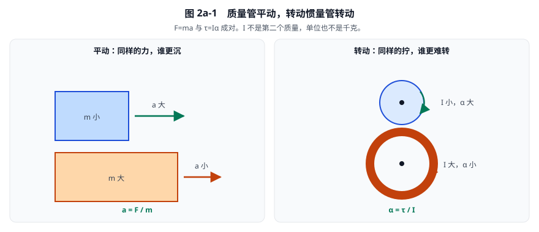
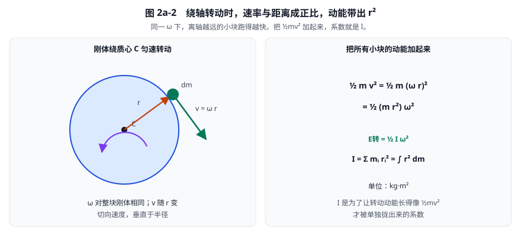
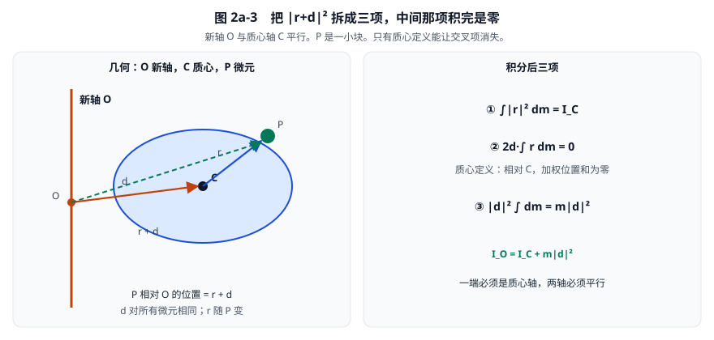
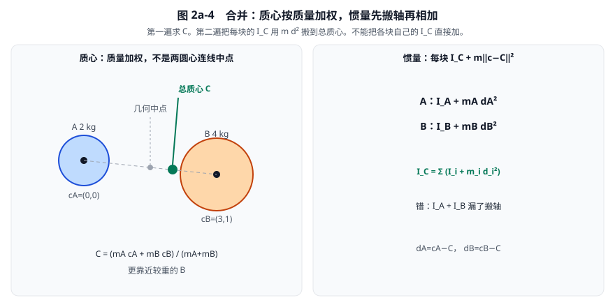

# 02a · 转动惯量的定义与由来

[返回总目录](./README.md)

第01章已经能描述位置和旋转。
第02章会用积分算出圆、多边形、胶囊的具体惯量数字。
本章先停一步，把三件事讲清楚：**转动惯量是什么**，**换平行轴时为什么变成 \(I_C+md^2\)**，以及 **几块焊成一个刚体时质心怎么加权、惯量怎么加**。
读完应能用一句话说清 \(I\)，从定义推出平行轴定理，并能对两块刚体算出总质心和总惯量。

形状积分、胶囊的两次移轴、以及 Box2D 里两遍累加的源码，见 [02 · 质量、质心与转动惯量](./02-质量质心与转动惯量.md)。

## 1. 它回答什么问题

**质量**回答：同样的力，谁更不愿意被推着走。  
**转动惯量**回答：同样的力矩（拧的劲），谁更不愿意转起来。

二者成对，但不是同一个量，也不能互相代替。

| | 平动 | 转动 |
|---|---|---|
| 惯性有多大 | 质量 \(m\) | 转动惯量 \(I\) |
| 谁来改变运动 | 力 \(F\) | 力矩 \(\tau\) |
| 运动改多快 | \(a=F/m\) | \(\alpha=\tau/I\) |
| 动能 | \(\tfrac12 m v^2\) | \(\tfrac12 I\omega^2\) |
| SI 单位 | kg | \(\mathrm{kg\cdot m^2}\) |

质量相同，转动响应仍可以差很多：质量往外摊，就更难转；往中心收拢，就更容易转。
滑冰的人把手臂收回去会转得更快，不是质量变了，而是质量离转轴近了，\(I\) 变小。角动量 \(I\omega\) 近似守恒时，\(\omega\) 就会变大。

**看图：** 左边两块都受同样的水平力，重的加速度小。右边两个质量可以相同，但细环把质量放在边缘，同样力矩下角加速度更小。

## 2. 定义：按到转轴距离的平方加权

对一根固定转轴，刚体分成许多小块，第 \(i\) 块质量为 \(m_i\)，到轴的**垂直距离**为 \(r_i\)。定义

\[
I=\sum_i m_i r_i^2.
\]

连续物体把求和换成积分：

\[
I=\int r^2\,dm.
\]

单位是 \(\mathrm{kg\cdot m^2}\)。它不是质量，也不是“长宽乘积”。
一个质量为 \(m\) 的点放在距轴 \(d\) 处，贡献就是 \(md^2\)。距离扩大两倍，贡献扩大四倍。

本书讨论二维均匀薄片。除特别说明，惯量都指**垂直于纸面、穿过质心的 \(z\) 轴**。微元相对质心的位置为 \(r=x-c\)，于是

\[
I_C=\int_A\lVert r\rVert^2\,dm
=\rho\int_A(r_x^2+r_y^2)\,dA.
\]

这就是第02章一开始直接写出的那个积分。本章只解释它为什么长这样。

**例：** 1 kg 的点质量放在距轴 0.5 m 处，

\[
I=1\times(0.5)^2=0.25\,\mathrm{kg\cdot m^2}.
\]

若改放到 1 m 处，\(I=1\,\mathrm{kg\cdot m^2}\)，是原来的四倍，不是两倍。

## 3. 平方为什么自然出现

可以先不背公式，用动能把平方逼出来。

刚体在转，角速度是 \(\omega\)。离轴 \(r\) 的那一小块，线速度大小是

\[
v=|\omega|\,r.
\]

同一刚体上 \(\omega\) 处处相同，但离轴远的点跑得更快。该微元动能

\[
\frac12 m v^2=\frac12 m(\omega r)^2=\frac12(m r^2)\omega^2.
\]

把所有小块加起来：

\[
E_{\rm rot}=\frac12\Bigl(\sum_i m_i r_i^2\Bigr)\omega^2=\frac12 I\omega^2.
\]

平动动能是 \(\tfrac12 m v^2\)。转动动能长得一模一样，只是 \(m\) 换成了 \(I\)，\(v\) 换成了 \(\omega\)。
**\(I\) 就是为了让这句话成立，才被单独拎出来的系数。**
严格说，\(\omega^2\) 前面的系数是 \(I/2\)，不是 \(I\)。

例如 \(I=2\,\mathrm{kg\cdot m^2}\)、\(\omega=3\,\mathrm{rad/s}\)，旋转动能为 \(9\,\mathrm J\)。

力矩那边走的是同一件事。对垂直轴，角动量 \(L=I\omega\)，牛顿定律的转动版就是

\[
\tau=I\alpha,
\]

与 \(F=ma\) 成对。后面碰撞冲量、关节约束，用的就是这个 \(I\)，以及它的倒数 \(I^{-1}\)。

**看图：** 绿色箭头是切向速度 \(v=\omega r\)，不是质心平动速度。把每块 \(\tfrac12 mv^2\) 加总，自然出现 \(\sum mr^2\)。

角动量也可以独立推出同一个平方。垂直轴上，点质量的角动量大小是

\[
L=r\cdot(mv)=m r(\omega r)=m r^2\omega.
\]

求和后仍是 \(L=I\omega\)。动能与角动量两条路给出同一个 \(I\)，不是两套定义。

## 4. 历史：先有钟摆问题，后有这个名字

转动惯量不是先发明一个抽象符号，再去找用途。它是被一件很具体的事逼出来的。

### 4.1 更早：杠杆里已经有“力矩”

古希腊静力学已经知道：同样重的东西，挂得离支点越远，越容易撬动。
英文 moment 来自拉丁语 momentum，在静力学里就是**力乘力臂**。
后面把惯性也按“离轴远近”加权，才出现 moment of inertia：字面意思是**惯性的力矩**，不是“一瞬间的惯性”。

中文译成“转动惯量”，其实更直白：旋转方向上的惯性有多大。

### 4.2 惠更斯，1673：给实物钟摆找等效长度

17 世纪要做准钟。理想单摆太干净：一根无质量绳子，底下一个点质量。
真实钟摆是一根有质量的杆，质量散布在各处。惠更斯（Christiaan Huygens）在 1673 年的《钟表论》（*Horologium Oscillatorium*）里问：

> 这根“质量摊开的实物摆”，等价于多长的理想单摆？

他发现：不能只看总质量和质心在哪。必须把每一小块的质量，按**到转轴距离的平方**加起来。
那个等效摆长就是现在写的

\[
\ell=\frac{I}{md},
\]

其中 \(d\) 是转轴到质心的距离，\(m\) 是总质量。
他当时还没有今天这个标准符号 \(I\)，但 \(\sum mr^2\) 这个量已经在公式里了。
他把轴从质心挪开时惯量要加 \(md^2\)，也是这条线索里长出来的。完整展开见本章第 6 节；第02章把它用到胶囊和复合刚体。

一句话：**转动惯量是为了给实物钟摆找一个“等效单摆”才被算清楚的。**

### 4.3 欧拉，约 1750–1765：写成刚体定律

牛顿的《原理》把平动讲透了：\(F=ma\)。
刚体还会转。欧拉（Leonhard Euler）在 1765 年前后的刚体力学里，把这个量定义成旋转惯性，并写出

\[
\tau=I\alpha.
\]

三维里还不够一个数：绕不同轴、质量分布不对称时，要用**惯量张量**（一组互相耦合的分量）。
二维游戏物理走运：物体只在平面里转，张量塌缩成**一个标量** \(I_z\)。
Box2D 里的 `rotationalInertia` 就是这个数。

时间线可以记成：

| 阶段 | 谁 | 做了什么 |
|---|---|---|
| 杠杆时代 | 阿基米德一脉 | 知道“离支点远就更有劲” |
| 1673 | 惠更斯 | 为钟摆算出 \(\sum mr^2\)，找到等效摆长 |
| 1765 前后 | 欧拉 | 把它定义成刚体的转动惯性，写出 \(\tau=I\alpha\) |
| 后来工程与教材 | | 固定名称 moment of inertia / 转动惯量 |

## 5. 定义时必须说清的三件事

否则公式会对、意思却乱。

### 5.1 绕哪根轴

\(I\) 不是贴在物体身上的一个绝对标签。换轴就换值。
物理引擎默认用**过质心、垂直于运动平面**的那根；铰链、转盘则用各自的转轴。
第02章的形状函数返回的是形状自身质心惯量；刚体再把各形状搬到总质心上相加。

### 5.2 \(r\) 是到轴的垂直距离

二维里就是 \(\sqrt{x^2+y^2}\)，不是沿某条边量出来的长度，也不是到某个角点的距离。
点在轴上则 \(r=0\)，该点对这根轴的惯量贡献为零：它只跟着转，自己并不“绕着跑”。

### 5.3 不要和材料力学的“惯性矩”混

工程里梁截面常用 \(I=\int y^2\,dA\)。那个积分**没有质量**，单位是 \(\mathrm{m^4}\)，描述的是截面抗弯。
刚体动力学的转动惯量带质量，单位是 \(\mathrm{kg\cdot m^2}\)。
中文有时都叫“惯性矩”，看书时先看单位，再看它有没有密度或质量。

换轴时惯量怎么变，下一节从定义推出来，不另引入新的物理定律。

## 6. 平行轴定理：换一根平行轴，惯量怎么变

要证明的就是

\[
I_O=I_C+m\lVert d\rVert^2.
\]

\(I_C\) 是绕质心轴的惯量，\(I_O\) 是绕新轴的惯量，\(m\) 是总质量，\(d\) 是质心到新轴的垂直距离（二维里就是质心 C 到轴脚 O 的向量）。
前提只有两条：**两轴平行**，并且 **其中一根必须穿过质心**。
它不是新实验定律，只是把定义 \(I=\int r^2\,dm\) 换了一个原点再展开。

### 6.1 先把三个点摆清楚

纸面里画三个点：

- O：新轴与纸面的交点，新轴垂直于纸面。
- C：质心。
- P：刚体上任意一小块，质量为 \(dm\)。

约定向量

\[
d=C-O,\qquad r=P-C.
\]

\(d\) 对所有小块都一样；\(r\) 随 P 变。于是小块相对新轴的位置是

\[
P-O=r+d.
\]

按定义，绕新轴的惯量就是把这个距离平方再对质量积分：

\[
I_O=\int\lVert r+d\rVert^2\,dm.
\]

绕质心轴则是

\[
I_C=\int\lVert r\rVert^2\,dm.
\]

**看图：** 橙色虚线是 \(r+d\)，也就是 P 到新轴的杆臂。平方一旦展开，会出现三项；只有中间那项会在积分后消失。

### 6.2 平方展开成三项

二维里 \(\lVert a\rVert^2=a_x^2+a_y^2=a\cdot a\)，所以

\[
\lVert r+d\rVert^2
=(r+d)\cdot(r+d)
=\lVert r\rVert^2+2r\cdot d+\lVert d\rVert^2.
\]

写成分量也是同一件事：

\[
(r_x+d_x)^2+(r_y+d_y)^2
=r_x^2+r_y^2+2(r_xd_x+r_yd_y)+d_x^2+d_y^2.
\]

代入积分，\(d\) 与每个小块无关，可以提出去：

\[
I_O
=\int\lVert r\rVert^2\,dm
+2d\cdot\int r\,dm
+\lVert d\rVert^2\int dm.
\]

三项分别是：

| 项 | 积分后 | 意思 |
|---|---|---|
| \(\int\lVert r\rVert^2\,dm\) | \(I_C\) | 质量相对质心摊开的那部分 |
| \(2d\cdot\int r\,dm\) | 下面证明是 0 | 交叉项 |
| \(\lVert d\rVert^2\int dm\) | \(m\lVert d\rVert^2\) | 把全部质量当成堆在质心上的一个点 |

第一项和第三项没有悬念。整个定理的关键是交叉项为什么消失。

### 6.3 交叉项为什么是零：那就是质心的定义

把 \(r=x-c\) 写回去，其中 \(x\) 是微元的位置，\(c\) 是质心位置：

\[
\int r\,dm
=\int(x-c)\,dm
=\int x\,dm-c\int dm.
\]

质心本来就定义为质量加权平均位置

\[
c=\frac{1}{m}\int x\,dm,
\qquad m=\int dm,
\]

所以 \(\int x\,dm=mc\)，于是

\[
\int r\,dm=mc-c\cdot m=0.
\]

人话：**站在质心上看，左边“质量×向左”和右边“质量×向右”正好抵消。**
\(2d\) 是常量，点乘一个零向量仍是零。交叉项整段蒸发。

因此

\[
I_O=I_C+m\lVert d\rVert^2.
\]

第三项永远非负，所以 **新轴只要离开质心，惯量只能变大，不能变小**。绕质心转是最轻省的。
反向要用减法：已经知道某根非质心轴上的 \(I_O\)，才能写 \(I_C=I_O-m\lVert d\rVert^2\)。减完若得到负数，多半是轴认错了，或把不平行的轴硬套进来。

这个结论也叫惠更斯–施泰纳定理（Huygens–Steiner theorem）。惠更斯在钟摆里已经用到移轴，后来施泰纳把它写成刚体惯量的标准形式。

### 6.4 用第02章那两个点质量把数字走完

第02章第1节的例子：左端 \(m_1=1\,\mathrm{kg}\) 在 \(x=0\)，右端 \(m_2=3\,\mathrm{kg}\) 在 \(x=2\,\mathrm m\)。总质量 \(m=4\,\mathrm{kg}\)，质心

\[
c_x=\frac{1\cdot0+3\cdot2}{4}=1.5\,\mathrm m.
\]

先按定义算绕质心的惯量。两块到质心的距离分别是 \(1.5\,\mathrm m\) 和 \(0.5\,\mathrm m\)：

\[
I_C=1\cdot(1.5)^2+3\cdot(0.5)^2=2.25+0.75=3\,\mathrm{kg\cdot m^2}.
\]

再按定义算绕原点轴 O（\(x=0\)）：

\[
I_O=1\cdot0^2+3\cdot2^2=12\,\mathrm{kg\cdot m^2}.
\]

平行轴公式给出

\[
I_C+m\lVert d\rVert^2=3+4\cdot(1.5)^2=3+9=12.
\]

两边相同。交叉项在离散求和里也看得到：

\[
\sum_i m_i r_i
=1\cdot(0-1.5)+3\cdot(2-1.5)
=-1.5+1.5=0.
\]

不是凑巧，是质心定义逼它为零。

### 6.5 为什么不能对任意两轴直接加 \(md^2\)

任意一根通过点 A 的平行轴，都可以先搬到质心再搬到 B：

\[
I_A=I_C+m\lVert c-A\rVert^2,
\qquad
I_B=I_C+m\lVert c-B\rVert^2.
\]

两式相减：

\[
I_B=I_A+m\bigl(\lVert c-B\rVert^2-\lVert c-A\rVert^2\bigr).
\]

只有当 A 就是 C 时，括号里剩下 \(\lVert c-B\rVert^2=\lVert d\rVert^2\)，才回到 \(I_B=I_A+md^2\)。
若 A、B 都不是质心，中间还藏着一项 \(-2m(c-A)\cdot(B-A)\)，不能省。

把上一小节的轴从原点错搬到右端 \(x=2\) 可以立刻验出来。绕右端按定义：

\[
I_{x=2}=1\cdot(0-2)^2+3\cdot0^2=4.
\]

正确用法是从质心搬：\(I_C+m(2-1.5)^2=3+4\cdot0.25=4\)。
若把 \(I_O=12\) 当成质心惯量再加 \(m\cdot2^2\)，会得到 \(12+16=28\)，错得离谱。

**口诀：一端必须是质心轴；两轴必须平行。** 复合刚体先算各块绕自己质心的 \(I_C\)，再搬到总质心，用的就是这一条。

### 6.6 白话图像

绕质心转：只反映质量相对质心摊得有多开，这是 \(I_C\)。
把轴挪开：相当于再加一个点质量 \(m\) 放在质心上、绕新轴转，这是 \(md^2\)。
两者相加，不多不少。质量并没有真的堆到质心上；交叉项为零，才允许把“摊开”和“整体挪轴”这样分开写。

第02章胶囊要把半圆质心先移回圆心、再移到胶囊质心，连续用两次，漏掉 \(2Ha\) 就是漏了第二次平行轴。下一节把同一公式用到“好几块焊成一个刚体”。

## 7. 几个物体合并：质心怎么加权，惯量怎么加

这里的“合并”是指焊成**一个刚体**：此后只有一个质心、一个绕质心的 \(I_C\)、一套质心速度和角速度。
不是几个独立刚体用关节连在一起。关节连接仍然是多个刚体，质量和惯量各算各的。

每块已经有自己的 \((m_i,\,c_i,\,I_{C_i})\)。\(c_i\) 是第 \(i\) 块自己的质心，\(I_{C_i}\) 是绕**它自己质心**的惯量。问题是：整体的 \(m\)、\(C\)、\(I_C\) 怎么从这些数得出来。

### 7.1 质量直接相加

质量是标量，与位置无关：

\[
m=\sum_i m_i.
\]

单位千克。零密度、传感器形状这一步贡献 0，不进入后面的质心和惯量。
若总质量仍为 0，质心公式分母为零，动态刚体不应走到这一步。

### 7.2 质心是质量加权平均，不是几何中点

整体质心的定义仍是 \(\displaystyle C=\frac1m\int x\,dm\)。
把积分拆到各块上（块与块之间若不重叠，这就是区域的无交并）：

\[
\int x\,dm=\sum_i\int_{\text{第 }i\text{ 块}}x\,dm=\sum_i m_i c_i.
\]

因此

\[
C=\frac{\sum_i m_i c_i}{m}.
\]

分子单位是千克·米，除以千克，结果是米。
**重的一块把 \(C\) 往自己那边拉。** 不能把各块质心直接平均，也不能在密度不同时拿总面积中心代替总质心。

两块时写开就是杠杆平衡：

\[
m_1(c_1-C)+m_2(c_2-C)=0.
\]

\(C\) 把 \(c_1c_2\) 按质量反比分割。三块及以上只是把同一加权再加一项。

取本章后面要用的二维例子：

| 块 | 质量 \(m_i\) | 自身质心 \(c_i\) | 自身惯量 \(I_{C_i}\) |
|---|---|---|---|
| A | \(2\,\mathrm{kg}\) | \((0,0)\,\mathrm m\) | \(0.25\,\mathrm{kg\cdot m^2}\) |
| B | \(4\,\mathrm{kg}\) | \((3,1)\,\mathrm m\) | \(0.50\,\mathrm{kg\cdot m^2}\) |

总质量 \(m=6\,\mathrm{kg}\)。总质心

\[
C=\frac{2\cdot(0,0)+4\cdot(3,1)}{6}
=\frac{(12,4)}{6}
=\Bigl(2,\,\frac23\Bigr)\,\mathrm m.
\]

A、B 圆心连线的几何中点是 \((1.5,\,0.5)\)，比 \(C\) 更靠左、更靠下。质心被 4 kg 那块拉向 B。

**看图：** 绿点是 \(C\)，灰点才是连线中点。右边公式里每块都要加 \(md^2\)，不是把 \(I_A\) 和 \(I_B\) 加起来就结束。

### 7.3 惯量不能把各块的 \(I_{C_i}\) 直接相加

\(I_{C_A}\) 的轴穿过 A 的质心，\(I_{C_B}\) 的轴穿过 B 的质心。合并之后整块刚体绕**同一个**总质心 \(C\) 转。
两根轴不是同一根，数字没有资格直接相加。

直接把 \(0.25+0.50=0.75\) 当成总惯量，等于假装两块都已经堆在 \(C\) 上。实际上它们离 \(C\) 还有一段距离，这段距离对转动惯性的贡献正是平行轴项 \(m_i\lVert c_i-C\rVert^2\)。漏掉它，总惯量会严重偏小，同样力矩下角加速度会被高估。

### 7.4 从定义推出加法：每块先搬到 \(C\)，再相加

整体绕 \(C\) 的惯量按定义是

\[
I_C=\int\lVert x-C\rVert^2\,dm=\sum_i\int_{\text{第 }i\text{ 块}}\lVert x-C\rVert^2\,dm.
\]

对第 \(i\) 块，把它相对自己质心的位置写出来：

\[
x-C=(x-c_i)+(c_i-C).
\]

令 \(r_i=x-c_i\)，\(d_i=c_i-C\)。\(d_i\) 在第 \(i\) 块内部是常量。平方展开与第 6 节完全相同：

\[
\lVert r_i+d_i\rVert^2=\lVert r_i\rVert^2+2r_i\cdot d_i+\lVert d_i\rVert^2.
\]

积分后：

\[
\int_{\text{第 }i\text{ 块}}\lVert x-C\rVert^2\,dm
=I_{C_i}+2d_i\cdot\int_{\text{第 }i\text{ 块}}r_i\,dm+m_i\lVert d_i\rVert^2.
\]

第 \(i\) 块自己的质心定义迫使 \(\int r_i\,dm=0\)，交叉项再次消失。于是每一块贡献

\[
I_{C_i}+m_i\lVert c_i-C\rVert^2,
\]

全部加起来：

\[
I_C=\sum_i\bigl(I_{C_i}+m_i\lVert c_i-C\rVert^2\bigr).
\]

两项都不能省：

- \(I_{C_i}\)：这一块相对**自己**质心摊开得有多开。
- \(m_i\lVert c_i-C\rVert^2\)：这一块的质心离**总**质心有多远。

每一项都非负，所以把质量往外接（质心离总质心更远）只会让整体更难转。

### 7.5 必须先求 \(C\)，再求 \(I_C\)：两遍

\(d_i=c_i-C\) 里有总质心。第一遍还不知道 \(C\)，第二遍才能搬轴。顺序是：

1. 累加 \(m=\sum m_i\) 和 \(\sum m_i c_i\)，然后 \(C=(\sum m_i c_i)/m\)。
2. 再对每块加 \(I_{C_i}+m_i\lVert c_i-C\rVert^2\)。

数学上也可以先把所有惯量搬到同一个遥远原点 O，得到 \(I_O=\sum(I_{C_i}+m_i\lVert c_i\rVert^2)\)，再减 \(m\lVert C\rVert^2\)。与两遍公式等价。浮点里若 \(C\) 很大，\(I_O\) 和 \(m\lVert C\rVert^2\) 都是大数，相减会吃掉有效数字。本版 Box2D 因此走两遍，每项只加非负数。这是运算顺序，不是另一条物理定律。

### 7.6 把第 7.2 节的两块数字走完

已有 \(m=6\,\mathrm{kg}\)，\(C=(2,\,2/3)\,\mathrm m\)。

A 相对总质心：

\[
d_A=(0,0)-\Bigl(2,\frac23\Bigr)=\Bigl(-2,-\frac23\Bigr),
\qquad
\lVert d_A\rVert^2=4+\frac49=\frac{40}9.
\]

B 相对总质心：

\[
d_B=(3,1)-\Bigl(2,\frac23\Bigr)=\Bigl(1,\frac13\Bigr),
\qquad
\lVert d_B\rVert^2=1+\frac19=\frac{10}9.
\]

核对加权位移是否抵消（第 7.2 节的杠杆式）：

\[
2\cdot d_A+4\cdot d_B
=2\Bigl(-2,-\frac23\Bigr)+4\Bigl(1,\frac13\Bigr)
=(-4,-\tfrac43)+(4,\tfrac43)=(0,0).
\]

惯量：

\[
\begin{aligned}
I_C
&=0.25+2\cdot\frac{40}9
+0.50+4\cdot\frac{10}9
=\frac34+\frac{80}9+\frac{40}9
=\frac34+\frac{40}3
=\frac{169}{12}
\approx14.0833\,\mathrm{kg\cdot m^2}.
\end{aligned}
\]

若漏掉平行轴，只加 \(0.25+0.50=0.75\)，会小估大约 19 倍。同样力矩下角加速度会被高估同样倍数。

### 7.7 五种用错的方式

| 错误做法 | 错在哪 |
|---|---|
| \(I_C=I_{C_A}+I_{C_B}\) | 两轴不是同一根，漏了 \(md^2\) |
| 把 \(c_A,c_B\) 直接平均当 \(C\) | 忽略了质量不同 |
| 密度不同时用总面积中心当 \(C\) | 质心是质量加权，不是面积加权 |
| 先搬到遥远原点再减 \(m\lVert C\rVert^2\) 却在大坐标下算 | 数学对，浮点可能抵消 |
| 两块几何重叠仍当两份材料 | 质量被算两次；Box2D 当前就是这样，它不是几何并集 |

重叠这一点不是公式写错，是模型选择：教学和本版引擎把各形状的质量独立累加。若形状交叠，交叠区域的密度被加了两遍。

关节连着的两个刚体也不走这一节。那是两个质心、两套惯量，靠约束冲量耦合，不是先合成一个 \(I_C\)。

第02章第 2.6 节先算多形状质心，第 10 节把两遍累加落到 `b2UpdateBodyMassData`。

## 8. 两个对照数字，用来钉住定义

质量同为 \(m=2\,\mathrm{kg}\)、外半径同为 \(R=0.5\,\mathrm m\)：

| 形状 | 质量怎么摊 | \(I_C\) |
|---|---|---|
| 均匀实心圆盘 | 从圆心铺到边缘 | \(\tfrac12 mR^2=0.25\,\mathrm{kg\cdot m^2}\) |
| 薄圆环 | 全部集中在半径 \(R\) | \(mR^2=0.50\,\mathrm{kg\cdot m^2}\) |

圆环更“转不动”，因为每一小块的 \(r\) 都等于最大的那个 \(R\)。
圆盘公式里的 \(\tfrac12\) 来自积分，不是经验系数；推导见第02章第5节。
边角碰撞时，惯量大的物体更不愿意被撞着转开，后面第09章的有效质量会把这一点算进去。

同一图在第02章标为图 2-2，这里只借用结论：离轴越远，权重按平方增加。

## 9. 收到引擎里，它变成什么

对每个形状先算自己绕自身质心的 \(I_C\)：圆是 \(\tfrac12 mR^2\)，矩形是 \(m(w^2+h^2)/12\)，多边形拆成三角形再积分。
一个刚体上有好几块形状时，按第 7 节做两遍：先加权求出总质心，再把各块用平行轴搬到总质心上相加。
求解器真正频繁用的是 \(I^{-1}\)：力矩除以惯量得到角加速度。惯量越大，同样一拧，角速度变得越慢。
静态、运动学刚体，以及锁定旋转的刚体，用零逆惯量表示“拧不动”，不是在内存里存无穷大。

形状积分和 `b2UpdateBodyMassData` 的两遍循环属于第02章。本章保证三件事：看到 `inertia` 想到 \(\int r^2\,dm\)；换轴用 \(I_C+md^2\)；合并时先求 \(C\)，再对每块加 \(I_{C_i}+m_i\lVert c_i-C\rVert^2\)。

## 10. 练习

### 题 1

用一句话区分质量和转动惯量。

答案：质量衡量同样的力能产生多大平动加速度；转动惯量衡量同样的力矩能产生多大角加速度，并且还取决于质量离转轴有多远。

### 题 2

2 kg 的点质量距轴 0.5 m。\(I\) 是多少？若距离改为 1 m，\(I\) 变成几倍？

答案：\(I=2\times0.25=0.5\,\mathrm{kg\cdot m^2}\)。距离加倍，\(I\) 变为 \(2\times1=2\,\mathrm{kg\cdot m^2}\)，是原来的 4 倍。

### 题 3

\(I=0.5\,\mathrm{kg\cdot m^2}\)，\(\omega=4\,\mathrm{rad/s}\)。旋转动能是多少？若有人把动能写成 \(I\omega^2=8\,\mathrm J\)，错在哪？

答案：\(E_{\rm rot}=\tfrac12\times0.5\times16=4\,\mathrm J\)。漏掉了 \(\tfrac12\)。\(I\) 是 \(\omega^2\) 前面整体系数的两倍。

### 题 4

为什么惠更斯研究钟摆会碰到 \(\sum mr^2\)，而不是 \(\sum mr\)？

答案：摆动时每块质量的速率与到转轴距离成正比。动能和等效摆长里都会出现 \(v^2\propto r^2\)，所以惯性必须按距离平方加权。若只按 \(\sum mr\) 加权，得到的是质心，不是转动惯性。

### 题 5

梁截面惯性矩和刚体转动惯量能否直接代入 \(\tau=I\alpha\)？

答案：不能。前者单位是 \(\mathrm{m^4}\)，没有质量；后者单位是 \(\mathrm{kg\cdot m^2}\)。\(\tau=I\alpha\) 里的 \(I\) 必须是质量二次矩。

### 题 6

平行轴公式里的交叉项 \(2d\cdot\int r\,dm\) 为什么会消失？如果新轴不平行于质心轴，还能不能用 \(I_O=I_C+md^2\)？

答案：\(r\) 是相对质心的位置，质心定义迫使 \(\int r\,dm=0\)。二维本书的轴都垂直于纸面，彼此已经平行。三维里若两轴不平行，平方展开会混进惯量积，不能再用这个标量公式。

### 题 7

沿用第 6.4 节：\(1\,\mathrm{kg}\) 在 \(x=0\)，\(3\,\mathrm{kg}\) 在 \(x=2\,\mathrm m\)。绕 \(x=2\) 的惯量是多少？若有人用 \(I_O+m\cdot2^2\)、其中 \(I_O=12\)，错在哪？

答案：按定义是 \(4\,\mathrm{kg\cdot m^2}\)。从质心搬：\(3+4\cdot(0.5)^2=4\)。\(I_O+m\cdot2^2=28\) 错在把原点轴当成了质心轴；定理的一端必须是质心。

### 题 8

两块焊成一个刚体：A 为 \(1\,\mathrm{kg}\)，\(c_A=(0,0)\)，\(I_A=0.2\)；B 为 \(3\,\mathrm{kg}\)，\(c_B=(2,0)\)，\(I_B=0.6\)。单位分别为 kg、m、kg·m²。总质心和绕总质心的惯量各是多少？若只把 \(0.2+0.6\) 相加，漏了什么？

答案：\(m=4\,\mathrm{kg}\)，\(C_x=1.5\,\mathrm m\)。
\(I_C=0.2+1\cdot(1.5)^2+0.6+3\cdot(0.5)^2=0.2+2.25+0.6+0.75=3.8\,\mathrm{kg\cdot m^2}\)。
只加 \(0.8\) 漏了两块相对总质心的平行轴项 \(2.25+0.75=3\)。

### 题 9

为什么惯量必须第二遍才算，不能和质心在同一轮循环里加完？

答案：平行轴项里的 \(d_i=c_i-C\) 需要已经知道总质心 \(C\)。第一遍只能累加质量和 \(m_i c_i\)。

## 11. 一句话收束

**转动惯量 = 把“质量如何摊在转轴周围”压缩成的一个数。**
平方来自 \(v=\omega r\)；历史上来自惠更斯给钟摆找等效长度，欧拉再把它写成和 \(F=ma\) 配套的转动定律。
换一根平行轴时，把 \(\lVert r+d\rVert^2\) 展开，交叉项被质心定义消掉，剩下 \(I_O=I_C+md^2\)。
几块焊成一个刚体时，质心按质量加权；惯量把每块自己的 \(I_{C_i}\) 用平行轴搬到总质心再相加，不能直接把各块的 \(I_{C_i}\) 加起来。

下一章从许多小质量块出发，算出质心，再对圆、三角形、胶囊、多边形真正积分出 \(I_C\)，并用两遍算法把各块搬到总质心。
[下一章：02 · 质量、质心与转动惯量](./02-质量质心与转动惯量.md) · [返回总目录](./README.md)
