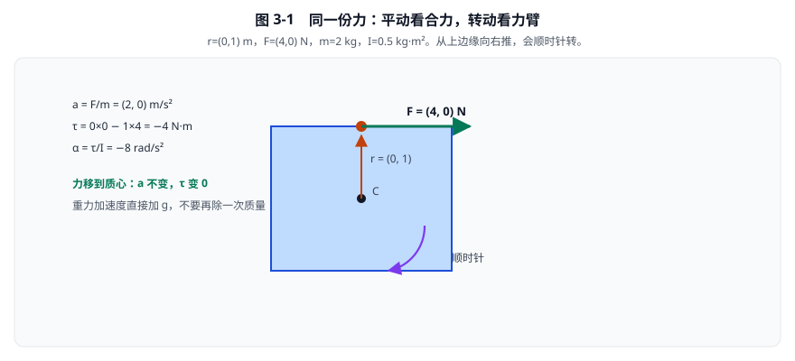
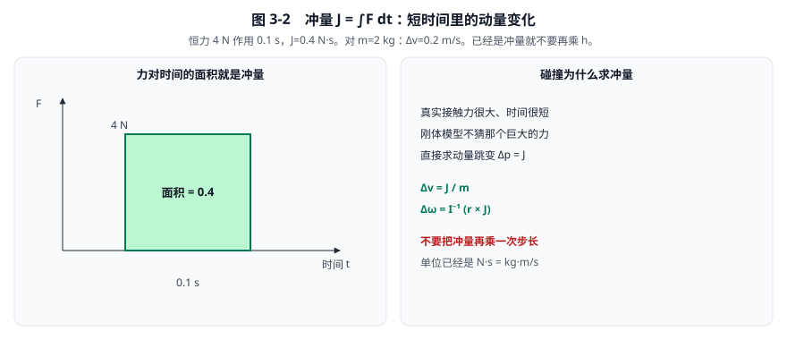
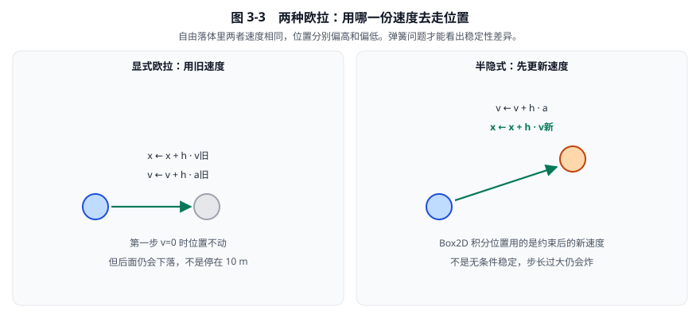
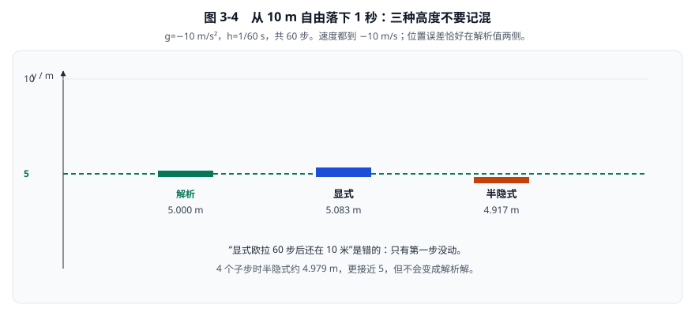

# 03 · 力、力矩、冲量与积分

[返回总目录](./README.md)

第01章提供向量运算，[02a](./02a-转动惯量的定义与由来.md) 说明转动惯量的定义，第02章提供质量和惯量的数值。
本章把它们连成时间推进公式，并明确区分：连续物理方程、教学离散算法、当前 Box2D 的实际实现。
这三者有关联，但不应写成完全相同的东西。

## 1. 先给状态变量一个明确含义

| 量 | 含义 | 单位 | 本章符号约定 |
|---|---|---|---|
| \(x\) | 世界质心位置 | m | 向右、向上为正 |
| \(v\) | 质心线速度 | m/s | 分量可正可负 |
| \(a\) | 质心加速度 | m/s² | 决定速度变化 |
| \(m\) | 质量 | kg | 动态物体应为正 |
| \(F\) | 外力合力 | N | \(1\,N=1\,kg\cdot m/s^2\) |
| \(\theta\) | 姿态角 | rad | 逆时针为正 |
| \(\omega\) | 角速度 | rad/s | 逆时针为正 |
| \(\tau\) | 关于质心的合力矩 | N·m | 逆时针为正 |
| \(I\) | 关于质心的转动惯量 | kg·m² | 非负 |
| \(h\) | 一个积分子步的时长 | s | 应为正且有限 |

速度不是位置，加速度也不是速度。
因此 \(x+=a\) 在量纲上就错了；\(v+=ha\)、\(x+=hv\) 才能匹配单位。
代码检查不能替代量纲检查，两者应同时存在。

## 2. 牛顿第二定律如何变成加减乘

平动定律：

\[
F=ma,\qquad a=\frac Fm.
\]

合力为零时是加速度为零，不是速度为零。
匀速直线运动无需持续“维持速度”的力；现实里必须持续推车，是因为存在阻力。
转动版本：

\[
\tau=I\alpha,\qquad\alpha=\frac\tau I,
\qquad\alpha=\frac{d\omega}{dt}.
\]

它们在平动与转动上结构相同，但质量和转动惯量的单位不同，不能互相代替。

作用点为 \(P\)，质心为 \(C\)，力臂 \(r=P-C\)：

\[
\tau=r\times F=r_xF_y-r_yF_x.
\]

取 \(r=(0,1)\,\mathrm m\)、\(F=(4,0)\,\mathrm N\)。
\(\tau=0\times0-1\times4=-4\,\mathrm{N\cdot m}\)，即从上边缘向右推会顺时针转。
若 \(m=2\,\mathrm{kg}\)、\(I=0.5\,\mathrm{kg\cdot m^2}\)：

\[
a=(2,0)\,\mathrm{m/s^2},
\qquad
\alpha=-8\,\mathrm{rad/s^2}.
\]

相同的力移到质心，平动加速度不变，但力矩变零。



**看图手算：** \(a=F/m=(2,0)\)，\(\tau=-4\)，\(\alpha=-8\)。重力不要再除一次质量，否则轻的会掉得更快。

源码 `b2Body_ApplyForce` 累加力并同时累加力矩，见 [刚体实现](../src/body.c)，935–955行。
非动态或禁用对象会提前返回；对睡眠对象是否起作用还取决于唤醒和 awake 状态。
不要把“API 调用成功”理解成任何对象一定响应。

## 3. 重力为什么不再乘一次逆质量

近地匀强重力为 \(F_g=mg\)。
代入牛顿定律：

\[
a_g=\frac{F_g}{m}=\frac{mg}{m}=g.
\]

质量约掉了；自由落体中的加速度与质量无关，忽略空气阻力时轻重物体同样加速。
实现中直接加 \(hg\)，不是 \(h\,m^{-1}g\)。
后者会错误地让轻物体掉得更快。
`gravityScale` 是无量纲缩放系数，可以改变这个刚体的重力响应：

\[
a=m^{-1}F+\text{gravityScale}\cdot g.
\]

这里的 F 不应再包含同一份已由 world gravity 添加的重力，否则会重复施加。
当前积分器在 `invMass == 0` 时将该重力缩放置零，特别用于运动学对象。
定位：[求解器](../src/solver.c)，`b2IntegrateVelocitiesTask`，97–102行。

## 4. 冲量：短时间内的力作用总量

线动量定义为 \(p=mv\)。
由 \(F=dp/dt\)，在时间区间积分：

\[
J=\int_{t_0}^{t_1}F(t)\,dt=\Delta p=m\Delta v.
\]

冲量 J 的单位为 \(\mathrm{N\cdot s}=\mathrm{kg\cdot m/s}\)。
若力在时长 h 内恒定，\(J=hF\)。
因此：

\[
\Delta v=m^{-1}J.
\]

点冲量还产生角冲量：

\[
\Delta L=r\times J,
\qquad
\Delta\omega=I^{-1}(r\times J).
\]

\(\Delta L\) 单位为 \(\mathrm{kg\cdot m^2/s}\)。
不要把冲量再乘一次 h，否则单位和效果都会错。
例如 \(F=(4,0)\,N\) 持续0.1秒，等效冲量为 \(J=(0.4,0)\,N\cdot s\)。
对前面的 \(m=2\)、\(I=0.5\)、\(r=(0,1)\)：
\(\Delta v=(0.2,0)\)，\(\Delta\omega=-0.8\)。
同样大小的力若只持续0.05秒，效果减半；已经给定的冲量则不应再随子步数量缩放。



**看图：** 碰撞力很大、时间很短，刚体模型不猜那个力，直接求动量跳变。\(J\) 已经是 N·s，再乘步长就会错 100 倍量级。

### 4.1 力缓冲与冲量 API 不同

`b2Body_ApplyForce` 修改待积分的 `force` 和 `torque`。
`b2Body_ApplyLinearImpulse` 直接修改当前线速度和角速度，并在该路径调用速度限制。

```1037:1040:src/body.c
		state->linearVelocity = b2MulAdd( state->linearVelocity, bodySim->invMass, impulse );
		state->angularVelocity += bodySim->invInertia * b2Cross( b2SubPos( point, bodySim->center ), impulse );

		b2LimitVelocity( state, world->maxLinearSpeed );
```

定位：[刚体实现](../src/body.c)，`b2Body_ApplyLinearImpulse`，1015–1041行。
碰撞求解使用冲量，正是因为需要直接改变速度，而不用构造极大、极短的碰撞力。
这并不意味着冲量是另一套违背牛顿定律的物理；它是牛顿定律的时间积分形式。

## 5. 连续积分与两种欧拉法

连续方程为：

\[
\frac{dv}{dt}=a,
\qquad
\frac{dx}{dt}=v.
\]

真实一步位置需要积分整个区间内的速度：

\[
x(t+h)=x(t)+\int_t^{t+h}v(s)\,ds.
\]

计算机用某个代表速度乘 h 来近似积分。
选择旧速度得到显式欧拉；选择先更新的速度得到半隐式欧拉。

### 5.1 显式欧拉必须使用同一份旧状态

\[
v_{n+1}=v_n+h\,a(x_n,v_n),
\qquad
x_{n+1}=x_n+hv_n.
\]

这里 n 是离散步编号，不是时间单位。
若代码先覆盖 x，再用覆盖后的 x 求弹簧力，那已经不是这里定义的显式欧拉。
最稳妥的教学实现是保存旧位置、旧速度，然后算两个新值。

### 5.2 半隐式欧拉先更新速度

\[
v_{n+1}=v_n+h\,a(x_n,v_n),
\qquad
x_{n+1}=x_n+hv_{n+1}.
\]

加速度仍可取旧状态，因此“半隐式”不等于求解一般非线性隐式方程。
在无耗散的合适哈密顿系统中，这种方法有辛结构；加上阻尼、冲量约束和钳制后，不宜笼统宣称整个游戏世界严格辛或严格守恒。

以下为教学伪代码，不是可编译代码，也不是 Box2D API 示例：

```text
oldPosition = body.center
acceleration = body.force / body.mass + gravity
body.velocity = body.velocity + h * acceleration
body.center = oldPosition + h * body.velocity
```



**看图：** Box2D 位置积分用的是约束修正后的新速度，属于半隐式这一边。它更稳，但不是“怎样都不会炸”。

## 6. 自由落体：完整计算60步，而不是只看第一步

设 \(y_0=10\,m\)、\(v_0=0\)、\(g=-10\,m/s^2\)、\(h=1/60\,s\)。
不启用碰撞、阻尼、速度钳制和其他力。
解析解：

\[
v(t)=v_0+gt,
\qquad
y(t)=y_0+v_0t+\frac12gt^2.
\]

1秒后 \(v=-10\,m/s\)、\(y=5\,m\)。
两种欧拉法的离散速度，在实数算术下都为 \(v_n=v_0+ngh=-n/6\)。
实际 float 实现会有小量舍入误差，不应把“理论精确”误写成“每个平台位级精确”。

### 6.1 显式欧拉的求和

位置每步使用旧速度 \(v_k\)，因此：

\[
y_N=y_0+h\sum_{k=0}^{N-1}v_k
=y_0+Nhv_0+gh^2\sum_{k=0}^{N-1}k.
\]

等差数列之和为 \(N(N-1)/2\)，于是：

\[
y_N^{\rm explicit}=y_0+Nhv_0+gh^2\frac{N(N-1)}2.
\]

代入 \(N=60\)：

\[
y_{60}=10-10\frac1{3600}\frac{60\times59}{2}
=10-\frac{59}{12}
=\frac{61}{12}
\approx5.083333.
\]

第一步确实没有下落，因为 \(v_0=0\)；但第二步已经使用负速度，之后仍会不断下落。
因此“显式欧拉60步后仍然在10米”是错误结论，不应继续传播。

### 6.2 半隐式欧拉的求和

每步使用新速度 \(v_{k+1}\)，所以：

\[
y_N^{\rm semi}=y_0+h\sum_{k=1}^{N}v_k
=y_0+Nhv_0+gh^2\frac{N(N+1)}2.
\]

代入60步：

\[
y_{60}=10-10\frac1{3600}\frac{60\times61}{2}
=10-\frac{61}{12}
=\frac{59}{12}
\approx4.916667.
\]

### 6.3 用中间状态排查代码

| 步号 n | 理论速度 \(v_n\) | 显式位置 | 半隐式位置 | 解析位置 |
|---|---:|---:|---:|---:|
| 0 | 0 | 10 | 10 | 10 |
| 1 | -0.166667 | 10 | 9.997222 | 9.998611 |
| 2 | -0.333333 | 9.997222 | 9.991667 | 9.994444 |
| 30 | -5 | 8.791667 | 8.708333 | 8.750000 |
| 60 | -10 | 5.083333 | 4.916667 | 5.000000 |

恒定加速度下，两者位置误差恰好在解析值两侧：

\[
y_N^{\rm explicit}-y(t)=-\frac12gth,
\qquad
y_N^{\rm semi}-y(t)=\frac12gth,
\quad t=Nh.
\]

由于 g 为负，显式偏高、半隐式偏低。
减半 h 会把这个问题中的位置误差减半，但不会让半隐式成为解析解。
若每个1/60秒大步分成4个子步，一秒共240步，半隐式高度为 \(4.979167\,m\)。



**看图：** 三种高度不要记混。第一步显式欧拉确实没动，但 60 步后绝不是还停在 10 m。

## 7. 半隐式为什么常更适合刚体模拟，但不是无条件稳定

自由落体不能充分展现方法的稳定性差异，因为加速度不依赖位置。
更有代表性的例子是无阻尼弹簧：

\[
a=-\omega_0^2x,
\qquad\omega_0=\sqrt{k/m}.
\]

\(k\) 为弹簧刚度，单位 \(N/m\)，\(\omega_0\) 为固有角频率，单位 \(s^{-1}\)。
负号表示偏离平衡点越远，力越指向平衡点。

显式欧拉对应矩阵：

\[
\begin{pmatrix}x_{n+1}\\v_{n+1}\end{pmatrix}
=
\begin{pmatrix}1&h\\-h\omega_0^2&1\end{pmatrix}
\begin{pmatrix}x_n\\v_n\end{pmatrix}.
\]

特征值为 \(1\pm ih\omega_0\)，模长 \(\sqrt{1+h^2\omega_0^2}>1\)。
理想无阻尼弹簧的振幅会持续增长；步长很小也只是增长慢些。
半隐式矩阵是：

\[
\begin{pmatrix}1-h^2\omega_0^2&h\\-h\omega_0^2&1\end{pmatrix}.
\]

其行列式为1，迹为 \(2-h^2\omega_0^2\)。
在 \(0<h\omega_0<2\) 时，特征值位于单位圆，可保持有界振荡。
它通常表现为能量有界摆动，不是每一步都严格保能量。
边界 \(h\omega_0=2\) 不能一般地当作安全稳定点；超过2通常会发散。
所以“用了半隐式就不会炸”仍然错误：再好的离散方法也有模型和步长适用范围。

## 8. 阻尼：先解物理模型，再看近似

采用线性阻尼模型：

\[
\frac{dv}{dt}=-cv.
\]

c 单位 \(s^{-1}\)，不是摩擦系数，要求 \(c\ge0\)。
物理阻力写成 \(F_d=-bv\) 时，\(c=b/m\)；引擎配置直接使用 c，并不保证不同质量物体共享同一个 b。
分离变量：\(dv/v=-c\,dt\)，积分得：

\[
v(t+h)=e^{-ch}v(t).
\]

令无量纲量 \(z=ch\)。
显式离散给出 \(v_{n+1}=(1-z)v_n\)。
它的稳定性必须分区说清：

| z范围 | 系数 | 结果 |
|---|---|---|
| \(0<z<1\) | 0到1 | 同向衰减 |
| \(z=1\) | 0 | 一步归零 |
| \(1<z<2\) | -1到0 | 翻向但幅值衰减 |
| \(z=2\) | -1 | 反复翻向，不衰减 |
| \(z>2\) | 小于-1 | 翻向且发散 |

因此不能把所有 \(ch>1\) 都说成“速度越来越大”。
其中1到2之间是非物理翻向的衰减，而非幅值增长。

### 8.1 当前实现的有理近似

后向欧拉对纯阻尼给出：

\[
\frac{v_{n+1}-v_n}{h}=-cv_{n+1},
\qquad
v_{n+1}=\frac{v_n}{1+ch}.
\]

它也可看作指数函数的低阶 Padé 近似：\(e^{-z}\approx1/(1+z)\)。
对于 \(c\ge0,h\ge0\)，系数在0到1之间，不翻向且不放大。
稳定不等于精确：例如 \(v=10\)、\(c=2\)、\(h=0.1\)，近似为 \(10/1.2=8.333333\)，解析值约 \(8.187308\)。
步长增大时，该近似通常会低估纯阻尼衰减程度。
负 c 会变成反阻尼，且 \(1+ch=0\) 时分母失效；不要把稳定结论用于非法参数。

## 9. 本版“阻尼加外力”的顺序必须忠于代码

本版实际速度更新为：

\[
v_{n+1}=\frac{v_n}{1+hc_v}+h(m^{-1}F+g_sg),
\qquad
\omega_{n+1}=\frac{\omega_n}{1+hc_\omega}+hI^{-1}\tau.
\]

\(c_v,c_\omega\) 分别是线性与角阻尼，\(g_s\) 为有效重力缩放。
只有旧速度乘阻尼系数，本步外力和重力增量在阻尼外加上。
它不是 \((v_n+ha)/(1+hc)\)，也不是整个受力阻尼方程的完整后向欧拉。

```94:105:src/solver.c
		float linearDamping = 1.0f / ( 1.0f + h * sim->linearDamping );
		float angularDamping = 1.0f / ( 1.0f + h * sim->angularDamping );

		// Gravity scale will be zero for kinematic bodies
		float gravityScale = sim->invMass > 0.0f ? sim->gravityScale : 0.0f;

		// lvd = h * im * f + h * g
		b2Vec2 linearVelocityDelta = b2Add( b2MulSV( h * sim->invMass, sim->force ), b2MulSV( h * gravityScale, gravity ) );
		float angularVelocityDelta = h * sim->invInertia * sim->torque;

		v = b2MulAdd( linearVelocityDelta, linearDamping, v );
		w = angularVelocityDelta + angularDamping * w;
```

定位：[求解器](../src/solver.c)，`b2IntegrateVelocitiesTask`，66–112行。
数值对比：\(v_n=10\)、\(a=3\)、\(c=2\)、\(h=0.1\)。
本版得到 \(10/1.2+0.3=8.633333\)。
若把整个分子除以1.2，会得到 \(10.3/1.2=8.583333\)，这不是相同结果。

若长期保持恒定 a 和 c，当前递推的固定点满足：

\[
v_* =\frac{v_*}{1+hc}+ha
\quad\Longrightarrow\quad
v_*=\frac ac(1+hc).
\]

连续模型的终端速度是 \(a/c\)，因此此分步近似的终端速度也有步长误差。
这不是要否定实现，而是说明为什么调阻尼时仍要保持固定步长，并通过减小子步改善一致性。

## 10. 力必须持续一个大步，不能每个子步都清零

设一个大步 \(\Delta t\) 分成 N 个子步，\(h=\Delta t/N\)。
同一外力每个子步贡献 \(hF/m\)，N次合计 \(\Delta tF/m\)。
如果第一个子步后立即清空 force，剩下 N-1 步没有这份力，效果会缩小到原来的 \(1/N\)。
如果每个子步都重复调用并累加同一份外力而不重置，又会越积越大。
因此应明确所有权：游戏逻辑在大步前提供外力，子步读取同一份缓冲，大步收尾才清零。
本版在 `b2FinalizeBodiesTask` 的631–633行清空力和力矩。
定位：[求解器](../src/solver.c)，`b2FinalizeBodiesTask`，617–633行。

冲量则是一次性速度跳变，不应为了 N 个子步重复施加 N 次。
若希望模拟持续推进器，使用每个大步持续提交的力通常比每帧随意提交固定冲量更符合时间尺度。

## 11. 旋转积分：归一化只修长度，不会修正所有角度误差

将姿态保存为 \(q=(c,s)=(\cos\theta,\sin\theta)\)。
由链式法则：

\[
\dot c=-\omega s,
\qquad
\dot s=\omega c.
\]

取 \(d=h\omega\)，显式一步得到：

\[
\tilde c=c-ds,
\qquad
\tilde s=s+dc.
\]

若原来 \(c^2+s^2=1\)，展开平方得：

\[
\tilde c^2+\tilde s^2=1+d^2.
\]

不归一化会让旋转二元组越变越长，最终把缩放混入旋转。
因此实现除以模长：

\[
q_{new}=\frac{(c-ds,s+dc)}{\sqrt{(c-ds)^2+(s+dc)^2}}.
\]

定位：[数学头文件](../include/box2d/math_functions.h)，`b2IntegrateRotation`，388–399行。
这避免了每个子步从角度重算正弦余弦，但仍包含平方根与归一化成本。

### 11.1 实际转角是 arctan，而不是精确 d

从单位姿态 \((1,0)\) 出发，结果为 \((1,d)/\sqrt{1+d^2}\)。
其角度为 \(\arctan d\)，而目标角度为 d。
当 d 很小时：

\[
\arctan d=d-\frac{d^3}{3}+O(d^5).
\]

例如 \(d=0.1\) 时实际增量约0.09966865弧度，略小于0.1。
\(d=1\) 时实际只有 \(\pi/4\approx0.785398\)，误差已明显。
所以单位长度稳定并不意味着任意角速度、任意步长都精确。
输入本来是零旋转二元组时，归一化也不会凭空恢复正确姿态；必须维持合法初始状态。

### 11.2 本版角速度上限使用大步时长

`b2IntegratePositionsTask` 在应用运动锁后限制线速度和角速度，再积累位置与旋转增量。
角速度上限为：

\[
|\omega|\le\frac{B2\_MAX\_ROTATION}{\Delta t},
\qquad B2\_MAX\_ROTATION=0.25\pi.
\]

这里分母是整个大步 \(\Delta t\)，不是子步 h。
\(\Delta t=1/60\) 时，上限约47.12389弧度每秒，除非允许快速旋转。
此限制服务于数值鲁棒性及连续碰撞假设，不应把它解释为自然界的旋转极限。
定位：[常量](../include/box2d/constants.h)，第50行；[求解器](../src/solver.c)，`b2IntegratePositionsTask`，121–158行。

## 12. 当前真实阶段顺序

一次大步先建立接触并准备约束，然后每个子步执行：

1. 积分外力、重力、力矩和阻尼，得到预测速度。
2. 热启动，把已有冲量估计应用到速度。
3. Solve，带偏置地求解约束并改变速度。
4. 使用修正后的速度积分位置和旋转增量。
5. Relax，关闭重叠偏置的相应影响，并在当前接触实现中处理恢复、摩擦和滚动阻力。

全部子步结束后，再执行一次接触冲量存储阶段，然后进行刚体收尾等工作；不是每个子步都执行 Store。
定位：[求解器](../src/solver.c)，`b2SolverTask`，1082–1169行。
`b2SolveContacts_Overflow` 的恢复分支位于 [接触求解器](../src/contact_solver.c)，301–305行，仅当 `useBias == false` 执行。
不要把 `b2SolverTask` 前面的历史阶段注释当成真正调用序列；其中仍列有并未在当前循环单独执行的 Restitution 阶段名称。

## 13. 手算练习与验收

### 题一：偏心冲量

\(m=2\)、\(I=0.5\)、\(r=(0,1)\)、\(J=(2,0)\)，求速度变化。
答案：\(\Delta v=(1,0)\,m/s\)，\(\Delta\omega=(0\times0-1\times2)/0.5=-4\,rad/s\)。
不乘 h，因为输入已经是冲量。

### 题二：阻尼系数的稳定性

\(h=0.1\)、\(c=15\)，纯阻尼显式法和本版有理近似各乘多少？
答案：显式乘 \(1-1.5=-0.5\)，翻向但幅值衰减；有理近似乘 \(1/2.5=0.4\)，同向衰减。
把显式结果说成“幅值发散”是不正确的。

### 题三：固定步长自由落体

\(y_0=10\)、\(g=-10\)，用半隐式 \(h=1/120\) 跑1秒，位置多少？
答案：\(5-5/120\approx4.958333\,m\)，速度理论值为-10。
与1/60秒步长相比，位置误差减半。

### 验收清单

- 无力、无阻尼、无碰撞时，速度保持不变。
- 重力自由落体不应随质量改变加速度。
- 给定一次冲量的效果不应随子步数成倍改变。
- 一份恒力跨 N 个子步的总效果应与 \(\Delta tF/m\) 一致，忽略其他效应。
- 纯阻尼不应因正常正参数反向或放大速度。
- 姿态归一化后长度接近1，仍要检查大转角的精度。
- 自由落体测试明确区分解析5、显式5.083333、半隐式4.916667。

下一章将这些公式组织成一个可逐步实现、可观测、可验证的单线程物理世界。
[返回总目录](./README.md)
