# 05 · 基础碰撞与接触流形

> 阅读目标：先记住一次形状对的总流程，再按 12 种已注册配对算出法线、分离量和接触点。
>
> 版本基线：`dc67c40ba2ce1ad384b0c985dbc1b539cba9221b` 对应的 3.2.0 工作树。下文以当前源码为准，不沿用其他版本的退化处理约定。

[返回目录](./README.md) · [下一章：SAT、裁剪与链段接触](./06-SAT裁剪与链段接触.md)

本章地图：

1. [检测和响应分开](#1-先把碰撞检测和碰撞响应分开)
2. [总流程、五种形状、十二种配对](#2-总流程先看这张地图)
3. [单位约定](#3-本章的单位约定)
4. [步骤 1：过滤](#4-步骤-1碰撞过滤)
5. [步骤 2：AABB](#5-步骤-2aabb-宽阶段)
6. [步骤 3：相对变换](#6-步骤-3把-b-放到-a-局部系)
7. [步骤 4：查表分发](#7-步骤-4按类型表分发)
8. [家族 A：距离型](#8-家族-a距离型窄阶段最多一个点)
9. [家族 B：两段加双点](#9-家族-b两段距离与面接触)
10. [家族 C：SAT](#10-家族-csat-与裁剪本章先算出结果)
11. [步骤 6–7：世界锚点](#11-步骤-67从局部流形到世界方向质心锚点)
12. [特征 ID](#12-分离量特征-id-与冲量历史)
13. [练习](#13-边界练习与答案)
14. [源码索引](#14-源码阅读索引)

SAT 的轴选择和裁剪逐步推导在第 06 章；本章先把每种配对的入口、分支和数字例算完。

## 1. 先把碰撞检测和碰撞响应分开

碰撞检测回答几何问题：

- 两个形状是否足够接近？
- 应该沿哪个方向阻止它们继续靠近？
- 在什么位置施加约束，才能得到合理的转动效果？

碰撞响应回答动力学问题：

- 需要多大的法向冲量？
- 摩擦可以消除多少切向相对速度？
- 应该怎样处理弹性恢复和穿透修正？

本章只完成第一组任务。

一个正确的接触点不等于已经算出了正确的碰撞冲量。

**看图：** 本章只做左边。SAT、GJK 也属于左边。第 09 章才用冲量改运动。

## 2. 总流程：先看这张地图

当前引擎对**一个形状对**走下面七步。后面每一节都对应这里的一步或一种分支，不要跳着把公式从不同步骤拼在一起。

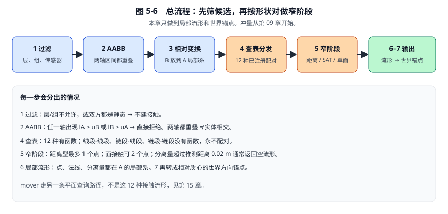

**看图按箭头走：** 蓝框是筛掉明显不可能的对，橙框才真正算几何，绿框把结果交给求解器。

| 步骤 | 问什么 | 可能的出口 |
|---|---|---|
| 1 过滤 | 这两类物体允许相碰吗？ | 不允许 → 不建接触 |
| 2 AABB | 两个轴对齐盒子叠了吗？ | 任一轴分开 → 跳过窄阶段 |
| 3 相对变换 | B 在 A 的局部系里在哪？ | 所有窄阶段函数都先做这一步 |
| 4 查表 | 这是 12 种配对里的哪一种？ | 3 种组合没有函数，直接不建接触 |
| 5 窄阶段 | 法线、分离量、0/1/2 个点 | 分离过大 → 空流形 |
| 6 局部流形 | 点在 A 局部系的什么位置？ | 输出 `b2LocalManifold` |
| 7 世界锚点 | 相对各自质心的杆臂是什么？ | 交给约束求解器 |

这里的流形容量针对**一个形状对**：当前实现最多两个代表接触点。

一个刚体可以安装多个形状，因此两个刚体之间可能存在多个流形、超过两个接触点。

### 2.1 五种形状

源码枚举是 [`b2ShapeType`](../include/box2d/types.h#L356)：

| 类型 | 源码名 | 几何 | 半径 |
|---|---|---|---|
| 圆 | `b2_circleShape` | 一个圆心 | 圆半径 |
| 胶囊 | `b2_capsuleShape` | 两个端点连成轴段 | 轴段外再包一层圆盘半径 |
| 线段 | `b2_segmentShape` | 两个端点 | 半径为 0 |
| 多边形 | `b2_polygonShape` | 凸多边形顶点，逆时针 | 可带圆角半径 |
| 链段 | `b2_chainSegmentShape` | 链上的一段，外加左右幽灵顶点 | 半径为 0，并且是单面的 |

链不是第六种独立窄阶段类型。一条链被拆成许多 `b2_chainSegmentShape`，每段单独和别的形状配对。

角色控制器使用的 mover 查询走 `b2CollideMover*`，输出的是平面而不是接触流形，见第 15 章。不要把它算进下面这 12 种。

### 2.2 十二种已注册配对，三种永不碰撞

理论上 5×5=25 个有序格子。源码在 [`b2InitializeContactRegisters`](../src/contact.c#L194) 里只注册了 **12** 个函数。交换 A/B 时，若 `primary==false`，[`b2CreateContact`](../src/contact.c#L220) 会把两个形状对调后再调用同一函数。

另外 **3** 种组合的函数指针是空的，接触根本不会被创建：

- 线段–线段
- 链段–线段
- 链段–链段

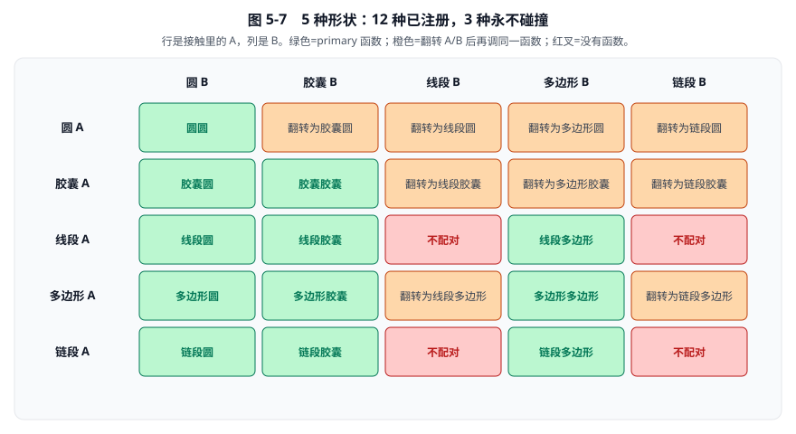

**看图：** 绿格是 primary 入口，橙格只是把 A/B 翻转后走同一条绿格，红格没有实现。

12 种配对按算法家族分成三组：

| 家族 | 配对 | 核心想法 | 点数 |
|---|---|---|---|
| A 距离型 | 圆–圆、胶囊–圆、线段–圆、多边形–圆、链段–圆 | 先找最近点或最近边，再减半径 | 0 或 1 |
| B 两段加双点 | 胶囊–胶囊、线段–胶囊 | 先求两轴段最近点，平行重叠再裁两点 | 0、1 或 2 |
| C SAT 加裁剪 | 多边形–多边形、多边形–胶囊、线段–多边形、链段–多边形、链段–胶囊 | 最浅分离轴 + 参考边裁剪 | 0、1 或 2 |

### 2.3 六种配对先改写成已有形状

不是每一种格子都有一套全新公式。有 6 种会先改写，再调用上面已经存在的函数：

| 配对 | 实际调用 | 改写规则 |
|---|---|---|
| 线段–圆 | `b2CollideCapsuleAndCircle` | 线段当成 \(r_A=0\) 的胶囊 |
| 线段–胶囊 | `b2CollideCapsules` | 线段当成 \(r_A=0\) 的胶囊 |
| 线段–多边形 | `b2CollidePolygons` | `b2MakeCapsule`，半径 0，两个顶点 |
| 多边形–胶囊 | `b2CollidePolygons` | 把胶囊做成带半径的两顶点多边形 |
| 链段–胶囊 | `b2CollideChainSegmentAndPolygon` | 同样把胶囊做成多边形 |
| 链段–圆 | 专用函数 | 不改写，但内部仍是点到段 |

**看图：** 左边把半径改成 0，中间把胶囊升级成一条带半径的边，右边三种组合直接没有函数。

因此本章真正要手算的独立算法是 6 条：

1. 圆–圆
2. 点到线段（胶囊–圆、线段–圆都用它）
3. 多边形–圆
4. 链段–圆（单面 + 幽灵顶点）
5. 两段最近点（胶囊–胶囊的单点路径）
6. SAT + 裁剪（多边形和链段的面接触，详细步骤在第 06 章）

其余配对都是这 6 条的参数变化。

## 3. 本章的单位约定

| 量 | 含义 | 单位 |
|---|---|---|
| \(p,a,b\) | 点的位置 | m |
| \(d,e,r\) | 位移或力臂 | m |
| \(R,r_A,r_B\) | 半径 | m |
| \(l_A,u_A\) | 某一维上盒子 A 的下界、上界 | m |
| \(l_B,u_B\) | 同一维上盒子 B 的下界、上界 | m |
| \(n\) | 单位法线，从 A 指向 B | 无量纲 |
| \(s\) | 有符号分离量 | m |
| \(t\) | 线段插值比例 | 无量纲 |
| \(\delta\) | 推测距离 `B2_SPECULATIVE_DISTANCE` | 默认 0.02 m |
| \(\lambda\) | 冲量 | kg·m/s |

数值例采用默认米制尺度。

如果项目改变长度单位，必须同时检查输入几何、速度与相关阈值；不要理解成所有应用参数都会自动换算。

- \(s>0\)：两表面还有间隙。
- \(s=0\)：刚好相切。
- \(s<0\)：已经穿透。

负分离量不是“负的欧氏距离”。欧氏距离仍非负；分离量额外表达了表面的相对侧别。

当前圆、胶囊、多边形窄阶段的共同门槛是：若 \(s>\delta\)，返回空流形。默认 \(\delta=0.02\) m。多边形双点裁剪还有自己的筛选，不能据此推出所有输出点都满足同一个硬上限。

## 4. 步骤 1：碰撞过滤

接触创建之前，先排除不允许相碰的形状对。常见出口有：

| 情况 | 结果 |
|---|---|
| 碰撞层 / 组过滤失败 | 不建接触 |
| 两个形状属于同一个刚体 | 不建接触 |
| 两个刚体都是静态 | 不建接触 |
| 至少一方是传感器 | 不走这 12 种流形函数，改走传感器重叠 |
| 类型表里函数指针为空 | 不建接触，见第 2.2 节那 3 格 |

这一步不计算距离。过滤通过后，宽阶段才用 AABB 继续筛。

## 5. 步骤 2：AABB 宽阶段

AABB 是与坐标轴平行的包围盒。源码结构是 [`b2AABB`](../include/box2d/math_functions.h#L82)：一个下界点 `lowerBound`，一个上界点 `upperBound`。

二维 AABB \(A\) 可以写成：

\[
A=[l_{Ax},u_{Ax}]\times[l_{Ay},u_{Ay}].
\]

四个标量都是同一世界坐标系中的位置，单位为 m：

| 符号 | 读法 | 含义 | 源码字段 |
|---|---|---|---|
| \(l_{Ax}\) | A 的 x 下界 | 盒子 A 最左边的 x | `a.lowerBound.x` |
| \(u_{Ax}\) | A 的 x 上界 | 盒子 A 最右边的 x | `a.upperBound.x` |
| \(l_{Ay}\) | A 的 y 下界 | 盒子 A 最下边的 y | `a.lowerBound.y` |
| \(u_{Ay}\) | A 的 y 上界 | 盒子 A 最上边的 y | `a.upperBound.y` |

字母 \(l\) 是 lower（下界），\(u\) 是 upper（上界）。下标 \(A\) 标明这是哪个盒子，后面的 \(x\) 或 \(y\) 标明是哪一条坐标轴。盒子 B 同理写成 \(l_{Bx},u_{Bx},l_{By},u_{By}\)。

有效 AABB 必须满足 \(l_{Ax}\le u_{Ax}\) 且 \(l_{Ay}\le u_{Ay}\)，否则不是正常盒子。

### 5.1 从区间交集推导判定式

二维相交可以拆成两个独立的一维问题：x 区间是否重叠，以及 y 区间是否重叠。

讨论其中**一条轴**时，不再重复写 \(x\) 或 \(y\)，只写四个标量：

| 符号 | 读法 | 含义 |
|---|---|---|
| \(l_A\) | A 的下界 | 盒子 A 在**当前这一维**上的下界 |
| \(u_A\) | A 的上界 | 盒子 A 在**当前这一维**上的上界 |
| \(l_B\) | B 的下界 | 盒子 B 在同一维上的下界 |
| \(u_B\) | B 的上界 | 盒子 B 在同一维上的上界 |

\(l_A\) 不是新的物理量，只是把 \(l_{Ax}\) 或 \(l_{Ay}\) 的轴下标暂时省略。检查 x 方向时：

\[
l_A=l_{Ax},\quad u_A=u_{Ax},\quad l_B=l_{Bx},\quad u_B=u_{Bx}.
\]

检查 y 方向时，改成对应的 y 分量即可。

于是当前这一维上，两个闭区间是 \([l_A,u_A]\) 和 \([l_B,u_B]\)。它们相交，当且仅当：

\[
\max(l_A,l_B)\le\min(u_A,u_B).
\]

这又等价于：

\[
l_A\le u_B,
\qquad
l_B\le u_A.
\]

左边 \(l_A\le u_B\) 的意思是：A 的左端（或下端）没有跑到 B 的右端（或上端）之外。右边 \(l_B\le u_A\) 对称。两个方向各检查这两条，四个条件都成立才保留候选。

当前源码 [`b2AABB_Overlaps`](../include/box2d/math_functions.h#L797) 写的是上述四个不等式的否定形式：任一方向出现 \(l_B>u_A\) 或 \(l_A>u_B\)，就判定不相交。

使用小于等于号意味着边界刚好贴住也会进入后续检查。

### 5.2 完整数值例

设：

\[
A=[-1,2]\times[0,1],
\qquad
B=[1.5,3]\times[0.8,2].
\]

也就是：

\[
l_{Ax}=-1,\quad u_{Ax}=2,\quad l_{Ay}=0,\quad u_{Ay}=1,
\]

\[
l_{Bx}=1.5,\quad u_{Bx}=3,\quad l_{By}=0.8,\quad u_{By}=2.
\]

对 x 方向取 \(l_A=-1\)、\(u_A=2\)、\(l_B=1.5\)、\(u_B=3\)。因为 \(-1\le 3\) 且 \(1.5\le 2\)，x 重叠。交集是：

\[
[\max(-1,1.5),\min(2,3)]=[1.5,2].
\]

对 y 方向取 \(l_A=0\)、\(u_A=1\)、\(l_B=0.8\)、\(u_B=2\)。因为 \(0\le 2\) 且 \(0.8\le 1\)，y 重叠。交集是：

\[
[\max(0,0.8),\min(1,2)]=[0.8,1].
\]

因此两框相交，应继续做窄阶段。

如果把 B 的 y 下界 \(l_{By}\) 改为 \(1.01\)，则 y 方向变成 \(l_B=1.01>u_A=1\)，y 区间立即分离，可以直接拒绝。

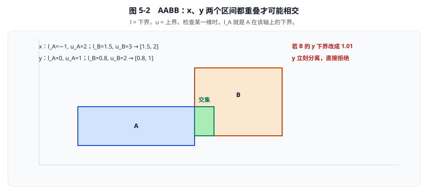

**看图：** 绿色小块是交集 \([1.5,2]\times[0.8,1]\)。图注里的 \(l_A,u_A\) 就是当前轴上 A 的下界和上界。x、y 只要有一边分开，整对形状就可以丢掉。

### 5.3 AABB 相交不代表实体相交

两个半径均为 \(1\) 的圆，圆心分别为：

\[
a=(0,0),\qquad b=(1.8,1.8).
\]

它们的 AABB 在两个方向上都重叠 \(0.2\) m。

但圆心距离为：

\[
\|b-a\|=\sqrt{1.8^2+1.8^2}
\approx2.545584>2.
\]

两个圆仍然分离。

因此 AABB 重叠宽度不能直接当作形状穿透深度。

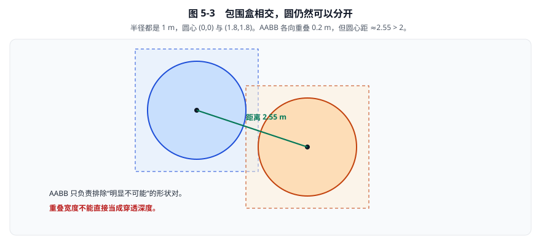

**看图：** 虚线框重叠 0.2 m，圆心距却约 2.55 m。宽阶段只能筛候选，不能代替圆圆、SAT 或 GJK。

### 5.4 旋转盒为什么会得到更宽的 AABB

设盒子局部半宽、半高为 \(h_x,h_y\)，旋转角为 \(\theta\)。

由旋转公式：

\[
x'=\cos\theta\,x-\sin\theta\,y,
\]

在 \(|x|\le h_x\)、\(|y|\le h_y\) 中取极值，可得：

\[
e_x=|\cos\theta|h_x+|\sin\theta|h_y,
\]

\[
e_y=|\sin\theta|h_x+|\cos\theta|h_y.
\]

其中 \(e_x,e_y\) 是世界 AABB 的半尺寸，单位为 m。

代入 \(h_x=2\)、\(h_y=1\)、\(\theta=30^\circ\)：

\[
e_x\approx2.232051,
\qquad
e_y\approx1.866025.
\]

这是盒子的教学闭式解。

当前通用多边形源码通过变换所有顶点，再逐坐标取最小值和最大值计算边界。

### 5.5 紧框、推测扩张与树的胖框不要混为一谈

一个包围盒按长度 \(m\) 扩张，意味着把它的二维角点沿两个轴各外扩 \(m\)：

\[
l'=l-(m,m),\qquad u'=u+(m,m).
\]

这里的 \(l=(l_x,l_y)\)、\(u=(u_x,u_y)\) 就是源码里的 `lowerBound`、`upperBound`，单位仍是 m。它不是把所有坐标乘以某个倍率。

- 紧框覆盖当前实体。
- 推测距离扩张帮助保留即将接触的候选。
- 树的额外胖框减少代理频繁移动的成本。

更详细的动态树优化应在优化章节学习。

源码入口是 [`src/geometry.c`](../src/geometry.c#L407) 中的 `b2ComputeCircleFatAABB`、`b2ComputeCapsuleFatAABB`、`b2ComputePolygonFatAABB`。

多边形计算范围为 `430—450` 行；这里还使用更高精度中间量以及朝外舍入，避免包围盒因数值舍入变小。

## 6. 步骤 3：把 B 放到 A 局部系

所有窄阶段函数的第二个形状都带着相对变换 `xf`。它把 B 的局部点变到 A 的局部系：

\[
Q_{AB}=Q_A^{-1}Q_B,
\qquad
p_{AB}=Q_A^{-1}(o_B-o_A),
\]

\[
b_A=p_{AB}+Q_{AB}b_L.
\]

- \(o_A,o_B\)：两个刚体的世界原点。
- \(Q_A,Q_B\)：各自局部到世界的旋转。
- \(b_L\)：B 的局部点。
- \(b_A\)：同一个点在 A 系中的坐标。

先统一坐标，再计算距离。不能把 B 的局部顶点直接减去 A 的世界点。

**代入：** A 在原点且不旋转，B 的原点是 \((2,0)\)、也不旋转，B 的局部圆心是 \((0.8,0)\)。则 A 系中的圆心是 \((2.8,0)\)。后面圆圆、胶囊圆的数字例都已经默认完成了这一步。

步骤 7 会再把算好的局部接触点转回世界方向、相对质心的锚点。那是另一件事，不要和这里的“先对齐坐标系”混写。

## 7. 步骤 4：按类型表分发

AABB 通过后，源码用 `s_registers[typeA][typeB].fcn` 找到窄阶段函数。

三种出口：

1. 指针为空：不创建接触。就是那 3 种永不配对。
2. `primary==false`：交换两个形状，递归一次，保证 A 总是表里的第一参数。
3. `primary==true`：调用对应的 `b2Collide*`。

读某个接触时，先看它的 A/B 类型是不是已经按 primary 排好。若你在调试器里看到“圆和多边形”，实际调用的是 `b2CollidePolygonAndCircle`，多边形才是 A。

## 8. 家族 A：距离型窄阶段，最多一个点

这一族的共同模板是：

1. 在 A 上找到离 B 最近的骨架点或参考边。
2. 沿从 A 指向 B 的方向做单位法线。
3. 分离量 = 中心距离 − 半径和。
4. 若 \(s>\delta\)，返回空流形。
5. 否则取两个表面点的中点，输出 1 个接触点。

表面见证点和代表点：

\[
c_A=a+r_A n,
\qquad
c_B=b-r_B n,
\qquad
p=\frac{c_A+c_B}{2}.
\]

\(p\) 是对两侧表面对称的代表位置，方便建立约束力臂。不要把它误认成“必定同时位于两个真实表面上的点”。

### 8.1 共享工具：点到线段的三块区域

胶囊–圆、线段–圆、链段–圆都要先回答：圆心离这段骨架最近的点在哪里？

设线段端点为 \(p_0,p_1\)，查询点为 \(q\)。

\[
e=p_1-p_0,
\qquad
t_0=\frac{(q-p_0)\cdot e}{e\cdot e},
\qquad
t=\operatorname{clamp}(t_0,0,1),
\qquad
a=p_0+t e.
\]

分子、分母都是 \(\mathrm{m}^2\)，因此 \(t_0\) 无量纲。

| 条件 | 最近特征 | 最近点 |
|---|---|---|
| \(t_0\le0\) | 起点区域 | \(p_0\) |
| \(0<t_0<1\) | 线段内部 | 垂足 |
| \(t_0\ge1\) | 终点区域 | \(p_1\) |

Voronoi 区域在这里就是“哪些查询位置以哪个特征为最近者”。

**内部例：** \(p_0=(0,0)\)，\(p_1=(4,0)\)，\(q=(1.5,0.75)\)。

\[
e=(4,0),\quad e\cdot e=16,\quad (q-p_0)\cdot e=6,
\qquad
t_0=\frac6{16}=0.375,
\qquad
a=(1.5,0).
\]

点到段距离 \(0.75\) m。

**起点例：** \(q=(-1,0.75)\)，则 \(t_0=-0.25\)，必须夹到 \(p_0\)。

**终点例：** \(q=(5,0.75)\)，则 \(t_0=1.25\)，必须夹到 \(p_1\)。

不做夹取，相当于检测无限直线，会在实际线段之外制造碰撞。

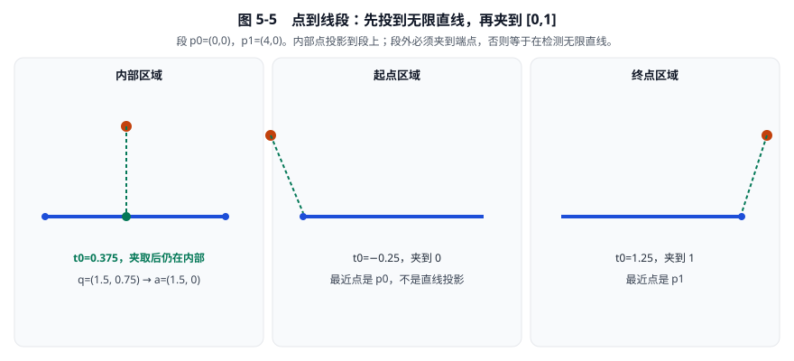

**看图：** 中间那张才是常见的“垂足在段上”。左右两张必须夹到端点。

当前胶囊圆函数用两个点积避免多数除法：

\[
s_1=(q-p_0)\cdot e,
\qquad
s_2=(p_1-q)\cdot e.
\]

- \(s_1<0\)：用起点。
- \(s_2<0\)：用终点。
- 否则 \(t=s_1/(e\cdot e)\)。

这里的 \(s_1,s_2\) 单位是 \(\mathrm{m}^2\)，不能当成插值比例。正常胶囊输入应有有效轴长；该专用函数没有替任意零长度轴段保护所有除法。

### 8.2 配对 1：圆–圆

入口：[`b2CollideCircles`](../src/manifold.c#L36)，范围 `36—64`。

情况只有两种：

| 情况 | 条件 | 结果 |
|---|---|---|
| 够近 | \(s\le\delta\) | 1 个点，`id=0` |
| 太远 | \(s>\delta\) | 空流形 |
| 同心退化 | \(\ell=0\) | 当前源码法线可能是零向量 |

设 A、B 的圆心为 \(a,b\)，半径为 \(r_A,r_B\)，且已经在同一坐标系：

\[
d=b-a,
\qquad
\ell=\sqrt{d\cdot d},
\qquad
R=r_A+r_B,
\qquad
n=\frac{d}{\ell},
\qquad
s=\ell-R.
\]

**代入：** \(a=(1,2)\)，\(b=(2.8,4.4)\)，\(r_A=2\)，\(r_B=1.2\)。

第一步，中心差与长度：

\[
d=(1.8,2.4),
\qquad
\ell=\sqrt{1.8^2+2.4^2}=3.
\]

第二步，单位法线和分离量：

\[
n=(0.6,0.8),
\qquad
s=3-2-1.2=-0.2.
\]

第三步，两个表面见证点：

\[
c_A=(1,2)+2(0.6,0.8)=(2.2,3.6),
\]

\[
c_B=(2.8,4.4)-1.2(0.6,0.8)=(2.08,3.44).
\]

第四步，代表接触点：

\[
p=\frac{(2.2,3.6)+(2.08,3.44)}{2}=(2.14,3.52).
\]

独立核对：

\[
(c_B-c_A)\cdot n=(-0.12,-0.16)\cdot(0.6,0.8)=-0.2.
\]

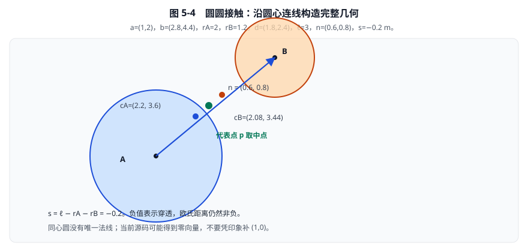

**看图对四个数：** \(n=(0.6,0.8)\)，\(s=-0.2\)，见证点 \(c_A,c_B\)，绿色中点 \(p\)。

当 \(a=b\) 时 \(\ell=0\)，不存在唯一连线方向。[`b2GetLengthAndNormalize`](../include/box2d/math_functions.h#L361) 在长度平方极小时返回长度零、向量 \((0,0)\)。当前工作树不会自动改成 \((1,0)\)。深度重合的初始化不要依赖这条常规接触法线。

### 8.3 配对 2：胶囊–圆

入口：[`b2CollideCapsuleAndCircle`](../src/manifold.c#L68)，范围 `68—124`。

三种情况，对应第 8.1 节的三块区域：

| 情况 | 最近骨架点 | 法线 |
|---|---|---|
| 轴段内部 | 垂足 | 通常垂直轴段 |
| 起点端帽 | \(p_0\) | 沿圆心到该端点 |
| 终点端帽 | \(p_1\) | 沿圆心到该端点 |

找到骨架点 \(a\) 之后，完全按圆圆计算：

\[
s=\|q-a\|-r_A-r_B.
\]

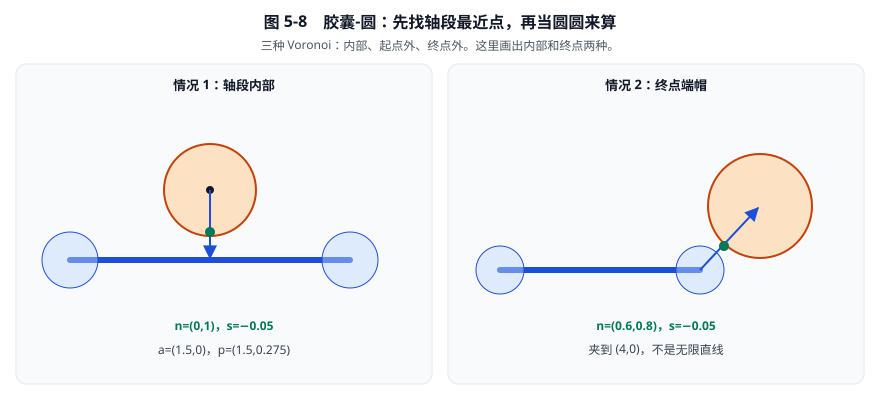

**看图：** 左图法线竖着，右图法线沿着端点连线，不再垂直胶囊轴。

**情况 1，轴段内部。** 轴段 \((0,0)\rightarrow(4,0)\)，\(r_A=0.3\)，圆心 \(q=(1.5,0.75)\)，\(r_B=0.5\)。

由第 8.1 节，\(a=(1.5,0)\)。于是：

\[
n=(0,1),
\qquad
s=0.75-0.3-0.5=-0.05,
\]

\[
c_A=(1.5,0.3),
\quad
c_B=(1.5,0.25),
\quad
p=(1.5,0.275).
\]

**情况 2，终点端帽。** 同一胶囊，圆心改为 \((4.6,0.8)\)，\(r_B=0.75\)。

\[
t_0=1.15\to t=1,
\qquad
a=(4,0),
\]

\[
d=(0.6,0.8),\quad \ell=1,\quad n=(0.6,0.8),\quad s=1-0.3-0.75=-0.05,
\]

\[
c_A=(4.18,0.24),
\qquad
c_B=(4.15,0.20),
\qquad
p=(4.165,0.22).
\]

### 8.4 配对 3：线段–圆

入口：[`b2CollideSegmentAndCircle`](../src/manifold.c#L1030)。它把线段改写成半径 0 的胶囊，然后调用上一节。

情况与胶囊–圆相同，只是 \(r_A=0\)，所以 \(c_A\) 就落在线段上。

**代入：** 段 \((0,0)\rightarrow(4,0)\)，圆心 \((1.5,0.4)\)，\(r_B=0.5\)。

最近骨架点 \(a=(1.5,0)\)。

\[
n=(0,1),
\qquad
s=0.4-0-0.5=-0.1,
\]

\[
c_A=(1.5,0),
\quad
c_B=(1.5,-0.1),
\quad
p=(1.5,-0.05).
\]

代表点略低于线段，是因为已经穿透：圆的下表面穿过了线段。这仍是中点公式，不是算错。

### 8.5 配对 4：多边形–圆

入口：[`b2CollidePolygonAndCircle`](../src/manifold.c#L127)，范围 `127—233`。

先对多边形每条边算圆心到该边的有符号距离，取最大者作为参考边。这就是“最浅分离边”。然后看圆心相对参考边两端的位置，分成三种情况：

| 情况 | 判定 | 法线来自 |
|---|---|---|
| 边区域 | 圆心投影夹在边两端之间，或圆心已进入多边形 | 该边外法线 |
| 顶点 1 | 投影落在起点外侧，且核心分离为正 | 圆心到该顶点 |
| 顶点 2 | 投影落在终点外侧，且核心分离为正 | 圆心到该顶点 |

设多边形无圆角 \(r_A=0\)，顶点逆时针：

\[
(0,0),\;(4,0),\;(4,2),\;(0,2).
\]

外法线是 \((0,-1)\)、\((1,0)\)、\((0,1)\)、\((-1,0)\)。圆半径 \(r_B=0.5\)。

边 \(i\) 的分离量是：

\[
s_i=n_i\cdot(\text{圆心}-v_i).
\]

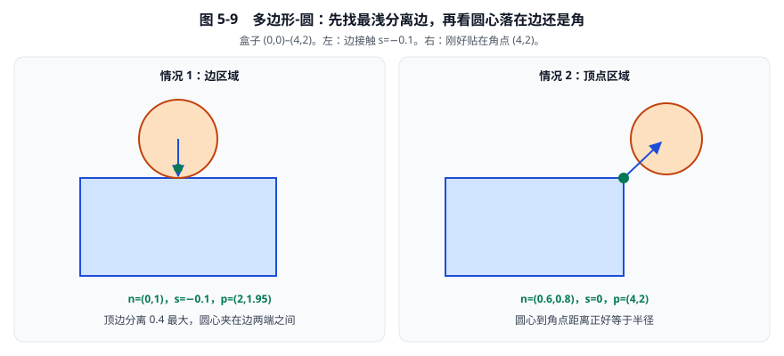

**看图：** 左边压在顶边上，右边刚好贴住右上角。

**情况 1，边区域。** 圆心 \((2,2.4)\)。

四条边的分离量：

\[
s=(-2.4,\;-2,\;0.4,\;-2).
\]

最大值 \(0.4\) 出现在顶边。半径和加推测距离是 \(0.52\)，\(0.4\le0.52\)，继续。

顶边两端 \(v_1=(4,2)\)、\(v_2=(0,2)\)。两个沿边点积都是 \(8>0\)，圆心夹在边内部。因此用法线 \((0,1)\)：

\[
s=0.4-0.5=-0.1,
\]

\[
c_A=(2,2),
\quad
c_B=(2,1.9),
\quad
p=(2,1.95).
\]

**情况 2，顶点区域。** 圆心 \((4.3,2.4)\)。

四条边分离量变成 \((-2.4,\;0.3,\;0.4,\;-4.3)\)，参考边仍是顶边。但圆心相对 \(v_1=(4,2)\) 已经偏到外侧。于是改用角点连线：

\[
n=\frac{(4.3,2.4)-(4,2)}{0.5}=(0.6,0.8),
\qquad
s=0.5-0.5=0.
\]

两个表面点都是 \((4,2)\)，代表点也是 \((4,2)\)。这是刚好贴在角上的相切。

**情况 3，圆心在多边形内部。** 圆心 \((2,1)\)。四条边分离量都是负数，最大值 \(-1\) 出现在底边。源码走边分支，分离量为 \(-1.5\)，法线取底边外法线 \((0,-1)\)。深度重合时这个结果能推出一个方向，但不适合当作稳定的初始姿态。

### 8.6 配对 5：链段–圆

入口：[`b2CollideChainSegmentAndCircle`](../src/manifold.c#L1042)，范围 `1042—1122`。

链段比普通线段多两件事：只碰撞法线一侧；端点附近还要看左右幽灵顶点，避免相邻两段抢同一个角点。

法线取边向量的右垂线 `b2RightPerp`：\((x,y)\mapsto(y,-x)\)。因此：

- 链从左向右 \((0,0)\rightarrow(4,0)\) 时，右法线朝下。
- 若地面要托住上方的物体，链必须从右向左画。

下面用一段朝上的地面：\(p_1=(4,0)\)，\(p_2=(0,0)\)，幽灵点 \(\mathrm{ghost1}=(6,0)\)，\(\mathrm{ghost2}=(-2,0)\)。右法线是 \((0,4)\)，朝上。圆半径 \(0.5\)。

| 情况 | 条件 | 结果 |
|---|---|---|
| 背面 | 圆心在法线另一侧 | 空流形 |
| 正面、段内 | 投影在开区间内 | 按点到段计算 |
| 正面、落在前一段 Voronoi | 起点外侧且 `uPrev≤0` | 空流形，交给上一段 |
| 正面、落在后一段 Voronoi | 终点外侧且下一段认领 | 空流形，交给下一段 |

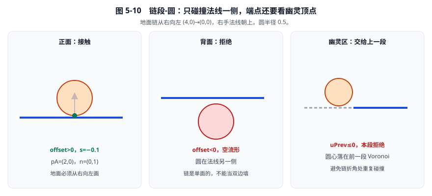

**看图：** 左图能碰，中图从地下穿上来被拒绝，右图这个角点属于虚线的前一段。

**情况 1，正面接触。** 圆心 \(q=(2,0.4)\)。

\[
e=(-4,0),
\qquad
\text{offset}=(0,4)\cdot((2,0.4)-(4,0))=1.6>0.
\]

两个沿边点积都是 \(8>0\)，投影在内部。最近骨架点 \(p_A=(2,0)\)。

\[
n=(0,1),
\qquad
s=0.4-0.5=-0.1,
\qquad
p=(2,-0.05).
\]

**情况 2，背面拒绝。** 圆心 \((2,-0.4)\)。offset 变成 \(-1.6<0\)，直接返回空流形。链不是双边墙。

**情况 3，幽灵区拒绝。** 圆心 \((4.5,0.3)\)，已经偏到 \(p_1\) 右侧。前一段方向 \(\mathrm{ghost1}\rightarrow p_1\) 的点积 \(u_{\mathrm{prev}}=-1\le0\)，本段放弃，让前一段来处理这个角。

## 9. 家族 B：两段距离与面接触

胶囊–胶囊和线段–胶囊都先求两条轴段的最近点。若两轴互相都能投影到对方内部，再尝试裁出两个点；否则退回单点。

### 9.1 共享工具：两条线段的最近点

设：

\[
A(s)=p_1+s d_1,
\qquad
B(t)=p_2+t d_2,
\qquad s,t\in[0,1].
\]

令 \(r=p_1-p_2\)，以及

\[
a=d_1\cdot d_1,\;
e=d_2\cdot d_2,\;
b=d_1\cdot d_2,\;
c=r\cdot d_1,\;
f=r\cdot d_2.
\]

这些标量单位都是 \(\mathrm{m}^2\)。非平行时：

\[
s=\frac{bf-ce}{ae-b^2},
\qquad
t=\frac{bs+f}{e}.
\]

分母为零表示平行，不能套这个式子。

不能把两个无限直线参数各夹一次就结束。正确顺序之一是：

1. 先夹取 \(s\)。
2. 根据这个 \(s\) 求 \(t\)。
3. 若 \(t<0\)，设 \(t=0\)，再求 \(s=\operatorname{clamp}(-c/a,0,1)\)。
4. 若 \(t>1\)，设 \(t=1\)，再求 \(s=\operatorname{clamp}((b-c)/a,0,1)\)。

原因是：B 的最近特征一旦变成端点，A 上的最优位置也可能改变。

**交叉例：** \(A:(0,0)\rightarrow(4,0)\)，\(B:(2,1)\rightarrow(2,-1)\)。

\[
d_1=(4,0),\; d_2=(0,-2),\; r=(-2,-1),
\]

\[
a=16,\; e=4,\; b=0,\; c=-8,\; f=2,
\]

\[
ae-b^2=64,\qquad s=0.5,\qquad t=0.5.
\]

两个最近点都是 \((2,0)\)，距离为零。此时不能用“两点之差除以距离”做法线。

[`b2SegmentDistance`](../src/distance.c#L33) 的退化分支：

- 只有第一段退化：当点，求点到第二段。
- 只有第二段退化：当点，求点到第一段。
- 两段都退化：返回两个端点距离。
- 两段都有效：参数求解再重新夹取。

源码用机器精度相关的平方门限识别退化。这不等于“所有物理容差都应直接用机器 epsilon”。

### 9.2 配对 6：胶囊–胶囊

入口：[`b2CollideCapsules`](../src/manifold.c#L237)，范围 `237—495`。

源码步骤：

1. 把 A 的一个轴端点平移到局部原点，减少大数相减。
2. 计算两轴段最近点。
3. 用平方距离拒绝 \(s>\delta\) 的明显分离。
4. 检查两轴是否互相投影在对方内部。
5. 若是，用 SAT 选参考轴并裁两点。
6. 裁出来的点分离过大，或两轴并不互相覆盖，就退回单点。
7. 单点时若最近点重合，用法线取 A 轴的左垂线，而不是零向量。

专用函数断言两条轴段有效，不能把它等同于接受任意退化输入的通用段距函数。

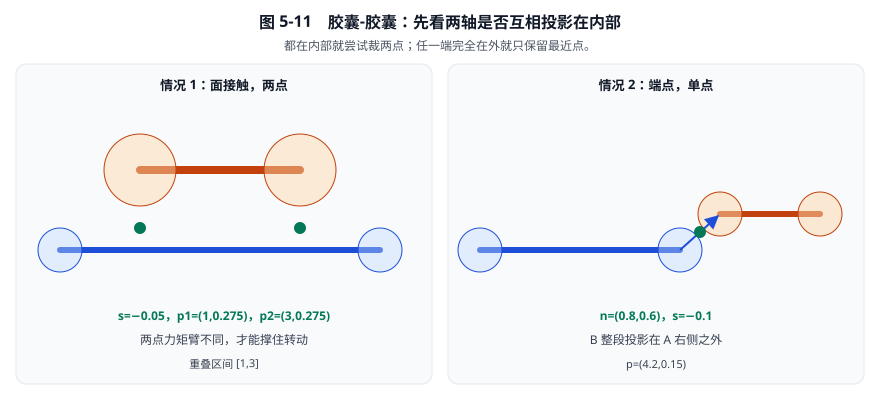

**看图：** 左图两根平行轴重叠一段，必须留两个点；右图 B 整段都在 A 右边，只留端点那一个点。

**情况 1，面接触、两个点。**

\[
A:(0,0)\rightarrow(4,0),\; r_A=0.3,
\qquad
B:(1,0.75)\rightarrow(3,0.75),\; r_B=0.5.
\]

两轴都水平，距离 \(0.75\) m，半径和 \(0.8\) m。互相投影的重叠区间是 \([1,3]\)。

\[
s=0.75-0.3-0.5=-0.05,
\]

\[
p_1=(1,0.275),\qquad p_2=(3,0.275).
\]

计算核对：参考法线取 A 的左垂线 \((0,1)\)。入射轴两端都不必再裁。每个代表点沿法线从 B 轴走到两侧表面的中点：

\[
y=0.75+\tfrac12(0.3-0.5-0.75)=0.275.
\]

两点力矩臂不同，才能表达这段支撑对转动的影响。只留中点 \((2,0.275)\) 会像把盒子放在一根针上。

**情况 2，端点、一个点。**

\[
A:(0,0)\rightarrow(4,0),\; r_A=0.3,
\qquad
B:(4.4,0.3)\rightarrow(5.4,0.3),\; r_B=0.3.
\]

B 的两个端点在 A 轴上的投影是 \(4.4\) 和 \(5.4\)，都大于 A 的轴长 \(4\)，所以 `outsideA==true`，不走双点裁剪。

最近骨架点是 \(A\) 的终点 \((4,0)\) 与 \(B\) 的起点 \((4.4,0.3)\)：

\[
d=(0.4,0.3),\quad \ell=0.5,\quad n=(0.8,0.6),\quad s=0.5-0.6=-0.1,
\]

\[
c_A=(4.24,0.18),
\quad
c_B=(4.16,0.12),
\quad
p=(4.2,0.15).
\]

**情况 3，两轴交叉。** 第 9.1 节那对线段若都加上半径，最近点差为零。源码不用除零，改取 A 轴左法线。这和圆圆同心时返回零法线的路径不同。

### 9.3 配对 7：线段–胶囊

入口：[`b2CollideSegmentAndCapsule`](../src/manifold.c#L498)。线段改写成 \(r_A=0\) 的胶囊，然后走上一节。

**代入：** 段 \((0,0)\rightarrow(4,0)\)，胶囊 \((1,0.4)\rightarrow(3,0.4)\)，\(r_B=0.5\)。

这仍是面接触。轴距 \(0.4\) m，半径和 \(0.5\) m：

\[
s=0.4-0.5=-0.1,
\]

\[
p_1=(1,-0.05),\qquad p_2=(3,-0.05).
\]

核对：代表点 \(y=0.4+\tfrac12(0-0.5-0.4)=-0.05\)。因为线段没有厚度，中点略低于线段，含义与第 8.4 节相同。

## 10. 家族 C：SAT 与裁剪，本章先算出结果

多边形对、以及被改写成多边形的胶囊，都走 [`b2CollidePolygons`](../src/manifold.c#L702)。链段对多边形还要额外处理单面和幽灵顶点，入口是 [`b2CollideChainSegmentAndPolygon`](../src/manifold.c#L1266)。

本章只做三件事：说出有哪些情况、用手算得到接触点、指出完整裁剪在第 06 章。不要在这里把 SAT 再推导一遍。

共同骨架：

1. 把 B 变到 A 局部系，并把 A 的一个顶点平移到原点。
2. 对 A、B 的每条边法线算分离量，取各自的最大值 \(s_A,s_B\)。
3. 若 \(s_A>r_A+r_B+\delta\) 或 \(s_B>r_A+r_B+\delta\)，空流形。
4. \(s_A\ge s_B\) 时 A 做参考形状，否则 B 做参考形状。
5. 在参考边上裁入射边，得到 1 或 2 个点。

边 \(i\) 的核心分离量是：

\[
s_i=\min_j n_i\cdot(b_j-v_i).
\]

先对另一形状的顶点取最小，再对所有边取最大。选的是较浅的那个负数，不是绝对值最大的那个。

### 10.1 配对 8：多边形–多边形

**代入：** A 的顶点 \((0,0),(3,0),(3,1),(0,1)\)，B 的顶点 \((1,0.8),(2.5,0.8),(2.5,2.3),(1,2.3)\)，两边半径都是 0。

A 四条外法线的分离量是 \((-2.3,\;-2,\;-0.2,\;-2.5)\)，所以

\[
s_A=-0.2,
\]

对应顶边 \(n=(0,1)\)。

B 四条边的分离量是 \((-0.2,\;-2.5,\;-2.3,\;-2)\)，所以

\[
s_B=-0.2,
\]

对应底边。当前源码在相等时偏向 A 做参考。

参考边是 A 的顶边 \(y=1\)，\(x\in[0,3]\)。入射边是 B 的底边 \(y=0.8\)，\(x\in[1,2.5]\)。两段在切向上的重叠是 \([1,2.5]\)。

表面分别在 \(y=1\) 和 \(y=0.8\)，中点 \(y=0.9\)：

\[
s=-0.2,
\qquad
p_1=(1,0.9),
\qquad
p_2=(2.5,0.9).
\]

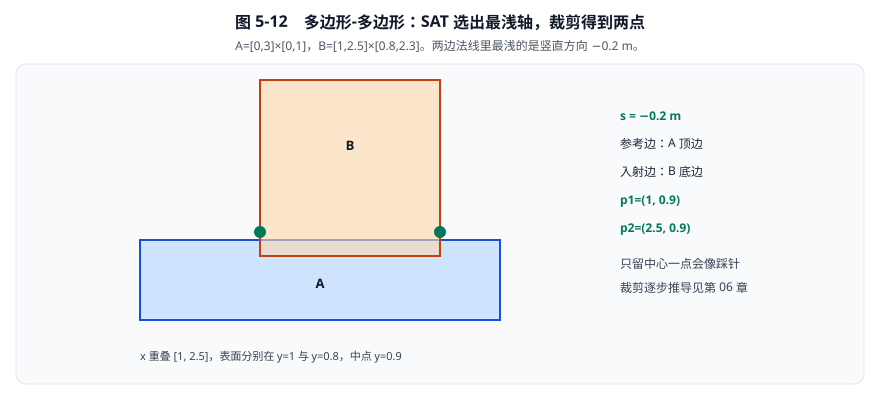

**看图：** 绿色两点撑住这段重叠。若只在 \(x=1.75\) 放一个点，B 仍能绕它左右摇。裁剪的半平面写法见第 06 章第 5 节。

### 10.2 配对 9：多边形–胶囊

入口：[`b2CollidePolygonAndCapsule`](../src/manifold.c#L504)。`b2MakeCapsule` 把胶囊变成：

- 两个顶点 = 两个轴端点；
- 两条外法线 = 轴的左右垂线；
- 多边形半径 = 胶囊半径。

它不是把胶囊拆成一个矩形加两个圆，而是一条带半径的边。

**代入：** 盒子 A 的顶点 \((0,0),(4,0),(4,2),(0,2)\)，半径 0。胶囊 B 的轴 \((1,2.2)\rightarrow(3,2.2)\)，半径 \(0.3\)。

核心（不含半径）沿竖直方向的分离是 \(2.2-2=0.2\)。扣掉胶囊半径后：

\[
s=0.2-0.3=-0.1.
\]

重叠区间仍是轴在盒子顶边上的投影 \([1,3]\)。两个代表点取在两侧表面中点 \(y=1.95\)：

\[
p_1=(1,1.95),\qquad p_2=(3,1.95).
\]

若胶囊竖着戳到盒子顶上，两轴不再互相覆盖，SAT 路径会退化成类似第 9.2 节的单点。

### 10.3 配对 10：线段–多边形

入口：[`b2CollideSegmentAndPolygon`](../src/manifold.c#L1036)。线段先变成半径 0 的两顶点多边形，再走多边形–多边形。

**代入：** 盒子顶点 \((0,0),(4,0),(4,2.1),(0,2.1)\)，线段 \((1,2)\rightarrow(3,2)\)。

最浅分离在竖直方向：

\[
s=2-2.1=-0.1.
\]

重叠区间 \([1,3]\)，中点高度 \(2.05\)：

\[
p_1=(1,2.05),\qquad p_2=(3,2.05).
\]

线段没有厚度，代表点会落在线段和盒子顶边之间。

### 10.4 配对 11、12：链段–多边形，链段–胶囊

链段–多边形是专用函数，情况比普通多边形多：

| 情况 | 含义 |
|---|---|
| 质心在背面 | 整段拒绝，单面链 |
| 法线落在相邻凸角的跳过锥 | 本段不接管，避免鬼碰撞 |
| 凹角需要贴边 | 把法线吸附到本段法线 |
| 正面 SAT | 与多边形类似，但参考边常是链段本身 |

链段–胶囊不另写一套：先把胶囊做成带半径的两顶点多边形，再走链段–多边形。

**链段–胶囊数字例。** 仍用第 8.6 节那条朝上的地面 \( (4,0)\rightarrow(0,0) \)。胶囊轴 \((1,0.4)\rightarrow(3,0.4)\)，半径 \(0.5\)。

质心大约在 \((2,0.4)\)，位于法线正面。轴距 \(0.4\) m，半径 \(0.5\) m：

\[
s=-0.1,
\qquad
p_1=(1,-0.05),
\qquad
p_2=(3,-0.05).
\]

若把同一胶囊放到 \(y=-0.4\)，质心在背面，空流形。这和链段–圆的单面规则一致。

**链段–多边形数字例。** 同一地面，盒子顶点 \((1,-0.1),(3,-0.1),(3,1.4),(1,1.4)\)。盒子压进地面 \(0.1\) m，质心约 \((2,0.65)\) 仍在正面：

\[
s=-0.1,
\qquad
p_1=(1,-0.05),
\qquad
p_2=(3,-0.05).
\]

鬼碰撞、法线分类和裁剪细节见第 06 章后半。本章只要能分清：背面直接拒绝，正面才进入 SAT。

## 11. 步骤 6–7：从局部流形到世界方向质心锚点

[`b2LocalManifold`](../include/box2d/collision.h#L592) 中的点和法线都处于 A 的局部坐标系。

为了避免混淆，记：

- \(o_A,o_B\)：两个刚体的世界原点。
- \(Q_A,Q_B\)：各自局部到世界的旋转。
- \(c_A,c_B\)：两个刚体的世界质心。
- \(p_L\)：流形中 A 局部接触点。

此节的 \(c_A,c_B\) 是质心，不再表示前面圆表面的见证点。

### 11.1 最终求解器锚点

代表接触点和世界法线为：

\[
p_W=o_A+Q_Ap_L,
\qquad
n_W=Q_An_L.
\]

最终质心相对锚点为：

\[
r_A=p_W-c_A,
\qquad
r_B=p_W-c_B.
\]

它们满足：

\[
c_A+r_A=c_B+r_B=p_W.
\]

这些锚点是**相对质心、沿世界坐标轴表达的位移**。它们不是刚体局部坐标，不应该再额外旋转一次。

### 11.2 完整数值例

设 A 的原点 \(o_A=(10,20)\)，旋转 \(90^\circ\)，局部接触点 \(p_L=(2,-1)\)。

先旋转：

\[
Q_Ap_L=(1,2).
\]

于是世界接触点为：

\[
p_W=(11,22).
\]

若质心分别为 \(c_A=(10,21)\)、\(c_B=(12,22)\)，则：

\[
r_A=(1,1),\qquad r_B=(-1,0).
\]

两边加回质心都得到 \((11,22)\)。

局部法线 \((1,0)\) 经同样旋转变成世界法线 \((0,1)\)。

### 11.3 当前源码分两阶段构造锚点

入口：[`b2UpdateContact`](../src/contact.c#L525)，范围 `525—702` 行。

源码先算：

\[
\widetilde r_A=Q_Ap_L,
\qquad
\widetilde r_B=\widetilde r_A+(o_A-o_B).
\]

这是相对原点的世界方向位移。

随后在 `611—612` 行减去各自的世界方向质心偏移，得到最终 COM 锚点。

这种顺序避免先拼出巨大世界接触坐标、再与巨大质心坐标相减。

需注意内部时序：`577—587` 行的 `PreSolve` 位于减 COM 偏移之前。

阅读内部中间状态时必须说明阶段；不要把中间原点锚点与公开最终 COM 锚点混写。

## 12. 分离量、特征 ID 与冲量历史

几何数据和动力学状态保存在同一个接触点结构中，但含义不同。

[`b2ManifoldPoint`](../include/box2d/collision.h#L527) 的主要字段包括：

- `separation`：几何分离量，单位 m。
- `normalImpulse`：法向冲量，单位 kg·m/s。
- `tangentImpulse`：切向冲量，单位 kg·m/s。
- `normalVelocity`：相对法向速度，单位 m/s，负值表示接近。
- `totalNormalImpulse`：跨子步及恢复过程的累计作用信息。
- `id`：当前形状对内的几何特征标识。
- `persisted`：本点是否与前一步的点匹配。

### 12.1 ID 不是世界唯一接触编号

当前打包方式位于 `src/manifold.c:14`：

\[
\mathrm{ID}=(A_{8bit}\ll8)\;|\;B_{8bit}.
\]

例如 A 特征索引为 2、B 特征索引为 1，则 ID 为：

\[
2\times256+1=513.
\]

它的语义取决于当前形状对和具体生成路径。

圆圆、胶囊圆、多边形圆、链段圆这些单点路径使用 `id=0`。胶囊–胶囊的双点路径会带上轴端点编号。

### 12.2 ID 热启动和几何回收是不同机制

`contact.c:603—651` 将新旧点的 ID 比较。

匹配成功就迁移法向、切向冲量并设置 `persisted`。

这属于“新几何已经算好后，继承旧动力学状态”。

另一层接触几何回收可能直接复用旧锚点和法线，减少重新计算窄阶段。

不能把几何回收的位姿门限说成这里 ID 匹配复制冲量的必备条件。

### 12.3 正分离点不是已经发生撞击

圆圆创建点时允许 \(s\le\delta\)，所以 \(s>0\) 仍可能有推测接触点。

但多边形双点裁剪具有不同筛选路径，不能据此推出所有输出点都有 \(s\le\delta\) 的统一硬上限。

下一章将给出一个实际算法可以输出 \(s=0.15\) m 的例子。

判断是否真正发生冲量作用，需要同时观察速度和冲量状态，而不是仅检查 `pointCount`。

## 13. 边界练习与答案

### 题一：Box2D 有多少种形状、多少种碰撞检测函数？

**答案：5 种形状，12 种已注册流形函数。** 另外 3 种组合（线段–线段、链段–线段、链段–链段）不创建接触。mover 查询不算在这 12 种里。

### 题二：两个圆的 AABB 相交，是否可以跳过圆圆距离检查？

**答案：不可以。** 圆心 \((0,0)\)、\((1.8,1.8)\)，半径都为 1 的例子已经构成反例。

### 题三：中心差是 \((3,4)\) m，能否直接拿它当单位法线？

**答案：不能。** 单位法线为 \((0.6,0.8)\)。不归一化会改变投影和冲量的比例。

### 题四：点段投影比例为 \(1.4\)，为什么不能保留这个比例？

**答案：线段仅允许 \([0,1]\)。** 应夹到终点，不能使用延长线上的虚构点。

### 题五：线段–圆和胶囊–圆差在哪里？

**答案：只差 \(r_A\)。** 线段就是半径为 0 的胶囊。第 8.4 节把第 8.3 节的 \(r_A\) 改成 0，其余步骤相同。

### 题六：链从左向右画在地面上，为什么箱子会掉下去？

**答案：右法线朝下，箱子在背面。** 地面链应画成从右向左，或改用双边的线段/多边形。

### 题七：两轴段交叉时，两胶囊法线一定能由最近点之差归一化得到吗？

**答案：不能。** 最近点差可能为零，源码改用 A 轴左法线。

### 题八：两个刚体能否有六个接触点？

**答案：可以。** 每个刚体安装多个形状时，多个形状对可以各自产生流形。单个形状对最多两个点。

### 题九：`separation=0.01` m 且累计法向冲量为零，是否能宣称已经撞击？

**答案：不能。** 它可能只是尚未产生实际约束作用的推测候选。

### 题十：最终 `anchorA` 加回 A 的世界质心得到什么？

**答案：该流形使用的代表接触点。** 它不一定等于 A 的真实表面见证点。

### 题十一：改变多边形顶点编号后，旧特征 ID 和 GJK 索引缓存还应直接复用吗？

**答案：不应。** 索引对应的几何语义已经改变。

### 题十二：多边形–胶囊有没有自己的专用距离公式？

**答案：没有。** 它先把胶囊做成两顶点圆角多边形，再走 SAT。独立手算的是第 10.2 节那种“先改写、再当多边形”的路径。

## 14. 源码阅读索引

| 主题 | 当前入口与范围 |
|---|---|
| 类型表注册 | [`b2InitializeContactRegisters`](../src/contact.c#L194)，`194—212` |
| 创建时翻转 A/B | [`b2CreateContact`](../src/contact.c#L220)，`228—239` |
| 圆圆 | [`b2CollideCircles`](../src/manifold.c#L36)，`36—64` |
| 胶囊圆 | [`b2CollideCapsuleAndCircle`](../src/manifold.c#L68)，`68—124` |
| 多边形圆 | [`b2CollidePolygonAndCircle`](../src/manifold.c#L127)，`127—233` |
| 胶囊胶囊 | [`b2CollideCapsules`](../src/manifold.c#L237)，`237—495` |
| 多边形多边形 | [`b2CollidePolygons`](../src/manifold.c#L702)，`702—1028` |
| 线段圆 / 线段胶囊 / 线段多边形 | `1030—1040`，分别改写后转发 |
| 链段圆 | [`b2CollideChainSegmentAndCircle`](../src/manifold.c#L1042)，`1042—1122` |
| 链段胶囊 | [`b2CollideChainSegmentAndCapsule`](../src/manifold.c#L1124)，改写后转发 |
| 链段多边形 | [`b2CollideChainSegmentAndPolygon`](../src/manifold.c#L1266) |
| 把胶囊做成多边形 | [`b2MakeCapsule`](../src/manifold.c#L16)，`16—34` |
| 通用段距 | [`b2SegmentDistance`](../src/distance.c#L33)，`33—105` |
| 多边形包围盒 | [`b2ComputePolygonFatAABB`](../src/geometry.c#L430)，`430—450` |
| 局部到世界锚点 | [`b2UpdateContact`](../src/contact.c#L525)，`525—702` |
| 公开接触点字段 | [`b2ManifoldPoint`](../include/box2d/collision.h#L527)，`527—571` |
| 极小向量归一化 | [`b2GetLengthAndNormalize`](../include/box2d/math_functions.h#L361)，`361—373` |

建议阅读顺序：先按图 5-6 走完七步，再手算圆圆和点到线段，然后做多边形–圆的边/角两个数字，最后才进入第 06 章的 SAT 裁剪。

能指出当前形状对属于 12 格中的哪一格、走哪一族算法、会输出几个点，才算把这一章读完。

[返回目录](./README.md) · [下一章：SAT、裁剪与链段接触](./06-SAT裁剪与链段接触.md)
