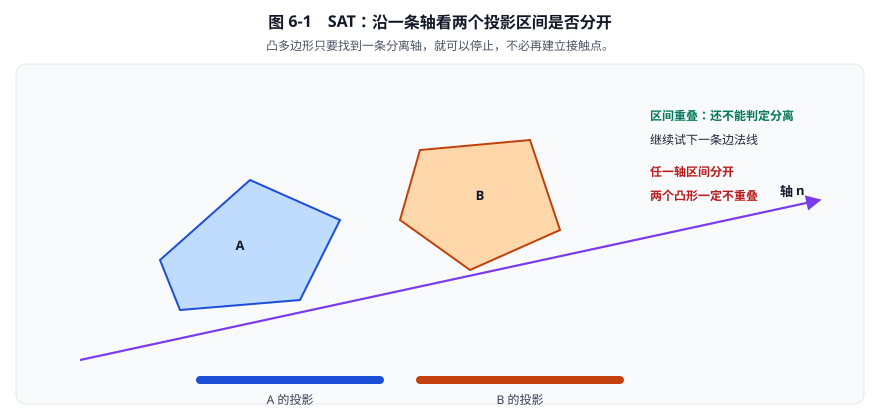
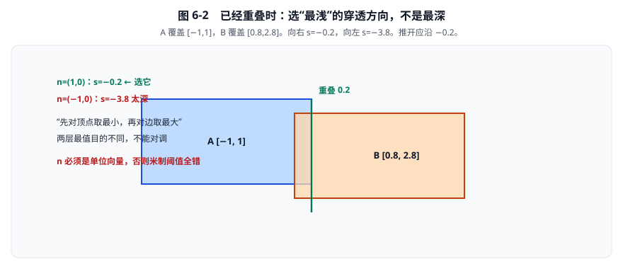
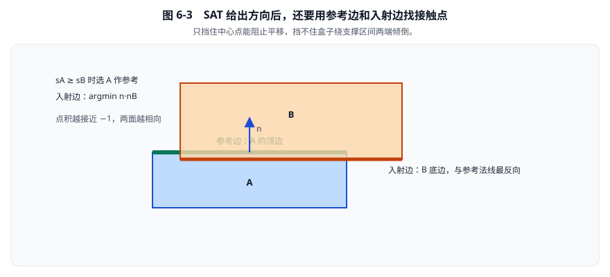
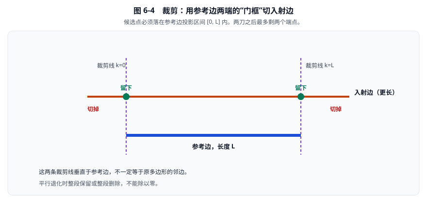
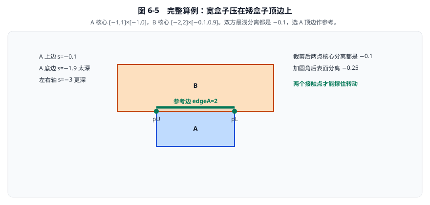

# 06 · SAT、裁剪与链段接触

> 阅读目标：能逐轴算出多边形分离量，选定参考边和入射边，完成两次裁剪，并理解圆角与单面链段为什么还需要额外规则。
>
> 基线：`dc67c40ba2ce1ad384b0c985dbc1b539cba9221b` 对应的 3.2.0 工作树。多边形主流形路径是 SAT 加裁剪，而不是所有形状都统一调用 GJK。第 05 章已经列出 12 种配对和每种的数字结果；本章把 SAT、裁剪和链段鬼碰撞逐步算完。

[返回目录](./README.md) · [上一章：基础碰撞](./05-基础碰撞与接触流形.md) · [下一章：GJK 与形状查询](./07-GJK距离与形状查询.md)

## 1. 先明确输入条件与坐标约定

本章多边形顶点采用逆时针顺序，即 CCW。

参与一次窄阶段运算的顶点都已经放到 A 的局部坐标系。

除特别说明外，位置、半径、距离的单位均为 m。

边向量为：

\[
e_i=v_{i+1}-v_i.
\]

对于逆时针凸多边形，其单位外法线为：

\[
n_i=\frac{(e_{iy},-e_{ix})}{\|e_i\|}.
\]

这表示沿有向边前进时的右侧。

法线无量纲，边向量单位为 m。

假定多边形是凸的、顶点有序、边长有效。

凹多边形应先分解为多个凸形状；不能把后面的凸多边形结论直接套到凹轮廓。

## 2. 最朴素的办法：枚举边相交还缺什么

一个容易想到的碰撞算法是枚举所有边对，检查线段是否相交。

但若 A 完全包住 B，两者边界可能完全不交，实体仍然重叠。

所以这种办法还要补上点包含检查。

分离轴定理提供了一种更统一的凸形判定方式：把二维问题变成多个一维区间问题。

## 3. SAT：在一条轴上比较投影区间

给定单位方向 \(n\)，A 的投影区间是：

\[
[\alpha_{\min},\alpha_{\max}]
=
\left[\min_i n\cdot a_i,\max_i n\cdot a_i\right].
\]

B 的区间同理：

\[
[\beta_{\min},\beta_{\max}]
=
\left[\min_j n\cdot b_j,\max_j n\cdot b_j\right].
\]

投影标量单位为 m。

若满足任一条件：

\[
\alpha_{\max}<\beta_{\min},
\qquad\text{或}\qquad
\beta_{\max}<\alpha_{\min},
\]

则两个形状一定分离。

对二维未圆角的凸多边形，检查两边所有边的法线即可。

只要找到一条分离轴，就不必继续建立接触流形。

**看图想一维：** 沿某条轴，A、B 各投影成一段区间。这段分开，二维里就一定分开。所有边法线都分不开，才认为核心可能重叠。

### 3.1 为什么只检查边法线

两个分开的凸集之间存在支撑分离直线。

对于多边形，极值由边或顶点实现；检查双方边法线可以覆盖凸核相交判定所需的候选方向。

这不意味着任意非凸形状也只需这些轴。

它也不意味着圆角轮廓的所有角角距离都能只靠核心边法线精确表达。

### 3.2 从投影区间化简为“边对顶点”

A 的一条边取顶点 \(v_i\)、外法线 \(n_i\)。

因为该边是 A 的支撑面：

\[
\max_{a\in A}n_i\cdot a=n_i\cdot v_i.
\]

于是该边对应的核心分离量为：

\[
s_i=\min_j n_i\cdot(b_j-v_i).
\]

第一层最小值找 B 沿这个方向最深入的点。

再对 A 的所有边取最大值：

\[
s_A=\max_i s_i.
\]

第二层最大值找最能分开两个形状的边。

“先最小、后最大”是两种不同目的，不能交换。

对 B 的所有边重复，得到 \(s_B\)。

### 3.3 负数中应该选择哪一个

设 A 在 x 上覆盖 \([-1,1]\)，B 覆盖 \([0.8,2.8]\)。

沿 \(n=(1,0)\)：

\[
s=0.8-1=-0.2.
\]

沿 \(n=(-1,0)\)：

\[
s=-2.8-1=-3.8.
\]

应该选择数值较大的 \(-0.2\)，表示较浅的穿透方向。

不是选绝对值最大的 \(-3.8\)。

如果错误使用 \(n=(10,0)\)，分离量会放大十倍，不能再与米制阈值直接比较。

**看图：** 把 B 往左推 3.8 m 也能分开，但那是穿过整个 A。正确接触法线沿最浅穿透，这里是向右 0.2 m。

### 3.4 对照当前源码

入口：[`b2FindMaxSeparation`](../src/manifold.c#L646)，范围 `646—681` 行。

源码对每条参考边遍历另一多边形全部顶点，再选择最大的边分离量。

复杂度约为 \(O(mn)\)。

当前顶点数很少，简单、紧凑的循环具有良好的工程价值。

[`b2CollidePolygons`](../src/manifold.c#L702) 还先进行两项坐标处理：

1. 将 A 的第一个顶点平移到原点。
2. 将 B 的顶点和法线变换到这个局部系。

这样可以减少巨大世界坐标相减带来的精度损失。

整对形状的初筛条件是：

\[
s_A>r_A+r_B+\delta
\quad\text{或}\quad
s_B>r_A+r_B+\delta.
\]

其中 \(r_A,r_B\) 为圆角半径，\(\delta\) 为推测距离，单位均为 m。

满足任一条件就返回空流形。

## 4. 为什么有法线之后还需要裁剪

SAT 可以提供合适的碰撞方向，但方向没有告诉我们在哪里施力。

两个不同位置的法向约束拥有不同力矩臂。

盒子平放时，只保留中心点可以挡住平移，却不能充分表达支撑区间两端对转动的影响。

二维边边接触沿切线方向形成一个区间。

取这个区间的两个端点，可以用少量约束近似面状接触。

这就是 SAT 后还需要裁剪的原因。

### 4.1 参考边和入射边

- **参考边**：来自当前最大分离的一侧。
- **入射边**：另一形状上法线最反向于参考法线的边。

当前多边形源码比较：

\[
s_A\ge s_B.
\]

成立时选 A 为参考形状，否则选 B。

相等时偏向 A。

此处不要套用其他版本中常见的比例容差参考边规则；当前 `747—788` 行使用上述直接比较。

若参考法线为 \(n\)，入射边选择：

\[
j=\arg\min_k n\cdot n_{Bk}.
\]

单位法线点积越接近 \(-1\)，两面越相向。

**看图：** 绿色粗线是参考边，橙色底边是入射边。只在盒子中心放一个接触点，平放的盒子会像踩在一根针上那样晃。

## 5. 先写通用的两半平面裁剪

设参考边起点、终点为 \(r_0,r_1\)。

定义长度和单位切向：

\[
L=\|r_1-r_0\|,
\qquad
t=\frac{r_1-r_0}{L}.
\]

候选点 \(p\) 应位于参考边两端之间：

\[
0\le t\cdot(p-r_0)\le L.
\]

这里的两条裁剪线经过参考边端点，并垂直于参考边。

它们**不一定等于原多边形的两条邻边**。

### 5.1 一次裁剪的插值公式

入射线段写为：

\[
x(u)=a+u(b-a),\qquad 0\le u\le1.
\]

若裁剪边界要求：

\[
t\cdot(x-r_0)=k,
\]

代入可得：

\[
u=
\frac{k-t\cdot(a-r_0)}{t\cdot(b-a)}.
\]

分子、分母单位都是 m，因此 \(u\) 无量纲。

分别用 \(k=0\) 和 \(k=L\) 完成两侧裁剪。

结果仍然是一条线段，最多有两个端点。

### 5.2 平行与退化情况

若分母为零，入射边平行于当前裁剪边界。

此时：

- 整段在合法半平面内：保留。
- 整段在外：删除。
- 位于边界上：按闭区间约定保留。

不能继续除以零。

若两点非常接近，还需要注意生成两条几乎重复约束的成本和稳定性。

### 5.3 当前源码将两刀化为区间相交

入口：[`b2ClipPolygons`](../src/manifold.c#L511)，范围 `511—642` 行。

源码利用 CCW 边的方向关系，取：

\[
t=(-n_y,n_x).
\]

参考边区间是：

\[
[0,\;t\cdot(v_{12}-v_{11})].
\]

入射边方向与参考切向相反，所以入射区间写为：

\[
[\mathrm{lower}_2,\mathrm{upper}_2]
=
[t\cdot(v_{22}-v_{11}),\;t\cdot(v_{21}-v_{11})].
\]

注意：这里 `v22` 对应较小投影端，`v21` 对应较大投影端。

源码在 `562` 行拒绝不相交区间，在 `568—585` 行计算被截断的两端。

这是专门的两边区间裁剪，不是一个通用多边形裁剪库。

**看图：** 紫色虚线是参考边两端的垂直门框。入射边更长时，两端切掉，中间留下最多两个接触点。

## 6. 完整数值例：八条轴、两次裁剪、半径与 ID

本例不跳过任何决定性步骤。

A 的核心顶点按 CCW 排列为：

\[
a_0=(-1,-1),\quad a_1=(1,-1),
\]

\[
a_2=(1,0),\quad a_3=(-1,0).
\]

B 的核心顶点为：

\[
b_0=(-2,-0.1),\quad b_1=(2,-0.1),
\]

\[
b_2=(2,0.9),\quad b_3=(-2,0.9).
\]

半径和推测距离取：

\[
r_A=0.05,\qquad r_B=0.10,\qquad\delta=0.02.
\]

### 6.1 A 的四条轴

四边法线依次为下、右、上、左。

| A 边索引 | 单位外法线 | 核心分离量 |
|---|---|---|
| 0 | \((0,-1)\) | \(-1.9\) |
| 1 | \((1,0)\) | \(-3\) |
| 2 | \((0,1)\) | \(-0.1\) |
| 3 | \((-1,0)\) | \(-3\) |

例如 A 上边位于 \(y=0\)：

\[
s_2=\min_j b_{jy}-0=-0.1.
\]

A 底边位于 \(y=-1\)，法线向下：

\[
s_0=\min_j[-(b_{jy}+1)]=-1.9.
\]

因此：

\[
s_A=-0.1,\qquad\mathrm{edgeA}=2.
\]

### 6.2 B 的四条轴

| B 边索引 | 单位外法线 | 核心分离量 |
|---|---|---|
| 0 | \((0,-1)\) | \(-0.1\) |
| 1 | \((1,0)\) | \(-3\) |
| 2 | \((0,1)\) | \(-1.9\) |
| 3 | \((-1,0)\) | \(-3\) |

于是：

\[
s_B=-0.1,\qquad\mathrm{edgeB}=0.
\]

两侧都没有超过：

\[
r_A+r_B+\delta=0.17.
\]

因为 \(s_A=s_B\)，选择 A 参考，`flip=false`。

B 底边法线 \((0,-1)\) 与 A 顶边法线 \((0,1)\) 点积为 \(-1\)，因此正好是入射边。

**看图对表：** A 上边和 B 底边都是 \(s=-0.1\)，左右轴 \(s=-3\) 太深，扔掉。裁剪后两个绿点撑住转动。

### 6.3 建立切向区间

参考边顶点为：

\[
v_{11}=a_2=(1,0),
\qquad
v_{12}=a_3=(-1,0).
\]

法线、切向分别是：

\[
n=(0,1),\qquad t=(-1,0).
\]

参考区间上界：

\[
\mathrm{upper}_1=t\cdot(v_{12}-v_{11})=2.
\]

入射边两点为：

\[
v_{21}=b_0=(-2,-0.1),
\qquad
v_{22}=b_1=(2,-0.1).
\]

所以：

\[
\mathrm{lower}_2=-1,
\qquad
\mathrm{upper}_2=3.
\]

把入射区间 \([-1,3]\) 裁到参考区间 \([0,2]\)。

### 6.4 第一刀：裁出较小投影端

插值比例是：

\[
u_L=\frac{0-(-1)}{3-(-1)}=0.25.
\]

从 `v22` 向 `v21` 插值：

\[
v_L=(1-0.25)v_{22}+0.25v_{21}=(1,-0.1).
\]

### 6.5 第二刀：裁出较大投影端

同理：

\[
u_U=\frac{2-(-1)}{3-(-1)}=0.75,
\]

\[
v_U=(1-0.75)v_{22}+0.75v_{21}=(-1,-0.1).
\]

两点的核心法向分离都是：

\[
g=n\cdot(v-v_{11})=-0.1.
\]

### 6.6 加入圆角半径

最终表面分离量为：

\[
s=g-r_A-r_B=-0.1-0.05-0.10=-0.25.
\]

参考表面见证点为：

\[
c_R=v-g n+r_A n.
\]

入射表面见证点为：

\[
c_I=v-r_B n.
\]

取中点可以化简为：

\[
p=\frac{c_R+c_I}{2}
=v+\frac12(r_A-r_B-g)n.
\]

代入后，法向偏移为：

\[
\frac12(0.05-0.10+0.10)=0.025.
\]

所以最终接触点是：

\[
p_L=(1,-0.075),
\qquad
p_U=(-1,-0.075).
\]

独立校验：参考表面高度 \(0.05\)，入射表面高度 \(-0.20\)，中点高度确为 \(-0.075\)。

### 6.7 特征 ID

源码在未翻转路径使用：

\[
\mathrm{ID}_L=\operatorname{MakeID}(i_{11},i_{22}),
\]

\[
\mathrm{ID}_U=\operatorname{MakeID}(i_{12},i_{21}).
\]

本例：

\[
\mathrm{ID}_L=2\times256+1=513,
\]

\[
\mathrm{ID}_U=3\times256+0=768.
\]

ID 表示几何来源，不是对接触点坐标做量化。

若参考形状是 B，源码会调整法线方向、点顺序和 ID 字段，最终公共法线仍必须从 A 指向 B。

## 7. 为什么一个输出点可以有较大的正分离量

“推测距离约 2 cm”不能直接改写成“每个流形点最多分离 2 cm”。

当前多边形裁剪在整对形状通过筛选后，并没有对每个输出点执行统一的这个删除条件。

下面给出合法凸形和完整轴检查。

### 7.1 几何输入

地面核心为：

\[
A=[-5,5]\times[-1,0].
\]

倾斜正方形 B 的顶点为：

\[
b_0=(-0.2,-0.05),\quad b_1=(0.7,0.15),
\]

\[
b_2=(0.5,1.05),\quad b_3=(-0.4,0.85).
\]

双方半径取零。

B 的相邻边向量是 \((0.9,0.2)\) 与 \((-0.2,0.9)\)。

它们点积为零、长度同为 \(\sqrt{0.85}\)，所以这确实是一个旋转正方形。

### 7.2 全部轴检查

| 轴来源 | 按边序得到的分离量，单位 m |
|---|---|
| A 四边 | \(-2.05,-5.4,-0.05,-5.7\) |
| B 四边 | \(-1.090075551,-5.813736270,-2.977370534,-5.087019236\) |

这些数值已通过独立算术计算核对。

最大分离确实是 A 的上表面 \(-0.05\)，因此选地面作为参考，不是仅凭图形猜测。

### 7.3 裁剪输出

B 底边两个点的 x 都在 \([-5,5]\) 内，不需要侧向截断。

两端核心分离分别为：

\[
s_0=-0.05,
\qquad
s_1=+0.15.
\]

接触中点是：

\[
p_0=(-0.2,-0.025),
\qquad
p_1=(0.7,0.075).
\]

当前 `b2ClipPolygons` 的 `589—618` 行直接构造两点，没有逐点判断 \(s>0.02\) 就删除。

因此第二个点虽然仍高于地面 15 cm，仍可作为该流形的候选点。

**候选点存在、几何已经接触、实际产生冲量，是三件不同的事。**

求解器还要结合分离量和相对速度决定是否施加冲量。

不要把图中第二个候选点标成“也已经触地”。

## 8. 圆角多边形：核心加圆盘

圆角凸形可以写为：

\[
K=P\oplus D(r).
\]

其中 \(P\) 是凸核，\(D(r)\) 是半径为 \(r\) 的圆盘。

沿任意单位方向 \(n\)，支撑值满足：

\[
h_K(n)=h_P(n)+r.
\]

原因是圆盘在任何方向上都能额外伸出 \(r\)。

因此面方向上可把核心分离量减去半径和：

\[
s=g-r_A-r_B.
\]

这不等于简单把每个顶点沿角平分线移动固定距离。

### 8.1 只检查核心边法线为何还不够

设 A 核心为 \([-1,1]^2\)，B 核心的左下角为 \((1.09,1.09)\)。

取：

\[
r_A+r_B=0.10,
\qquad
\delta=0.02.
\]

沿 x、y 两轴的核心分离都是：

\[
0.09\le0.10+0.02.
\]

所以核心轴初筛通过。

但最近角点距离是：

\[
\ell=\sqrt{0.09^2+0.09^2}\approx0.12727922.
\]

表面距离为：

\[
\ell-0.10\approx0.02727922>0.02.
\]

这对形状应该被更精确的角角距离检查拒绝。

### 8.2 当前角角修正路径

`b2CollidePolygons` 在 `794—900` 行处理核心可能分离的情况。

主要步骤是：

1. 对参考边和入射边求线段最近点。
2. 若最近距离减半径和仍超过推测距离，返回空。
3. 尝试通常的边裁剪。
4. 比较段距得到的分离与裁剪点的最小分离。
5. 若角角结果明显更合适，且最近参数确实落在两个端点，改用单点径向法线。

径向法线由两个最近角点之差归一化得到。

当前活跃实现位于 `#if 1` 分支；后面的 `#else` 代码不是本工作树实际执行路径。

## 9. 单面链段为什么会出现“幽灵碰撞”

假设把若干独立线段拼成平滑地面。

某个物体滑到线段接缝附近时，单独检测其中一段可能认定端点是最近特征。

端点指向物体的法线通常是斜的，于是产生不该存在的水平阻挡。

这就是 ghost collision：不是端点位置错了，而是把邻段已经覆盖的区域当成独立外边界。

### 9.1 ghost 顶点保存的是邻接信息

一个链段有：

- `ghost1`：前一段提供的邻接顶点。
- `point1`：当前段起点。
- `point2`：当前段终点。
- `ghost2`：后一段提供的邻接顶点。

真正碰撞的实体段只有 `point1 → point2`。

ghost 顶点不额外增加实体长度。

### 9.2 单面朝向

当前链段法线指向有向边右侧。

若希望水平地面上方可碰，段应从右向左。

例如：

\[
p_1=(2,0),\qquad p_2=(0,0).
\]

则：

\[
e=(-2,0),
\qquad
\operatorname{RightPerp}(e)=(0,2).
\]

这个方向指向上方。

链段圆碰撞先计算：

\[
\mathrm{offset}
=\operatorname{RightPerp}(e)\cdot(q-p_1).
\]

若 \(\mathrm{offset}<0\)，直接拒绝背面。

因为这里 \(e\) 未归一化，`offset` 单位是 \(\mathrm{m}^2\)；源码只用符号，不把它当米制穿透量。

## 10. 完整 ghost 所有权数值例

取共线地面：

\[
\mathrm{ghost1}=(4,0),\quad p_1=(2,0),
\]

\[
p_2=(0,0),\quad\mathrm{ghost2}=(-2,0).
\]

圆心为 \(q=(2.1,0.2)\)，半径 \(0.25\)。

### 10.1 先检查正面

\[
\mathrm{offset}=(0,2)\cdot(0.1,0.2)=0.4>0.
\]

所以圆在链段正面。

### 10.2 判定当前段端点区域

\[
v=e\cdot(q-p_1)=(-2,0)\cdot(0.1,0.2)=-0.2.
\]

因为 \(v\le0\)，圆位于当前段起点外侧。

若把当前段当孤立线段，最近点会取 \(p_1\)。

### 10.3 检查前段是否拥有这个区域

前段方向为：

\[
e_{\mathrm{prev}}=p_1-\mathrm{ghost1}=(-2,0).
\]

计算：

\[
u_{\mathrm{prev}}
=e_{\mathrm{prev}}\cdot(q-p_1)=-0.2\le0.
\]

因此当前段不生成接触，交给前段处理。

### 10.4 如果没有 ghost 信息会怎样

孤立端点到圆心的向量是 \((0.1,0.2)\)。

其单位法线是：

\[
n\approx(0.447214,0.894427).
\]

这在平地上引入了水平阻挡分量。

而前段把该圆视为段内部接触，正确法线是 \((0,1)\)。

### 10.5 另外两个边界检查

若圆心为 \((-0.1,0.2)\)，位于终点之外：

\[
e_{\mathrm{next}}=(-2,0),
\quad
e_{\mathrm{next}}\cdot(q-p_2)=0.2>0.
\]

当前段交给后段处理。

若圆心为 \((1,-0.2)\)，则：

\[
\mathrm{offset}=(0,2)\cdot(-1,-0.2)=-0.4,
\]

直接作为背面拒绝。

若圆心为 \((1,0.2)\)，最近轴点是 \((1,0)\)，分离量为：

\[
s=0.2-0.25=-0.05.
\]

此时由当前段生成向上的正常接触。

### 10.6 等号归属不是随手写的

入口：[`b2CollideChainSegmentAndCircle`](../src/manifold.c#L1042)，范围 `1042—1121`。

源码对前段使用 \(u_{\mathrm{prev}}\le0\) 拒绝，对后段使用 \(v_{\mathrm{next}}>0\) 拒绝。

这种边界所有权是非对称的。

不要只为形式对称就改动等号，否则共享边界可能被两个段争抢或同时放弃。

## 11. 链段多边形：GJK、法线分类、SAT 和裁剪协作

不能把这条路径简写成“链段与多边形只用 GJK”。

入口：[`b2CollideChainSegmentAndPolygon`](../src/manifold.c#L1266)，范围 `1266—1640`。

当前处理可分为四层：

1. 读取前后邻边，判定凸角与单面背面。
2. 用不计半径的 GJK 得到核心距离及特征缓存。
3. 对候选法线执行接纳、跳过或吸附分类。
4. 必要时进行 SAT，并通过线段裁剪生成接触点。

GJK 只知道凸几何距离，不知道接缝所有权。

ghost 与单面拓扑必须在外层补充。

### 11.1 三种法线分类

[`b2ClassifyNormal`](../src/manifold.c#L1226) 的范围是 `1226—1263` 行。

- `Admit`：接受这个角点或面方向。
- `Skip`：方向不属于当前段的合法区域，应跳过。
- `Snap`：将可能引发凹角内部阻挡的方向约束回主段法线。

这不是简单取相邻两边法线的平均值。

### 11.2 一个凸角许可例

设单位邻边方向为：

\[
e_0=(1,0),\qquad e_1=(0,1).
\]

叉积为：

\[
e_0\times e_1=1.
\]

它通过源码的凸角门限。

对应前段法线为 \(n_0=(0,-1)\)。

候选方向：

\[
n=\frac{(1,-1)}{\sqrt2}.
\]

它朝当前段尾部，并满足：

\[
n\times n_0=-\frac1{\sqrt2}.
\]

因此通过当前凸角尾部方向检查。

若候选换为：

\[
n=\frac{(-1,-1)}{\sqrt2},
\]

则：

\[
n\times n_0=+\frac1{\sqrt2},
\]

超过允许门限，进入 `Skip`。

如果邻接改成凹角，相关候选会进入 `Snap` 路径，而不是按凸角规则接受。

源码中的 `convexTol=0.01` 和 `sinTol=0.01` 作用在归一化方向上，是无量纲角度相关门限，不是 1 cm。

## 12. 推荐实现顺序

先完成正确、易观察的版本：

1. 验证凸多边形顶点、绕序与边长。
2. 遍历双方全部边法线执行 SAT。
3. 选择参考边和反向入射边。
4. 用通用两半平面裁剪求候选点。
5. 加入圆角半径与中点位置。
6. 检查 A 到 B 法线方向及 ID 来源。
7. 用独立数值例验证角角和面面接触。

正确后再添加：

- A 局部坐标与顶点原点平移。
- 专门的区间裁剪。
- 角角径向距离修正。
- 邻接链段法线许可规则。
- 特征缓存与接触回收。

不要从第一天就把所有优化和退化处理塞进一个不可观察的大函数。

## 13. 边界练习与答案

### 题一：SAT 中到底取最大还是最小？

**答案：每条轴先取另一形状顶点的最小分离，再跨参考边取最大值。** 两层各有不同几何含义。

### 题二：两个候选轴分离量为 \(-0.1\) 和 \(-2\)，选哪个？

**答案：选 \(-0.1\)。** 它对应更浅的穿透方向。

### 题三：裁剪参考边两端所用的线就是原多边形邻边吗？

**答案：不是。** 它们经过参考端点，并垂直参考切向。

### 题四：圆角只减半径和，是否就能用核心边法线精确完成所有判定？

**答案：不能。** 对角间隙例中还需要角角径向距离。

### 题五：一个流形点有 \(s=0.15\) m，是否一定说明窄阶段写错？

**答案：不一定。** 当前双点裁剪可能输出这种较远正分离候选；还要看该分支和后续冲量。

### 题六：链段从 \((0,0)\) 指向 \((2,0)\)，正面朝哪边？

**答案：向右行进的右侧，即 \(y<0\) 一侧。**

### 题七：ghost 顶点是否给链段增加额外实体长度？

**答案：不会。** 它们提供邻接、法线和所有权信息。

### 题八：GJK 返回距离零，就可以直接用其法线处理链段吗？

**答案：不能保证。** 零距离时法线可能无效，链段还需要拓扑规则与 SAT 分支。

## 14. 源码阅读索引

| 主题 | 当前函数与范围 |
|---|---|
| SAT 最大分离 | [`b2FindMaxSeparation`](../src/manifold.c#L646)，`646—681` |
| 多边形主流形 | [`b2CollidePolygons`](../src/manifold.c#L702)，`702—1027` |
| 两边裁剪 | [`b2ClipPolygons`](../src/manifold.c#L511)，`511—642` |
| 链段与圆 | [`b2CollideChainSegmentAndCircle`](../src/manifold.c#L1042)，`1042—1121` |
| 链段法线分类 | [`b2ClassifyNormal`](../src/manifold.c#L1226)，`1226—1263` |
| 链段与多边形 | [`b2CollideChainSegmentAndPolygon`](../src/manifold.c#L1266)，`1266—1640` |

先把第 6 节完整算通，再用第 7 节检查“候选点不等于已触地”。

这两个例子比背下所有分支名称更重要。

[返回目录](./README.md) · [下一章：GJK 与形状查询](./07-GJK距离与形状查询.md)
