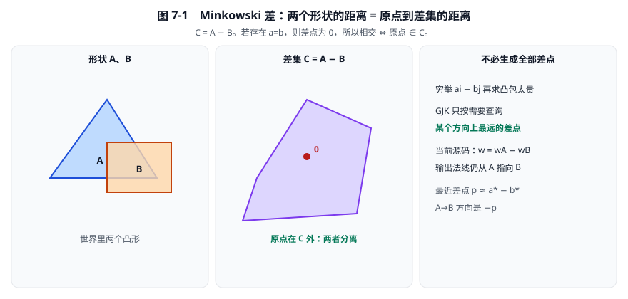
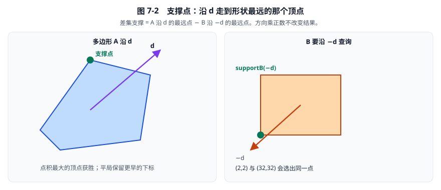
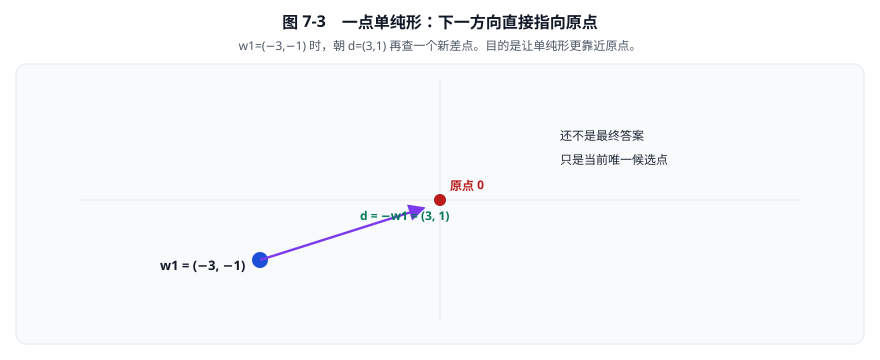
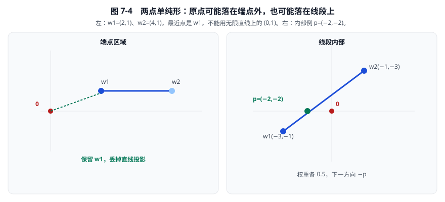
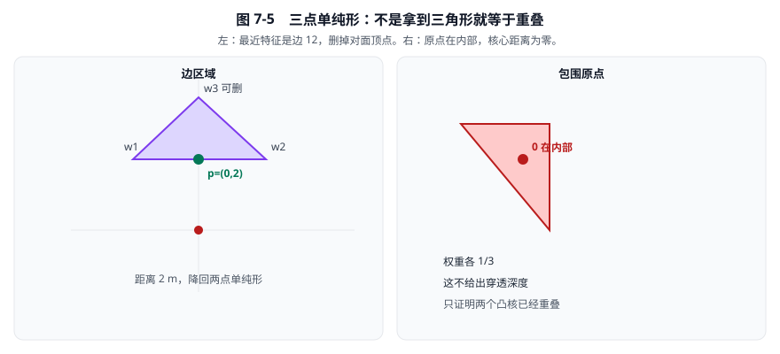
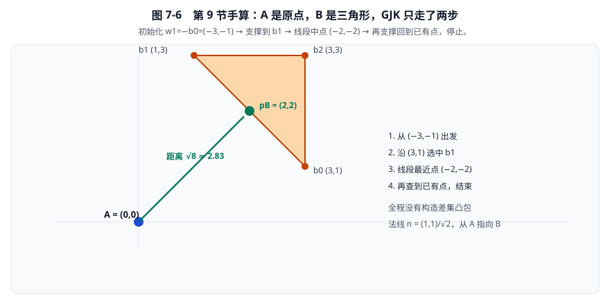

# 07 · GJK 距离与形状查询

> 阅读目标：从 Minkowski 差推导 GJK，手算点、线段、三角形单纯形，理解缓存和退化停止，并区分距离、射线、形状扫掠及角色移动平面查询。
>
> 基线：`dc67c40ba2ce1ad384b0c985dbc1b539cba9221b` 对应的 3.2.0 工作树。当前差点采用 A 减 B；射线初始重叠行为也不能照搬旧版资料。

[返回目录](./README.md) · [上一章：SAT 与裁剪](./06-SAT裁剪与链段接触.md) · [下一章：TOI 与连续碰撞](./08-TOI与连续碰撞.md)

## 1. 先分清本章几个接口回答的问题

| 接口类别 | 问题 | 主要输出 |
|---|---|---|
| 接触流形 | 应在哪里建立接触约束？ | 法线、分离量、代表点 |
| 距离查询 | 两个凸形目前最近有多远？ | 非负距离、见证点 |
| 射线查询 | 一个零厚度点沿线走，会在哪里碰到形状？ | 比例、命中点、法线 |
| 形状扫掠 | 一个凸形只做指定平移，会在哪里接近目标？ | 比例、命中点、法线 |
| mover 查询 | 胶囊角色应该受到哪些移动平面限制？ | 扫掠比例或平面 |
| TOI | 两个带旋转的 sweep 在何时接近？ | 状态、时间比例 |

它们共享几何运算，但不是同一个接口的不同名字。

和第 06 章 SAT 的分工可以先记成：

- **SAT + 裁剪**：已经知道两个凸多边形可能重叠，要找**法线和一两个接触点**，交给求解器。
- **GJK**：要问两个凸形**现在隔多远**，或射线/扫掠何时碰上。它找原点到 Minkowski 差的最近点，不直接给出盒子压在地面上的那两个支撑点。
- 当前多边形主流形路径是 SAT，不是“所有形状统一跑一遍 GJK 再当接触”。

本章所有距离计算默认在 A 局部坐标系中进行。

位置和半径以 m 计，插值比例与重心权重无量纲。

## 2. 从最朴素的凸形距离算法出发

可以枚举两个多边形的所有边对，计算线段最近距离。

再加上包含判断，便能处理很多凸多边形情况。

但不同形状组合需要不同分支，统一处理圆、胶囊、圆角多边形会越来越复杂。

另一种更统一、但仍很笨的思路是：

1. 生成所有顶点差 \(a_i-b_j\)。
2. 求这些差点的凸包。
3. 计算原点到这个凸包的距离。

GJK 保留第三步背后的数学关系，却避免真的生成全部差点。

它只按需要查询某个方向上的最远差点。

## 3. Minkowski 差：把两个形状变成一个原点问题

定义：

\[
C=A-B=\{a-b\mid a\in A,\ b\in B\}.
\]

如果 A、B 凸，C 也凸。

两个形状相交的条件可以写成：

\[
A\cap B\ne\varnothing
\quad\Longleftrightarrow\quad
0\in A-B.
\]

原因很直接：共同点满足 \(a=b\)，于是差为零。

距离关系同样直接：

\[
\operatorname{dist}(A,B)
=\min_{a\in A,b\in B}\|a-b\|
=\min_{w\in C}\|w\|.
\]

所以我们要找的是差集里离原点最近的点。

所有差点 \(w\) 单位仍为 m。

**看图换问题：** 不再问“A 离 B 多远”，改问“差集 C 离原点多远”。原点进了 C，两个凸核就已经重叠。

### 3.1 差集符号必须与法线方向一起核对

当前源码采用：

\[
w=w_A-w_B.
\]

若最近差点为 \(p\approx a^*-b^*\)，则从 A 指向 B 的方向是：

\[
-p\approx b^*-a^*.
\]

因此，采用 A 减 B 并不意味着输出法线从 B 指向 A。

当前输出法线仍为 A 到 B。

## 4. 支撑映射：不生成整个差集也能访问它

形状 A 沿方向 \(d\) 的支撑点定义为：

\[
\operatorname{support}_A(d)
=\arg\max_{a\in A}a\cdot d.
\]

对差集展开：

\[
\max_{a,b}(a-b)\cdot d
=\max_a a\cdot d+\max_b b\cdot(-d).
\]

因此：

\[
\operatorname{support}_{A-B}(d)
=\operatorname{support}_A(d)
-\operatorname{support}_B(-d).
\]

只需要对 A、B 各查询一次支撑点。

**看图：** 差集支撑不用真的画出 C。A 沿 \(d\) 取最远点，B 沿 \(-d\) 取最远点，相减即得。\((2,2)\) 和 \((32,32)\) 会选出同一个点。

### 4.1 搜索方向不必每轮归一化

对任何正数 \(k\)：

\[
\operatorname{support}_A(kd)
=\operatorname{support}_A(d).
\]

方向乘正比例不改变点积排序。

因此 \((2,2)\) 与 \((32,32)\) 会选出相同支撑特征。

源码可能通过叉积构造非单位方向；其量纲也不必每轮都等于位移量纲。

算法利用的是方向和排序，不应强迫把每个中间方向都解释为“移动多少米”。

### 4.2 当前支撑查询的平局规则

入口：[`b2FindSupport`](../src/distance.c#L148)，范围 `148—165`。

源码只在新点积严格大于当前最佳值时更新索引。

平局保留数组中较早的顶点。

这个细节会影响迭代轨迹和缓存索引，也使后面的数值例能够明确复现。

## 5. 单纯形：只保留最有用的一点、两点或三点

二维单纯形可以是：

- 一个点。
- 一条线段。
- 一个三角形。

GJK 不保留已经访问过的所有差点。

它不断删去不属于当前最近特征的点。

例如原点离三角形某条边最近，则对面的第三个顶点可以暂时丢掉。

若原点在三角形内部，已经证明两个凸核重叠。

### 5.1 重心权重的作用

单纯形内一点可以写成：

\[
p=\sum_i\alpha_iw_i,
\qquad
\alpha_i\ge0,
\qquad
\sum_i\alpha_i=1.
\]

其中 \(\alpha_i\) 是无量纲重心权重。

每个差点都保存来源：

\[
w_i=a_i-b_i.
\]

因此可以还原原形状上的见证点：

\[
p_A=\sum_i\alpha_i a_i,
\qquad
p_B=\sum_i\alpha_i b_i.
\]

两者之差自动满足：

\[
p_A-p_B=\sum_i\alpha_i(a_i-b_i)=p.
\]

只保存差点而丢掉来源，通常无法恢复原形状上的见证点。

### 5.2 当前三点重叠输出的特殊处理

[`b2ComputeWitnessPoints`](../src/distance.c#L220) 的范围是 `220—246`。

一点直接取来源点，两点按权重插值。

三点内部重叠时，当前代码计算 A 点后直接令 B 点等于 A 点。

这避免有限精度下两侧独立重建产生微小不一致。

不要把所有分支都描述成分别独立加权重建 A、B。

## 6. 一点单纯形：最简单的情况

若只有 \(w_1\)，最近点就是：

\[
p=w_1.
\]

下一搜索方向为：

\[
d=-w_1.
\]

例如 \(w_1=(-3,-1)\)，就朝 \((3,1)\) 方向查询新的差集支撑点。

其目的不是直接走到原点，而是寻找能够让当前单纯形更靠近原点的极点。

**看图：** \(w_1=(-3,-1)\) 还不是答案。朝 \((3,1)\) 再要一个支撑点，单纯形才能更靠近 0。

## 7. 两点单纯形：把点段距离中的查询点换成原点

设：

\[
e=w_2-w_1,
\qquad
p(t)=w_1+t e.
\]

最小化 \(\|p(t)\|^2\)，得到：

\[
t^*=-\frac{w_1\cdot e}{e\cdot e}.
\]

源码引入两个未归一化权重：

\[
d_{12,2}=-w_1\cdot e,
\qquad
d_{12,1}=w_2\cdot e.
\]

它们满足：

\[
d_{12,1}+d_{12,2}=e\cdot e.
\]

两个 \(d\) 的单位为 \(\mathrm{m}^2\)。

### 7.1 三块区域

如果：

\[
d_{12,2}\le0,
\]

则最近点是 \(w_1\)，保留权重 \((1,0)\)。

如果：

\[
d_{12,1}\le0,
\]

则最近点是 \(w_2\)，保留权重 \((0,1)\)。

否则原点投影在线段内部：

\[
\alpha_1=\frac{d_{12,1}}{d_{12,1}+d_{12,2}},
\]

\[
\alpha_2=\frac{d_{12,2}}{d_{12,1}+d_{12,2}}.
\]

对应函数为 [`b2SolveSimplex2`](../src/distance.c#L274)，范围 `274—306`。

### 7.2 端点区域例

取 \(w_1=(2,1)\)、\(w_2=(4,1)\)。

则：

\[
e=(2,0),
\qquad
d_{12,2}=-(2,1)\cdot(2,0)=-4.
\]

最近点是 \(w_1\)，不能使用无限直线投影点 \((0,1)\)。

### 7.3 线段内部例

取：

\[
w_1=(-3,-1),\qquad w_2=(-1,-3).
\]

于是：

\[
e=(2,-2),
\quad d_{12,1}=4,
\quad d_{12,2}=4.
\]

所以：

\[
\alpha_1=\alpha_2=0.5,
\qquad p=(-2,-2).
\]

当前最近距离为：

\[
\|p\|=\sqrt8\approx2.828427.
\]

教学上可以取下一方向 \(-p=(2,2)\)。

源码使用叉积表达式得到同向的 \((32,32)\)。

两者正比例，因此支撑查询结果相同。

**看图对比：** 左图若用无限直线，会得到虚假最近点 \((0,1)\)；右图权重各一半，\(p=(-2,-2)\)，距离 \(\sqrt8\)。

## 8. 三点单纯形：七块 Voronoi 区域

三角形有三块顶点区域、三块边区域和一块内部区域。

不是每次拿到三个点就已经包围原点。

需要检查最近特征到底落在哪里。

### 8.1 有向面积与内部权重

定义：

\[
D=(w_2-w_1)\times(w_3-w_1).
\]

再定义：

\[
T_1=D(w_2\times w_3),
\]

\[
T_2=D(w_3\times w_1),
\]

\[
T_3=D(w_1\times w_2).
\]

\(D\) 单位为 \(\mathrm{m}^2\)，\(T_i\) 单位为 \(\mathrm{m}^4\)。

额外乘上 \(D\) 可以统一顺时针、逆时针单纯形的符号判断。

内部权重为：

\[
\alpha_i=\frac{T_i}{T_1+T_2+T_3}.
\]

但必须先排除顶点和边区域，不能对任意三角形直接套这组内部权重。

### 8.2 当前区域判定的结构

[`b2SolveSimplex3`](../src/distance.c#L309) 的范围是 `309—418`。

先对三条边分别构造和上一节类似的投影量。

然后检查：

| 区域 | 判断含义 |
|---|---|
| 顶点 1 | 对边 12、13 都投影到顶点 1 外侧 |
| 边 12 | 沿边投影在内部，且原点位于顶点 3 对侧 |
| 边 13 | 沿边投影在内部，且原点位于顶点 2 对侧 |
| 顶点 2 | 两条相邻边都支持顶点 2 最近 |
| 顶点 3 | 两条相邻边都支持顶点 3 最近 |
| 边 23 | 沿边投影在内部，且原点位于顶点 1 对侧 |
| 三角内部 | 上述外部区域均未命中 |

例如边 12 的源码条件为：

\[
d_{12,1}>0,
\quad d_{12,2}>0,
\quad T_3\le0.
\]

前两个条件确保投影不在线段端点之外，第三个条件检查三角形侧别。

### 8.3 三角形外的边区域例

设：

\[
w_1=(-1,2),\quad w_2=(1,2),\quad w_3=(0,4).
\]

有：

\[
D=4,
\qquad d_{12,1}=d_{12,2}=2,
\]

\[
T_3=4[(-1,2)\times(1,2)]=-16.
\]

因此最近特征是边 12。

权重和最近点为：

\[
(\alpha_1,\alpha_2,\alpha_3)=(0.5,0.5,0),
\qquad p=(0,2).
\]

应删除第三个顶点，距离为 2 m。

### 8.4 包围原点的内部例

设：

\[
w_1=(1,1),\quad w_2=(-2,1),\quad w_3=(1,-2).
\]

得到：

\[
D=9,
\qquad T_1=T_2=T_3=27.
\]

所以：

\[
\alpha_1=\alpha_2=\alpha_3=\frac13,
\]

\[
p=\frac13(1,1)+\frac13(-2,1)+\frac13(1,-2)=(0,0).
\]

原点被单纯形包围，两个凸核重叠。

这不直接提供穿透深度，也不意味着两个形状只在一个点相切。

**看图：** 左边应删掉对面顶点，降回线段；右边三个权重都是 \(1/3\)，只证明重叠，不给出 SAT 那种穿透深度。

### 8.5 共线退化

三点共线时 \(D=0\)，不能直接使用内部权重分母。

教学实现应明确降为最近的线段或点。

当前代码先尝试各 Voronoi 分支，主循环还检查过小搜索方向；不要宣称它依靠一个“万能三角形除法”处理全部病态输入。

## 9. 完整数值迭代表一：原点到三角形的距离

A 只有一个点：

\[
a_0=(0,0).
\]

B 的顶点按数组顺序为：

\[
b_0=(3,1),\quad b_1=(1,3),\quad b_2=(3,3).
\]

双方半径为零，相对变换为单位变换。

### 9.1 初始化

空缓存使用双方第 0 点：

\[
w_1=a_0-b_0=(-3,-1).
\]

当前单点距离为 \(\sqrt{10}\)，还不是最终答案。

搜索方向：

\[
d=(3,1).
\]

### 9.2 第一次支撑查询

B 要沿 \(-d=(-3,-1)\) 查询。

| B 顶点 | 与 \((-3,-1)\) 的点积 |
|---|---|
| \(b_0=(3,1)\) | \(-10\) |
| \(b_1=(1,3)\) | \(-6\) |
| \(b_2=(3,3)\) | \(-12\) |

最大值为 \(-6\)，选 \(b_1\)。

新差点为：

\[
w_2=a_0-b_1=(-1,-3).
\]

### 9.3 解线段单纯形

由第 7 节的计算：

\[
\alpha_1=\alpha_2=0.5,
\qquad p=(-2,-2).
\]

源码下一方向为 \((32,32)\)。

### 9.4 第二次支撑查询并停止

B 沿 \((-32,-32)\) 的点积为：

| 顶点 | 点积 |
|---|---|
| \(b_0\) | \(-128\) |
| \(b_1\) | \(-128\) |
| \(b_2\) | \(-192\) |

平局选较早的 \(b_0\)。

索引对 \((0,0)\) 已在当前保存的单纯形中，属于重复支撑点，停止。

### 9.5 输出重建

\[
p_A=(0,0),
\]

\[
p_B=0.5(3,1)+0.5(1,3)=(2,2).
\]

所以：

\[
\mathrm{distance}=\sqrt8\approx2.828427,
\]

\[
n=\frac{(1,1)}{\sqrt2}.
\]

共执行两次支撑查询，缓存保存边对应的两个索引对。

这套计算没有生成完整差集，也没有显式构造差集凸包。

**看图跟一次迭代：** 从 \(b_0\) 出发 → 换到 \(b_1\) → 最近点对着边中点 \((2,2)\) → 再查到已有点，结束。距离 \(\sqrt8\)，法线 \((1,1)/\sqrt2\)。

## 10. 完整数值迭代表二：从线段扩展到包围原点

A 仍为原点，B 顶点改为：

\[
b_0=(-1,-1),\quad b_1=(2,-1),\quad b_2=(-1,2).
\]

初始化得到：

\[
w_1=(1,1),\qquad d=(-1,-1).
\]

### 10.1 第一次支撑

B 沿 \((1,1)\) 的点积依次为 \(-2,1,1\)。

平局选 \(b_1\)，得到：

\[
w_2=(-2,1).
\]

线段权重为：

\[
\alpha_1=\frac23,
\qquad
\alpha_2=\frac13.
\]

最近点是：

\[
p=(0,1).
\]

源码搜索方向为 \((0,-18)\)。

### 10.2 第二次支撑

B 沿 \((0,18)\) 的点积依次为 \(-18,-18,36\)。

选择 \(b_2\)，得到：

\[
w_3=(1,-2).
\]

三角形恰好是第 8.4 节的内部例。

因此三个权重均为 \(1/3\)，原点在其中，核心距离为零。

算法不再请求第三个新支撑点。

这里几何过程执行了两次支撑查询。

但当前重叠提前返回分支没有经过普通尾部的 `iterations` 赋值，不能把教学计数硬当作所有路径的接口字段值。

## 11. 当前 GJK 的缓存、停止和数值保护

入口：[`b2ShapeDistance`](../src/distance.c#L424)，范围 `424—610`。

### 11.1 先将 B 全部顶点放入 A 局部系

`435—444` 行预先转换 B。

主循环不必为每次支撑查询反复变换同一组顶点。

当前顶点数很小，一次预变换是合理优化。

### 11.2 缓存保存索引，不保存本帧答案

[`b2MakeSimplexFromCache`](../src/distance.c#L168) 的范围是 `168—203`。

它读取缓存的顶点索引，用当前代理点重新构造：

\[
w_A,
\quad w_B,
\quad w=w_A-w_B.
\]

因此位置变化后仍需重新计算重心和距离。

如果上一例 B 整体平移 \((0.1,0.1)\)，缓存只是帮助重新找到同一条候选边，不会直接返回旧见证点 \((2,2)\)。

当前缓存恢复没有旧版本常见的 `metric` 比率有效性检查。

更换形状对、改变顶点数量或重排索引后，应清空缓存，不可假定接口会自动修复错误索引。

### 11.3 当前主要停止条件

- 最多 20 次支撑查询。
- 三角形包围原点：按重叠返回。
- 搜索方向平方过小：按无法产生可靠法线的重叠情况返回。
- 新索引对与本轮保存的旧单纯形重复：停止，避免循环。

重复检查比较的是 \((\mathrm{indexA},\mathrm{indexB})\)，不是只比较浮点坐标。

而且检查集合来自本轮简化之前的单纯形，可以阻止刚删除的特征立即反复返回。

不要把此版本描述成“只要两轮距离不再下降就停止”，源码主要终止判断并不是这个。

20 次上限限制工作量，不是对任意病态输入的无限精度数学保证。

## 12. `useRadii`：非负距离不等于任意两见证点的距离

GJK 首先计算凸核距离 \(\ell\)。

普通输出尾部启用半径时：

\[
\mathrm{distance}=\max(0,\ell-r_A-r_B).
\]

周界见证点更新为：

\[
p_A'=p_A+r_A n,
\qquad
p_B'=p_B-r_B n.
\]

源码范围是 `distance.c:598—608`。

### 12.1 分离例

核点分别为 \((0,0)\)、\((3,0)\)，半径为 \(0.5\)、\(0.75\)。

则：

\[
\mathrm{distance}=3-0.5-0.75=1.75.
\]

周界点为：

\[
p_A'=(0.5,0),\qquad p_B'=(2.25,0).
\]

二者距离也是 \(1.75\) m。

### 12.2 半径重叠例

核点分别为 \((0,0)\)、\((1,0)\)，双方半径都为 \(0.75\)。

输出距离被夹到零：

\[
\mathrm{distance}=\max(0,1-1.5)=0.
\]

但周界点仍分别偏移：

\[
p_A'=(0.75,0),\qquad p_B'=(0.25,0).
\]

两点之间仍相差 \(0.5\) m。

当前源码刻意保留周界点的平滑移动，并没有把它们合并为中点。

因此不能在这种情况下用 \(\|p_B'-p_A'\|\) 替代返回距离。

如果凸核本身已经重叠，算法会提前返回，甚至不经过这个半径尾部。

公开 [`b2DistanceOutput`](../include/box2d/collision.h#L399) 明确说明零距离时法线无效。

GJK 距离并不是穿透深度算法；不要据此编造一个负距离或默认已经调用 EPA。

## 13. 凸包：当前是 QuickHull 式递归，不是 Andrew 单调链

GJK 可以查询凸代理，但形状输入仍需要合法几何。

[`b2ComputeHull`](../src/hull.c#L87) 的范围是 `87—270`。

当前实现没有字典序排序，也没有上下链栈。

它采用最远点递归的 QuickHull 思路：

1. 检查输入点数。
2. 焊接过近的点。
3. 从 AABB 中心选最远点作为 \(p_1\)。
4. 选离 \(p_1\) 最远的点作为 \(p_2\)。
5. 将其余点按基线两侧分组。
6. 在一侧选最远点，递归处理两条新边。
7. 拼接两侧结果，保持 CCW。
8. 删除近共线中间点。

递归函数为 [`b2RecurseHull`](../src/hull.c#L13)，范围 `13—80`。

### 13.1 基线距离符号

令：

\[
e=\frac{p_2-p_1}{\|p_2-p_1\|}.
\]

源码使用：

\[
d=(p-p_1)\times e.
\]

这个 \(d\) 单位为 m。

由于叉积顺序如此，正值对应有向基线右侧；不要和 \(e\times(p-p_1)\) 的符号混淆。

### 13.2 完整数值例

输入点为：

\[
(0,0),(2,0),(2,2),(0,2),(1,1),(0.001,0.001).
\]

默认 \(\mathrm{slop}=0.005\) m，焊接平方阈值为：

\[
16\mathrm{slop}^2=0.0004.
\]

对应距离阈值为 \(0.02\) m。

最后一个点距第一个点约 \(0.001414\) m，被焊接掉。

AABB 中心是 \((1,1)\)，四角到中心同距，按顺序选择：

\[
p_1=(0,0),\qquad p_2=(2,2).
\]

基线单位方向为 \((1,1)/\sqrt2\)。

- \((2,0)\) 的右侧距离为 \(\sqrt2\)。
- \((0,2)\) 的右侧距离为 \(-\sqrt2\)。
- \((1,1)\) 距离为零，不形成外边界。

最终凸包为：

\[
(0,0),(2,0),(2,2),(0,2).
\]

输入少于三个有效点、全部共线或点数超过接口上限时可能返回空包。

超过上限并不意味着自动从大量点中挑出若干代表点。

凸包会填掉凹缺口和孔洞；它不能替代保留凹轮廓的凸分解。

## 14. 射线查询：参数是平移比例，不是秒

射线段写成：

\[
p(f)=o+f\Delta,
\qquad 0\le f\le f_{\max}.
\]

其中 \(o\) 是起点，\(\Delta\) 是完整平移向量，单位为 m。

比例 \(f\) 无量纲，不要求 \(\Delta\) 是单位向量。

若要得到运动时间，需要另乘这段运动对应的持续时间。

### 14.1 圆射线的几何推导

将圆心移到原点，设相对起点 \(s=o-c\)。

将平移拆成长度与方向：

\[
L=\|\Delta\|,
\qquad d=\Delta/L.
\]

无限直线上离原点最近的位置参数为：

\[
t=-s\cdot d.
\]

最近点是：

\[
c_{\mathrm{near}}=s+t d.
\]

若 \(\|c_{\mathrm{near}}\|>r\)，整条直线都不碰圆。

否则由勾股定理，半弦长为：

\[
h=\sqrt{r^2-\|c_{\mathrm{near}}\|^2}.
\]

进入圆的线距离为 \(t-h\)，最终比例为：

\[
f=\frac{t-h}{L}.
\]

### 14.2 完整数值例

圆心为原点，半径 1。

射线输入：

\[
o=(-3,0.6),\qquad\Delta=(6,0).
\]

计算得到：

\[
L=6,\quad d=(1,0),\quad t=3,
\quad c_{\mathrm{near}}=(0,0.6).
\]

所以：

\[
h=\sqrt{1-0.36}=0.8,
\qquad
f=\frac{3-0.8}{6}=0.3666667.
\]

命中点和法线为：

\[
p=(-0.8,0.6),\qquad n=(-0.8,0.6).
\]

因为圆半径为 1，这里的点坐标恰好与单位法线数值相同。

若 \(f_{\max}=0.3\)，则有限查询范围内未命中。

### 14.3 当前版本的初始重叠行为

入口：[`b2RayCastCircle`](../src/geometry.c#L557)，范围 `557—630`。

当前圆射线在起点严格位于圆内部时可以返回 `hit=true`、`fraction=0`。

零长度射线若起点在圆内部，也有这种返回路径。

该路径的法线可能保持零值。

无圆角多边形的初始内部路径也可以返回命中。

不要沿用“初始内部一定 miss”的旧版概括。

线段的平行、零长度和边界处理另有分支，不能将圆的规则扩展为所有形状的统一规则。

### 14.4 线段与多边形射线

[`b2RayCastSegment`](../src/geometry.c#L769)，范围 `769—847`：

1. 可选单面过滤。
2. 求射线与无限支撑线的交点比例。
3. 检查比例范围。
4. 检查交点是否在线段两个端点之间。

平行时分母为零，当前直接返回未命中。

[`b2RayCastPolygon`](../src/geometry.c#L850)，范围 `850—940`：

- 无圆角核心通过逐边半平面求进入和退出比例。
- 圆角多边形则改用点对形状的 `b2ShapeCast`。

## 15. 形状扫掠：B 相对 A 平移，姿态固定

[`b2ShapeCastPairInput`](../include/box2d/collision.h#L434) 中：

- `proxyA` 是参考形状。
- `transform` 是 B 在 A 系中的相对姿态。
- `translationB` 是 B 在 A 系中的完整平移。
- `maxFraction` 是允许查询的最大比例。
- `canEncroach` 允许某些已接触情况轻微靠近。

此接口不在扫掠过程中改变 B 的旋转。

不能把它解释成“旋转物体的一般 TOI”。

### 15.1 从当前分离轴推导前进量

当前 GJK 核心距离为 \(d\)，单位法线 \(n\) 从 A 指向 B。

沿平移 \(\Delta_B\) 的法向变化率为：

\[
\nu=\Delta_B\cdot n.
\]

它的单位是 m/单位比例。

若 \(\nu\ge0\)，两形沿该分离轴没有接近，当前平移扫掠可拒绝。

若 \(\nu<0\)，到目标距离 \(d_{\mathrm{target}}\) 的比例增量为：

\[
\Delta f=\frac{d_{\mathrm{target}}-d}{\nu}.
\]

分子、分母均为 m，比例无量纲。

每次推进后重新做距离查询，因为最近特征和法线可能变化。

### 15.2 当前目标与完整数值例

[`b2ShapeCast`](../src/distance.c#L614)，范围 `614—705`，使用：

\[
d_{\mathrm{target}}=\max(\mathrm{slop},r_A+r_B-\mathrm{slop}),
\]

\[
\varepsilon_d=0.25\mathrm{slop}.
\]

取圆 A 核心在原点、圆 B 核心在 \((3,0)\)，半径各为 \(0.5\)，B 平移 \((-4,0)\)。

默认 \(\mathrm{slop}=0.005\)，则：

\[
d_{\mathrm{target}}=0.995,
\qquad\varepsilon_d=0.00125.
\]

初始 \(d=3\)、\(n=(1,0)\)、\(\nu=-4\)。

推进比例为：

\[
f=\frac{0.995-3}{-4}=0.50125.
\]

此时核心距离为 \(0.995\)，满足目标。

严格几何相切比例是 \(0.5\)；差异来自有意设置的几何容差，不是公式算错。

### 15.3 初始重叠和 `canEncroach`

当前默认初始接近或重叠路径可以直接返回 `hit=true`、比例零。

这条初始命中分支没有给 `output.normal` 赋值，返回法线保持零向量；即使内部 GJK 算出了方向，该分支也不会把它复制到扫掠输出。因此不能直接把这个初始命中的法线当作单位向量，用于反弹或推出；需要另外处理初始重叠几何。

如果允许 `canEncroach` 且核心距离大于两倍 slop，则目标改为当前核心距离减一个 slop，允许轻微进一步靠近。

这为几何角色移动提供容忍度，不代表允许任意深穿透。

接口有最多 20 轮限制；达到或超过 `maxFraction` 的具体比较应以当前 `695—698` 行为准。

## 16. mover：平面位移修正不是刚体关节冲量

角色移动有两类不要混淆的机制：

- 几何 mover 查询和平面修正。
- 动力学 mover 关节的速度目标及冲量限制。

本节讨论第一类。

### 16.1 世界查询入口

[`b2World_CastMover`](../src/physics_world.c#L2868)，范围 `2868—2924`：

- 输入世界 `origin`、相对该原点的胶囊和目标平移。
- 设置 `canEncroach=true`。
- 查询三棵树，逐渐缩短可移动比例。
- 返回一个比例，不直接施加刚体冲量。

[`b2World_CollideMover`](../src/physics_world.c#L2970)，范围 `2970—3018`：

- 在当前位置查询附近重叠几何。
- 通过回调输出碰撞平面。
- 不执行普通接触的质量、摩擦和恢复求解。

### 16.2 平面约束的变量是什么

[`b2CollideMoverAndPolygon`](../src/geometry.c#L1047) 用核心距离 \(d\) 和总半径 \(R\) 构造：

\[
\mathrm{offset}=R-d.
\]

平面法线从障碍指向胶囊。

这里约束的变量是候选移动位移 \(\Delta\)：

\[
n\cdot\Delta-\mathrm{offset}\ge0.
\]

不要把这个 `offset` 自动解释成世界空间平面高度。

### 16.3 完整位移修正例

设地面法线 \(n=(0,1)\)，当前需要推出的距离为 \(0.1\) m。

期望位移：

\[
\Delta=(0.5,-0.2).
\]

忽略容差时：

\[
n\cdot\Delta-0.1=-0.3.
\]

需要向上推 \(0.3\) m，得到 \((0.5,0.1)\)。

当前 [`b2SolvePlanes`](../src/mover.c#L7) 加入 \(0.005\) m slop：

\[
\mathrm{separation}=-0.2-0.1+0.005=-0.295.
\]

因此推量为 \(0.295\) m，最终：

\[
\Delta'=(0.5,0.095).
\]

`push` 是位移，单位 m，不是 kg·m/s 的冲量。

源码还累计夹取 `pushLimit`，依次处理多个平面，最多迭代 20 轮。

### 16.4 裁掉进入平面的速度分量

[`b2ClipVector`](../src/mover.c#L56)，范围 `56—71`，使用：

\[
v'=v-\min(0,v\cdot n)n.
\]

例如：

\[
v=(2,-3),\qquad n=(0,1)
\quad\Longrightarrow\quad v'=(2,0).
\]

切向运动保留，进入地面的分量删除。

如果 \(v=(2,3)\)，物体正在离开地面，不应删掉向上的分量。

当前代码只处理已有非零推量且开启 `clipVelocity` 的平面。

这种几何投影不会自动向另一刚体施加等大反向冲量，也不是库仑摩擦。

## 17. 边界练习与答案

### 题一：GJK 是否必须先显式生成整个 Minkowski 差？

**答案：不需要。** 差集支撑点可以通过双方支撑查询直接得到。

### 题二：搜索方向 \((2,2)\) 和 \((32,32)\) 哪个正确？

**答案：都正确。** 正比例缩放不改变支撑点排序。

### 题三：有三个差点就说明形状重叠吗？

**答案：不是。** 原点可能位于三角形外的顶点或边 Voronoi 区域。

### 题四：只保存差点，能否总能还原两形状见证点？

**答案：不能。** 还需要对应来源点、索引和重心权重。

### 题五：半径重叠时返回距离零，但两个周界点不同，是否矛盾？

**答案：不矛盾。** 当前距离被夹到零，周界点仍分别偏移以保持连续性。

### 题六：缓存可以复用于任意两个顶点数相同的形状吗？

**答案：不能这样保证。** 它依赖特定形状对及索引语义。

### 题七：当前凸包是 Andrew 排序单调链吗？

**答案：不是。** 它是最远点分组递归的 QuickHull 式实现。

### 题八：当前圆射线起点在圆内，一定返回未命中吗？

**答案：不是。** 可返回比例零的命中，且法线可能无效。

### 题九：形状扫掠会自动按角速度旋转 B 吗？

**答案：不会。** 当前 `b2ShapeCast` 只推进平移。

### 题十：mover 平面 `push=0.1` 表示施加了多大冲量？

**答案：它不是冲量。** 这里表示位移修正长度，应以 m 理解。

## 18. 源码阅读索引

| 主题 | 函数与范围 |
|---|---|
| 支撑点 | [`b2FindSupport`](../src/distance.c#L148)，`148—165` |
| 缓存恢复 | [`b2MakeSimplexFromCache`](../src/distance.c#L168)，`168—203` |
| 见证点 | [`b2ComputeWitnessPoints`](../src/distance.c#L220)，`220—246` |
| 线段单纯形 | [`b2SolveSimplex2`](../src/distance.c#L274)，`274—306` |
| 三角单纯形 | [`b2SolveSimplex3`](../src/distance.c#L309)，`309—418` |
| GJK 主循环 | [`b2ShapeDistance`](../src/distance.c#L424)，`424—610` |
| 平移扫掠 | [`b2ShapeCast`](../src/distance.c#L614)，`614—705` |
| 凸包 | [`b2ComputeHull`](../src/hull.c#L87)，`87—270` |
| 圆射线 | [`b2RayCastCircle`](../src/geometry.c#L557)，`557—630` |
| 多边形射线 | [`b2RayCastPolygon`](../src/geometry.c#L850)，`850—940` |
| 平面位移求解 | [`b2SolvePlanes`](../src/mover.c#L7)，`7—53` |
| 向量裁剪 | [`b2ClipVector`](../src/mover.c#L56)，`56—71` |

建议把第 9、10 节的每个支撑索引和重心权重画出来。

如果还不能解释为什么删除某个顶点，先不要尝试记忆整个 GJK 主循环。

[返回目录](./README.md) · [下一章：TOI 与连续碰撞](./08-TOI与连续碰撞.md)
