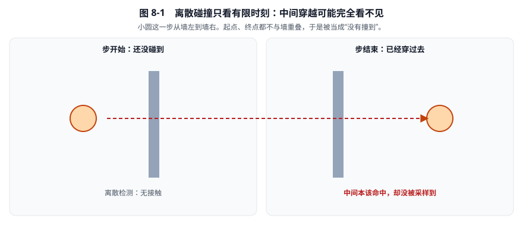
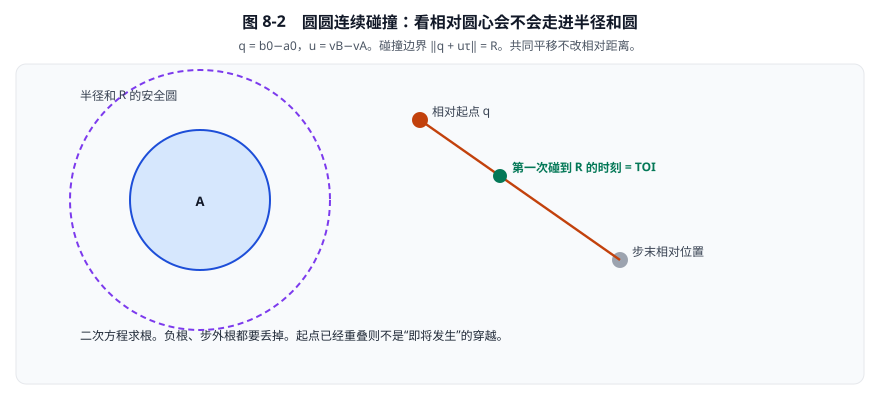

# 08 · TOI 与连续碰撞

> 阅读目标：先解匀速圆圆扫掠，再理解带旋转的 sweep、目标距离、分离轴与根求解，最后准确对应世界求解器中的 CCD 调度、截断方式和限制。
>
> 基线：`dc67c40ba2ce1ad384b0c985dbc1b539cba9221b` 对应的 3.2.0 工作树。当前 CCD 不是对所有刚体对执行无限精度、剩余时间完整重算的事件模拟器。

[返回目录](./README.md) · [上一章：GJK 与形状查询](./07-GJK距离与形状查询.md)

## 1. 连续碰撞首先是时间采样问题

离散碰撞只在有限时刻检查几何。

一个很小的圆可能从薄墙左侧移动到右侧，而起点、终点都不与墙重叠。

中间发生的穿越没有被采样到，这就是隧穿。

最朴素的改进是增加采样次数：

1. 将整步分成若干时间片。
2. 在每个采样时刻进行离散碰撞。
3. 找到第一次检测到重叠的位置。

但样本之间仍可能跨过更薄的障碍。

因此先从有解析解的连续问题入手，比直接增加任意采样次数更容易建立正确直觉。



**看图：** 这就是隧穿。加采样能减轻，但不能保证更薄的障碍一定被抓到。连续碰撞改问“这一段轨迹何时第一次碰到”。

### 1.1 必须分开的三个层次

- **数学轨迹相交**：理想连续运动是否相交？
- **TOI 几何函数**：当前算法如何近似定位接近时刻？
- **世界 CCD 调度**：哪些对象调用 TOI，结果如何影响位姿和速度？

独立 TOI 函数支持两形旋转，不代表世界会为所有形状对执行完整连续求解。

## 2. 匀速圆圆扫掠：从距离平方推导二次根

设两个世界圆心随物理时间 \(\tau\) 变化：

\[
a(\tau)=a_0+v_A\tau,
\qquad
b(\tau)=b_0+v_B\tau.
\]

这里：

- \(\tau\)：秒。
- \(a_0,b_0\)：起点位置，单位 m。
- \(v_A,v_B\)：线速度，单位 m/s。
- \(r_A,r_B\)：圆半径，单位 m。
- \(\Delta t\)：当前步时长，单位 s。

只考虑：

\[
0\le\tau\le\Delta t.
\]

### 2.1 消去共同平移

定义初始相对位置、相对速度和半径和：

\[
q=b_0-a_0,
\qquad
u=v_B-v_A,
\qquad
R=r_A+r_B.
\]

碰撞边界是：

\[
\|q+u\tau\|=R.
\]

两个物体共同增加相同速度，不会改变相对距离。

但共同平移会改变世界命中点，所以计算时间和还原世界位置仍是不同步骤。



**看图：** 紫色虚线圆半径是 \(R=r_A+r_B\)。相对起点沿相对速度走线段，第一次碰到虚线圆的时刻就是 TOI。共同平移可先消掉。

### 2.2 展开二次方程

两边平方：

\[
(q+u\tau)\cdot(q+u\tau)=R^2.
\]

展开：

\[
a\tau^2+b\tau+c=0,
\]

其中：

\[
a=u\cdot u,
\qquad
b=2q\cdot u,
\qquad
c=q\cdot q-R^2.
\]

注意这里的标量 \(a,b\) 是二次系数，不再表示圆心。

单位分别为：

\[
[a]=\mathrm{m}^2/\mathrm{s}^2,
\quad[b]=\mathrm{m}^2/\mathrm{s},
\quad[c]=\mathrm{m}^2.
\]

判别式和根为：

\[
D=b^2-4ac,
\]

\[
\tau_{\pm}=\frac{-b\pm\sqrt D}{2a}.
\]

根的单位为秒。

初始分离时，应选择位于当前步内的最小非负进入根。

较大的根通常是离开时刻，不能拿它代替第一次撞击。

## 3. 完整解析例：进入和离开不是同一个时刻

取 A 静止：

\[
a_0=(0,0),\qquad r_A=0.5.
\]

B 的输入为：

\[
b_0=(3,0),\qquad r_B=0.5,
\qquad v_B=(-4,0).
\]

整步时长取 \(\Delta t=1\) s。

于是：

\[
q=(3,0),\quad u=(-4,0),\quad R=1.
\]

二次系数为：

\[
a=16,\qquad b=-24,\qquad c=8.
\]

判别式：

\[
D=(-24)^2-4\times16\times8=64.
\]

因此：

\[
\tau_{\mathrm{enter}}=\frac{24-8}{32}=0.5\ \mathrm{s},
\]

\[
\tau_{\mathrm{exit}}=\frac{24+8}{32}=1\ \mathrm{s}.
\]

进入时 B 圆心为 \((1,0)\)，两圆表面在 \((0.5,0)\) 相切。

A 到 B 法线为 \((1,0)\)。

如果整步只有 \(0.4\) s，进入根仍是 \(0.5\) s，但它位于步外，所以本步没有命中。

### 3.1 两边都运动的校验

若改为：

\[
v_A=(2,0),\qquad v_B=(-2,0),
\]

相对速度仍为 \((-4,0)\)，进入时刻仍为 \(0.5\) s。

但此时 A、B 圆心分别为 \((1,0)\)、\((2,0)\)。

世界接触点变成 \((1.5,0)\)，不是上一例的 \((0.5,0)\)。

## 4. 解析根的退化和数值保护

### 4.1 没有相对运动

若 \(a=u\cdot u=0\)，则两个圆心相对静止。

- \(c>0\)：初始分离，未来仍分离。
- \(c=0\)：初始相切。
- \(c<0\)：初始重叠。

这时不能继续除以 \(2a\)。

### 4.2 初始重叠

若 \(c<0\)，查询开始时已经重叠。

即使存在正的离开根，它也不代表未来第一次进入。

必须把初始重叠与正常进入事件分开处理。

### 4.3 擦切、背离和步外根

- \(D<0\)：连无限直线轨迹都不接触半径和边界。
- \(D=0\)：擦切双根。
- 初始分离且 \(q\cdot u\ge0\)：匀速圆模型中正在背离，可提前拒绝。
- 根小于零：交点在过去。
- 根大于 \(\Delta t\)：交点在当前步之后。

浮点下很小的负判别式是否夹到零，应由有意义的数值容差决定。

不能把所有负判别式无条件改成零，否则会制造不存在的命中。

### 4.4 避免二次根的大数相减

标准公式在某些数值组合下可能发生消去误差。

一种教学上常用的稳定写法是：

\[
Q=-\frac12\left(b+\operatorname{sign}(b)\sqrt D\right),
\]

再求：

\[
\tau_1=Q/a,
\qquad
\tau_2=c/Q.
\]

仍需单独处理 \(a=0\)、\(Q=0\) 等退化。

这只是解析圆模型的数值改进，不是当前 `b2TimeOfImpact` 的实现方式。

## 5. 源码为什么使用时间比例

源码中的时间通常是归一化比例：

\[
t=\frac{\tau}{\Delta t}.
\]

于是整步相对平移为：

\[
\Delta=(v_B-v_A)\Delta t.
\]

圆碰撞方程可以写为：

\[
\|q+t\Delta\|^2=R^2,
\qquad0\le t\le1.
\]

此时 \(q,\Delta\) 都以 m 计，\(t\) 无量纲。

若返回 `fraction=0.4`，步长为 \(0.02\) s，物理时刻就是：

\[
\tau=0.4\times0.02=0.008\ \mathrm{s}.
\]

不能把 `fraction` 直接当成秒。

## 6. 加入旋转后，为什么不再是一个二次方程

多边形运动过程中，最近特征会改变：

- 先是角对角。
- 随后变成角对边。
- 再变成面状接触。

旋转还让局部点沿弯曲轨迹运动。

沿某个法线的分离量不再对时间全局线性，最近距离也不再由一个固定二次式描述。

只扫质心会漏掉旋转杆端。

用一个很大的包围圆代替整个物体虽然简单，但对细长形状往往过于宽松。

TOI 的思路是反复建立临时分离函数，在这个较简单的一维函数上求根，再更新几何特征。

## 7. Sweep：插值质心，再恢复刚体原点

`sweep` 保存：

- `localCenter`：局部质心。
- `c1`、`c2`：起止质心位置。
- `q1`、`q2`：起止旋转。

质心线性插值为：

\[
c(t)=(1-t)c_1+t c_2.
\]

二维旋转用余弦、正弦对表示：

\[
q_1=(\cos\theta_1,\sin\theta_1),
\quad
q_2=(\cos\theta_2,\sin\theta_2).
\]

当前先做线性混合：

\[
\widetilde q(t)=(1-t)q_1+t q_2,
\]

然后归一化：

\[
q(t)=\frac{\widetilde q(t)}{\|\widetilde q(t)\|}.
\]

这称为归一化线性插值，即 NLerp。

### 7.1 为什么要减去局部质心的旋转偏移

刚体原点是：

\[
p(t)=c(t)-Q(t)c_L,
\]

其中 \(c_L\) 为局部质心，\(Q(t)\) 为旋转矩阵。

局部点 \(x_L\) 的世界位置为：

\[
x(t)=p(t)+Q(t)x_L
=c(t)+Q(t)(x_L-c_L).
\]

这个公式确保旋转围绕质心进行。

若省略局部质心补偿，偏心形状会围绕错误的原点运动。

### 7.2 一个单姿态坐标校验

设：

\[
c=(2,3),\qquad c_L=(0.5,0),
\]

旋转为 \(90^\circ\)。

于是：

\[
Qc_L=(0,0.5),
\qquad
p=(2,2.5).
\]

把局部质心变换回世界：

\[
p+Qc_L=(2,3),
\]

与指定世界质心一致。

这只是单姿态变换例，不意味着一帧应该旋转 90 度。

### 7.3 对照源码与旋转限制

入口：[`b2GetSweepTransform`](../src/distance.c#L14)，范围 `14—29`。

NLerp 不等于直接线性插值角度，也不保证严格恒角速度。

起止旋转若相差 180 度，混合向量甚至可能变成零。

两个端点旋转也无法表示中间转了多圈的信息。

当前 [`B2_MAX_ROTATION`](../include/box2d/constants.h#L50) 为：

\[
0.25\pi=45^\circ.
\]

`solver.c:123,148—152` 根据整步时间限制角速度，除非允许快速旋转。

常量附近还警告提高到 \(0.5\pi\) 或更大会破坏连续碰撞。

因此不能声称任意大角度旋转仍保持同样 CCD 保证。

## 8. TOI 的目标距离不是零，也不是表面分离量

入口：[`b2TimeOfImpact`](../src/distance.c#L1148)，范围 `1148—1440`。

它调用 GJK 时使用：

\[
\texttt{useRadii=false}.
\]

因此得到的是凸核之间的距离。

半径放到目标值中：

\[
d_{\mathrm{target}}
=\max(\mathrm{slop},r_A+r_B-\mathrm{slop}).
\]

距离容差为：

\[
\varepsilon_d=0.25\mathrm{slop}.
\]

两者单位都是 m。

### 8.1 完整目标值例

默认：

\[
\mathrm{slop}=0.005,
\qquad r_A+r_B=1.
\]

所以：

\[
d_{\mathrm{target}}=0.995,
\qquad\varepsilon_d=0.00125.
\]

核心距离达到 \(0.995\) 时，表面分离大约是：

\[
0.995-1=-0.005.
\]

也就是允许轻微进入，避免要求浮点算法精确卡在零间隙边界。

若半径和非常小，目标至少保留一个 slop，避免完全零距离的脆弱几何。

### 8.2 与解析圆根对照

前面的圆例，在整个 \(t\in[0,1]\) 范围内，非负核心距离是：

\[
d(t)=|3-4t|.
\]

首次相遇前的分支 \(t\le0.75\) 上，它才等于 \(3-4t\)。固定方向投影的有符号分离函数则可写成 \(s(t)=3-4t\)，圆心交越后允许为负。距离与有符号分离不能混用。

首次严格几何相切发生在 \(t=0.5\)。

TOI 目标对应：

\[
3-4t=0.995
\quad\Longrightarrow\quad t=0.50125.
\]

这点差异来自目标设定。

不要重复减去半径，也不要把距离容差误写成时间比例容差。

## 9. 三种分离函数

[`b2MakeSeparationFunction`](../src/distance.c#L953) 的范围是 `953—1026`。

它利用当前 GJK 缓存构造更便宜的标量函数。

### 9.1 点点类型

缓存只有一个索引对时，建立世界方向：

\[
n=\frac{p_B-p_A}{\|p_B-p_A\|}.
\]

随后测量：

\[
s(t)=n\cdot(p_B(t)-p_A(t)).
\]

这里的轴在该轮分离函数中保持世界方向固定。

### 9.2 A 面类型

A 的两个缓存点形成参考面。

法线存储在 A 局部系，求值时随 A 旋转：

\[
n_A(t)=Q_A(t)n_{A,L}.
\]

分离量为：

\[
s(t)=n_A(t)\cdot(p_B(t)-p_A(t)).
\]

### 9.3 B 面类型

如果 A 缓存索引相同、B 有两个点，就构造 B 面。

其内部公式是：

\[
s(t)=n_B(t)\cdot(p_A(t)-p_B(t)).
\]

因为参考面换到了 B，点差顺序也改变。

不能因此随意改变最终公共输出的 A 到 B 法线约定。

### 9.4 找最深特征与固定特征求值要分开

[`b2FindMinSeparation`](../src/distance.c#L1029)，范围 `1029—1093`：

- 给定时刻。
- 用支撑查询找当前轴上最深的特征。
- 返回分离量并记下特征索引。

[`b2EvaluateSeparation`](../src/distance.c#L1097)，范围 `1097—1143`：

- 固定已选特征索引。
- 在不同时间只变换这些特征并求投影。

后者更适合高频根求解。

它不等于在每次试探时间都重新计算完整 GJK 距离。

## 10. TOI 的三层循环

### 10.1 外层：更新 GJK 和分离轴

在当前时间 \(t_1\) 计算核心距离。

- 距离不大于零：返回核心重叠状态。
- 距离已进入目标容差：返回命中。
- 否则构造新的分离函数。

外层允许最近特征和候选分离轴随推进改变。

### 10.2 中层：在较晚时间选择最深特征

先令 \(t_2=t_{\max}\)，求：

\[
s_2=s(t_2).
\]

若 \(s_2>d_{\mathrm{target}}+\varepsilon_d\)，当前分离模型返回分离结论。

若 \(s_2\) 已在目标附近，则把 \(t_1\) 推进到 \(t_2\)，回外层重新检查。

否则固定此时选到的特征，求其在 \(t_1\) 的分离 \(s_1\)。

只有 \(s_1\) 在目标外、\(s_2\) 在目标内时，才形成适合求根的区间。

如果内部状态已经不一致或无法继续进展，会返回失败状态，而不是伪装成正常未命中。

### 10.3 最内层：固定特征的一维根

求解：

\[
s(t)-d_{\mathrm{target}}=0.
\]

得到暂定 \(t_2\) 后，中层还会重新找最深特征。

如果新特征更早限制运动，还需要继续推进。

所以 TOI 不是“一次 GJK，加一次二分，然后完成”。

### 10.4 当前工作量上限

- 外层距离查询：最多 20 次。
- 一次固定特征求根：最多 50 次。
- 中层 push-back：最多 `B2_MAX_POLYGON_VERTICES` 次。

这些限制控制计算成本，不是对任意输入的无限精度保证。

## 11. 二分与假位法交替：为什么不用一种方法到底

设当前根区间为 \([a_1,a_2]\)，满足：

\[
s_1>d_{\mathrm{target}},
\qquad
s_2<d_{\mathrm{target}}.
\]

### 11.1 二分法

取：

\[
t=\frac{a_1+a_2}{2}.
\]

它不关心曲线形状，能稳定缩小区间，但收敛速度有限。

### 11.2 假位法

用区间端点连线估计目标交点：

\[
t=a_1+
\frac{d_{\mathrm{target}}-s_1}{s_2-s_1}(a_2-a_1).
\]

这是端点插值，不是牛顿法，因为没有计算导数。

当函数接近线性时，它可能非常快。

但曲率较大时某个端点可能长期不更新。

### 11.3 当前混合策略

源码 `distance.c:1346—1395` 从第零轮开始：

- 偶数轮使用二分。
- 奇数轮使用假位法。

计算分离量后，如果：

\[
|s(t)-d_{\mathrm{target}}|<\varepsilon_d,
\]

则接受。

否则依据分离量在目标哪一侧更新对应端点，继续维持括住根的区间。

### 11.4 在线性圆例上手算两轮

取：

\[
s(t)=3-4t,
\quad d_{\mathrm{target}}=0.995,
\quad[a_1,a_2]=[0,1].
\]

第一轮二分：

\[
t=0.5,\qquad s=1.
\]

误差为 \(0.005\)，大于 \(0.00125\)，不能停止。

左端改为 \(0.5\)。

第二轮假位：

\[
t=0.5+
\frac{0.995-1}{-1-1}(1-0.5)
=0.50125.
\]

此时 \(s=0.995\)，达到目标。

## 12. 完整旋转几何例：四轮得到非线性根

这一例来自明确的几何与源码 NLerp，不是随手假设一个多项式。

### 12.1 形状与运动输入

A 是静止竖段：

\[
(0,-10)\rightarrow(0,10),
\qquad r_A=0.
\]

取参考法线 \(n=(1,0)\)。

B 代理有一个局部核心点：

\[
x_L=(1,0),\qquad r_B=1.
\]

B 的局部质心取原点，质心 sweep 为：

\[
c_B(t)=(3-4t,0).
\]

旋转由 \(0^\circ\) 变到 \(45^\circ\)。

这个例子可理解为刚体上一个偏心圆形状；单个形状的圆心不必等于整个刚体质心。

总旋转量不超过默认每步 45 度限制。

### 12.2 写出 NLerp 后的点轨迹

定义：

\[
u(t)=1-t+\frac{t}{\sqrt2},
\qquad
v(t)=\frac{t}{\sqrt2}.
\]

归一化旋转的余弦为：

\[
\cos\theta(t)=\frac{u(t)}{\sqrt{u(t)^2+v(t)^2}}.
\]

因此 B 核心点的 x 坐标，即对 A 参考面的分离量，是：

\[
s(t)=3-4t+
\frac{u(t)}{\sqrt{u(t)^2+v(t)^2}}.
\]

B 核心点的 y 坐标始终位于竖段端点之间，所以此处面参考特征合法。

### 12.3 目标与初始区间

半径和为 1 m，默认参数给出：

\[
d_{\mathrm{target}}=0.995,
\qquad\varepsilon_d=0.00125.
\]

端点分离量为：

\[
s(0)=4,
\]

\[
s(1)=-1+\frac1{\sqrt2}\approx-0.2928932188.
\]

目标被区间 \([0,1]\) 括住。

### 12.4 实际算术核对的迭代表

| 轮次 | 方法 | 试探比例 \(t\) | 分离量 \(s(t)\) | 与目标之差 |
|---|---|---:|---:|---:|
| 0 | 二分 | 0.5000000000 | 1.9238795325 | +0.9288795325 |
| 1 | 假位 | 0.7095116723 | 1.0067815865 | +0.0117815865 |
| 2 | 二分 | 0.8547558362 | 0.3594663339 | −0.6355336661 |
| 3 | 假位 | 0.7121552168 | 0.9950684650 | +0.0000684650 |

第一轮后区间是 \([0.5,1]\)。

第二轮后左端变为 \(0.7095116723\)。

第三轮后右端变为 \(0.8547558362\)。

第四轮误差满足：

\[
0.0000684650<0.00125,
\]

因此可以接受暂定根。

### 12.5 如何解释结果

此时表面分离约为：

\[
s-R=0.9950684650-1=-0.0049315350\ \mathrm{m}.
\]

若整步为 \(1/60\) s，对应物理时刻：

\[
\tau=\frac{0.7121552168}{60}
\approx0.0118692536\ \mathrm{s}.
\]

随后中层与外层仍按算法检查最深特征和距离，不应把最内层暂定根描述成跳过所有后续验证。

该表使用独立双精度算术运行核对。

库内部采用 float，最后若干位允许不同；这里没有声称执行了 C 单元测试或逐位验证。

## 13. TOI 输出不能只读 `fraction`

[`b2TOIOutput`](../include/box2d/collision.h#L490) 包含状态、点、法线和时间比例。

主要状态含义是：

- `Overlapped`：核心已重叠，比例通常为零。
- `Hit`：进入当前目标容差。
- `Separated`：当前查询给出分离结论，比例通常为查询上限。
- `Failed`：迭代未能正常继续，不能当成精确未命中。

`fraction=1` 必须与状态和 `maxFraction` 一起解释。

`fraction=0` 也不能保证存在适合直接施加冲量的有效单位法线。

头文件对 [`b2TimeOfImpact`](../include/box2d/collision.h#L509) 的说明明确指出：扫掠分离轴可能漏掉某些中间、非隧穿型碰撞。

改变查询时间区间后应重新调用。

旋转使分离函数可能非单调，因此不能把当前近似算法包装成“求出了任意旋转轨迹的所有精确根”。

## 14. 世界实际时序：先离散求解，再决定哪些刚体补做 CCD

现在从几何函数回到 [`src/solver.c`](../src/solver.c)。

`b2Solve` 先执行普通约束求解和子步推进。

`1609—1610` 行在约束求解及岛分裂之后调用 `b2FinalizeBodiesTask`。

Finalize 把累计位移、累计旋转落实为预测终位姿，然后识别快物体。

不是先对所有刚体执行 TOI，再启动普通接触求解。

### 14.1 快运动度量

源码 `607—615` 行估计：

\[
v_{\max}=\|v\|+|\omega|R_{\max}.
\]

其中：

- \(v\)：质心线速度，m/s。
- \(\omega\)：角速度，rad/s。
- \(R_{\max}\)：最远几何范围，m。

因此 \(v_{\max}\) 单位为 m/s。

累计运动量还包含位置修正和旋转：

\[
\Delta_{\max}
=\|\Delta p\|+|\Delta q.s|R_{\max}.
\]

接着取：

\[
\mathrm{maxMotion}
=\max(\Delta_{\max},v_{\max}\Delta t).
\]

动态刚体满足连续检测等条件，且：

\[
\mathrm{maxMotion}
>\mathrm{safetyFactor}\times\mathrm{minExtent},
\]

就进入快物体路径。

`safetyFactor` 无量纲，`minExtent` 单位 m。

当前判定位于未进入睡眠处理的相应分支中，不要省略整个上下文后声称所有物体每步无条件检查。

### 14.2 平移快物体例

取：

\[
\Delta t=1/60\ \mathrm{s},
\quad\|v\|=30\ \mathrm{m/s},
\]

\[
\mathrm{minExtent}=0.1\ \mathrm{m},
\quad\mathrm{safetyFactor}=0.5.
\]

速度运动量为：

\[
30/60=0.5\ \mathrm{m}.
\]

门限为：

\[
0.5\times0.1=0.05\ \mathrm{m}.
\]

因此需要快物体处理。

### 14.3 质心不动也可能很快

若 \(v=0\)、\(\omega=20\) rad/s、\(R_{\max}=2\) m，则：

\[
v_{\max}=40\ \mathrm{m/s}.
\]

在 \(1/60\) s 中对应约 \(0.6667\) m 的端点运动估计。

所以不能只观察质心位移判断是否需要 CCD。

## 15. 普通 fast 和 bullet 的调度不同

入口：[`b2FinalizeBodiesTask`](../src/solver.c#L560)，范围 `560—749`。

- 普通 fast dynamic 在 Finalize 中立即调用 `b2SolveContinuous`。
- fast bullet 先放入 `bulletBodies` 数组。

随后主流程更新非 bullet 的相关包围代理。

`1893—1902` 行再统一调用 bullet 任务。

[`b2BulletBodyTask`](../src/solver.c#L1236) 的 `1236—1248` 行仍调用同一个 `b2SolveContinuous`。

bullet 阶段完成后，主流程再串行扩大相应代理。

这种时序让 bullet 查询时能使用非 bullet 已更新的运动与包围信息。

它不是“bullet 使用另一套完全不同的 TOI 公式”。

## 16. 当前 CCD 到底查询哪些目标

入口：[`b2SolveContinuous`](../src/solver.c#L384)，范围 `384—556`。

函数遍历 fast body 的形状，并构造扫掠查询框。

关键查询代码如下：

```443:449:src/solver.c
		b2DynamicTree_Query( staticTree, sweptBox, B2_DEFAULT_MASK_BITS, b2ContinuousQueryCallback, &context );

		if ( isBullet )
		{
			b2DynamicTree_Query( kinematicTree, sweptBox, B2_DEFAULT_MASK_BITS, b2ContinuousQueryCallback, &context );
			b2DynamicTree_Query( dynamicTree, sweptBox, B2_DEFAULT_MASK_BITS, b2ContinuousQueryCallback, &context );
		}
```

因此：

| 快物体类别 | CCD 查询树 |
|---|---|
| 普通 fast dynamic | static |
| fast bullet | static、kinematic、dynamic |

不要把一般宽阶段动态物体查三棵树的规则，误写成普通 fast CCD 也查三棵树。

### 16.1 bullet 不对目标 bullet 做这条连续检测

[`b2ContinuousQueryCallback`](../src/solver.c#L183) 在 `228—231` 行跳过目标 bullet。

所以 bullet 可以对非 bullet dynamic 做连续检查，但 bullet-bullet 被排除。

设置 bullet 不意味着对所有对象类型无条件提供同样检测。

### 16.2 回调还执行哪些过滤

- 跳过同一形状。
- 跳过同一刚体。
- 检查形状碰撞过滤。
- 检查刚体之间的碰撞许可。
- 检查自定义过滤。
- 对传感器检查相关事件标志。
- 对链段执行单面与近平行运动早退。

独立 TOI 函数只处理输入的凸代理与 sweep，世界上下文规则需要由外层补充。

## 17. 候选如何不断缩短最早比例

对每个候选，回调建立：

- A：目标形状及其 sweep。
- B：当前 fast shape 及 fast body 的 sweep。
- `maxFraction`：目前已知最早比例。

只要新结果满足：

\[
0<f_{\mathrm{new}}<f_{\mathrm{current}},
\]

就缩短当前允许运动比例。

当前回调主要按比例比较，不是简单写成“只有 `state==Hit` 才接受”。

源码解读不能自行添加不存在的条件。

### 17.1 初始零比例的回退

若第一次 TOI 返回零比例，`347—359` 行会：

1. 取 fast shape 的几何质心。
2. 构造围绕该点的小圆代理。
3. 用与最小几何范围相关的核心半径重试 TOI。

这用于处理初始重叠等难以推进的情况。

它不是完整的穿透推出算法，也不是所有高速形状永远都被简化为圆。

若启用连续预处理回调，用户还可否决本次候选。

## 18. 命中后实际做的是位姿截断

假设最早比例为 \(f<1\)。

当前源码计算：

\[
c_f=(1-f)c_1+f c_2,
\]

\[
q_f=\operatorname{NLerp}(q_1,q_2,f).
\]

再根据局部质心恢复刚体原点，更新最终变换和包围盒。

这发生在 `solver.c:454—506`。

### 18.1 没有完整重算剩余时间

这里并没有：

1. 在 TOI 时刻重新运行全部接触与关节求解。
2. 计算撞击反弹后的完整速度状态。
3. 再把剩余 \((1-f)\Delta t\) 完整模拟一遍。

也没有直接根据 TOI 法线将速度反弹或清零。

因此它是一种实用的时间损失式截断，不是理想事件驱动求解器。

### 18.2 损失时间只撤销重力贡献

定义：

\[
\Delta t_{\mathrm{loss}}=(1-f)\Delta t.
\]

当前速度修正是：

\[
v_{\mathrm{new}}
=v_{\mathrm{old}}
-\Delta t_{\mathrm{loss}}\,\mathrm{gravityScale}\,g.
\]

源码 `468—473` 明确说明其他力与力矩暂时忽略。

减去重力贡献，是撤销已经多积分的那部分重力，不是再加一次重力。

### 18.3 完整数值例

设：

\[
\Delta t=1/60\ \mathrm{s},\qquad f=0.4.
\]

损失时间为：

\[
\Delta t_{\mathrm{loss}}=0.6/60=0.01\ \mathrm{s}.
\]

取：

\[
g=(0,-10)\ \mathrm{m/s^2},
\quad\mathrm{gravityScale}=1,
\]

\[
v_{\mathrm{old}}=(12,-5)\ \mathrm{m/s}.
\]

则：

\[
v_{\mathrm{new}}
=(12,-5)-0.01(0,-10)
=(12,-4.9).
\]

x 速度仍是 12 m/s，并未因 CCD 自动归零。

若预测质心从 \((0,0)\) 到 \((0.2,-0.0833333)\)，截断后为：

\[
c_f=(0.08,-0.0333333).
\]

只接受原预测位移的 40%。

剩余 60% 时间没有在这个函数里按完整碰撞动力学恢复推进。

## 19. 包围框、传感器和旋转的工程限制

### 19.1 局部基准减少大坐标消去

`b2SolveContinuous` 使用旧质心作为相对基准，将 sweep 放到附近坐标系计算。

世界大位置先相减，再进入主要 float 几何，有利于保留局部细节。

这与直接在巨大世界坐标上反复计算差点不同。

### 19.2 两端 AABB 的并不是任意旋转轨迹的严格包络

源码使用旧包围框与预测终框的并作为候选查询范围。

对纯平移，它能覆盖中间形状位置。

对一般旋转，不能直接给出同样结论。

反例：细杆半长 2 m、半厚 0.1 m，从 \(-22.5^\circ\) 转到 \(+22.5^\circ\)。

两端 AABB 半宽均为：

\[
e_x=2\cos22.5^\circ+0.1\sin22.5^\circ
\approx1.8860274083.
\]

中间水平姿态半宽为 2 m。

所以中途形状可能比两端框的并更宽。

这只证明包络性质不能普遍成立；具体场景是否漏碰，还与额外 margin、目标包围框及其他处理有关。

不要由这个反例反过来断言所有旋转杆都必然隧穿。

### 19.3 连续传感器不是无限事件收集器

`solver.c:164` 的连续传感器记录上限是 8。

当前 fast shape 若本身为传感器，不作为普通连续实体扫掠。

被扫描的传感器需要满足事件标志等条件。

最后还会丢弃位于实体截断之后的传感器命中记录。

因此不能承诺高速路径上任意数量、任意时序的传感器事件全部被保留。

重要游戏逻辑应使用与需求匹配的明确查询方案。

### 19.4 如何正确使用这些限制

- 采用合理的形状尺寸与长度尺度。
- 避免深度初始重叠。
- 对高速小动态物体按需要设置 bullet。
- 控制细长物体的大角度旋转。
- 必要时减小时间步。
- 对游戏命中判定使用专门射线或形状查询。

把所有物体都设成 bullet，既不是通用精度开关，也不能消除算法本身的限制。

## 20. 边界练习与答案

### 题一：半径各 0.5、中心距 3、相对速度为 −4 m/s，进入和离开时间是多少？

**答案：0.5 s 和 1 s。** 首次撞击取进入根。

### 题二：`fraction=0.4`、步长 0.02 s，物理时刻是多少？

**答案：0.008 s。** 比例本身没有秒单位。

### 题三：TOI 使用 `useRadii=false`，是否意味着完全忽略半径？

**答案：不是。** 半径进入目标距离，不能重复扣除。

### 题四：目标 0.995 m，当前分离 1 m，默认容差下可以停止吗？

**答案：不行。** 误差 0.005 m 大于 0.00125 m。

### 题五：假位法是否就是牛顿法？

**答案：不是。** 它使用区间端点插值，不计算导数。

### 题六：局部质心不在原点时，只插值 body origin 是否等价？

**答案：不等价。** 当前 sweep 插值质心，再减去旋转后的局部质心偏移。

### 题七：普通 fast dynamic 是否查询运动学和动态树？

**答案：当前 CCD 路径不查询。** 它只查 static；bullet 才追加另外两棵树。

### 题八：两个 bullet 之间是否使用这条 TOI 路径互相检测？

**答案：当前回调显式跳过目标 bullet。**

### 题九：CCD 命中后是否完整模拟剩余时间？

**答案：没有。** 当前截断末位姿，只撤销损失时间的重力速度贡献。

### 题十：旧 AABB 与新 AABB 的并是否严格覆盖任意中间旋转？

**答案：不是。** 细杆中途更宽的例子说明需要谨慎。

### 题十一：TOI 返回 `Failed` 是否说明确定没有碰撞？

**答案：不能。** 它表示算法没有正常获得所需结论。

### 题十二：连续传感器上限 8 是否意味着最多检查 8 个 TOI 候选？

**答案：不是。** 8 是相关传感器记录容量，不是所有 TOI 候选数量上限。

## 21. 源码阅读索引与验证范围

| 主题 | 当前入口与范围 |
|---|---|
| sweep 变换 | [`b2GetSweepTransform`](../src/distance.c#L14)，`14—29` |
| 分离函数构造 | [`b2MakeSeparationFunction`](../src/distance.c#L953)，`953—1026` |
| 最深特征选择 | [`b2FindMinSeparation`](../src/distance.c#L1029)，`1029—1093` |
| 固定特征求值 | [`b2EvaluateSeparation`](../src/distance.c#L1097)，`1097—1143` |
| TOI 主流程 | [`b2TimeOfImpact`](../src/distance.c#L1148)，`1148—1440` |
| 根求解 | [`二分与假位法交替`](../src/distance.c#L1346)，`1346—1395` |
| 快物体识别 | [`b2FinalizeBodiesTask`](../src/solver.c#L560)，核心判断 `607—665` |
| 连续查询回调 | [`b2ContinuousQueryCallback`](../src/solver.c#L183)，`183—380` |
| CCD 截断 | [`b2SolveContinuous`](../src/solver.c#L384)，`384—556` |
| bullet 任务 | [`b2BulletBodyTask`](../src/solver.c#L1236)，`1236—1248` |
| 主调度位置 | [`b2Solve`](../src/solver.c#L1255)，重点 `1610`、`1873`、`1902`、`1952` |

本章旋转根表与细杆包围尺寸经过独立算术运行核验。

源码分支经过静态阅读核对；没有据此宣称运行过 C 构建、C 单元测试或完整世界场景仿真。

建议先用解析圆例作为简单基准，再观察旋转例的每次区间更新，最后对照世界 CCD 的对象选择和时间损失行为。

[返回目录](./README.md) · [上一章：GJK 与形状查询](./07-GJK距离与形状查询.md)
