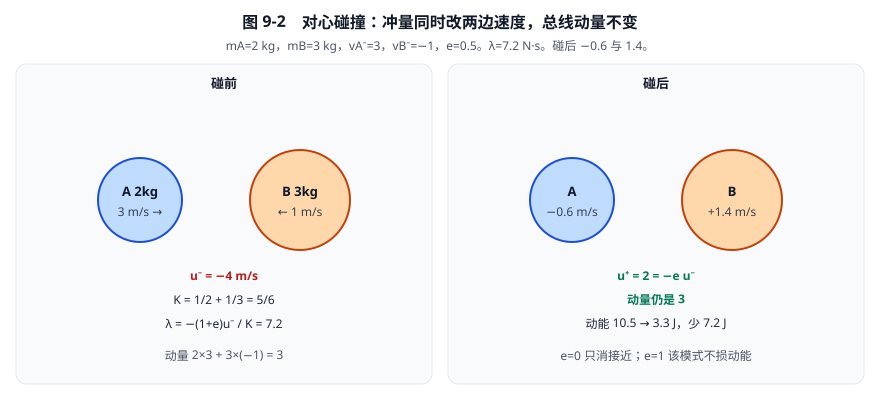
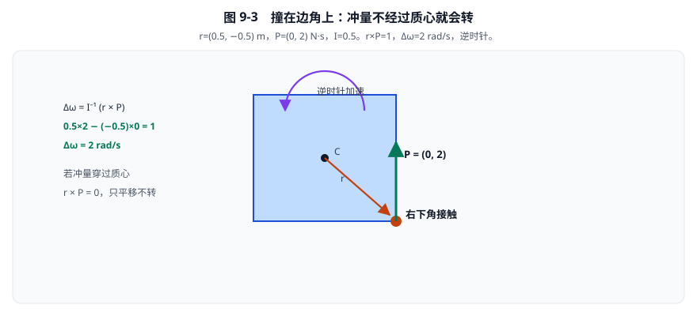
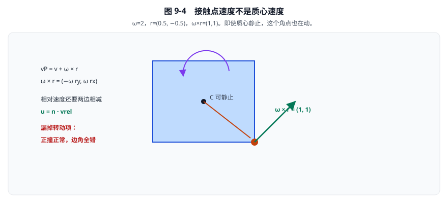
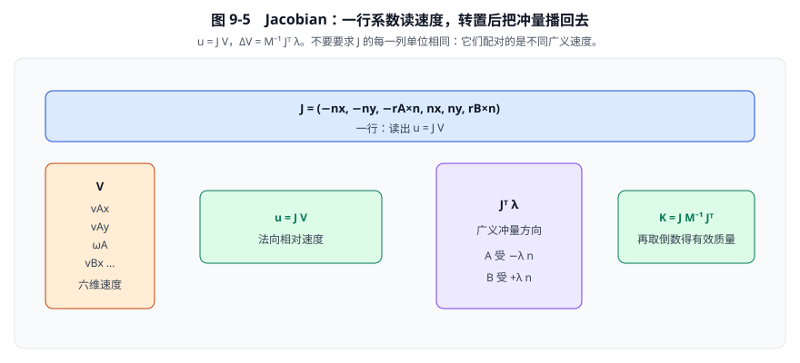
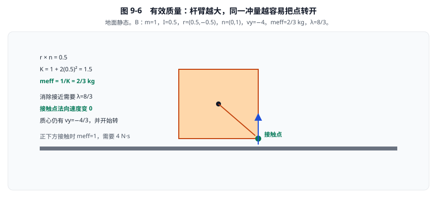
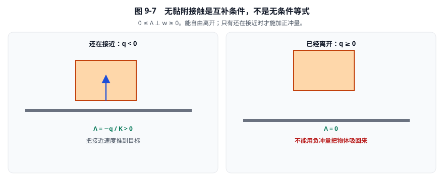
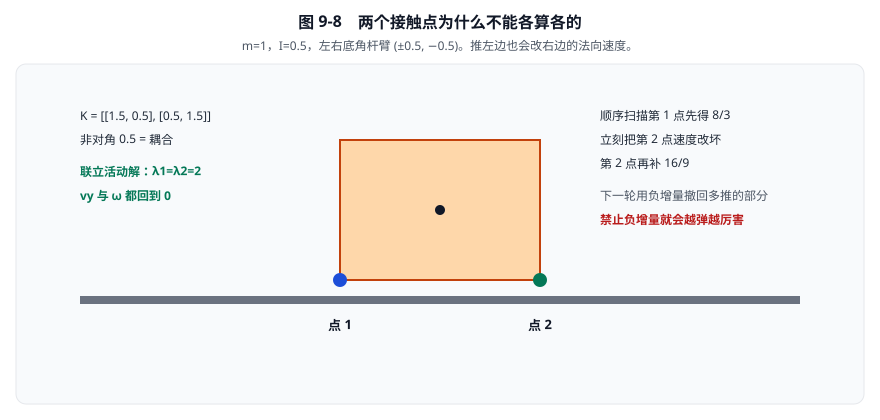

# 09 · 碰撞冲量与约束方程

[返回总目录](./README.md) · [下一章：累计冲量、摩擦与热启动](./10-累计冲量摩擦与热启动.md)

> 本章先从动量定理推导单点碰撞，再把转动加入公式，最后认识多个接触点的耦合。
> 源码基准：Box2D 3.2.0，提交 `dc67c40ba2ce1ad384b0c985dbc1b539cba9221b`。
> 本章的理想碰撞公式不等于本版本完整求解流程；实际恢复时序见第12章。

插图按推导顺序出现：先认 A/B 与 \(u\) 的方向，再算对心冲量，然后加入转动、接触点速度、Jacobian、有效质量和两点耦合。

## 1. 先约定方向，避免所有公式一起出错

设接触涉及刚体 A、B，单位法线 \(\mathbf n\) 从 A 指向 B。

| 符号 | 含义 | SI单位 |
|---|---|---|
| \(m_A,m_B\) | 质量 | kg |
| \(\mathbf v_A,\mathbf v_B\) | 质心速度 | m/s |
| \(I_A,I_B\) | 绕质心的转动惯量 | kg·m² |
| \(\omega_A,\omega_B\) | 逆时针为正的角速度 | rad/s |
| \(\mathbf r_A,\mathbf r_B\) | 从各自质心指向接触点的杆臂 | m |
| \(\lambda\) | 本次标量冲量 | N·s |
| \(\Lambda\) | 当前累计标量冲量 | N·s |
| \(\Delta\Lambda\) | 对累计量的修正 | N·s |
| \(e\) | 恢复系数 | 无量纲 |

本章按通常力学约定将弧度视为无量纲。

暂不考虑转动时，相对法向速度是

\[
u=(\mathbf v_B-\mathbf v_A)\cdot\mathbf n.
\]

- \(u<0\)：B相对A沿法线反方向运动，双方接近。
- \(u=0\)：当前法向相对速度为零。
- \(u>0\)：双方正在分离。

地面为A、箱子为B、法线向上时，下落箱子的 \(u\) 应为负。

这个小检查应在写第一行求解代码前完成。


**看图：** 左图两球对撞，\(u<0\)。右图地面为 A、箱子下落，\(u=v_{By}<0\)。两种情形都用 \(u=(\mathbf v_B-\mathbf v_A)\cdot\mathbf n\)。法线或 A/B 任一写反，后面冲量符号全错。

## 2. 为什么求冲量，而不直接猜接触力

牛顿第二定律为

\[
m\frac{d\mathbf v}{dt}=\mathbf F.
\]

对短暂接触时间积分：

\[
m(\mathbf v^+-\mathbf v^-)
=\int\mathbf F\,dt
=\mathbf P.
\]

因此

\[
\Delta\mathbf v=m^{-1}\mathbf P.
\]

这里 \(\mathbf P\) 是冲量，不是力。

其单位检查为

\[
[\mathbf P]=\mathrm{N\,s}=\mathrm{kg\,m/s},
\qquad
[m^{-1}\mathbf P]=\mathrm{m/s}.
\]

理想瞬时碰撞直接求接触力的时间积分，避免先猜一个巨大接触力。

这并不表示真实接触没有形变或有限接触时间，而是刚体离散模型做了简化。

## 3. 无转动单点碰撞的完整推导

令B受到 \(\mathbf P=\lambda\mathbf n\)，A受到反向冲量。

动量定理分别给出

\[
\mathbf v_A^+=\mathbf v_A^--m_A^{-1}\lambda\mathbf n,
\]

\[
\mathbf v_B^+=\mathbf v_B^-+m_B^{-1}\lambda\mathbf n.
\]

相减后沿法线投影：

\[
u^+=u^-+(m_A^{-1}+m_B^{-1})\lambda.
\]

定义

\[
K=m_A^{-1}+m_B^{-1}.
\]

则 \(K\lambda\) 就是这次冲量造成的相对法向速度变化。

恢复系数模型给出另一条条件：

\[
u^+=-e u^-.
\]

它是材料行为的近似模型，不是动量守恒自动提供的结论。

两式联立：

\[
u^-+K\lambda=-e u^-,
\]

\[
\boxed{\lambda=-\frac{(1+e)u^-}{K}}.
\]

### 3.1 代入两个有限质量物体

取

\[
m_A=2\ \mathrm{kg},\quad m_B=3\ \mathrm{kg},
\quad v_A^-=3\ \mathrm{m/s},\quad v_B^-=-1\ \mathrm{m/s},
\quad e=0.5.
\]

所有速度均指沿 \(\mathbf n\) 的分量。

先计算接近速度和响应系数：

\[
u^-=-1-3=-4\ \mathrm{m/s},
\qquad K=\frac12+\frac13=\frac56\ \mathrm{kg^{-1}}.
\]

再计算冲量：

\[
\lambda=-\frac{1.5(-4)}{5/6}=7.2\ \mathrm{N\,s}.
\]

碰后速度为

\[
v_A^+=3-\frac{7.2}{2}=-0.6\ \mathrm{m/s},
\]

\[
v_B^+=-1+\frac{7.2}{3}=1.4\ \mathrm{m/s}.
\]

两项校验：

\[
v_B^+-v_A^+=2=-0.5(-4),
\]

\[
2(3)+3(-1)=3=2(-0.6)+3(1.4).
\]

恢复关系和总线动量同时满足。



**看图对公式：** 先由碰前速度算出 \(u^-=-4\)，再用 \(K=5/6\) 换成冲量 \(\lambda=7.2\)。碰后 \(u^+=2=-eu^-\)，总线动量仍是 3。动能少掉的 7.2 J 就是恢复系数小于 1 吃掉的。三项必须同时成立。

### 3.2 边界不能省略

- \(e=0\)：消除接近速度，不要求反弹。
- \(e=1\)：理想孤立无摩擦单碰撞不损失该法向模式的动能。
- \(u^-\ge0\)：已经分离，不能无条件套公式产生负接触冲量。
- \(K=0\)：当前方向没有可改变的自由度，必须避免除零。
- 静态地面吸收反作用但不更新速度；移动刚体自身不是封闭系统。

## 4. 撞在边角上，为什么会转动

平面叉积定义为

\[
\mathbf a\times\mathbf b=a_xb_y-a_yb_x.
\]

接触点相对质心的杆臂是

\[
\mathbf r=\mathbf p-\mathbf c.
\]

角动量定理给出

\[
I(\omega^+-\omega^-)=\mathbf r\times\mathbf P,
\]

所以

\[
\boxed{\Delta\omega=I^{-1}(\mathbf r\times\mathbf P)}.
\]

量纲为

\[
[\mathbf r\times\mathbf P]=\mathrm{kg\,m^2/s},
\qquad [I^{-1}(\mathbf r\times\mathbf P)]=\mathrm{s^{-1}}.
\]

例：\(\mathbf r=(0.5,-0.5)\ \mathrm m\)、\(\mathbf P=(0,2)\ \mathrm{N\,s}\)、\(I=0.5\ \mathrm{kg\,m^2}\)。

\[
\mathbf r\times\mathbf P=0.5(2)-(-0.5)(0)=1\ \mathrm{kg\,m^2/s},
\]

\[
\Delta\omega=2(1)=2\ \mathrm{rad/s}.
\]

右下角向上受冲量，物体逆时针加速。

若冲量通过质心，\(\mathbf r\times\mathbf P=0\)，不会由这一冲量产生角速度变化。



**看图：** 杆臂 \(\mathbf r=(0.5,-0.5)\) 与向上冲量叉乘得 \(r\times P=1\)，于是 \(\Delta\omega=2\)。正撞可以只改平动；边角碰撞必须带上这一项，否则“看起来撞偏了却不转”。

## 5. 接触点速度不是质心速度

刚体随体点的位置可写成

\[
\mathbf p=\mathbf c+R(\theta)\mathbf r_{\mathrm{local}}.
\]

对时间求导，得到

\[
\mathbf v_p=\mathbf v+\omega\times\mathbf r,
\qquad
\omega\times\mathbf r=(-\omega r_y,\omega r_x).
\]

例如 \(\omega=2\)、\(\mathbf r=(0.5,-0.5)\)，转动贡献为

\[
\omega\times\mathbf r=(1,1)\ \mathrm{m/s}.
\]

即使质心静止，这个点也在运动。

两刚体接触点的相对速度因此是

\[
\mathbf v_{\mathrm{rel}}
=(\mathbf v_B+\omega_B\times\mathbf r_B)
-(\mathbf v_A+\omega_A\times\mathbf r_A).
\]

真正需要约束的法向速度为

\[
u=\mathbf n\cdot\mathbf v_{\mathrm{rel}}.
\]

忽略转动项，是“正撞正常、边角碰撞异常”的常见原因。



**看图：** 约束看的是角点 \(\mathbf v_p=\mathbf v+\omega\times\mathbf r\)。\(\omega\times r=(1,1)\)。真正约束的是它在法线上的分量，不是质心速度。只改质心，边角碰撞会对不上。

## 6. Jacobian只是一行已经推出来的系数

利用恒等式

\[
\mathbf n\cdot(\omega\times\mathbf r)
=\omega(\mathbf r\times\mathbf n),
\]

展开法向速度：

\[
u=-\mathbf n\cdot\mathbf v_A
-(\mathbf r_A\times\mathbf n)\omega_A
+\mathbf n\cdot\mathbf v_B
+(\mathbf r_B\times\mathbf n)\omega_B.
\]

把六个速度排成列：

\[
\mathbf V=(v_{Ax},v_{Ay},\omega_A,v_{Bx},v_{By},\omega_B)^T.
\]

把相应系数排成一行：

\[
J=(-n_x,-n_y,-\mathbf r_A\times\mathbf n,
 n_x,n_y,\mathbf r_B\times\mathbf n).
\]

于是

\[
\boxed{u=J\mathbf V}.
\]

这就是接触法向的Jacobian。



**看图：** 上一行用 \(J\) 读出 \(u=J\mathbf V\)；\(J^{T}\lambda\) 把标量冲量播回两个刚体。合在一起就是 \(K=JM^{-1}J^{T}\)。

平动列无量纲，转动列具有长度，最终每项均为m/s。

不要要求Jacobian中的不同列具有相同单位：它们配对的是不同类型的广义速度。

定义广义逆质量矩阵：

\[
M^{-1}=\operatorname{diag}
(m_A^{-1},m_A^{-1},I_A^{-1},m_B^{-1},m_B^{-1},I_B^{-1}).
\]

作用反作用和角动量更新合并为

\[
\boxed{\Delta\mathbf V=M^{-1}J^T\lambda}.
\]

为什么出现转置？

若广义微位移 \(\delta\mathbf q\) 产生约束位移 \(\delta c=J\delta\mathbf q\)，则

\[
\lambda\delta c=\lambda J\delta\mathbf q
=(J^T\lambda)^T\delta\mathbf q.
\]

与广义坐标配对的冲量方向因此是 \(J^T\lambda\)。

这里是在辨认广义作用方向，不是在断言有恢复和摩擦的接触总功为零。

## 7. 有效质量：单位冲量能改多少速度

把速度更新左乘 \(J\)：

\[
\Delta u=JM^{-1}J^T\lambda=K\lambda.
\]

展开得到

\[
K=m_A^{-1}+m_B^{-1}
+I_A^{-1}(\mathbf r_A\times\mathbf n)^2
+I_B^{-1}(\mathbf r_B\times\mathbf n)^2.
\]

因此

\[
\boxed{m_{\mathrm{eff}}=\frac1K}.
\]

- \(K\) 的单位为kg⁻¹，表示冲量到相对速度的响应。
- \(m_{\mathrm{eff}}\) 的单位为kg，才叫有效质量。
- 源码 `normalMass` 存的是 \(m_{\mathrm{eff}}\)，不是其倒数。

实际表达式如下：

```123:126:src/contact_solver.c
float rnA = b2Cross( rA, normal );
float rnB = b2Cross( rB, normal );
float kNormal = mA + mB + iA * rnA * rnA + iB * rnB * rnB;
cp->normalMass = kNormal > 0.0f ? 1.0f / kNormal : 0.0f;
```

这里局部变量 `mA`、`mB` 实际存逆质量。

### 7.1 偏心接触的数值例

A静态；B取 \(m=1\ \mathrm{kg}\)、\(I=0.5\ \mathrm{kg\,m^2}\)。

\[
\mathbf r_B=(0.5,-0.5)\ \mathrm m,
\quad\mathbf n=(0,1),
\quad\mathbf v_B=(0,-4)\ \mathrm{m/s},\quad\omega_B=0.
\]

先计算

\[
\mathbf r_B\times\mathbf n=0.5\ \mathrm m,
\quad K=1+2(0.5)^2=1.5\ \mathrm{kg^{-1}},
\quad m_{\mathrm{eff}}=\frac23\ \mathrm{kg}.
\]

无恢复、无偏置时，消除当前接近速度需要

\[
\lambda=-\frac23(-4)=\frac83\ \mathrm{N\,s}.
\]

结果是

\[
v_y=-4+\frac83=-\frac43,
\qquad \omega=2\left(0.5\frac83\right)=\frac83.
\]

接触点法向速度为

\[
u=v_y+0.5\omega=-\frac43+\frac43=0.
\]

接触点停住，不代表质心停住：物体可以转着避让。

若改为质心正下方接触，\(\mathbf r\times\mathbf n=0\)，则 \(K=1\)、有效质量为1kg，需要4N·s。

杆臂使物体更容易转开，所以所需冲量变小。



**看图对比：** 杆臂让 \(K\) 从 1 增到 1.5，所需冲量从 4 降到 \(8/3\)。正下方接触时 \(m_{\mathrm{eff}}=1\) kg；撞在角上变成 \(2/3\) kg。接触点停住后，质心仍可带着转动向下。

## 8. 硬约束bias的符号：目标速度是负bias

对硬约束的活动标量行，写法为

\[
u+b=0.
\]

其中 \(b\) 的单位为m/s，目标速度是 \(-b\)。软约束还包含累计冲量柔度项，第 11 章会得到 \(u^++\beta c+\gamma\Lambda^+=0\)；不能把软式中已乘 `massScale` 的源码 `velocityBias` 直接代入这里的硬约束结论。

若恢复目标为 \(u^+=-e u_{\mathrm{old}}\)，应设置

\[
\boxed{b=e u_{\mathrm{old}}}.
\]

碰前接近时 \(u_{\mathrm{old}}<0\)，所以恢复bias为负。

例：\(u_{\mathrm{old}}=-4\ \mathrm{m/s}\)、\(e=0.5\)：

\[
b=-2\ \mathrm{m/s},\qquad u^+=2\ \mathrm{m/s}.
\]

若误写 \(b=-eu_{\mathrm{old}}=2\)，目标反而是继续接近的 \(-2\ \mathrm{m/s}\)。

本版本字段 `restitutionVelocity` 存正的恢复目标；Relax取其负值作为bias。

```301:305:src/contact_solver.c
// Restitution in the relax phase only.
if ( useBias == false && cp->restitutionVelocity > 0.0f )
{
	velocityBias = b2MinFloat( velocityBias, -cp->restitutionVelocity );
	stopRestitution = stopRestitution && s > 0.0f;
```

这里的目标来自历史数据，第12章会追到它的真正生成位置。

## 9. 单向接触不是无条件等式

无黏附的法向接触只能推，不能拉。

对局部硬接触速度子问题，条件为

\[
\Lambda\ge0,\qquad w=u+b\ge0,\qquad \Lambda w=0.
\]

简写为

\[
0\le\Lambda\perp w\ge0.
\]

含义是：

1. 没有接触冲量时，可以自由分离。
2. 接触冲量为正时，活动约束的速度残差应为零。
3. 不允许用负法向冲量把已经离开的物体吸回来。

令自由速度为 \(\mathbf V_{\mathrm{free}}\)，则

\[
w=J\mathbf V_{\mathrm{free}}+b+K\Lambda=q+K\Lambda.
\]

单个点且 \(K>0\) 时：

\[
\Lambda=\begin{cases}
0,&q\ge0,\\
-q/K,&q<0.
\end{cases}
\]

例：\(q=-3\ \mathrm{m/s}\)、\(K=2\ \mathrm{kg^{-1}}\)，得到 \(\Lambda=1.5\ \mathrm{N\,s}\)。

若 \(q=+3\)，则应取零，而不是负冲量。

这并不保证已有几何穿透瞬间消失；位置误差、软度和推测模型将在第11章加入。



**看图：** 左图还在砸向地面，施加正冲量；右图已经跳开，冲量必须是 0。负的累计法向冲量等于把物体吸回去。

## 10. 两个接触点为什么互相影响

取静态地面上的动态物体：

\[
m=1,\quad I=0.5,\quad
\mathbf r_1=(-0.5,-0.5),\quad\mathbf r_2=(0.5,-0.5),\quad\mathbf n=(0,1).
\]

两个法向约束的耦合系数为

\[
K_{ij}=m^{-1}+I^{-1}(\mathbf r_i\times\mathbf n)(\mathbf r_j\times\mathbf n).
\]

代入：

\[
K=\begin{pmatrix}1.5&0.5\\0.5&1.5\end{pmatrix}.
\]

非对角的0.5表示：另一个点施加冲量，也会改变本点速度。

初始 \(v_y=-4,\omega=0\)，若两个点都活动，联立解为

\[
K\begin{pmatrix}\Lambda_1\\\Lambda_2\end{pmatrix}
=\begin{pmatrix}4\\4\end{pmatrix},
\qquad
\Lambda_1=\Lambda_2=2.
\]

于是 \(v_y=-4+2+2=0\)，\(\omega=-2+2=0\)。

若候选解有负分量，还必须改查单点活动或全不活动；不能把负解直接取绝对值。

### 10.1 顺序求解的两次扫描

从零累计开始，第一点先得到 \(\Delta\Lambda_1=8/3\)。

此时 \(v_y=-4/3\)、\(\omega=-8/3\)，第二点法向速度为 \(-8/3\)。

第二点随后得到 \(\Delta\Lambda_2=16/9\)。

| 扫描结束 | \(\Lambda_1\) | \(\Lambda_2\) | \(v_y\) | \(\omega\) | \(u_1\) | \(u_2\) |
|---|---|---|---|---|---|---|
| 第1扫 | \(8/3\) | \(16/9\) | \(4/9\) | \(-8/9\) | \(8/9\) | 0 |
| 第2扫 | \(56/27\) | \(160/81\) | \(4/81\) | \(-8/81\) | \(8/81\) | 0 |
| 联立解 | 2 | 2 | 0 | 0 | 0 | 0 |

第2扫第一点需要修正 \(-16/27\)，第二点需要修正 \(+16/81\)。

负修正是撤回先前推多的部分，不是最终接触变成吸力。

这个固定几何线性例每扫残差缩小到原来的 \(1/9\)；它不是任意摩擦多体场景的普遍收敛倍率。



**看图：** 点 2 的冲量会转动箱子，从而改变点 1 的法向速度，所以 \(K\) 有非对角元 0.5。顺序扫描先把第一点推多，下一轮用负增量撤回；禁止负增量就会越弹越厉害。

## 11. 最朴素的实现顺序

依次完成以下版本，每一步都先跑可手算用例：

1. 无旋转单点，验证作用反作用和恢复符号。
2. 加点速度与角冲量，验证边角碰撞。
3. 加累计投影，允许撤回过量冲量。
4. 多点顺序扫描，后一约束立即读取前一约束改过的速度。
5. 再加热启动、摩擦、软度及子步。

**教学伪代码，非项目源码：**

```text
for each contact point:
    if K <= 0: continue
    residual = normalVelocity() + bias
    candidateDelta = -residual / K
    next = max(0, accumulated + candidateDelta)
    actualDelta = next - accumulated
    accumulated = next
    applyImpulse(actualDelta * normal)
```

若所有点都读同一份旧速度，最后再一起写回，就不再是这里描述的顺序Gauss-Seidel。

本版本标量路径在 `contact_solver.c:267–329` 逐点处理，并未在这里联立精确求解上述2×2法向矩阵。

## 12. 习题、诊断与源码导航

| 习题 | 答案 |
|---|---|
| 两个1kg物体相对接近6m/s，\(e=0.25\)，求冲量 | \(K=2\)，\(\lambda=3.75\ \mathrm{N\,s}\) |
| 第7节锁旋转后有效质量是多少 | 1kg，而非原来的 \(2/3\)kg |
| \(u_{old}=-3,e=0.4\)，恢复bias是多少 | \(-1.2\)m/s，目标为 \(+1.2\)m/s |
| 第二接触为何破坏第一接触的零残差 | 因为 \(K_{12}\ne0\)，共同刚体传播了速度变化 |
| \(K=0\)应怎样处理 | 当前方向无响应，跳过，不能除零 |

能量校验也可以用来抓符号错误。理想孤立单碰撞有

\[
\Delta T=\lambda u^-+\frac12K\lambda^2
=-\frac{1-e^2}{2K}(u^-)^2.
\]

第3节代入得到 \(\Delta T=-7.2\ \mathrm J\)，与动能从10.5J降到3.3J一致。

有摩擦、位置偏置、外力或多个耦合接触时，不要把这条单模式结果当作整体求解器保能承诺。

| 现象 | 优先检查 |
|---|---|
| 落地后继续加速向下 | 法线方向、B减A、A减B加的符号 |
| 正撞正确，边角错误 | 是否漏掉 \(\omega\times\mathbf r\) 或写反叉积 |
| 杆臂越大，需要冲量反而越大 | 是否把 \(K\) 当作有效质量 |
| 多点支撑越迭代越弹 | 是否禁止负增量，或重复施加累计 |

| 主题 | 源码入口 |
|---|---|
| 法向/切向有效质量 | [`contact_solver.c:123–131`](../src/contact_solver.c#L123-L131) |
| 点速度、恢复偏置 | [`contact_solver.c:296–305`](../src/contact_solver.c#L296-L305) |
| 累计投影、冲量应用 | [`contact_solver.c:308–328`](../src/contact_solver.c#L308-L328) |
| 恢复历史来源 | [`contact.c:627–645`](../src/contact.c#L627-L645) |

最后才需要关心优化：图着色和宽向量组织这些相同的局部计算，但不能代替对冲量方程的理解。

[返回总目录](./README.md) · [继续第10章](./10-累计冲量摩擦与热启动.md)
