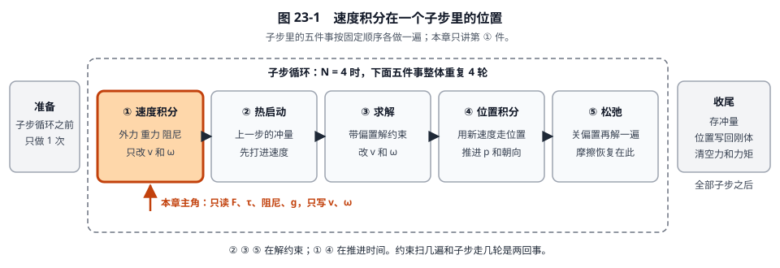
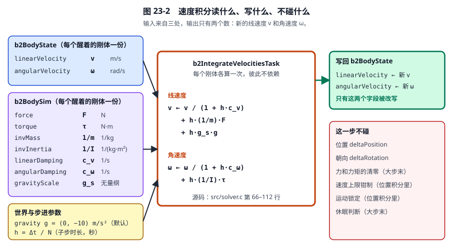
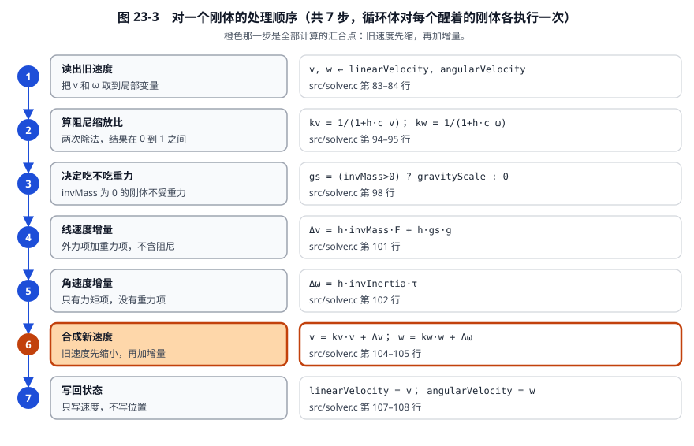
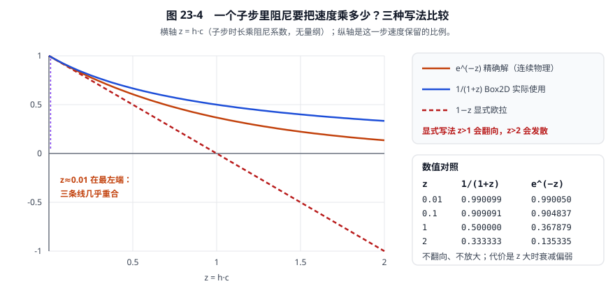
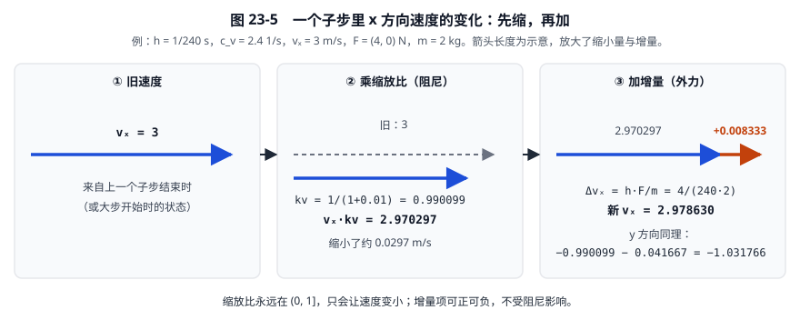
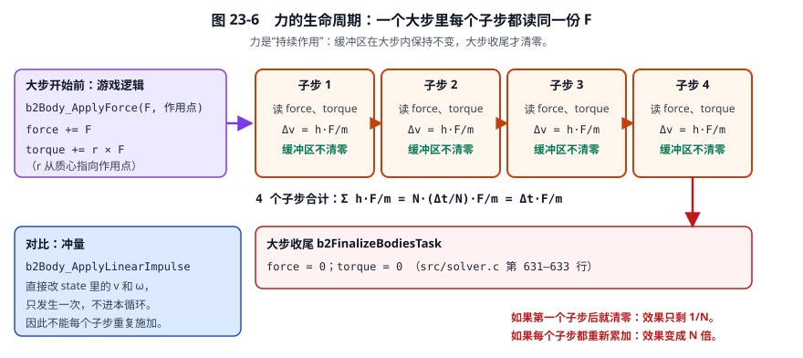
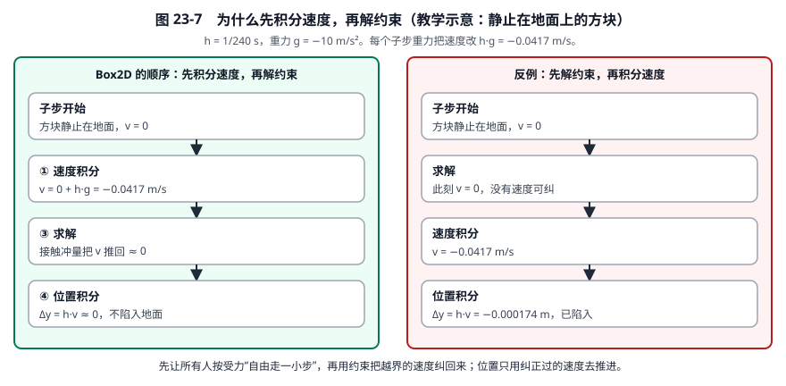

# 23 · 子步里的“速度积分”：每个刚体到底被改了什么

[返回总目录](./README.md) · [上一章](./22-二维物理模拟与约束冲量.md) · [下一章](./24-子步热启动详解.md)

> 本章只盯一件事：一个子步里排第一的那一步——**速度积分**（`b2IntegrateVelocitiesTask`）。
> 讲清它读了什么、改了什么、按什么顺序算、公式怎么来、为什么放在约束求解之前，以及哪些事它**不做**。
> 源码基准：Box2D 3.2.0，提交 `dc67c40ba2ce1ad384b0c985dbc1b539cba9221b`。行号会随提交移动，请优先按函数名定位。

第 03 章已经从牛顿定律推过半隐式欧拉和阻尼；第 11、12 章讲了后面的求解与松弛。
本章把“速度积分”这一步单独拆开，逐行、逐个量地走一遍，并配图。

## 0. 先用一句人话说清

**一个子步开始时，先让每个醒着的刚体“不管碰撞、不管关节”，只按它受到的力、重力和阻力，把自己的速度改一小下。**

打个比方：一群人在玩“木头人”。每一小格时间开始时，大家先各自按自己的状况动一下——有的被风吹（外力），有的往下掉（重力），有的在水里走（阻尼，会变慢）。
这一步只改**速度**，不挪位置，也不管有没有撞到人。撞没撞、有没有关节拉着，是后面“求解约束”那几步的事。

三个要点先记住：

1. **改的只有速度**：线速度 \(v\) 和角速度 \(\omega\)。
2. **每个刚体独立算**：不看别的刚体，不看接触，不看关节。
3. **每个子步算一次**：一个大步分成 \(N\) 个子步，就会做 \(N\) 次，每次时长是 \(h=\Delta t/N\)。

## 1. 它在一个子步里排第几

一个子步里的五件事，固定按下面的顺序各做一遍：



**看图：** 橙色是本章主角。① 和 ④ 是“推进时间”的两次积分（先速度、后位置）；② ③ ⑤ 是在“解约束”。
准备工作在整个子步循环之前做一次，存冲量、位置写回、清空力在全部子步之后做一次。

对应源码（子步循环里的第一件事）：

```1088:1091:src/solver.c
			// Integrate velocities
			syncBits = ( bodySyncIndex << 16 ) | iterationStageIndex;
			B2_ASSERT( stages[iterationStageIndex].type == b2_stageIntegrateVelocities );
			b2ExecuteMainStage( stages + iterationStageIndex, context, syncBits );
```

## 2. 读什么、写什么、不碰什么



**看图：** 左边三个黄、紫、蓝的盒子是输入；中间橙框是这一步的全部计算；右边绿框是唯一的输出；红框列出这一步明确不碰的东西。

### 2.1 逐项解释每个输入量

| 名字（源码） | 符号 | 单位 | 通俗解释 | 从哪里来 |
|---|---|---|---|---|
| `state->linearVelocity` | \(v\) | m/s | 质心现在的平移速度 | 上一个子步结束时的值（大步第一个子步则是上一大步留下的） |
| `state->angularVelocity` | \(\omega\) | rad/s | 现在绕质心转得多快，逆时针为正 | 同上 |
| `sim->force` | \(F\) | N | 用户这一大步里施加的合力 | `b2Body_ApplyForce` 等累加，**不含重力** |
| `sim->torque` | \(\tau\) | N·m | 用户施加的合力矩 | 同上；偏心推力的力矩由 `r × F` 算出 |
| `sim->invMass` | \(1/m\) | 1/kg | 质量的倒数，越重越小 | 创建/更新质量时由形状密度算出；静态、运动学为 0 |
| `sim->invInertia` | \(1/I\) | 1/(kg·m²) | 转动惯量的倒数；越难转越小 | 同上；固定旋转的刚体为 0 |
| `sim->linearDamping` | \(c_v\) | 1/s | 线性阻尼系数，**不是摩擦系数** | 创建刚体时设定，默认 0 |
| `sim->angularDamping` | \(c_\omega\) | 1/s | 角阻尼系数 | 同上，默认 0 |
| `sim->gravityScale` | \(g_s\) | 无量纲 | 这个刚体感受到多少重力；0 = 失重，1 = 正常 | 创建时设定，默认 1 |
| `world->gravity` | \(\mathbf g\) | m/s² | 世界重力向量 | 世界默认 \((0,-10)\)；Box2D 不规定哪个方向是“上” |
| `context->h` | \(h\) | s | 子步时长 \(=\Delta t/N\) | `b2World_Step` 入口算一次 |

### 2.2 输出与“不碰”

输出只有两个字段：`state->linearVelocity` 和 `state->angularVelocity`。
这一步**不**改位置、不改朝向、不清零力、不钳制速度上限、不做运动锁定、不做睡眠判断（它们各自在别处，见第 10 节）。

### 2.3 哪些刚体会被算到

循环遍历的是“醒着的集合”（awake set）里的所有刚体：

```1280:1281:src/solver.c
		stepContext->sims = awakeSet->bodySims.data;
		stepContext->states = awakeSet->bodyStates.data;
```

- **静态刚体**不在醒着的集合里，不会被算到（它们不动，也不需要）。
- **睡着的刚体**也不在里面，直到被唤醒。
- **运动学刚体**在醒着的集合里，会被算到，但它的逆质量是 0，所以外力和重力对它没有作用（见第 9 节）。

`sims[i]` 和 `states[i]` 是两个**下标一一对应**的数组：同一个 `i`，一个存“质量、力、阻尼”这些慢变量，一个存“速度、位移增量”这些子步里每次都要改的量。

## 3. 谁在调用、怎么分工

阶段里的代码是这样被调到的：

```870:872:src/solver.c
		case b2_stageIntegrateVelocities:
			b2IntegrateVelocitiesTask( block, context );
			break;
```

“块”（block）是一段连续的刚体下标：

```1302:1303:src/solver.c
		int minBodiesPerBlock = 32;
		b2BlockDim bodyDim = b2ComputeBlockCount( awakeBodyCount, minBodiesPerBlock, maxBlockCount );
```

划分规则在 `b2ComputeBlockCount`（第 769–792 行）：

- 醒着的刚体不太多时（不超过 \(32\times\) 最大块数），每块正好 32 个，最后一块可能不满；
- 刚体很多时，改为平均分成最多“工人线程数的 4 倍”块（`maxBlockCount = 4 * workerCount`），每块变大。

每块交给一个工人去处理，所以一块里的代码只是一个普通的 `for` 循环。只有一块时，主线程直接执行，不用多线程同步。

两个重要性质：

1. **刚体之间互不依赖**：甲的新速度不依赖乙。所以块之间可以随意并行，线程怎么分都不会改变结果。
2. **阶段之间有同步**：主线程要等这一阶段的所有块都完成（`completionCount == blockCount`），才开始下一阶段（热启动）。

```998:1003:src/solver.c
		while ( b2AtomicLoadInt( &stage->completionCount ) != blockCount )
		{
			b2Pause();
		}

		b2AtomicStoreInt( &stage->completionCount, 0 );
```

所以到热启动开始时，**所有**醒着的刚体都已经完成了速度积分，约束求解看到的是一致的速度快照。

## 4. 对一个刚体的处理顺序

循环体对每个刚体恰好是下面 7 步：



完整的源码（`b2IntegrateVelocitiesTask` 的循环体）：

```83:108:src/solver.c
		b2Vec2 v = state->linearVelocity;
		float w = state->angularVelocity;

		// Apply forces, torque, gravity, and damping
		// Apply damping.
		// Differential equation: dv/dt + c * v = 0
		// Solution: v(t) = v0 * exp(-c * t)
		// Time step: v(t + dt) = v0 * exp(-c * (t + dt)) = v0 * exp(-c * t) * exp(-c * dt)
		// v2 = exp(-c * dt) * v1
		// Pade approximation:
		// v2 = v1 * 1 / (1 + c * dt)
		float linearDamping = 1.0f / ( 1.0f + h * sim->linearDamping );
		float angularDamping = 1.0f / ( 1.0f + h * sim->angularDamping );

		// Gravity scale will be zero for kinematic bodies
		float gravityScale = sim->invMass > 0.0f ? sim->gravityScale : 0.0f;

		// lvd = h * im * f + h * g
		b2Vec2 linearVelocityDelta = b2Add( b2MulSV( h * sim->invMass, sim->force ), b2MulSV( h * gravityScale, gravity ) );
		float angularVelocityDelta = h * sim->invInertia * sim->torque;

		v = b2MulAdd( linearVelocityDelta, linearDamping, v );
		w = angularVelocityDelta + angularDamping * w;

		state->linearVelocity = v;
		state->angularVelocity = w;
```

逐步讲解：

**第 1 步：读出旧速度**（83–84 行）。把 \(v\)、\(\omega\) 拷到局部变量。之后的计算都在局部变量上进行，最后一次性写回。

**第 2 步：算阻尼缩放比**（94–95 行）。

\[
k_v=\frac1{1+h\,c_v},\qquad k_\omega=\frac1{1+h\,c_\omega}.
\]

这是两个 0 到 1 之间的数，意思是“这一小段时间里，旧速度还能保留多少比例”。
**注意变量名陷阱**：源码里的局部变量 `linearDamping` 其实是这个**缩放比** \(k_v\)，而不是阻尼系数 \(c_v\)；系数是 `sim->linearDamping`。读代码时别把两个同名的东西混了。
阻尼为 0（默认）时，\(k_v=1\)，速度原样保留。

**第 3 步：决定吃不吃重力**（98 行）。

\[
g_{\rm eff}=\begin{cases}g_s,& \text{invMass}>0\\ 0,& \text{invMass}=0\end{cases}
\]

逆质量为 0 说明这个刚体“质量无穷大”或没有质量（运动学、密度为 0 的动态刚体），让它去追重力没有意义，也不应该被重力改速度，所以直接置 0。

**第 4 步：线速度增量**（101 行）。

\[
\Delta v=\underbrace{h\,\tfrac1m\,F}_{\text{外力}}+\underbrace{h\,g_{\rm eff}\,\mathbf g}_{\text{重力}}.
\]

这是“这一小段时间里，加速度造成的速度变化”，单位 m/s。
重力项**没有**再乘一次 \(1/m\)，原因见 5.3。

**第 5 步：角速度增量**（102 行）。

\[
\Delta\omega=h\,\tfrac1I\,\tau.
\]

只有力矩项。重力作用在质心上，对质心没有力矩，所以角速度方程里没有重力项。

**第 6 步：合成新速度**（104–105 行）。

\[
v\leftarrow k_v\,v+\Delta v,\qquad \omega\leftarrow k_\omega\,\omega+\Delta\omega.
\]

**顺序要点：阻尼只作用在旧速度上，增量加在阻尼外面。** 这和“先把增量加上去再整体除以 \(1+hc\)”不是一回事，见 6.3。

**第 7 步：写回状态**（107–108 行）。写回的只有两个速度字段。

## 5. 公式推导

### 5.1 从牛顿定律出发

平动：

\[
m\,\frac{dv}{dt}=F+m\,g_s\,\mathbf g\;-\;m\,c_v\,v.
\]

左边是动量变化率。右边三项依次是：用户外力、重力（\(m g\)，已乘质量）、阻尼（写成“加速度 \(=-c_v v\)”的形式，所以乘了 \(m\) 才是力）。两边同时除以 \(m\)：

\[
\frac{dv}{dt}=\underbrace{\frac Fm+g_s\,\mathbf g}_{a:\ \text{推力部分}}\;\underbrace{-\,c_v\,v}_{\text{阻力部分}}.
\]

转动同理（\(\tau=I\alpha\)）：

\[
\frac{d\omega}{dt}=\underbrace{\frac{\tau}{I}}_{\text{推力部分}}\;\underbrace{-\,c_\omega\,\omega}_{\text{阻力部分}}.
\]

两条方程结构完全一样，只是 \(m\leftrightarrow I\)、\(F\leftrightarrow\tau\)。

| | 平动 | 转动 |
|---|---|---|
| 惯性 | 质量 \(m\) | 转动惯量 \(I\) |
| 推力 | 力 \(F\)（N） | 力矩 \(\tau\)（N·m） |
| 加速度 | \(a=F/m\)（m/s²） | \(\alpha=\tau/I\)（rad/s²） |
| 一小步的变化 | \(h\,F/m\)（m/s） | \(h\,\tau/I\)（rad/s） |
| 重力项 | \(h\,g_s\,\mathbf g\) | 无（对质心力矩为 0） |

### 5.2 为什么要拆成“推力”和“阻力”两块

把整条方程一口气做成数值公式，会遇到阻尼项里 \(v\) 取旧值还是新值的问题：

- 取旧值（显式）：\(v_{n+1}=v_n+h(a-c\,v_n)\)，即 \(v_n(1-hc)+ha\)。\(hc>1\) 时系数变负，速度会翻向；\(hc>2\) 时发散（见图 23-4 的红色虚线）。
- 取新值（隐式）：\(v_{n+1}=v_n+h(a-c\,v_{n+1})\)，解出 \(v_{n+1}=\dfrac{v_n+ha}{1+hc}\)。稳定，但把推力也一起缩了。

Box2D 的做法是“**先对旧速度做隐式阻尼，再把显式的推力增量加上去**”：

\[
\boxed{\,v_{n+1}=\frac{v_n}{1+h\,c_v}+h\Big(\frac Fm+g_s\,\mathbf g\Big)\,}
\qquad
\boxed{\,\omega_{n+1}=\frac{\omega_n}{1+h\,c_\omega}+h\,\frac\tau I\,}
\]

这种“把方程拆成两块，各自单独走一步”的办法叫**算子分裂**。它每步引入一个 \(O(h^2)\) 量级的小误差，累计后整体是一阶精度：子步越多，越接近连续解。

和“整体除以 \(1+hc\)”的差别：

\[
\frac{v_n+ha}{1+hc}\;\ne\;\frac{v_n}{1+hc}+ha .
\]

推力项在 Box2D 里**不被缩**。

### 5.3 推力部分：为什么重力不再除以质量

近地重力是 \(F_g=m g\)，加速度是 \(F_g/m=g\)，**质量约掉了**。所以重力项直接写成 \(h\,g_s\,\mathbf g\)，不是 \(h\,\tfrac1m\,g\)。
若误写成后者，轻的物体会掉得比重的快——与实验相反。
用户外力 \(F\) 则不同：同样的 \(F\)，质量越大，速度变化越小，所以要乘 \(1/m\)。

`gravityScale` 只缩放重力，不缩放外力。如果在外力里又加了一份重力，会重复，因为世界重力已经在这里加过。

用户在偏离质心的位置 \(P\) 上施力时，除了 \(F\)，还会产生力矩 \(\tau=r\times F\)，其中 \(r\) 是质心指向作用点的向量。这个累加发生在施加力的时候（不在速度积分里）：

```951:956:src/body.c
	if ( body->setIndex == b2_awakeSet )
	{
		b2BodySim* bodySim = b2GetBodySim( world, body );
		bodySim->force = b2Add( bodySim->force, force );
		bodySim->torque += b2Cross( b2SubPos( point, bodySim->center ), force );
	}
```

速度积分只管把已经累好的 `force`、`torque` 变成速度增量。

### 5.4 阻力部分：阻尼为什么写成 \(1/(1+hc)\)

只看阻尼：\(dv/dt=-c\,v\)。

**物理上的精确解**：分离变量 \(dv/v=-c\,dt\)，积分得

\[
v(t+h)=e^{-c\,h}\,v(t).
\]

意思是：速度每过一小段 \(h\)，就乘一个固定比例 \(e^{-ch}\)。

**为什么不直接用 \(e^{-ch}\)**：指数函数比除法贵，每个刚体每个子步都要算。

**后向欧拉（隐式）一步**：\(\dfrac{v_{n+1}-v_n}{h}=-c\,v_{n+1}\)，移项得

\[
v_{n+1}=\frac{v_n}{1+h\,c}.
\]

这等价于用 \(\dfrac1{1+z}\) 近似 \(e^{-z}\)（\(z=hc\)）。它的两个好处：

1. \(z\ge0\) 时结果在 \((0,1]\)，**不会翻向，也不会放大**。
2. 只要一次除法。

**代价**：\(z\) 大时，它比真实衰减弱；\(z\) 很小时二者几乎一样。



**看图：** 蓝线是 Box2D 用的 \(1/(1+z)\)，橙线是精确的 \(e^{-z}\)，红色虚线是显式写法 \(1-z\)。
Box2D 日常取值 \(z=hc\) 很小（例如 \(h=1/240\)、\(c=2.4\) 时 \(z=0.01\)），蓝线、橙线在最左端几乎重合。

| \(z=hc\) | \(1/(1+z)\) | \(e^{-z}\) | 相对差 |
|---|---:|---:|---:|
| 0.01 | 0.990099 | 0.990050 | 0.005% |
| 0.1 | 0.909091 | 0.904837 | 0.47% |
| 1 | 0.500000 | 0.367879 | 36% |
| 2 | 0.333333 | 0.135335 | 146% |

所以头文件里提醒“阻尼值大时，效果对步长敏感”。需要强阻尼时，应通过更小的子步或其他手段（例如关节马达）处理，不宜把 \(c\) 拉很大。
头文件还指出：线性阻尼会让物体“像漂浮在介质中”，通常不是想要的外观。

### 5.5 合并之后，和连续解差多少

若 \(a\) 与 \(c\) 保持恒定，连续解在一小段 \(h\) 内是

\[
v(t+h)=e^{-ch}\,v+\frac{1-e^{-ch}}{c}\,a .
\]

Box2D 的单步是 \(\dfrac1{1+ch}\,v+h\,a\)。取 \(h=1/240\)、\(c=2.4\)：

- 旧速度系数：\(0.990099\) 对 \(0.990050\)，偏大约 0.005%。
- 加速度系数：\(h=0.0041667\) 对 \((1-e^{-0.01})/2.4=0.0041459\)，偏大约 0.5%。

长期受恒定 \(a\) 与 \(c\) 时，连续模型的终端速度是 \(a/c\)。Box2D 递推的固定点满足 \(v_*=\dfrac{v_*}{1+hc}+ha\)，解得

\[
v_*=\frac ac\,(1+hc).
\]

取 \(a=-10\)、\(c=2.4\)、\(h=1/240\)：连续模型 \(-4.1667\ \mathrm{m/s}\)，Box2D 约 \(-4.2083\ \mathrm{m/s}\)。差了 1%（正是 \(hc\)）。
这不是 bug，而是离散近似的代价；减小 \(h\)（增大子步数）会让它缩小。

## 6. 完整手算一个刚体

### 6.1 已知条件

沿用第 03 章的方块，并加上阻尼：

| 量 | 值 |
|---|---|
| 大步与子步 | \(\Delta t=1/60\ \mathrm s\)，\(N=4\)，\(h=1/240\ \mathrm s\) |
| 质量、转动惯量 | \(m=2\ \mathrm{kg}\)，\(I=0.5\ \mathrm{kg\cdot m^2}\)；逆质量 0.5，逆惯量 2 |
| 外力 | 在质心上方 1 m 处水平向右推 \(F=(4,0)\ \mathrm N\)，所以 \(\tau=r_xF_y-r_yF_x=0\cdot0-1\cdot4=-4\ \mathrm{N\cdot m}\)（顺时针） |
| 重力 | \(\mathbf g=(0,-10)\ \mathrm{m/s^2}\)，\(g_s=1\) |
| 阻尼 | \(c_v=2.4\ \mathrm{s^{-1}}\)，\(c_\omega=4.8\ \mathrm{s^{-1}}\) |
| 旧速度 | \(v=(3,-1)\ \mathrm{m/s}\)，\(\omega=2\ \mathrm{rad/s}\) |

### 6.2 按图 23-3 的七步走

1. 读出：\(v=(3,-1)\)，\(\omega=2\)。
2. 缩放比：\(hc_v=\dfrac{2.4}{240}=0.01\)，\(k_v=\dfrac1{1.01}=0.990099\)；\(hc_\omega=0.02\)，\(k_\omega=\dfrac1{1.02}=0.980392\)。
3. 重力缩放：逆质量 \(0.5>0\)，所以取 \(g_s=1\)。
4. 线速度增量：
   - 外力项：\(h\cdot\tfrac1m\cdot F=\dfrac1{240}\cdot0.5\cdot(4,0)=(0.008333,\ 0)\)；
   - 重力项：\(h\cdot g_s\cdot\mathbf g=\dfrac1{240}\cdot(0,-10)=(0,\ -0.041667)\)；
   - \(\Delta v=(0.008333,\ -0.041667)\ \mathrm{m/s}\)。
5. 角速度增量：\(h\cdot\tfrac1I\cdot\tau=\dfrac1{240}\cdot2\cdot(-4)=-0.033333\ \mathrm{rad/s}\)。
6. 合成：
   - \(v_x=3\times0.990099+0.008333=2.970297+0.008333=2.978630\)
   - \(v_y=-1\times0.990099-0.041667=-0.990099-0.041667=-1.031766\)
   - \(\omega=2\times0.980392-0.033333=1.960784-0.033333=1.927451\)
7. 写回：\(v=(2.978630,\ -1.031766)\ \mathrm{m/s}\)，\(\omega=1.927451\ \mathrm{rad/s}\)。



**看图：** 以 \(v_x\) 为例，先被阻尼缩小一点（蓝线变短），再加上外力带来的一点增量（橙色小箭头）。
图里的箭头长度是示意，为了看清而放大了缩小量与增量。

**量纲检查：** \(h\,F/m\)：s·N/kg = s·(kg·m/s²)/kg = m/s ✓；\(h\,\tau/I\)：s·(N·m)/(kg·m²) = rad/s ✓（rad 无量纲）；\(h\,\mathbf g\)：s·m/s² = m/s ✓。

### 6.3 如果写成“增量加完再整体除”，结果不同

错误写法 \((v+\Delta v)/(1+hc_v)\)：

\[
v_x'=\frac{3+0.008333}{1.01}=2.978548,\qquad v_y'=\frac{-1-0.041667}{1.01}=-1.031353.
\]

正确值是 \(2.978630\) 和 \(-1.031766\)。在 \(h\) 很小时差别不大，但**与源码不是同一个公式**，对照断点时会对不上。

### 6.4 连续做 4 个子步会怎样

教学简化：只重复速度积分，不含约束求解、不积分位置，外力 \(F\)、\(\tau\) 保持不变（第 7 节解释为什么保持不变）。

| 子步 | \(v_x\) | \(\omega\) |
|---:|---:|---:|
| 0（开始） | 3.000000 | 2.000000 |
| 1 | 2.978630 | 1.927451 |
| 2 | 2.957472 | 1.856324 |
| 3 | 2.936524 | 1.786593 |
| 4 | 2.915783 | 1.718228 |

阻尼在不断削弱速度，外力每次都再补一小口。

再看一个**静止物体只受重力**的例子（\(v_y\) 从 0 开始，\(c_v=2.4\) 与 \(c_v=0\) 对比）：

| 子步 | \(c_v=0\) | \(c_v=2.4\) |
|---:|---:|---:|
| 1 | −0.041667 | −0.041667 |
| 2 | −0.083333 | −0.082921 |
| 3 | −0.125000 | −0.123766 |
| 4 | −0.166667 | −0.164208 |

无阻尼时四步合计 \(-1/6\ \mathrm{m/s}=\Delta t\cdot g\)：总时间仍然是 \(1/60\ \mathrm s\)，没有变成四倍速。

## 7. 力的生命周期：为什么 F 在每个子步都要读一遍



**看图：** 用户在大步开始前调用 `b2Body_ApplyForce`，力被累加进 `sim->force`、`sim->torque`。接下来 \(N\) 个子步**都读这同一份**缓冲区，每次贡献 \(h\,F/m\)。大步收尾时才清零。

四个子步合计：

\[
\sum_{k=1}^{N}\frac{h\,F}{m}=N\cdot\frac{\Delta t}{N}\cdot\frac Fm=\frac{\Delta t\,F}{m}.
\]

即“力持续作用整个大步”的总效果。如果第一个子步之后就清零，效果只剩 \(1/N\)；如果每个子步都重新累加同一个 \(F\)，效果变成 \(N\) 倍。
所以清零必须在大步收尾：

```631:633:src/solver.c
		// reset applied force and torque
		sim->force = b2Vec2_zero;
		sim->torque = 0.0f;
```

这是 `b2FinalizeBodiesTask` 里的一段。

**和冲量的区别：** `b2Body_ApplyLinearImpulse` 直接修改 `state` 里的速度，只发生一次，不进入本循环，也不能“每个子步重复施加”，否则会被放大 \(N\) 倍。

由此得出实用约定：
- 想要**持续推**：每个大步调用一次 `ApplyForce`。公开接口里没有“每个子步回调一次”的入口，力只能在大步之间提交。
- 想要**瞬间弹一下**：用冲量。

另外，`b2Body_ApplyForce` 只对动态刚体有效。对睡眠刚体，是否生效还取决于参数 `wake`：为 `true` 才会先唤醒；为 `false` 则力被丢弃（见 `src/body.c` 的 `b2Body_ApplyForce`，第 936–957 行附近）。

## 8. 为什么先积分速度，再解约束



**看图：** 设一个静止在地面上的方块。每个子步重力都想把它的速度改成 \(h\,g=-0.0417\ \mathrm{m/s}\)。

- **Box2D 的顺序**：速度积分先让速度变成 \(-0.0417\)；接着求解接触，接触冲量把这个向下的速度推回约等于 0；然后位置积分用的是**已经被约束修正过的速度**，方块基本不动，没有陷进地面。
- **反例**：先解约束（此刻速度是 0，没有可纠的），再积分速度（变成 \(-0.0417\)），位置积分就用它走：\(\Delta y=h\,v=-0.000174\ \mathrm m\)，方块已经陷进去了，要到下个子步才被拉回来。

可以这样记：

> 先让所有人按受力“自由走一小步”，再用约束把越界的速度纠回来；位置只用纠正过的速度去推进。

这就是第 03 章说的半隐式欧拉在引擎里的具体样子：**先更新速度（并经约束修正），再用新速度更新位置。**

## 9. 各类刚体的特殊情形

| 刚体类型 | 逆质量 | 逆惯量 | 重力 | 外力 / 力矩 | 阻尼 |
|---|---|---|---|---|---|
| 普通动态 | \(1/m\) | \(1/I\) | 生效 | 生效 | 生效 |
| 动态 + 固定旋转 | \(1/m\) | 0 | 生效 | 力生效，**力矩无效** | 角阻尼仍缩放 \(\omega\) |
| 动态但所有形状密度为 0 | 0 | 0 | **无效** | **无效** | 生效 |
| 运动学 | 0 | 0 | 无效 | 无效（也不能施加） | **仍会缩放速度**，默认系数为 0 所以不受影响 |
| 静态 | 不参与 | 不参与 | 不参与 | 不参与 | 不参与 |
| 睡眠 | 不参与 | 不参与 | 不参与 | 不参与 | 不参与 |

几点说明：

- **逆质量如何得到**：动态刚体在更新质量时，只有总质量大于 0 才会取倒数（`src/body.c` 第 596 行）。形状密度全为 0 时质量是 0，逆质量保持 0——于是重力项被第 3 步直接置零。如果发现一个动态刚体“不受重力”，先检查它的质量是否真的大于 0。
- **固定旋转**：逆惯量被置 0（`src/body.c` 第 620–627 行），力矩因此无法产生角速度变化。
- **运动学刚体**由用户直接设速度，在这里不会被加速，但如果设置了非零阻尼，速度仍会被缩小。

## 10. 它不做的事

下面这些容易被误以为是“速度积分”的一部分，其实都不在这里：

**① 速度上限钳制和运动锁定——在位置积分里。**

```135:153:src/solver.c
		v.x = ( state->flags & b2_lockLinearX ) ? 0.0f : v.x;
		v.y = ( state->flags & b2_lockLinearY ) ? 0.0f : v.y;
		w = ( state->flags & b2_lockAngularZ ) ? 0.0f : w;

		// Clamp to max linear speed
		if ( b2Dot( v, v ) > maxLinearSpeedSquared )
		{
			float ratio = maxLinearSpeed / b2Length( v );
			v = b2MulSV( ratio, v );
			state->flags |= b2_isSpeedCapped;
		}

		// Clamp to max angular speed
		if ( w * w > maxAngularSpeedSquared && ( state->flags & b2_allowFastRotation ) == 0 )
		{
			float ratio = maxAngularSpeed / b2AbsFloat( w );
			w *= ratio;
			state->flags |= b2_isSpeedCapped;
		}
```

线速度上限来自世界参数 `maximumLinearSpeed`（默认 400 m/s）。角速度上限是 `B2_MAX_ROTATION * inv_dt`：\(\tfrac\pi4\) 除以大步时长，大步 \(1/60\ \mathrm s\) 时约为 47.1 rad/s。
因此速度积分之后、位置积分之前，速度可能短暂超过上限；真正限制它的是位置积分前的这几行。

**② 位置与朝向的更新——在位置积分里。** 速度积分不动 `deltaPosition`、`deltaRotation`。

**③ 力和力矩的清零——在大步收尾。** 见第 7 节。

**④ 接触、关节、摩擦、恢复——在热启动、求解、松弛里。** 速度积分不看它们。

**⑤ 睡眠与连续碰撞——在全部子步之后。** 它们用整个大步的结果判断。

## 11. 常见误解

| 误解 | 事实 |
|---|---|
| 速度积分会移动物体 | 它只改 \(v\)、\(\omega\)。位置由第 ④ 件事（位置积分）推进 |
| 阻尼系数就是摩擦系数 | 不是。阻尼表示“单位时间速度衰减多少比例”，单位 1/s；摩擦只在接触里存在，与速度大小无关 |
| 每个子步重复读 `force` 会让力放大 \(N\) 倍 | 每次只贡献 \(h\,F/m\)，\(N\) 次合计正好是 \(\Delta t\,F/m\)，等于力持续一个大步 |
| 重力项也要除以质量 | 不要。质量约掉了，直接加 \(h\,g_s\,\mathbf g\) |
| 增量加完再整体除以 \(1+hc\) 也一样 | 不一样。源码是先缩旧速度、再加增量，见 6.3 |
| 增大迭代次数 `ITERATIONS` 会让速度积分多做几次 | 不会。`ITERATIONS` 只在求解阶段重复解约束；速度积分每个子步固定一次 |
| 静止的物体积分后速度还是 0 | 不是。受重力时每个子步都会得到 \(h\,g\)，是靠后面的接触约束把它纠回 0 |
| 子步越多，施加的力越大 | 不会。\(h=\Delta t/N\)，增量变小，合计不变 |
| 静态物体也被这一步算一遍 | 不会。静态和睡眠的刚体不在醒着的集合里 |
| `linearDamping` 变量就是阻尼系数 | 循环体里的局部变量 `linearDamping` 是缩放比 \(1/(1+hc)\)，系数是 `sim->linearDamping` |

## 12. 自检

### 12.1 练习

**题 1**　\(\Delta t=1/60\ \mathrm s\)，\(N=2\)，物体 \(m=4\ \mathrm{kg}\)，向上的外力 \(F=(0,20)\ \mathrm N\)，\(g_s=0.5\)，\(\mathbf g=(0,-10)\)，无阻尼，旧速度为 0。一个子步后 \(v_y\) 是多少？

**题 2**　\(h=1/240\ \mathrm s\)，\(c_v=24\ \mathrm{s^{-1}}\)，\(g_s=0\)，无外力，旧速度 \(v=(10,0)\)。一个子步后 \(v_x\) 是多少？精确的连续解是多少？

**题 3**　\(I=2\ \mathrm{kg\cdot m^2}\)，\(\tau=6\ \mathrm{N\cdot m}\)，\(h=1/240\ \mathrm s\)，无阻尼，旧 \(\omega=0\)。一个子步后 \(\omega\) 是多少？

**题 4**　默认世界、一个形状密度为 0 的动态刚体，旧速度 0。一个子步后 \(v_y\) 是多少？为什么？

### 12.2 答案

**题 1**　\(h=\dfrac1{120}\)。外力项 \(h\cdot\dfrac1m\cdot F_y=\dfrac1{120}\cdot0.25\cdot20=\dfrac5{120}=0.041667\)；重力项 \(h\cdot g_s\cdot g_y=\dfrac1{120}\cdot0.5\cdot(-10)=-0.041667\)。合计 \(v_y=0\)：外力恰好托住重力，物体悬停。

**题 2**　\(hc_v=0.1\)，\(v_x=10/1.1=9.090909\ \mathrm{m/s}\)；连续解 \(10\,e^{-0.1}=9.048374\ \mathrm{m/s}\)。Box2D 衰减偏弱约 0.47%，与 5.4 的表一致。

**题 3**　\(\Delta\omega=h\,\tau/I=\dfrac{6}{240\cdot2}=0.0125\ \mathrm{rad/s}\)，所以 \(\omega=0.0125\ \mathrm{rad/s}\)。

**题 4**　\(v_y=0\)。密度为 0 使质量为 0，逆质量保持 0，第 3 步把重力缩放置 0，外力项乘以 0 也无效。这个刚体不会被重力或外力改变速度。

### 12.3 断点核对

在 `src/solver.c` 的 `b2IntegrateVelocitiesTask` 里，对 6.1 的刚体（\(h=1/240\)）在第 104 行打断点，应看到：

| 变量 | 预期值 |
|---|---|
| `linearDamping`（缩放比） | 0.990099 |
| `angularDamping`（缩放比） | 0.980392 |
| `gravityScale` | 1 |
| `linearVelocityDelta` | (0.008333, −0.041667) |
| `angularVelocityDelta` | −0.033333 |

执行第 104–105 行之后：

| 变量 | 预期值 |
|---|---|
| `v` | (2.978630, −1.031766) |
| `w` | 1.927451 |

单精度 `float` 的最后一位可能不同，这属于正常舍入，不要要求位级相等。

如果断点处 `h` 不是 \(\Delta t/N\)，先回到 `b2World_Step` 检查 `context.h` 的计算。

## 13. 源码索引

| 位置 | 内容 |
|---|---|
| `src/solver.c` 第 65–112 行 | `b2IntegrateVelocitiesTask` 全文（本章主角） |
| `src/solver.c` 第 114–162 行 | `b2IntegratePositionsTask`：运动锁定、速度钳制、位置积分 |
| `src/solver.c` 第 631–633 行 | `b2FinalizeBodiesTask` 里清零力与力矩 |
| `src/solver.c` 第 870–872 行 | 阶段分发：`b2_stageIntegrateVelocities` |
| `src/solver.c` 第 973–1004 行 | `b2ExecuteMainStage`：阶段之间的同步 |
| `src/solver.c` 第 1088–1091 行 | 子步循环里的速度积分 |
| `src/solver.c` 第 769–792 行 | `b2ComputeBlockCount`：块的划分规则 |
| `src/solver.c` 第 1302–1303 行 | 刚体块的划分调用 |
| `src/solver.c` 第 1506 行 | 建立速度积分阶段 |
| `src/body.h` 第 153–208 行 | `b2BodyState` 与 `b2BodySim` 的字段定义 |
| `src/body.c` 第 596 行 | 逆质量的计算 |
| `src/body.c` 第 951–956 行 | `b2Body_ApplyForce` 累加力和力矩 |
| `src/types.c` 第 12–13 行 | 默认世界重力 \((0,-10)\) |
| `include/box2d/types.h` | `linearDamping`、`angularDamping`、`gravityScale` 的公开说明 |

本章的图由 [`images/build_ch23_figs.py`](./images/build_ch23_figs.py) 生成，可修改后重新运行。
