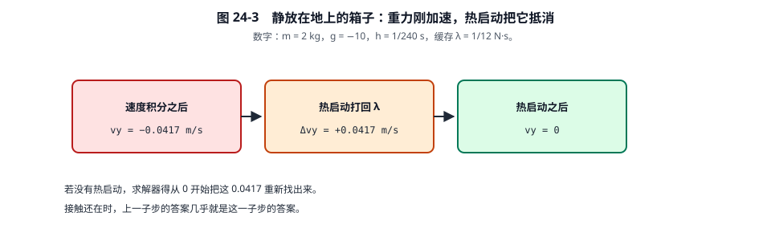
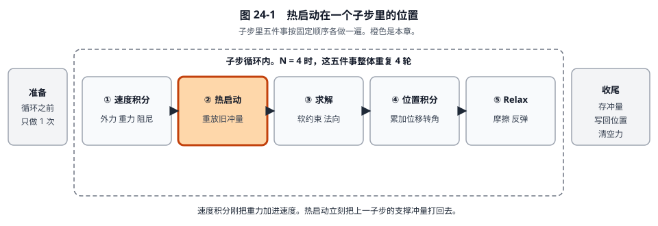
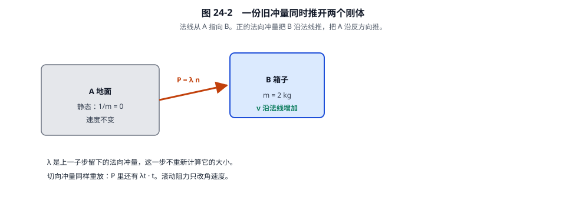

# 24 · 子步热启动：用一个箱子把每一步算完

[返回总目录](./README.md) · [上一章](./23-子步速度积分详解.md) · [下一章](./25-子步软约束求解详解.md)

这一章只做**一个子步里的热启动**。公式先写成“每个字母是什么”，再把同一个箱子的数代进去，一步一步算出新速度。

源码基准：Box2D 3.2.0。标量实现是 `b2WarmStartContacts_Overflow`；着色路径的 `b2WarmStartContacts_Wide` 做同一件事，只是一次算四个接触。

## 0. 先记住这只箱子

地面是刚体 A，静止。箱子是刚体 B，压在地面上，还在往右滑。取这一大步的**第一个子步**，所以累计位移还是 0。

世界一步 \(\Delta t = 1/60\ \mathrm s\)，切成 4 个子步，所以

\[
h = \frac{\Delta t}{4} = \frac{1}{240}\ \mathrm s \approx 0.004167\ \mathrm s.
\]

重力 \(\mathbf g = (0,\ -10)\ \mathrm{m/s^2}\)。没有阻尼，用户也没有再推它。

| 符号 | 本例的值 | 单位 | 它是什么 |
|---|---:|---|---|
| \(m_B\) | 1 | kg | 箱子质量 |
| \(1/m_B\) | 1 | 1/kg | 逆质量。冲量乘它才变成速度变化 |
| \(1/m_A\) | 0 | 1/kg | 地面是静态，逆质量为 0，速度不会被改 |
| \(1/I_A,\ 1/I_B\) | 0 | 1/(kg·m²) | 本例两边都不吃力矩，角速度保持 0 |
| \(n\) | \((0,\ 1)\) | 无 | 接触法线，从 A 指向 B，也就是竖直向上 |
| \(t\) | \((1,\ 0)\) | 无 | 法线的右垂线。\(n=(n_x,n_y)\) 时 \(t=(n_y,\ -n_x)\) |
| \(r_A\) | \((0,\ 0)\) | m | 地面质心指向接触点。本例取在接触点上 |
| \(r_B\) | \((0,\ -0.5)\) | m | 箱子质心指向接触点。接触点在质心正下方 0.5 m |
| \(\lambda_n\) | \(1/24 \approx 0.041667\) | N·s | 上一子步留下的法向冲量。正号表示沿 \(n\) 推 |
| \(\lambda_t\) | 0.010000 | N·s | 上一子步留下的切向（摩擦）冲量 |
| \(v_B\) 进入本子步时 | \((0.400000,\ 0)\) | m/s | 上一子步结束时的速度：往右 0.4，竖直为 0 |
| \(\omega_A,\omega_B\) | 0 | rad/s | 角速度 |

\(1/24\) 不是随便取的。箱子每子步被重力改掉的竖直速度是 \(h\times 10 = 10/240 = 1/24\ \mathrm{m/s}\)。上一子步留下的支撑冲量如果正好是 \(m \times 1/24 = 1/24\ \mathrm{N\cdot s}\)，热启动就能把这点重力抵消。

接触点只有 1 个。滚动阻力冲量是 0。热启动开关是开的，所以准备阶段把旧冲量原样抄了进来，没有乘 0。

## 1. 热启动开始之前，速度积分已经做完

热启动不读力。它读到的速度，是速度积分刚刚改过的速度。这里把那三行补上，后面的数才有来处。阻尼为 0，外力为 0：

\[
v_y \leftarrow 0 + h \times (-10) = -\frac{10}{240} = -0.041667\ \mathrm{m/s},
\]
\[
v_x \leftarrow 0.400000.
\]

所以热启动**拿到手**的速度是

\[
v_B = (0.400000,\ -0.041667)\ \mathrm{m/s}.
\]

竖直方向上，箱子正在以 0.041667 m/s 往下掉。这就是重力在这 1/240 秒里造成的全部变化。

## 2. 这一步要算的式子

热启动**不重新求** \(\lambda_n\) 和 \(\lambda_t\)。它只做三件事。

**第一件：把两个冲量合成一个向量。**

\[
\mathbf P = \lambda_n\, n + \lambda_t\, t.
\]

\(\mathbf P\) 的单位是 N·s，就是动量的变化量。沿法线的那部分把箱子往上托，沿切向的那部分是摩擦力留下的横向作用。

**第二件：力臂产生的转动。** 二维叉积

\[
r \times \mathbf P = r_x P_y - r_y P_x,
\]

单位 N·m·s。角速度的变化是

\[
\Delta\omega_A = -\frac{1}{I_A}(r_A \times \mathbf P), \qquad
\Delta\omega_B = +\frac{1}{I_B}(r_B \times \mathbf P).
\]

本例 \(1/I=0\)，所以结果是 0。式子仍然要算一遍，因为源码里这几行始终存在。

**第三件：线速度。** 冲量等于动量变化，\( \Delta(mv)=\mathbf P \)，所以

\[
v_A \leftarrow v_A - \frac{1}{m_A}\mathbf P, \qquad
v_B \leftarrow v_B + \frac{1}{m_B}\mathbf P.
\]

A 减、B 加，是因为法线从 A 指向 B：正的 \(\lambda_n\) 把 B 推向 \(n\) 的方向，把 A 推向相反方向。

另外还有一行账，不参与速度：

\[
\lambda_n^{\mathrm{total}} \leftarrow \lambda_n^{\mathrm{total}} + \lambda_n.
\]

`totalNormalImpulse` 在准备阶段被清成 0。它是这一大步里“法向冲量打出去多少”的流水，留给步末的碰撞事件，**不会**再代回速度公式。

对应源码：

```188:195:src/contact_solver.c
			b2Vec2 P = b2Add( b2MulSV( cp->normalImpulse, normal ), b2MulSV( cp->tangentImpulse, tangent ) );
			cp->totalNormalImpulse += cp->normalImpulse;
			wA -= iA * b2Cross( rA, P );
			vA = b2MulAdd( vA, -mA, P );
			wB += iB * b2Cross( rB, P );
			vB = b2MulAdd( vB, mB, P );
```

`mA` 在源码里是逆质量 \(1/m_A\)，不是质量。`iA` 是 \(1/I_A\)。

## 3. 把数字代进去

### 步骤 1：合成 \(\mathbf P\)

\[
\lambda_n\, n = 0.041667 \times (0,\ 1) = (0,\ 0.041667),
\]
\[
\lambda_t\, t = 0.010000 \times (1,\ 0) = (0.010000,\ 0),
\]
\[
\mathbf P = (0.010000,\ 0.041667)\ \mathrm{N\cdot s}.
\]

### 步骤 2：力臂

箱子：

\[
r_B \times \mathbf P = 0 \times 0.041667 - (-0.5)\times 0.010000 = 0.005000\ \mathrm{N\cdot m\cdot s}.
\]

地面 \(r_A=(0,0)\)，叉积是 0。

### 步骤 3：角速度

\[
\Delta\omega_B = 0 \times 0.005000 = 0, \qquad \omega_B \text{ 仍是 } 0.
\]

如果 \(1/I_B\) 不是 0，这 0.005 就会变成角速度。本例把它乘 0，是为了让后面的法向算术不被转动搅乱。切向冲量的力臂不是 0：接触点在质心下方，横向冲量本来就会拧箱子。

### 步骤 4：线速度

地面 \(1/m_A=0\)，\(v_A\) 保持 \((0,0)\)。

箱子：

\[
\frac{1}{m_B}\mathbf P = (0.010000,\ 0.041667),
\]
\[
v_B \leftarrow (0.400000,\ -0.041667) + (0.010000,\ 0.041667) = (0.410000,\ 0).
\]

竖直分量 \(-0.041667+0.041667=0\)。重力刚刚加上的下沉，被上一子步的支撑冲量抵消了。水平分量从 0.400 变成 0.410，是因为旧的摩擦冲量又打了一次。

### 步骤 5：流水账

\[
\lambda_n^{\mathrm{total}} \leftarrow 0 + 0.041667 = 0.041667.
\]

\(\lambda_n\) 和 \(\lambda_t\) 的存储值**不变**。热启动只使用它们，不修改它们。



**看图：** 本例竖直方向就是这三格。图里用的是 2 kg 的示意；上面的手算是 1 kg，所以冲量是 \(1/24\) 而不是 \(1/12\)，抵消掉的速度仍是 \(1/24\ \mathrm{m/s}\)。

## 4. 热启动结束时，每个量是多少

| 量 | 进入热启动 | 离开热启动 | 有没有被改 |
|---|---:|---:|---|
| \(v_B\) | \((0.400000,\ -0.041667)\) | \((0.410000,\ 0)\) | 改了 |
| \(\omega_B\) | 0 | 0 | 没改（逆惯量为 0） |
| \(\lambda_n\) | 0.041667 | 0.041667 | 没改 |
| \(\lambda_t\) | 0.010000 | 0.010000 | 没改 |
| \(\lambda_n^{\mathrm{total}}\) | 0 | 0.041667 | 加上了整份 \(\lambda_n\) |
| 位置、\(\Delta p\) | 0 | 0 | 热启动不动位置 |

下一章求解拿到的竖直速度是 0，水平速度是 0.410000 m/s，法向冲量仍然是 0.041667 N·s。

## 5. 这几条式子为什么长这样

冲量的定义就是“动量的变化”。质量 1 kg 的物体吃进 \((0.01,\ 0.041667)\ \mathrm{N\cdot s}\)，速度就增加同样的数，单位从 N·s 变成 m/s。地面质量被当成无限大，逆质量写成 0，同一份冲量除下去是 0，地面不动。

热启动放在速度积分之后，是因为每个子步的重力都会把 \(v_y\) 再减掉 \(h|g|\)。接触还在的时候，上一子步已经求出的 \(\lambda_n\) 几乎就是这份支撑。先打回去，求解只处理“还差多少”，不用从 0 把托力重新找一遍。

世界若关掉热启动，准备阶段会把抄进来的冲量乘 0：

```43:43:src/contact_solver.c
	float warmStartScale = world->enableWarmStarting ? 1.0f : 0.0f;
```

函数仍会跑，但 \(\mathbf P=\mathbf 0\)，速度就停在 \((0.400000,\ -0.041667)\)。

关节在同一步里也是“重放旧冲量”。差别只在锚点：接触用准备时写好的 \(r\)，距离关节会先用本子步已经累计的转角把锚点转一下，再沿当前连线打出去。本例没有关节。





## 6. 这一步没有做的事

没有看重叠了多少毫米，没有夹摩擦上限，没有改 \(\lambda_n\) 的大小，没有改位置。那些分别是求解、Relax 和位置积分的工作。
