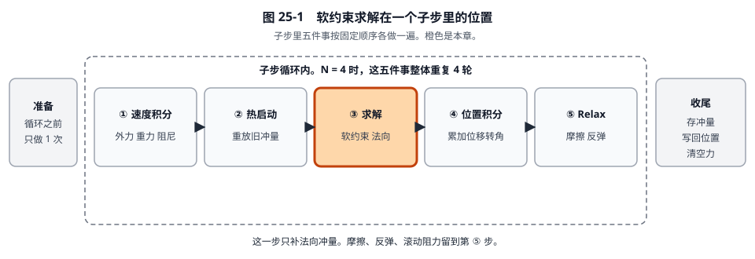

# 25 · 子步软约束求解：用同一个箱子把法向冲量算完

[返回总目录](./README.md) · [上一章](./24-子步热启动详解.md) · [下一章](./26-子步位置积分详解.md)

这一章只做**求解**这一步（`useBias = true`）。沿用第 24 章那只箱子，从热启动结束时的数字接着算。每出现一个新符号，先写它的意思，再代入。

着色路径的函数是 `b2PushContacts_Wide`，只做两点法向。overflow 的 `b2SolveContacts_Overflow(context, true)` 是同一套式子的标量版。下面按标量版的顺序写。摩擦和反弹不在这一步。

## 0. 箱子还是那一只

| 符号 | 值 | 单位 | 意思 |
|---|---:|---|---|
| \(h\) | \(1/240\) | s | 本子步时长 |
| \(1/h\) | 240 | 1/s | 子步时长的倒数。推测接触要用它 |
| \(n\) | \((0,\ 1)\) | 无 | 从地面指向箱子 |
| \(1/m_B\) | 1 | 1/kg | 箱子逆质量。地面是 0 |
| \(1/I_B\) | 0 | 1/(kg·m²) | 本例不转动 |
| \(r_B\) | \((0,\ -0.5)\) | m | 质心指向接触点 |
| \(s_0\) | \(-0.004\) | m | 碰撞检测给出的间隙。负号表示箱子陷进地面 4 mm |
| \(v_{\mathrm{push}}\) | 3 | m/s | 推开重叠的速度上限，世界默认值 `contactSpeed` |
| \(f\) | 30 | Hz | 接触弹簧的频率，默认 `contactHertz` |
| \(\zeta\) | 10 | 无 | 接触阻尼比，默认 `contactDampingRatio`。大于 1 表示过阻尼，重叠会尽快消掉，少来回晃 |

热启动结束时，交给这一步的数是：

| 量 | 值 | 意思 |
|---|---:|---|
| \(v_B\) | \((0.410000,\ 0)\) | 竖直速度已经被旧支撑冲量抵消 |
| \(\omega_B\) | 0 | |
| \(\lambda_n\) | 0.041667 N·s | 累计法向冲量，这一步会在它上面加增量 |
| \(\lambda_t\) | 0.010000 N·s | 这一步完全不读它 |
| \(\Delta p\) | \((0,\ 0)\) | 大步的第一个子步，还没走过路 |
| \(\Delta q\) | \((1,\ 0)\) | 累计转动还是“没有转”，即 \(\cos=1,\sin=0\) |

因为是第一个子步，当前间隙 \(s\) 就等于 \(s_0=-0.004\)。第 3 节会把这个等式按源码算一遍，而不是直接拿来用。

## 1. 源码实际执行的顺序

对这一个接触点，顺序是：

1. 用累计位移把间隙 \(s\) 算出来。
2. 看 \(s\) 是正还是负，决定速度目标 \(b\)，以及两个比例 \(s_m\)、\(s_\lambda\)。
3. 算接触点的法向相对速度 \(v_n\)。
4. 算出冲量**增量** \(\Delta\lambda\)。
5. 加到旧的 \(\lambda_n\) 上，如果结果小于 0，就停在 0。
6. 只把增量打进速度。


法向有效质量在准备阶段已经算好。本例地面不动、箱子不转：

\[
k_n = \frac{1}{m_A}+\frac{1}{m_B}+\frac{(r_A\times n)^2}{I_A}+\frac{(r_B\times n)^2}{I_B}
= 0 + 1 + 0 + 0 = 1.
\]

\(r_B\times n = 0\times 1 - (-0.5)\times 0 = 0\)，接触点在质心正下方，法向冲量没有力臂。

\[
m_n = \frac{1}{k_n} = 1.
\]

源码里的 `normalMass` 就是这个 \(m_n\)。它的意思是：沿法线打出 1 N·s 的冲量，法向相对速度 \(v_n\) 会增加 \(k_n=1\ \mathrm{m/s}\)。所以想把 \(v_n\) 改变 \(\Delta v_n\)，需要的冲量就是 \(m_n\,\Delta v_n\)。

## 2. 三个软度系数：先算出数，再解释

重叠被当成一根弹簧。频率 \(f\) 决定硬，阻尼比 \(\zeta\) 决定晃不晃。源码把它们收成三个数（`b2MakeSoft`）：

\[
\omega = 2\pi f, \qquad
a_1 = 2\zeta + h\omega, \qquad
a_2 = h\omega\, a_1, \qquad
a_3 = \frac{1}{1+a_2}.
\]

\[
\beta = \frac{\omega}{a_1}, \qquad
s_m = a_2\, a_3, \qquad
s_\lambda = a_3.
\]

| 符号 | 源码字段 | 意思 |
|---|---|---|
| \(\omega\) | 局部变量 | 弹簧的角频率，单位 1/s。30 Hz 就是每秒 30 次，乘 \(2\pi\) 变成角频率 |
| \(\beta\) | `biasRate` | 单位 1/s。重叠 \(s\) 乘它，得到“还想补多少分离速度” |
| \(s_m\) | `massScale` | 无量纲。当前速度和这个分离速度，这一拍听多少 |
| \(s_\lambda\) | `impulseScale` | 无量纲。旧冲量里要卸掉的比例。恒有 \(s_m+s_\lambda=1\) |

代入时 \(f\) 还不能直接用 30。源码对这种接触把频率再乘 2，并且频率本身先被 \(0.125/h\) 封顶。\(h=1/240\) 时封顶值正好是 30 Hz，乘 2 之后实际用来算弹簧的是 \(f=60\ \mathrm{Hz}\)：

```978:980:src/physics_world.c
	float contactHertz = b2MinFloat( world->contactHertz, 0.125f * context.inv_h );
	context.contactSoftness = b2MakeSoft( contactHertz, world->contactDampingRatio, context.h );
	context.staticSoftness = b2MakeSoft( 2.0f * contactHertz, world->contactDampingRatio, context.h );
```

于是 \(\omega = 2\pi\times 60 = 376.991118\)。

\[
h\omega = \frac{376.991118}{240} = 1.570796,
\]
\[
a_1 = 20 + 1.570796 = 21.570796,
\]
\[
a_2 = 33.883328.
\]

\(a_2\) 用还没舍入的 \(h\omega\) 与 \(a_1\) 相乘，再保留 6 位。若先把两个因子都收成 6 位再乘，得到 33.883320，只差在第 6 位。后面的数都按完整计算保留 6 位，纸上重乘时末位允许差 1。
\[
a_3 = \frac{1}{34.883328} = 0.028667.
\]

\[
\beta = \frac{376.991118}{21.570796} = 17.476922\ \mathrm{s^{-1}},
\]
\[
s_m = 33.883328 \times 0.028667 = 0.971333, \qquad s_\lambda = 0.028667.
\]

\(0.971333+0.028667=1.000000\)。两边都是动态刚体时不乘这一个 2，三个数会软一档，后面的代入步骤相同。

## 3. 逐步代入

### 步骤 1：间隙 \(s\)

准备阶段存过

\[
s_{\mathrm{base}} = s_0 - (r_B-r_A)\cdot n.
\]

\(r_B-r_A=(0,\ -0.5)\)，点法线：

\[
(r_B-r_A)\cdot n = -0.5, \qquad s_{\mathrm{base}} = -0.004 - (-0.5) = 0.496\ \mathrm m.
\]

这一步再用累计位移把锚点转回去：

\[
s = s_{\mathrm{base}} + \big(\Delta p_B-\Delta p_A + R(\Delta q_B)r_B - R(\Delta q_A)r_A\big)\cdot n.
\]

\(\Delta p=0\)，\(\Delta q\) 是单位旋转，\(R r = r\)，所以括号里只剩 \(r_B-r_A\)：

\[
s = 0.496 + (0,\ -0.5)\cdot(0,\ 1) = 0.496 - 0.5 = -0.004\ \mathrm m.
\]

和碰撞检测给的 \(s_0\) 相同。负号的意思：沿法线看，箱子比“刚好贴住”更低 4 mm，也就是陷进去 4 mm。

### 步骤 2：由 \(s\) 选目标


\(s<0\)，走重叠那一支（求解阶段 `useBias` 为真）：

\[
b = \max(s_m\,\beta\, s,\ -v_{\mathrm{push}}).
\]

\[
s_m\,\beta = 0.971333 \times 17.476922 = 16.975911,
\]
\[
s_m\,\beta\, s = 16.975911 \times (-0.004) = -0.067904.
\]

和 \(-3\) 比较，取没那么负的一个：\(\max(-0.067904,\ -3)=-0.067904\)。推开速度没有顶到 3 m/s 的盖子。

同时

\[
s_m = 0.971333, \qquad s_\lambda = 0.028667.
\]

\(b\) 的单位是 m/s。\(b=-0.067904\) 表示：弹簧希望法向相对速度往“分开”的方向偏 0.067904 m/s。分开是 \(v_n>0\)。

### 步骤 3：现在的法向相对速度

\[
v_n = \big(v_B+\omega_B\times r_B - v_A-\omega_A\times r_A\big)\cdot n.
\]

角速度都是 0，地面速度是 0：

\[
v_n = (0.410000,\ 0)\cdot(0,\ 1) = 0.
\]

热启动已经把下沉速度消掉了，这一刻接触点既不继续下沉，也没有往上离开。

### 步骤 4：冲量增量

源码：

```308:309:src/contact_solver.c
			float impulse = -cp->normalMass * ( massScale * vn + velocityBias ) - impulseScale * cp->normalImpulse;
```

\[
\Delta\lambda = -\, m_n\,(s_m\, v_n + b) - s_\lambda\, \lambda_n.
\]

代入：

\[
s_m\, v_n + b = 0.971333 \times 0 + (-0.067904) = -0.067904,
\]
\[
-\, m_n\,(s_m v_n+b) = -1 \times (-0.067904) = 0.067904,
\]
\[
s_\lambda\,\lambda_n = 0.028667 \times 0.041667 = 0.001195,
\]
\[
\Delta\lambda = 0.067904 - 0.001195 = 0.066709\ \mathrm{N\cdot s}.
\]

两项各自的意思：

- \(0.067904\) 是弹簧这一拍想再补的冲量。因为 \(m_n=1\)，它同时也是想再增加的分离速度，单位从 N·s 看成 m/s。
- \(0.001195\) 是旧冲量里按 \(s_\lambda\) 卸掉的一截。旧的 \(0.041667\) 已经在热启动里打进速度了，不能再原样叠一份弹簧力。

### 步骤 5：单边夹紧

接触只能推，不能拉。累计冲量不许小于 0。

\[
\lambda_n^{\mathrm{new}} = \max(\lambda_n+\Delta\lambda,\ 0) = \max(0.041667+0.066709,\ 0) = 0.108376\ \mathrm{N\cdot s}.
\]

没有被夹住。真正打进速度的增量就是 \(0.066709\)，不是 \(0.108376\)。\(0.108376\) 是新的累计值，留给下一子步的热启动。

流水账只加增量：

\[
\lambda_n^{\mathrm{total}} \leftarrow 0.041667 + 0.066709 = 0.108376.
\]

### 步骤 6：增量打进速度

\[
\Delta v_B = \frac{1}{m_B}(\Delta\lambda\, n) = (0,\ 0.066709)\ \mathrm{m/s},
\]
\[
v_B \leftarrow (0.410000,\ 0) + (0,\ 0.066709) = (0.410000,\ 0.066709)\ \mathrm{m/s}.
\]

箱子获得了向上的 0.066709 m/s。水平速度没变。\(\lambda_t\) 仍是 0.010000。位置还没变，\(\Delta p\) 仍是 0。位置是下一章的事，它会用这个新速度。

## 4. \(b\) 为什么等于那一截弹簧速度

只看弹簧，不看旧冲量。重叠 \(s\) 上的弹簧阻尼写成“每单位质量的加速度”：

\[
\frac{\mathrm dv_n}{\mathrm dt} = -\omega^2 s - 2\zeta\omega\, v_n.
\]

后向欧拉用**这一步结束时**的速度 \(v'\)，并且认为这一步里间隙变成 \(s+h v'\)：

\[
\frac{v'-v_n}{h} = -\omega^2(s+h v') - 2\zeta\omega\, v'.
\]

把含 \(v'\) 的项收到左边：

\[
v' + h\omega(2\zeta + h\omega)\, v' = v_n - h\omega^2 s,
\]
\[
v' = \frac{v_n - h\omega^2 s}{1+a_2}.
\]

本例 \(v_n=0\)，\(s=-0.004\)：

\[
h\omega^2 = \frac{376.991118^2}{240} = 592.176264,
\]
\[
-h\omega^2 s = 592.176264 \times 0.004 = 2.368705,
\]
\[
v' = \frac{2.368705}{1+33.883328} = \frac{2.368705}{34.883328} = 0.067904\ \mathrm{m/s}.
\]

这和步骤 4 里的第一项 \(0.067904\) 是同一个数。也就是说，\(b=s_m\beta s\) 并不是多出来的经验系数：\(v_n=0\) 时，\(-b\) 就是这根弹簧用后向欧拉解出来的分离速度。

代码又减了 \(s_\lambda\lambda_n=0.001195\)，所以真正加上的是 \(0.066709\) 而不是 \(0.067904\)。那一项是累计冲量的卸力：弹簧的记忆已经存在 \(\lambda_n\) 里，这一拍只保留 \(s_\lambda\) 那么多，其余按当前的 \(v_n\) 和 \(s\) 重算。\(s_m+s_\lambda=1\) 就是这个“听当前”和“留旧账”的分配。

若 \(s>0\)（还没碰上），不走弹簧。源码改成 \(b=s/h\)，\(s_m=1\)，\(s_\lambda=0\)。例如还剩 2 mm 间隙，\(b=0.002\times 240=0.480\ \mathrm{m/s}\)。它要求靠近的速度不要快于 \(0.480\ \mathrm{m/s}\)，这样这一子步结束时刚好落到面上。冲量仍然不许小于 0，所以不会把两个已经分开的物体吸回去。

## 5. 交给位置积分的数

| 量 | 求解前 | 求解后 |
|---|---:|---:|
| \(v_B\) | \((0.410000,\ 0)\) | \((0.410000,\ 0.066709)\) |
| \(\lambda_n\) | 0.041667 | 0.108376 |
| \(\lambda_t\) | 0.010000 | 0.010000 |
| \(s\) | \(-0.004\) | 还是 \(-0.004\)，位置没动 |
| \(\Delta p\) | \((0,\ 0)\) | \((0,\ 0)\) |

向上的 0.066709 m/s 是为了 4 mm 重叠多推的一截。下一章用它走路。再下一章 Relax 会把这一截速度收回去，因为位置已经记过账，不能让它继续往上飞。


