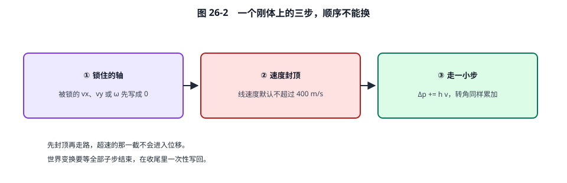
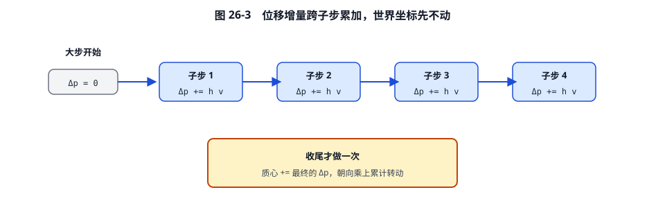
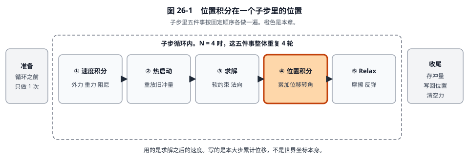

# 26 · 子步位置积分：用刚算完的速度走这一小步

[返回总目录](./README.md) · [上一章](./25-子步软约束求解详解.md) · [下一章](./27-子步Relax详解.md)

这一章只做 `b2IntegratePositionsTask`。箱子仍是第 24、25 章那一只。求解刚把竖直速度改成向上 0.066709 m/s。这一步把这个速度乘上 \(h\)，加进位移账本。世界坐标先不动。

## 0. 走进这一步时，每个量是多少

| 符号 | 值 | 单位 | 意思 |
|---|---:|---|---|
| \(h\) | \(1/240 \approx 0.004167\) | s | 这一小步多长 |
| \(\Delta t\) | \(1/60 \approx 0.016667\) | s | 整个大步多长。角速度封顶用它，不用 \(h\) |
| \(v_B\) | \((0.410000,\ 0.066709)\) | m/s | 求解之后的线速度 |
| \(\omega_B\) | 0 | rad/s | 角速度 |
| \(\Delta p\) | \((0,\ 0)\) | m | 本大步已经累计的位移。第一个子步还是 0 |
| \(\Delta q=(c,s)\) | \((1,\ 0)\) | 无 | 本大步已经累计的转动。\((1,0)\) 表示转角为 0 |
| \(v_{\max}\) | 400 | m/s | 线速率上限，默认 `maximumLinearSpeed` |
| \(\omega_{\max}\) | \((\pi/4)/\Delta t \approx 47.123890\) | rad/s | 一个大步最多转 45°，换成角速度 |
| 运动锁 | 都没锁 | | `lockLinearX/Y`、`lockAngularZ` 都是关 |

没有接触数据要读。这一步每个醒着的刚体各走各的。

## 1. 三步，顺序固定



```134:158:src/solver.c
		v.x = ( state->flags & b2_lockLinearX ) ? 0.0f : v.x;
		v.y = ( state->flags & b2_lockLinearY ) ? 0.0f : v.y;
		w = ( state->flags & b2_lockAngularZ ) ? 0.0f : w;
		// ... 线速度、角速度封顶 ...
		state->deltaPosition = b2MulAdd( state->deltaPosition, h, state->linearVelocity );
		state->deltaRotation = b2IntegrateRotation( state->deltaRotation, h * state->angularVelocity );
```

先改速度，再拿改完的速度去乘 \(h\)。如果先走路再封顶，超速的那一截会进位移。

## 2. 逐步代入

### 步骤 1：运动锁

三个标志都是关。

\[
v_x = 0.410000,\quad v_y = 0.066709,\quad \omega = 0.
\]

三个数都原样留下。若锁了 Y，\(v_y\) 会先写成 0，后面的 \(\Delta p_y\) 就是 0，箱子这一子步不会被重叠修正抬起来。

### 步骤 2：线速度封顶

先比速率的平方，避免先做开方：

\[
|v|^2 = 0.410000^2 + 0.066709^2 = 0.168100 + 0.004450 = 0.172550,
\]
\[
v_{\max}^2 = 400^2 = 160000.
\]

\(0.172550 < 160000\)，不缩放，也不打 `b2_isSpeedCapped`。

若 \(|v|\) 真的超过 400，源码做的是

\[
v \leftarrow 400\,\frac{v}{|v|}.
\]

方向不变，长度变成 400。例如 \(|v|=500\) 且方向不变，会乘 \(400/500=0.8\)。

### 步骤 3：角速度封顶

\[
\omega_{\max} = 0.25\pi \times \frac{1}{\Delta t} = 0.785398 \times 60 = 47.123890\ \mathrm{rad/s}.
\]

本例 \(\omega=0\)，\(0 < 47.123890\)，不缩放。

注意除数是大步 \(\Delta t\)，不是子步 \(h\)。一个大步最多转 \(\pi/4\) 弧度（45°）。转得太猛时，后面“转角的线性更新”会偏离真正的旋转。标志 `b2_allowFastRotation` 若打开，这一段跳过，角速度可以更快。

### 步骤 4：位移增量

\[
\Delta p \leftarrow \Delta p + h\, v.
\]

\[
h v_x = \frac{0.410000}{240} = 0.001708\ \mathrm m,
\]
\[
h v_y = \frac{0.066709}{240} = 0.000278\ \mathrm m,
\]
\[
\Delta p \leftarrow (0,\ 0) + (0.001708,\ 0.000278) = (0.001708,\ 0.000278)\ \mathrm m.
\]

箱子这一小步向右 1.708 mm，向上 0.278 mm。向上的 0.278 mm 就是求解为了 4 mm 重叠多给的那点速度走出来的。重叠从 4 mm 变成大约 \(4-0.278=3.722\) mm。间隙的正式更新在 Relax 里重算，数值会和这里一致。

### 步骤 5：转角

\(\omega=0\)，转角增量 \(h\omega=0\)。`b2IntegrateRotation` 收到 \(\Delta\theta=0\)：

\[
c_2 = 1 - 0\times 0 = 1, \qquad s_2 = 0 + 0\times 1 = 0.
\]

长度仍是 1，归一化后 \(\Delta q\) 还是 \((1,\ 0)\)。

## 3. 转角公式本身：另用一个不为 0 的角速度

主算例的 \(\omega\) 是 0，转角公式看起来像没算。下面单独把 \(\omega=3\ \mathrm{rad/s}\)、\(h=1/240\)、起始 \(\Delta q=(1,0)\) 走一遍。这不是主算例的箱子，只为看清函数。

平面转动存 \((\cos\theta,\ \sin\theta)\)。\(\omega=\mathrm d\theta/\mathrm dt\) 时

\[
\frac{\mathrm d\cos\theta}{\mathrm dt} = -\omega\sin\theta, \qquad
\frac{\mathrm d\sin\theta}{\mathrm dt} = \omega\cos\theta.
\]

显式走一步，\(\Delta\theta=h\omega\)：

\[
c_2 = c_1 - \Delta\theta\, s_1, \qquad s_2 = s_1 + \Delta\theta\, c_1.
\]

\[
\Delta\theta = \frac{3}{240} = 0.012500,
\]
\[
c_2 = 1 - 0.012500\times 0 = 1, \qquad s_2 = 0 + 0.012500\times 1 = 0.012500.
\]

\(c_2^2+s_2^2 = 1+0.00015625=1.00015625\)，长度

\[
\sqrt{1.00015625} = 1.000078.
\]

归一化：

\[
c = \frac{1}{1.000078} = 0.999922, \qquad
s = \frac{0.012500}{1.000078} = 0.012499.
\]

0.0125 弧度约 0.72°。归一化只改到小数第五位。一个大步若转到几十度，这一步的误差才明显，所以前面把一个大步的转角封在 45° 以内。

```388:398:include/box2d/math_functions.h
B2_INLINE b2Rot b2IntegrateRotation( b2Rot q1, float deltaAngle )
{
	b2Rot q2 = { q1.c - deltaAngle * q1.s, q1.s + deltaAngle * q1.c };
	float mag = sqrtf( q2.s * q2.s + q2.c * q2.c );
	float invMag = mag > 0.0f ? 1.0f / mag : 0.0f;
	b2Rot qn = { q2.c * invMag, q2.s * invMag };
	return qn;
}
```

## 4. 世界坐标为什么还是旧的

\(\Delta p\) 要等**全部子步**结束才加到质心上。收尾函数里才有：

```604:605:src/solver.c
		sim->center = b2OffsetPos( sim->center, state->deltaPosition );
		sim->transform.q = b2NormalizeRot( b2MulRot( state->deltaRotation, sim->transform.q ) );
```



子步内部用离原点不远的增量去更新间隙，避免箱子在很大的世界坐标上做减法时丢掉 0.1 mm 这种小数。外部在这一子步中途去读位置，读到的仍是大步开始时的位置。

若后面还有第 2 个子步，它看到的 \(\Delta p\) 已经是 \((0.001708,\ 0.000278)\)，再加自己的 \(h v\)，不会从 0 重算。

## 5. 交给 Relax 的数

| 量 | 位置积分前 | 位置积分后 |
|---|---:|---:|
| \(v_B\) | \((0.410000,\ 0.066709)\) | 没变 |
| \(\omega_B\) | 0 | 0 |
| \(\Delta p\) | \((0,\ 0)\) | \((0.001708,\ 0.000278)\) |
| \(\Delta q\) | \((1,\ 0)\) | \((1,\ 0)\) |
| \(\lambda_n\) | 0.108376 | 没变 |
| 世界质心 | 大步开始时的值 | 仍然没写 |

Relax 会用新的 \(\Delta p\) 重算间隙。它改的是速度，不会把 \(\Delta p\) 再加一次。所以本子步的摩擦若把 \(v_x\) 从 0.410 减小，那一截水平位移**已经记进** 0.001708 m 了，要等下一个子步才会按更慢的水平速度走路。向上的 0.000278 m 也已经记账，Relax 只把对应的竖直速度收回去。


