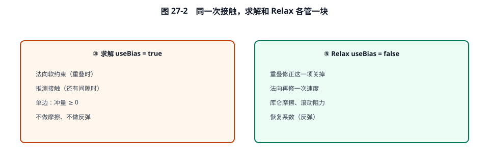
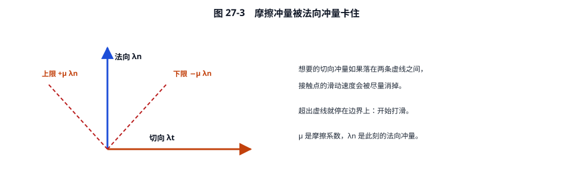
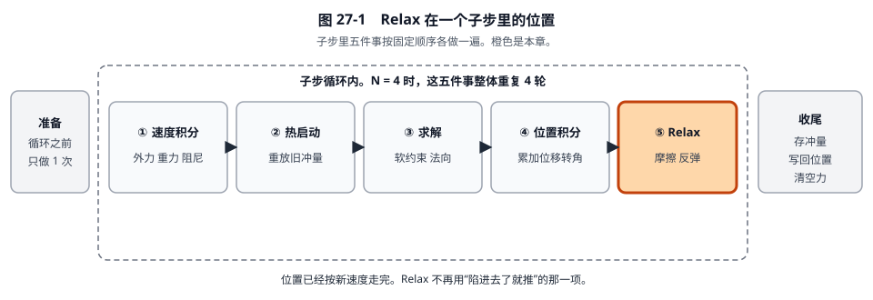

# 27 · 子步 Relax：位置记账之后，把多出来的速度收回去

[返回总目录](./README.md) · [上一章](./26-子步位置积分详解.md)

这一章只做 Relax（`useBias = false`）。箱子仍是前三章那一只。位置积分已经让它向上走了 0.278 mm，竖直速度仍是 \(+0.066709\ \mathrm{m/s}\)。Relax 不再为了重叠去推，只把这个“已经用来走路”的速度消掉，然后做摩擦。

着色路径的函数是 `b2SolveContacts_Wide`。overflow 是 `b2SolveContacts_Overflow(context, false)`。下面按标量版的顺序：先法向（含反弹开关），再滚动阻力，再摩擦。

## 0. 走进这一步时，每个量是多少

| 符号 | 值 | 单位 | 意思 |
|---|---:|---|---|
| \(v_B\) | \((0.410000,\ 0.066709)\) | m/s | 求解之后的速度。位置积分没有改它 |
| \(\omega_B\) | 0 | rad/s | |
| \(\Delta p_B\) | \((0.001708,\ 0.000278)\) | m | 本子步刚记账的位移 |
| \(\Delta q\) | \((1,\ 0)\) | 无 | 没有转 |
| \(s_{\mathrm{base}}\) | 0.496 | m | 第 25 章算过的基准间隙 |
| \(s_0\) | \(-0.004\) | m | 子步开始时陷进去 4 mm |
| \(\lambda_n\) | 0.108376 | N·s | 求解加上重叠修正之后的累计法向冲量 |
| \(\lambda_t\) | 0.010000 | N·s | 热启动用过、求解没动过的切向冲量 |
| \(m_n\) | 1 | s²/kg 的倒数，这里数值为 1 | 法向有效质量。打出 1 N·s，\(v_n\) 增加 1 m/s |
| \(m_t\) | 1 | 同上 | 切向有效质量。本例不转动，和 \(m_n\) 相同 |
| \(\mu\) | 0.5 | 无 | 摩擦系数。切向冲量的绝对值不许超过 \(\mu\lambda_n\) |
| \(v_{\mathrm{belt}}\) | 0 | m/s | 传送带速度 `tangentSpeed`。0 表示目标是相对地面不滑动 |
| \(v_{\mathrm{restitution}}\) | 0 | m/s | 恢复速度。0 表示这次不要求弹起来 |
| \(\mu_r\) | 0 | m | 滚动阻力系数。0 表示不拧角速度 |
| \(1/m_B\) | 1 | 1/kg | |
| \(1/I_B\) | 0 | 1/(kg·m²) | |
| \(n,\ t\) | \((0,1),\ (1,0)\) | 无 | 法线向上，切向向右 |
| \(r_B\) | \((0,\ -0.5)\) | m | 质心指向接触点 |

和求解的差别只有一个开关：重叠时**不再**使用 \(\beta\)、\(s_m\)、\(s_\lambda\)。



## 1. 重算间隙

公式和第 25 章相同，只是 \(\Delta p\) 不再是 0。

\[
s = s_{\mathrm{base}} + \big(\Delta p_B + R(\Delta q)\, r_B - r_A\big)\cdot n.
\]

\(\Delta q\) 不转，\(R r_B=r_B=(0,\ -0.5)\)。

\[
\Delta p_B + r_B = (0.001708,\ 0.000278-0.500000) = (0.001708,\ -0.499722),
\]
\[
(0.001708,\ -0.499722)\cdot(0,\ 1) = -0.499722,
\]
\[
s = 0.496 + (-0.499722) = -0.003722\ \mathrm m.
\]

也可以看成：原来陷进 4 mm，这一子步向上走了 0.278 mm，还剩 \(4-0.278=3.722\) mm。\(s\) 仍是负的，还没分开。

## 2. 法向：把多推的那一截收回去

### 步骤 1：偏置三个数

\(s=-0.003868<0\)，但是 `useBias` 为假，弹簧那一支不进去。三个数保持函数开头的初值：

\[
b = 0, \qquad s_m = 1, \qquad s_\lambda = 0.
\]

\(b=0\) 的意思：不再额外要求“请以某个速度把重叠推开”。只处理当前的 \(v_n\)。

反弹分支要求 `restitutionVelocity > 0`。本例是 0，跳过。若它是 \(2\ \mathrm{m/s}\)，源码会做

\[
b \leftarrow \min(b,\ -2) = -2,
\]

也就是把目标改成“沿法线分开的速度要达到 2 m/s”。那是弹起，不是重叠弹簧。

### 步骤 2：法向相对速度

\[
v_n = v_B\cdot n = 0.066709\ \mathrm{m/s}.
\]

正号：接触点正在沿法线离开地面。这个速度就是求解为了重叠加上去的那一截，位置积分已经用它走过 0.278 mm。

### 步骤 3：增量

\[
\Delta\lambda = -\, m_n\,(s_m v_n + b) - s_\lambda\lambda_n
= -1\times(1\times 0.066709 + 0) - 0 = -0.066709\ \mathrm{N\cdot s}.
\]

负号表示从累计冲量里减掉。

### 步骤 4：夹紧

\[
\lambda_n^{\mathrm{new}} = \max(0.108376 + (-0.066709),\ 0) = 0.041667\ \mathrm{N\cdot s}.
\]

回到了热启动之前的 \(1/24\)。那一份正好是抵消重力的支撑冲量。求解多加的 \(0.066709\) 被整段减掉了。

打进速度的是增量 \(-0.066709\)，不是新的累计值：

\[
v_y \leftarrow 0.066709 + (-0.066709) = 0.
\]

\(v_x\) 仍是 0.410000。流水账：

\[
\lambda_n^{\mathrm{total}} \leftarrow 0.108376 + (-0.066709) = 0.041667.
\]

这一步的物理结果可以读成一句话：重叠修正已经变成了 0.278 mm 的位移，速度里那一截向上的分量如果留着，下一子步还会再往上飞，所以 Relax 把它收回来。重叠还剩 3.722 mm，留给后面的子步，由求解阶段的弹簧再推一点。

## 3. 滚动阻力

\[
\Delta\lambda_r = -m_r(\omega_B-\omega_A), \qquad |\lambda_r| \le \mu_r\, \lambda_n^{\mathrm{sum}}.
\]

本例 \(\mu_r=0\)，上限是 0，\(\omega\) 也是 0，增量是 0。角速度不变。

\(m_r = 1/(1/I_A+1/I_B)\)。两边都能转时，它把角速度差往 0 拉，拉力随正压力 \(\lambda_n\) 增大。没有正压力就没有滚动阻力。

## 4. 摩擦：想停住，但锥不够大

### 步骤 1：滑动速度

\[
v_t = \big(v_B+\omega_B\times r_B - v_A\big)\cdot t - v_{\mathrm{belt}}.
\]

\[
v_t = (0.410000,\ 0)\cdot(1,\ 0) - 0 = 0.410000\ \mathrm{m/s}.
\]

正号：箱子相对地面向右滑。

### 步骤 2：假如没有摩擦上限，需要多少冲量

切向有效质量和法向同一套算法，方向换成 \(t\)。本例 \(m_t=1\)。想把 \(v_t\) 打到 0：

\[
\Delta\lambda_t^{\mathrm{want}} = -m_t\, v_t = -0.410000\ \mathrm{N\cdot s}.
\]

旧的切向冲量是 \(0.010000\)，若直接加：

\[
\lambda_t^{\mathrm{want}} = 0.010000 + (-0.410000) = -0.400000.
\]

### 步骤 3：库仑上限



\[
\lambda_t^{\max} = \mu\,\lambda_n = 0.5 \times 0.041667 = 0.020833\ \mathrm{N\cdot s}.
\]

用的是**刚刚 Relax 法向更新之后**的 \(\lambda_n=0.041667\)，不是求解结束时的 0.108376。正压力越小，摩擦力越小。

\[
\lambda_t^{\mathrm{new}} = \mathrm{clamp}(-0.400000,\ -0.020833,\ 0.020833) = -0.020833.
\]

\-0.400 落在锥外面，停在边界上：由静摩擦变成打滑。真正打进速度的增量是

\[
\Delta\lambda_t = -0.020833 - 0.010000 = -0.030833\ \mathrm{N\cdot s}.
\]

源码：

```371:377:src/contact_solver.c
				float impulse = cp->tangentMass * ( -vt );
				float maxFriction = friction * cp->normalImpulse;
				float newImpulse = b2ClampFloat( cp->tangentImpulse + impulse, -maxFriction, maxFriction );
				impulse = newImpulse - cp->tangentImpulse;
				cp->tangentImpulse = newImpulse;
```

### 步骤 4：打进水平速度

\[
\Delta v_x = \frac{1}{m_B}\Delta\lambda_t = -0.030833\ \mathrm{m/s},
\]
\[
v_x \leftarrow 0.410000 - 0.030833 = 0.379167\ \mathrm{m/s}.
\]

滑动没有停住。这一子步只擦掉了 0.030833 m/s。\(v_y\) 已经是 0，水平冲量的方向是 \(t=(1,0)\)，不改变 \(v_y\)。

力臂 \(r_B\times(\Delta\lambda_t\, t)= -(-0.5)\times(-0.030833)\) 不是 0，但 \(1/I_B=0\)，角速度仍是 0。

传送带若 \(v_{\mathrm{belt}}=0.2\ \mathrm{m/s}\)，步骤 1 的 \(v_t\) 会改成 \(0.410-0.2=0.210\)，上限 \(\pm 0.020833\) 不变。目标从“相对地面静止”变成“相对带子静止”。

## 5. 这一个子步结束时的账单

| 量 | 子步开始（速度积分之后、热启动之前） | 本子步结束 |
|---|---:|---:|
| \(v_B\) | \((0.400000,\ -0.041667)\) | \((0.379167,\ 0)\) |
| \(\lambda_n\) | 0.041667 | 0.041667 |
| \(\lambda_t\) | 0.010000 | \(-0.020833\) |
| \(\Delta p\) | \((0,\ 0)\) | \((0.001708,\ 0.000278)\) |
| 重叠 | 4.000 mm | 还剩 3.722 mm，写在 \(s\) 里，世界坐标仍未更新 |

竖直速度回到 0，是因为：热启动抵消重力，求解为重叠多推的速度被 Relax 收回。水平速度从 0.400 变成 0.379，中间热启动先加过旧摩擦 \(+0.010\)，Relax 再按新的摩擦锥改到 \(-0.020833\) 的累计值。

下一子步会从 \(v=(0.379167,\ 0)\) 再做速度积分。重力会再次把 \(v_y\) 减成 \(-0.041667\)，热启动再用 \(\lambda_n=0.041667\) 把它托回 0。重叠还在，求解会再推一截，位置再抬一点，Relax 再把那截速度收回来。4 mm 就是这样在若干子步里被一点点抬出去的，而不是这一步一次弹飞。

## 6. 为什么这轮要排在位置积分之后

求解给的 \(+0.066709\ \mathrm{m/s}\) 有一个职务：让位置积分走出 0.278 mm。如果在走路之前就把它收掉，重叠修正就不会进入 \(\Delta p\)。如果走路之后还按弹簧再加一份，箱子会在已经抬起来之后继续加速，下一子步热启动又把这份冲量再打一遍，重叠修正就被算了两次。

所以同一套法向公式用两次，开关不同：

| | 求解 | Relax |
|---|---|---|
| 重叠弹簧 \(b=s_m\beta s\) | 开，本例 \(b=-0.067904\) | 关，\(b=0\) |
| 本例 \(\Delta\lambda_n\) | \(+0.066709\) | \(-0.066709\) |
| 本例 \(v_y\) | 变成 \(+0.066709\) | 回到 0 |
| 摩擦 | 不做 | 做到 \(|\lambda_t|\le 0.020833\) |

`RELAX_ITERATIONS` 是 1。摩擦改完速度之后，法向不会在这一步里再算第二遍。锥和法向若还不完全一致，下一个子步再修。


