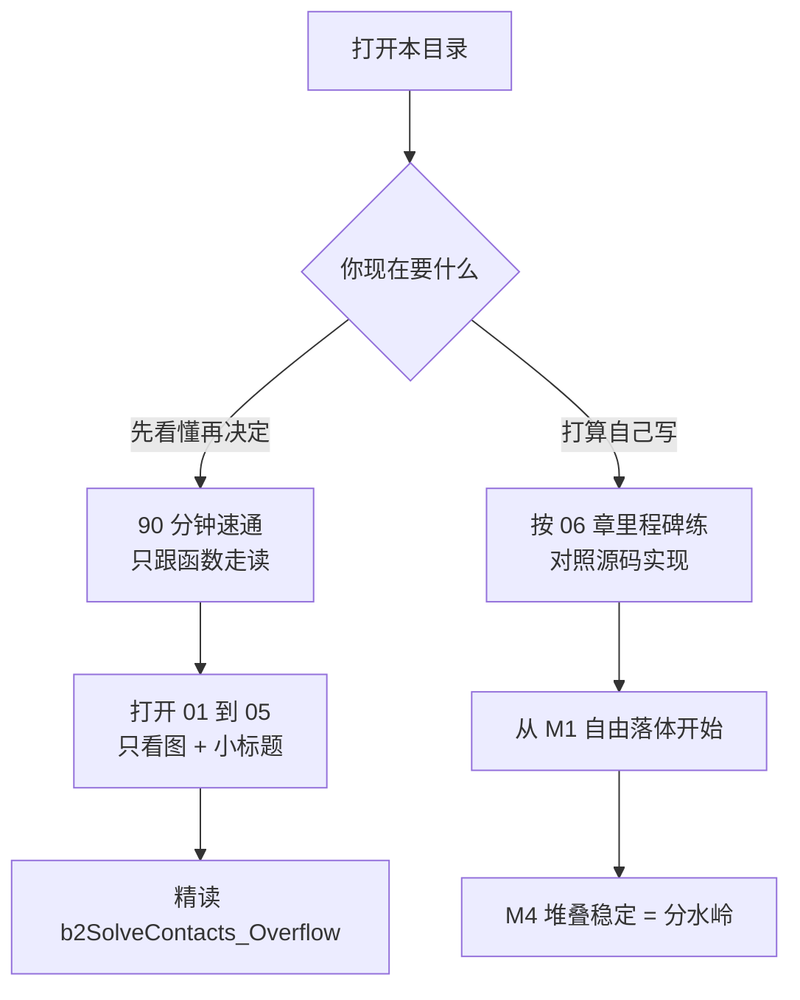
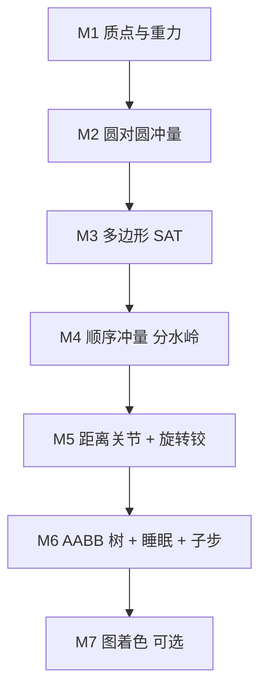
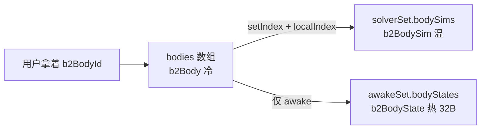
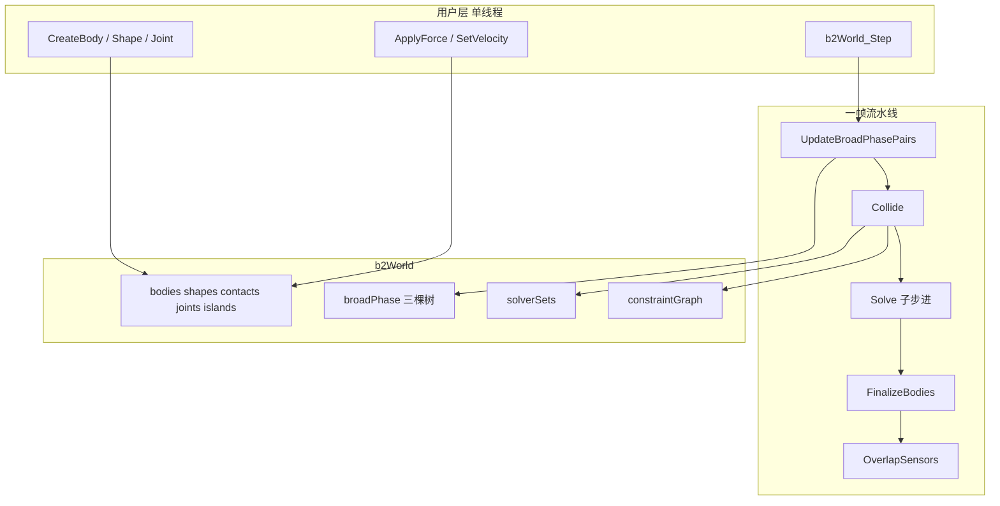

# 00 · 学习路线图：从「看不懂」到「写得出」

> 读完你能回答：我该按什么顺序打开源码？哪 185 行是灵魂？自己写引擎时哪一步是分水岭？

这一章不讲公式。它只给你两张时间表和五个必须先建立的心智模型。后面每一章都默认你已经接受这五条。

---

## 一、两条路线，选一条走



### 路线 A：90 分钟速通

只打开函数，不推导。目标是「再看到这些名字时不慌」。

```mermaid
gantt
    title 90 分钟读懂 Box2D
    dateFormat mm
    axisFormat %M
    section 骨架
    b2World_Step 五段         :a1, 00, 12
    Body Sim State 三分       :a2, 12, 22
    section 数据
    宽阶段到 manifold         :b1, 22, 42
    顺序冲量 Overflow         :b2, 42, 68
    section 收尾
    图着色与子步进            :c1, 68, 82
    睡眠 CCD 事件             :c2, 82, 90
```



| 时间 | 做什么 | 打开哪个函数 / 文件 |
|---|---|---|
| 0–12 min | 记下 Step 的五段名字 | `b2World_Step`（[`physics_world.c`](../src/physics_world.c)） |
| 12–22 min | 搞清刚体为什么拆三份 | `b2Body` / `b2BodySim` / `b2BodyState`（[`body.h`](../src/body.h)） |
| 22–42 min | 胖 AABB → 接触点 | `b2UpdateBroadPhasePairs`、`b2CollidePolygons` |
| 42–68 min | **纸笔手算** Overflow 接触求解 | `b2SolveContacts_Overflow`（[`contact_solver.c`](../src/contact_solver.c)） |
| 68–82 min | 看同色为何能并行 | `b2AddContactToGraph`、`b2Solve` 里的 stage 表 |
| 82–90 min | 岛、睡眠、CCD 各看一眼 | `b2TrySleepIsland`、`b2FinalizeBodiesTask` |

**最重要的建议**：`b2SolveContacts_Overflow` 那一小段（大约 180 行）包含了引擎的全部核心数学。看懂它，关节、SIMD 宽版本、软约束都是同一公式的变体。

### 路线 B：认真实现

跟 [06 章](./06-从零打造2D物理引擎.md) 的里程碑走。先在这里看全局：



| 里程碑 | 你第一次看到 | 过不了关时回看 |
|---|---|---|
| M1 | 球往下掉，能量不发散 | [02](./02-物理定律与数值积分.md) 半隐式欧拉 |
| M2 | 两球对撞后分开 | [04](./04-约束与接触求解.md) 冲量公式 |
| M3 | 斜盒子两个接触点 | [03](./03-碰撞检测.md) SAT + 裁剪 |
| **M4** | **10 个盒子叠住不塌** | [04](./04-约束与接触求解.md) 热启动 + 累积冲量 |
| M5 | 一辆能开的车 | [05](./05-关节与并行.md) |
| M6 | 几千物体仍可交互 | [01](./01-物理世界框架.md) SolverSet、[03](./03-碰撞检测.md) 树 |
| M7 | 理解并行即可 | [05](./05-关节与并行.md) 图着色 |

M4 是分水岭。堆叠会塌、会抖、会陷进去，说明求解器还没入门。这一关过不去，后面加再多关节都是沙上建塔。

---

## 二、读代码前必须建立的 5 个心智模型

### 模型 1：一切都用「逆」表示

Box2D 里到处是 `invMass`、`invInertia`。静态物体质量是「无穷大」，浮点里没有无穷大。约定：

```
invMass == 0    表示质量无穷大（静态 / 运动学）
invMass  > 0    表示 1/m
```

于是所有公式不用写分支：

```
v += P * invMass
```

静态物体被踹一脚，速度加 0。运动学物体也是 `invMass == 0`，但速度由用户设，求解器会积分它的位置、却不该改它的速度（靠 `b2_dynamicFlag` 挡住写回）。

### 模型 2：冷 / 温 / 热数据分离

一个「刚体」在内存里不是一个大结构体，而是三份、放在不同数组里：



- 用户 API 走 id，忍受一次间接跳转。
- 求解器只扫 `bodyStates`，连续、32 字节对齐，适合 SIMD。
- 静态物体 **没有** `b2BodyState`。求解时用一份 dummy identity：速度 0、增量旋转 `{c=1, s=0}`。

详见 [01 章](./01-物理世界框架.md)。

### 模型 3：约束统一成 `J · V + bias = 0`

不管是「不要穿进地面」还是「铰链两点重合」，最后都长这样：

```
J · V + bias = 0     等式（关节）
J · V + bias >= 0    不等式（接触法向、限位）
```

- `V` 是两个刚体的速度拼起来：`(vA.x, vA.y, wA, vB.x, vB.y, wB)`
- `J` 是雅可比（Jacobian）：「这个约束关心哪个方向的相对速度」
- `bias` 负责位置误差修正、马达驱动、推测接触

求解器不算力，它算标量冲量 `λ`，再沿 `J` 的转置打到两个刚体上。接触、距离关节、旋转铰，差别只在 `J` 怎么写。

### 模型 4：推测性接触，separation 可以为正

普通引擎：等穿进去再推开 → 下一帧又弹回来 → 抖。

Box2D：还差 2cm 就建接触，约束「这一小步结束时，分离距离不要变成负的」。

```
普通接触                         推测性接触
  A                                A          还差 1.5cm
  |                                |
  B   已经重叠 0.5cm                B
      硬推开 → 抖                   约束 v·n <= s/h
                                    刚好停住
```

所以看到 `manifold.points[i].separation > 0` 不要惊讶：它不是 bug，是「还没碰上，但这一帧可能碰上」。

求解时：

- `s > 0`：bias = `s / h`（推测，让相对速度刚好在步末把缝补上）
- `s < 0`：bias 用软约束把重叠慢慢推开，并钳到 `-contactSpeed`

### 模型 5：子步进代替「一大步 + 很多次迭代」

打开 [`src/solver.c`](../src/solver.c) 顶部：

```c
#define ITERATIONS 1
#define RELAX_ITERATIONS 1
```

v2 常见写法是：一个大 `dt` 里对约束迭代 8～20 次，再用 Baumgarte 修位置。v3 反过来：

```
一个大步 dt
  分成 subStepCount 个小步，每小步 h = dt / N
    积分速度（力、重力、阻尼）
    热启动
    求解约束 1 次（带 bias，修穿透）
    积分位置
    松弛 1 次（恢复、摩擦、滚动；不带重叠 bias）
```

位置误差在每个小步内就被吃掉，不会积累。代价是准备/求解次数变多；SIMD + 图着色把这笔账摊平。

这也解释了为什么接触「弹簧」频率要按 `h` 缩放：大步长时 Hertz 会被压住，避免软约束瞬间变钢板。

---

## 三、每章对应打开哪些函数

读某一章时，把这些函数放在编辑器里并排，比从文件头看到尾快得多。

| 章 | 先打开这些 |
|---|---|
| [01 框架](./01-物理世界框架.md) | `b2World`（[`physics_world.h`](../src/physics_world.h)）、`b2World_Step`、`b2Solve`、`b2Body` / `b2BodySim` / `b2BodyState` |
| [02 定律](./02-物理定律与数值积分.md) | `b2IntegrateVelocitiesTask`、`b2IntegratePositionsTask`、`b2MakeSoft`、`b2IntegrateRotation` |
| [03 碰撞](./03-碰撞检测.md) | `b2UpdateBroadPhasePairs`、`b2Collide`、`b2CollidePolygons`、`b2ShapeDistance` |
| [04 接触](./04-约束与接触求解.md) | `b2PrepareContacts_Overflow`、`b2WarmStartContacts_Overflow`、`b2SolveContacts_Overflow` |
| [05 关节](./05-关节与并行.md) | `b2PrepareDistanceJoint`、`b2SolveDistanceJoint`、`b2AddContactToGraph`、`b2TrySleepIsland` |
| [06 从零](./06-从零打造2D物理引擎.md) | 对照自己的代码，而不是再通读 Box2D |

---

## 四、一张图记住全局数据流



Step 期间世界 `locked == true`：不能创建/销毁物体，也不能安全读正在搬家的数组。事件在帧末批量给你，下一帧开始前再清。

---

## 五、自己写引擎时的最小集（本章版）

现在还不用写代码。只要记住：一个能跑的最小引擎，按时间顺序只需要

1. 数组里的刚体：位置、速度、`invMass`
2. 半隐式欧拉
3. 圆对圆：一个法向冲量
4. 再谈多边形、摩擦、关节、树

不要一上来就写 AABB 树和图着色。Box2D 的这些是「几千物体仍然 60fps」的工程，不是「两个盒子能停在地上」的物理。

下一章 → [01-物理世界框架](./01-物理世界框架.md)
