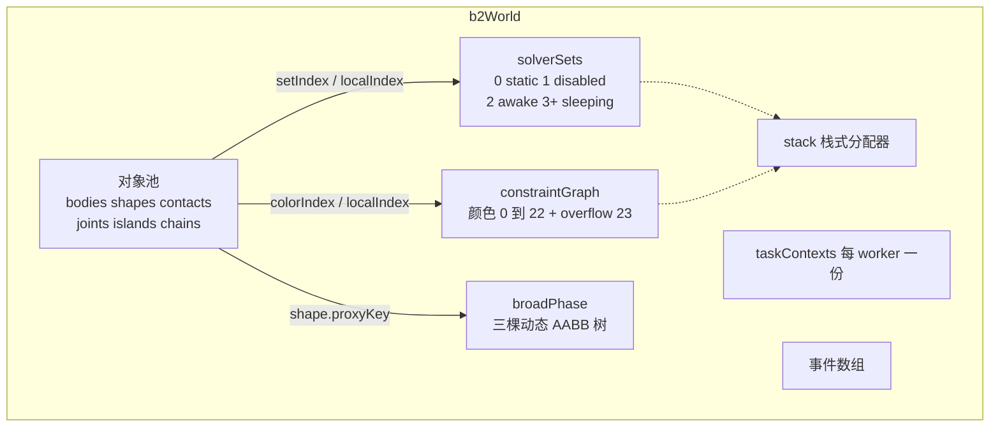
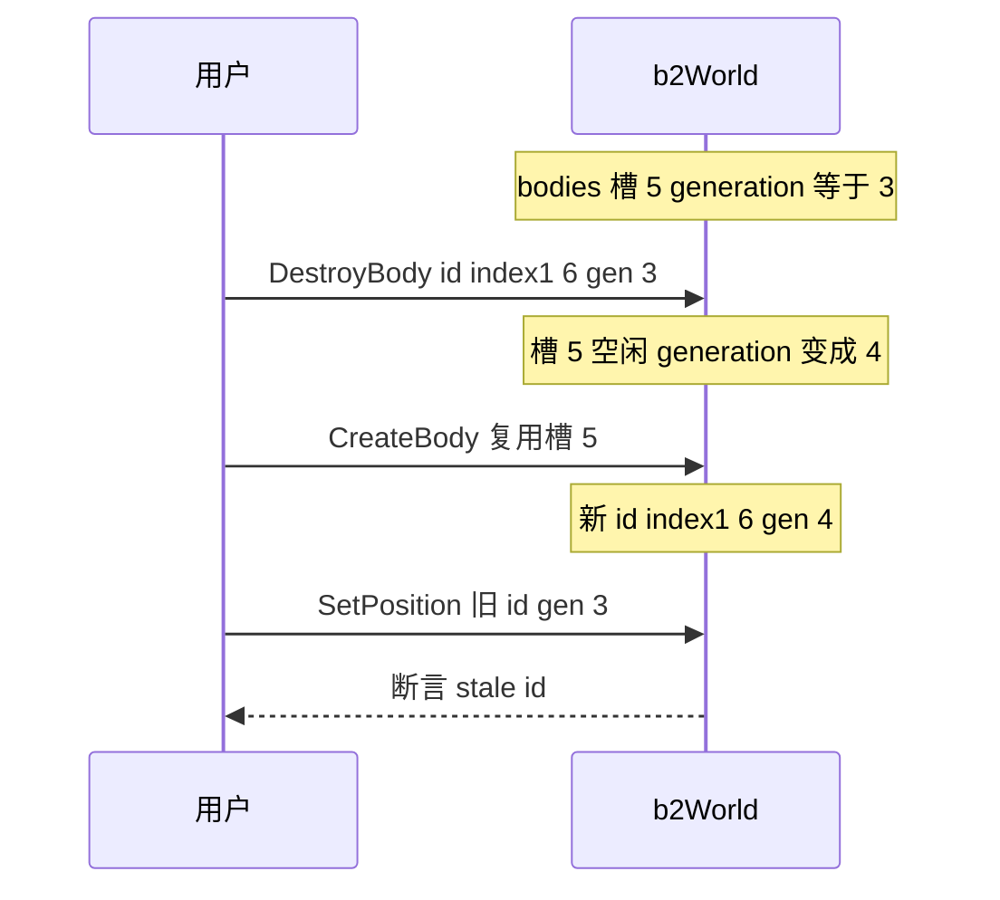
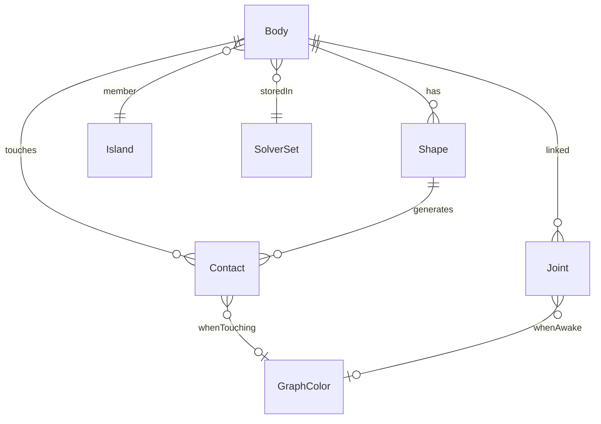
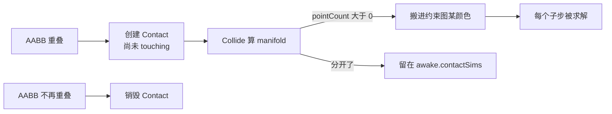
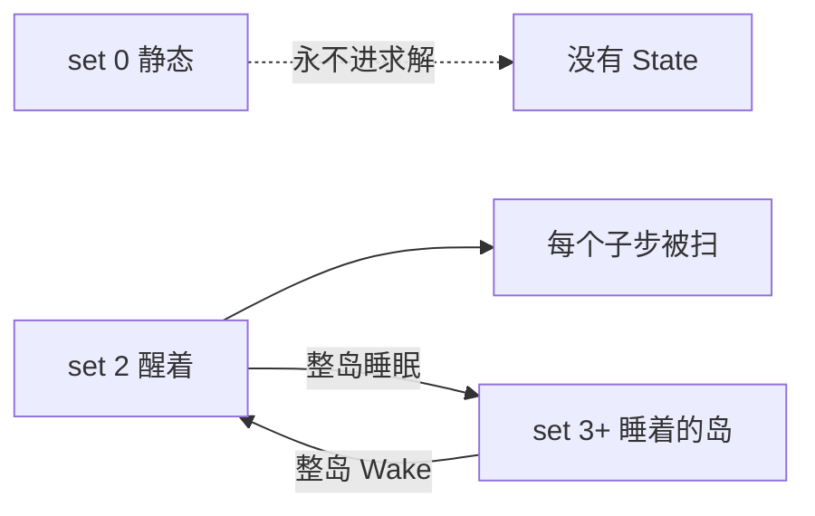
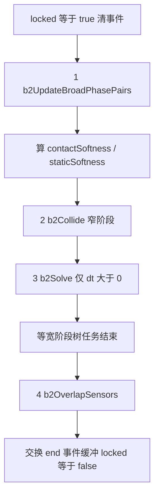

# 01 · 物理世界框架：一座工厂的流水线

> 读完你能回答：`b2World` 里到底装了什么？一个刚体为什么拆成三份？`b2World_Step` 里数据按什么顺序被改写？岛是用来求解的吗？

把 Box2D 想成一座工厂。这一章只参观厂房和传送带，不讲「踹一脚」的公式（那是 [04](./04-约束与接触求解.md)）。

---

## 一、World 里到底装了什么

`b2World` 是唯一的上帝对象。几乎所有东西都以 **数组 + 整数索引** 活在它里面：没有 `new` 出来的对象网，也没有用户可见的裸指针。

结构定义在 [`src/physics_world.h`](../src/physics_world.h)。可以先记住这几块：



### 为什么全是数组和索引？

三件事同时成立：

1. **缓存友好**。求解器要扫几千个接触，连续内存比指针跳转快一个数量级。
2. **可序列化 / 可复现**。整帧状态就是几坨数组，可以 hash、存盘、回放（`src/recording*.c`）。
3. **对象能搬家**。数组增长时元素会挪地址，但外部只持有 id，不持有指针。

用户拿到的是 handle，不是指针。定义在 [`include/box2d/id.h`](../include/box2d/id.h)：

```c
typedef struct b2BodyId
{
    int32_t index1;      // 真实下标 + 1
    uint16_t world0;     // 世界 id
    uint16_t generation; // 代数，防悬挂
} b2BodyId;
```

- `index1 = index + 1`：全 0 就是空 id。`b2BodyId id = {0}` 天然无效。
- `generation`：槽位被销毁再分配时 +1。你拿着旧 id 来操作，代数对不上，立刻断言，而不是默默改了另一个物体。



这是 v3 相对 v2 最大的 API 变化：v2 给裸指针，删了就是野指针。

---

## 二、五个核心对象



### 1. 刚体：一份逻辑，三块内存

定义在 [`src/body.h`](../src/body.h)。

**`b2Body`（冷）** — 给用户 API 和岛/链表用：

- `userData`、`name`、`generation`、`type`
- `headShapeId` / `headContactKey` / `headJointKey`：串形状、接触、关节
- `setIndex` + `localIndex`：去哪套求解集里找 Sim/State
- `islandId`：属于哪座岛
- `mass` / `inertia`：给用户查询；求解器只用逆质量

**`b2BodySim`（温）** — 每帧积分和碰撞准备：

- `transform`：原点位姿（大世界模式下平移可以是 double）
- `center`：质心世界坐标
- `center0` / `rotation0`：上一帧，给 TOI 用
- `force` / `torque`：本帧累加，Finalize 时清零
- `invMass` / `invInertia` / `gravityScale` / 阻尼
- `minExtent` / `maxExtent`：判断「会不会隧穿」

**`b2BodyState`（热，32 字节）** — 只存在于 **awake** 集：

```
linearVelocity    8
angularVelocity   4
flags             4
deltaPosition     8
deltaRotation     8   共 32
```

求解器在子步里反复读写的就是它。`deltaPosition` / `deltaRotation` 是 **相对本大步开始** 的增量，不是世界坐标本身。好处：远离原点时，减法发生在增量上，误差小。静态物体没有 State，约束里用 `b2_identityBodyState` 顶上。

三种刚体类型（[`include/box2d/types.h`](../include/box2d/types.h) 的 `b2BodyType`）：

| 类型 | 质量 | 速度谁定 | 求解器写速度吗 |
|---|---|---|---|
| static | 无穷（inv=0） | 恒为 0 | 没有 State |
| kinematic | 无穷（inv=0） | 用户设 | 有 State，但不写回（无 `b2_dynamicFlag`） |
| dynamic | 有限 | 力 + 约束 | 写回 |

运动学物体也进图着色，被当成「会动的邻居」。若多线程同时写它的 State，即使数值不变也会把缓存线打爆。所以写回处一律判断 `b2_dynamicFlag`。

### 2. 形状：几何挂在刚体上

[`src/shape.h`](../src/shape.h) 的 `b2Shape`：类型、材料（摩擦/恢复/滚动阻力）、密度、AABB、`proxyKey`、过滤。几何是个 union：圆、胶囊、多边形、线段、链段。

形状本身不参与求解。它做三件事：

1. 把 AABB 挂进宽阶段树
2. 窄阶段算出 manifold
3. 密度积分出刚体的质量和惯量（[`src/geometry.c`](../src/geometry.c)）

`sensorIndex != NULL` 的形状是传感器：进树、查重叠、发事件，**不产生接触约束**。

一个刚体可以挂多个形状。质量在「添加/删除形状」时重算，或你推迟到 `b2Body_ApplyMassFromShapes`。若推迟了却忘了调用，`b2_dirtyMass` 会在 Step 里断言。

### 3. 接触：冷热分离

[`src/contact.h`](../src/contact.h)：

- `b2Contact`：持久句柄。两条 `b2ContactEdge` 挂到两个 body 上，还有 `islandId`、`colorIndex`、`setIndex`。
- `b2ContactSim`：热数据，带着 `manifold`、混合后的摩擦/恢复、两个刚体的逆质量。触摸中的 Sim 住在约束图的某个颜色里；没碰上的 Sim 住在 awake 集的 `contactSims` 里。

接触的一生：



### 4. 关节：约束的另一种形状

冷数据 `b2Joint` + 热数据 `b2JointSim`。类型见 `b2JointType`：

`distance / filter / motor / mover / pogo / prismatic / revolute / weld / wheel`

`filter` 比较特殊：它只禁止两刚体之间产生接触，不往求解器里塞力。其余关节和接触走同一套 Prepare / WarmStart / Solve。细节在 [05](./05-关节与并行.md)。

### 5. 岛：不是求解分块，是睡眠单位

v2 把岛当「这一帧要一起解的连通分量」。v3 求解按 **约束图颜色** 并行，岛缩小成：

> 用接触和关节连起来的一组 awake 刚体。整组一起睡、一起醒。

所以 [`src/constraint_graph.c`](../src/constraint_graph.c) 开头写着：*Islands are only used for sleep.*

---

## 三、SolverSet：传送带，不是分类标签

定义在 [`src/solver_set.h`](../src/solver_set.h)。

| 下标 | 名字 | 里面有什么 |
|---|---|---|
| 0 | `b2_staticSet` | 所有静态 bodySim；静态-静态关节 |
| 1 | `b2_disabledSet` | 被禁用的刚体及其关节 |
| 2 | `b2_awakeSet` | 醒着的 bodySim **和** bodyState；未触摸的 contactSim；岛列表 |
| 3+ | 每个睡眠岛一套 | 那座岛的 bodySim、接触、关节，整坨搬走 |

关键设计：

- **只有 awake 集有 `bodyStates`**。睡了的刚体没有速度数组，省内存，也避免误写。
- 触摸中的接触 **不** 住在 awake 集，住在 `constraintGraph.colors[i]`。
- 一座岛入睡 = 新建一个 solver set，把 body/contact/joint 的 Sim **拷过去**，然后从 awake/图里删掉。唤醒是反向搬回。
- 所以「唤醒一座岛」是 O(岛内物体数)，不用扫全世界。



刚体在集合间搬家时，`b2Body.setIndex` / `localIndex` 一起改。用户手里的 `b2BodyId` 不变。

---

## 四、一帧真流程：`b2World_Step`

入口：[`b2World_Step`](../src/physics_world.c)。先锁定世界、清事件，再按下面走。`timeStep == 0` 时仍做配对和窄阶段（方便单步调试），但跳过 `b2Solve`。



和「先碰撞后求解」的口语说法相比，有两处容易漏：

1. **传感器在求解之后**。刚体已经走到新位置，再查重叠，事件才和画面一致。
2. **子弹 CCD 不在 Step 开头**，而在 `b2Solve` 末尾的 Finalize 之后：先按离散步走完，再对「走得太快可能隧穿」的物体做 TOI 修正。

### 第 1 段：宽阶段配对

`b2UpdateBroadPhasePairs`（[`src/broad_phase.c`](../src/broad_phase.c)）：

- 本帧 AABB 变大或移动过的 proxy，去另外两棵树里查询
- 哈希表去掉重复对
- 过滤：同 body、category/mask/group、静态对静态
- 新对 → 创建 `b2Contact`（尚未 touching）
- AABB 不再重叠 → 销毁接触，可能发 end 事件

三棵树：static / kinematic / dynamic。静态物体彼此永不配对。细节在 [03](./03-碰撞检测.md)。

### 第 2 段：窄阶段 `b2Collide`

[`b2Collide`](../src/physics_world.c) 把「图里已触摸的接触」和「awake 集里未触摸的接触」收成指针数组，然后 `b2ParallelFor(b2CollideTask)`。

每个任务：取两形状当前变换 → 调 `manifold.c` 里对应的 `b2Collide*` → 得到新 manifold。可能发生：

- 开始触摸：从 awake.contactSims 搬进约束图，染一个颜色
- 停止触摸：从图搬回 awake.contactSims
- AABB 已经分离：标记销毁
- 接触点仍在、几何差不多：复用旧冲量（热启动）

状态变化先记在每线程的 bitset 里，主线程再串行处理岛的合并/拆分和 begin/end 事件。接触指针会搬家，所以 bitset 按 **contactId** 索引，不按指针。

### 软约束系数在这里算好

```c
h = timeStep / subStepCount
contactHertz = min(world.contactHertz, 0.125 * inv_h)
contactSoftness = b2MakeSoft(contactHertz, dampingRatio, h)
staticSoftness  = b2MakeSoft(2 * contactHertz, dampingRatio, h)
```

和静态物体的接触更硬（Hertz 乘 2），减少「被推进地面」。公式在 [02](./02-物理定律与数值积分.md)。

### 第 3 段：`b2Solve`

[`b2Solve`](../src/solver.c) 是调度器。它不写物理公式，它搭舞台：

1. 若 awake 集一个刚体都没有，直接返回
2. 按颜色统计接触/关节，分配 wide（SIMD）约束缓冲和 overflow 标量缓冲
3. 把工作切成 block，排成一张 **stage 表**
4. 每个 worker 进 `b2SolverTask`；**调用 `b2World_Step` 的线程也会再进一次**，抢 orchestrator，避免任务系统把 worker 0 排到后面导致死等
5. 所有子步跑完后 `b2FinalizeBodiesTask`
6. 收集关节事件、hit 事件
7. 放大变胖的 AABB，处理子弹 TOI
8. 尝试让整岛睡眠

一张子步里的 stage 顺序（`ITERATIONS` 和 `RELAX_ITERATIONS` 都是 1）：


对 `subStepCount` 次循环而言：Prepare 在大步开始做一次，后面每个小步重复 IntegrateVelocities → WarmStart → Solve → IntegratePositions → Relax，最后 Store 一次。读 `b2SolverTask` 时按 stage 类型跳到对应函数即可。

同色约束不共享动态刚体，所以 WarmStart / Solve / Relax 可以多线程写速度。不同颜色之间有同步点：必须等上一色写完，下一色才能读到新速度。这就是「图着色 + 顺序冲量」能并行的原因。

Overflow（染不上色的约束）由 orchestrator 线程在每色并行之前先解，优先级最低；静态接触被故意染到靠后的颜色，最后写速度，减少「被推进地面」。

### 第 4 段：FinalizeBodies

[`b2FinalizeBodiesTask`](../src/solver.c)：

- `center += deltaPosition`，旋转乘上 `deltaRotation`，再反推原点 `transform.p`
- 清掉 `force` / `torque` 和增量
- 填 `bodyMoveEvents`
- 用「速度 + 本步位移」判断能不能睡
- 走得太远可能隧穿 → 标 `b2_isFast`；普通快物体当场 `b2SolveContinuous`，子弹先登记，后面统一做（子弹之间不对打）
- 更新每个 shape 的 AABB；超出 fat AABB 则标 enlarged，稍后扩树

### 第 5 段：传感器与解锁

`b2OverlapSensors` 查所有传感器和新位置的重叠，写 begin/end。然后交换 end 事件的双缓冲：你这边还能读上一帧的 end，引擎那边清另一侧准备下一帧。

`locked = false`。栈分配器此时应归零；不够用就 `b2GrowStack`，下一帧有更大的一块。

---

## 五、约束图：24 个工位

[`src/constraint_graph.h`](../src/constraint_graph.h)：

```
colors[0 .. 22]   每色一份 bodySet 位图 + contactSims + jointSims
colors[23]        overflow：染不上色的约束，单线程标量求解
```

染色规则（`b2AddContactToGraph`）：

- **动态-动态**：从颜色 0 往前找，只能用前 `B2_DYNAMIC_COLOR_COUNT`（20）色。两刚体在该色的 `bodySet` 里都不能已占用。
- **动态-静态 / 动态-运动学**：从颜色 22 往回找（避开 overflow）。静态不占 bit——反正它没有可写 State。
- 找不到空位 → overflow。典型场景：一个箱子被一百块碎片挤着。

动态-静态放在「后面的颜色」、求解顺序更靠后、等效优先级更高，减少「一堆动态物体把一个箱子推进地面」。细节和关节染色在 [05](./05-关节与并行.md)。

---

## 六、事件、锁定、栈、附录

### 事件是帧末批量的

| 数组 | 何时产生 |
|---|---|
| `bodyMoveEvents` | Finalize，每个 awake 刚体一条 |
| `contactBeginEvents` | Collide 后串行处理「开始触摸」 |
| `contactEndEvents` | 双缓冲，分开或销毁时 |
| `contactHitEvents` | StoreImpulses 后，法向接近速度超过阈值 |
| `sensorBegin/EndEvents` | OverlapSensors |
| `jointEvents` | 关节力/力矩超过阈值 |

Step 一开始就清掉（end 清的是另一侧缓冲），避免你读到上一帧的脏数据却以为是这一帧的。

### 世界锁定

Step 期间 `world->locked == true`。创建/销毁会断言或早退。查询函数在锁定时也会早退。原因：数组正在搬家，指针和下标都不稳定。

### 栈式分配器

`b2Stack`（[`src/arena_allocator.c`](../src/arena_allocator.c)）按帧借还：宽约束数组、stage 表、contact 指针表。LIFO，还的时候只动指针。不要在栈上挂跨帧对象。

### 附录 A：大世界

单精度下离原点十几公里，加减接触点会丢精度。v3 的 `b2Pos` 在大世界模式下平移用 double；窄阶段还会把多边形平移到顶点 0 再算。自己写引擎时，先保证场景在 ±1km 内，再考虑这层。

### 附录 B：Recording

`B2_REC` 宏在 Step 入口记下输入，帧末 `b2HashWorldState` 证明回放一致。这是确定性工具，不是物理核心。读主循环时把它当成日志即可。

---

## 源码索引

| 你想看什么 | 去哪 |
|---|---|
| 世界里有哪些数组成员 | [`src/physics_world.h`](../src/physics_world.h) `b2World` |
| 刚体三件套 | [`src/body.h`](../src/body.h) |
| id 为什么 +1 | [`include/box2d/id.h`](../include/box2d/id.h) |
| 求解集含义 | [`src/solver_set.h`](../src/solver_set.h) |
| 一帧五段 | `b2World_Step` |
| 窄阶段并行 + 状态搬迁 | `b2Collide` / `b2CollideTask` |
| 子步进调度 | `b2Solve` / `b2SolverTask` |
| 写回位姿、睡眠、快物体 | `b2FinalizeBodiesTask` |
| 染色 | `b2AddContactToGraph` |

---

## 自己写引擎时的最小集

第一版不要模仿整座工厂。够用的骨架：

```c
typedef struct World {
    Body* bodies;
    int bodyCount;
    // 稍后才需要：contacts、joints、一棵 AABB 树
} World;

void WorldStep(World* w, float dt) {
    // 1. 粗测：双重循环，AABB 重叠就当一对
    // 2. 细测：写出接触点
    // 3. 积分速度 → 解约束 → 积分位置
}
```

等物体过百、双重循环变慢，再抄 SolverSet 和动态树。等你要多线程，再抄图着色。

下一章 → [02-物理定律与数值积分](./02-物理定律与数值积分.md)
