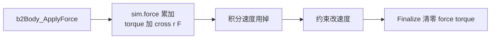
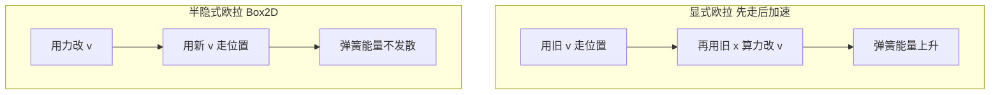
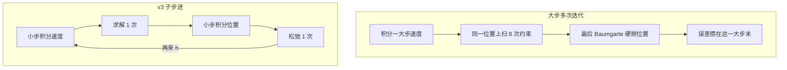

# 02 · 物理定律与数值积分

> 读完你能回答：Box2D 到底用了哪几条物理定律？为什么先改速度再改位置？`b2MakeSoft` 三个系数从哪来？子步进和「迭代很多次」有何不同？

大学物理第一学期就够。真正难的是：怎么把连续时间的定律，变成计算机里每秒 240 次的加减乘，还不炸掉。

---

## 一、全部定律清单（真的就这些）

经典力学里用到的：

| 定律 | 公式 | 落点 |
|---|---|---|
| 牛顿第二定律（平动） | `F = m · a` | `b2IntegrateVelocitiesTask` |
| 牛顿第二定律（转动） | `τ = I · α` | 同上 |
| 匀强重力 | `a = g`（不是 `F/m` 再乘一遍） | 同上，`gravityScale` |
| 动量定理 | `Δv = P / m` | 所有约束 |
| 角动量定理 | `Δw = invI · cross(r, P)` | 所有约束 |
| 库仑摩擦 | `\|ft\| ≤ μ · fn` | 接触切向冲量钳制 |

不在守恒律里、属于工程模型的：

| 模型 | 公式 / 行为 | 说明 |
|---|---|---|
| 恢复系数 | `v_n+ ≈ -e · v_n-` | 唯象，只在 Relax 阶段 |
| 线性 / 角阻尼 | `dv/dt = -c · v` | 空气阻力的线性化 |
| 滚动阻力 | `\|τ\| ≤ ρ · Fn` | 轮胎压扁损耗 |
| 软约束 | 弹簧-阻尼二阶 ODE | 用户调 Hertz / ζ |

没有万有引力公式，没有流体，没有柔性体。刚体 = 两点距离永远不变的一块物质。

---

## 二、平动：牛顿第二定律怎么进代码

[`b2IntegrateVelocitiesTask`](../src/solver.c) 每个子步、对每个 awake 刚体做一次：

```c
float linearDamping  = 1.0f / (1.0f + h * sim->linearDamping);
float angularDamping = 1.0f / (1.0f + h * sim->angularDamping);
float gravityScale   = sim->invMass > 0.0f ? sim->gravityScale : 0.0f;

b2Vec2 linearVelocityDelta = b2Add(
    b2MulSV(h * sim->invMass, sim->force),   // h * (F/m)
    b2MulSV(h * gravityScale, gravity));     // h * g
float angularVelocityDelta = h * sim->invInertia * sim->torque;

v = linearVelocityDelta + linearDamping * v;
w = angularVelocityDelta + angularDamping * w;
```

翻译：

```
v ← v / (1 + h·c_lin)  +  h·F/m  +  h·g
w ← w / (1 + h·c_ang)  +  h·τ/I
```

### 为什么重力那一项不乘 invMass？

```
a_gravity = (m · g) / m = g
```

质量消掉了。伽利略斜塔：铁球和木球一起掉。代码直接加 `h * g`。

但有一句精巧的门卫：

```c
float gravityScale = sim->invMass > 0.0f ? sim->gravityScale : 0.0f;
```

静态 / 运动学 `invMass == 0`，强制不受重力。用户仍可给动态物体设 `gravityScale = 0` 做失重，而不影响别处。

### 力从哪来，何时清零



力是 **本大步有效** 的。你每帧都要重新 Apply。冲量 API（`ApplyLinearImpulse`）则直接改 `bodyState.linearVelocity`，不等积分。

`ApplyForce` 若作用点不在质心，会同时加力矩：`τ += cross(point - center, F)`。这就是「推箱子边角，箱子会转」。

---

## 三、阻尼：解析解的 Pade 近似

连续方程：

```
dv/dt + c · v = 0
v(t) = v0 · exp(-c · t)
```

一步：`v_new = v_old · exp(-c · h)`。指数函数贵，而且和「再加外力」不好混。Box2D 用 **Pade 近似**：

```
exp(-x) ≈ 1 / (1 + x)     当 x = c·h 不太大
v_new = v_old / (1 + h·c)
```

性质：

- `c = 0` → 系数 1，无阻尼
- `c → ∞` → 系数 → 0，一步刹停，不会变负、不会振荡
- 比显式 `v *= (1 - h·c)` 稳：后者 `h·c > 1` 会反向加速

注释就写在 `b2IntegrateVelocitiesTask` 上面，建议对照着读一遍。

---

## 四、半隐式欧拉：先 v 后 x

连续世界：`a = F/m`，`v̇ = a`，`ẋ = v`。

**显式欧拉**（会炸）：

```
x ← x + h · v
v ← v + h · a(x)     用的是旧位置的力，弹簧会越荡越大
```

**半隐式欧拉**（symplectic Euler，Box2D 用这个）：

```
v ← v + h · a        先用当前力改速度
x ← x + h · v_new    再用新速度改位置
```

弹簧-质点上，半隐式欧拉近似保能量（面积守恒），显式欧拉每步往能量账上加一笔。堆盒子时，显式欧拉会「越堆越弹」。



### 自由落体手算

`y0 = 10`，`v0 = 0`，`g = -10`，`dt = 1/60`，无阻尼。解析解 1 秒后：`v = -10`，`y = 5`。

半隐式欧拉一步：

```
v = 0 + (1/60) * (-10) = -1/6
y = 10 + (1/60) * (-1/6) = 10 - 1/360 ≈ 9.9972
```

走 60 步后，`v` 精确等于 `-10`（加速度恒定），`y` 略低于 5（因为每步用的是「步末速度」，多走了半步）。游戏里看不出来。若改成显式欧拉先走位置，1 秒后 `y` 仍是 10——第一步 `v` 还是 0，整秒都在用「滞后的速度」，最后才突然获得 `-10`。堆叠时这种滞后就是穿透和抖动。

---

## 五、位置积分、增量、旋转

[`b2IntegratePositionsTask`](../src/solver.c) 在约束 **Solve 之后** 才跑：先让冲量把速度改对，再用对的速度走位置。

```c
// 运动锁：当成最后一条约束
v.x = (flags & lockLinearX) ? 0 : v.x;
v.y = (flags & lockLinearY) ? 0 : v.y;
w   = (flags & lockAngularZ) ? 0 : w;

// 钳速度
if (|v| > maxLinear)  v *= maxLinear / |v|;
if (|w| > maxAngular && !allowFastRotation) w *= maxAngular / |w|;

deltaPosition += h * v;
deltaRotation  = IntegrateRotation(deltaRotation, h * w);
```

### 为什么用增量，不用直接改 world position？

子步里接触点的分离写成：

```
s(t) = s0 + dot( (cB0 + ΔpB + rot(ΔqB, rB))
               - (cA0 + ΔpA + rot(ΔqA, rA)) , n )
```

`Δp`、`Δq` 从 0 / 单位旋转长出来，减法发生在「这一大步走了多远」上，而不是「离世界原点十万米」。静态物体 dummy state 的 `Δp = 0`、`Δq = {1,0}`，公式不用分支。

大步结束，Finalize 才：

```
center += deltaPosition
q = Normalize(deltaRotation * q)
deltaPosition = 0
deltaRotation = identity
```

### 旋转不用角度，用 `(c, s) = (cos θ, sin θ)`

[`b2IntegrateRotation`](../include/box2d/math_functions.h)：

```
c2 = c1 - Δθ · s1
s2 = s1 + Δθ · c1
再除以模长，拉回单位圆
```

这是旋转的微分方程 `q̇ = ω × q` 的一步欧拉，避免 `atan2` / `sincos`。`b2Rot` 全程是这个二元组。需要角度时再 `atan2(s, c)`。

### 速度钳制和 CCD 的关系

- `maximumLinearSpeed` 默认 400 m/s（比音速快），防止 NaN 传染。
- `B2_MAX_ROTATION = 0.25π` **每个大步**。换算成角速度上限：`maxW = 0.25π · inv_dt`。
- 注释写得很狠：若放到 `0.5π` 或更大，**连续碰撞会坏**。TOI 假设一小步内转角不大，旋转用线性插值才说得通。

---

## 六、质量与惯量

形状带密度。创建/更新时 [`src/geometry.c`](../src/geometry.c) 算出 `b2MassData`：质量、质心、绕质心的惯性。

- **圆**：`m = π r² ρ`，`I = m r² / 2`（薄圆盘，2D）。
- **胶囊**：矩形 + 两个半圆，半圆质心在 `4r / (3π)`，再用平行轴定理拼起来。
- **多边形**：从顶点 0 剖成三角形，面积加权质心；惯性先绕原点再移到质心（平行轴定理）。圆角多边形面积按「核心 + 扇形」处理；退化成 1～2 个点时走圆/胶囊公式。

多个形状挂在同一刚体上：质量相加，质心是质量加权平均，惯性移到总质心后再加。

求解器 **只存逆**：

```
invMass    = (m > 0) ? 1/m : 0
invInertia = (I > 0 && !fixedRotation) ? 1/I : 0
```

锁定旋转时 `invInertia = 0`，等于「转动惯量无穷大」。和静态物体同一套路。

`localCenter` 是质心相对 body 原点。积分的是质心 `center`，渲染用的原点是：

```
origin = center - rotate(q, localCenter)
```

自己写引擎时很容易忘这一步：力加在「精灵左上角」，转动却绕质心，视觉上会滑。

---

## 七、软约束：`b2MakeSoft` 手推一次

接触不是无限硬的墙。重叠被当成一根弹簧-阻尼器：你调频率（Hertz）和阻尼比（ζ）。实现在 [`b2MakeSoft`](../src/solver.h)。

连续模型（位置误差 `c`，要把它拉回 0）：

```
c̈ + 2 ζ ω ċ + ω² c = 0
ω = 2π · Hertz
```

隐式欧拉离散后，速度约束变成：

```
λ = -massScale · K⁻¹ · (J·V + biasRate · c)  -  impulseScale · λ_old
```

三个系数：

```
ω  = 2π · Hertz
a1 = 2ζ + h·ω
a2 = h·ω · a1
a3 = 1 / (1 + a2)

biasRate    = ω / a1
massScale   = a2 · a3
impulseScale = a3
```

恒等式：**`massScale + impulseScale == 1`**。这不是巧合，是隐式离散的结构：新冲量和旧冲量按这个比例混合，对应「弹簧有记忆」。

极限：

| 情况 | biasRate | massScale | impulseScale | 手感 |
|---|---|---|---|---|
| Hertz → 0 | 0 | 0 | 0 | 关掉软约束 |
| Hertz → ∞ | 1/h | 1 | 0 | 硬约束：一步按分离除以 h 改速度 |
| ζ = 0 | 1/h 量级 | `x/(1+x)` | `1/(1+x)` | 会振荡 |
| ζ 很大 | 变小 | 接近 1 | 接近 0 | 过阻尼，慢慢推开 |

### 数值例子：默认接触，4 子步

```
Hertz = 30, ζ = 10, dt = 1/60, subSteps = 4
h = 1/240 ≈ 0.004167
ω = 2π·30 ≈ 188.5
hω ≈ 0.785
a1 = 20 + 0.785 = 20.785
a2 ≈ 16.32
a3 ≈ 0.0577

biasRate    ≈ 9.07
massScale   ≈ 0.942
impulseScale ≈ 0.058
```

读法：这一小步几乎按「硬」来改速度（massScale≈0.94），但 bias 不是 `1/h≈240`，只有约 9——重叠被慢慢吃掉，不会一帧弹飞。再被 `contactSpeed = 3 m/s` 钳一层：

```
velocityBias = max(massScale * biasRate * s, -contactSpeed)
```

`s` 是负的重叠。推开速度封顶 3 m/s，堆十层盒子也不会底层「爆炸」。

和静态地面的接触用 `2 * Hertz`，更硬，减少「陷进地板」。

大步长保护（`b2World_Step` 里）：

```c
contactHertz = min(world->contactHertz, 0.125f * inv_h);
```

若有人把 `subStepCount` 设成 1 且 `dt` 很大，`hω` 会被卡住，避免 `biasRate` 接近 `1/h` 把物体打飞。

关节弹簧走 **同一函数**，只是 Hertz / ζ 是关节自己的（轮子悬挂、软距离关节）。Hertz = 0 表示这根弹簧关掉。

---

## 八、子步进：质量从哪来

```
b2World_Step(dt, subStepCount)
    h = dt / subStepCount
    每个小步:
        积分速度      力、重力、阻尼，用 h
        热启动        把上一小步的 λ 再打一遍
        Solve         useBias = true，修穿透 / 推测
        积分位置      x += h · v
        Relax         useBias = false，摩擦、恢复、滚动
```

对比旧习惯「1 个大 dt + 8 次迭代」：



为什么更稳：接触点的分离 `s` 每个小步都按新的 `Δp` 重算（法线先冻结）。盒子刚碰上地面，第一个小步就把相对速度压到接近 0，后面三个小步只做微调。大步迭代则是：位置已经重叠 2cm，8 次冲量在「过时的几何」上打架，最后靠 bias 猛推。

代价：Prepare 的有效质量、锚点，每个大步算一次；Solve/Relax 跑 N 遍。N=4 是官方样品的默认。自己写引擎可以从 N=1 开始，堆叠不稳再加。

源码里 `ITERATIONS = 1` 不是「求解很弱」，是「迭代被展开成了子步」。

---

## 九、恢复系数为什么在 Relax，不在 Solve

恢复是「碰完之后弹开」，不是「重叠时再加一个弹簧」。

Solve（`useBias = true`）的任务：推测或推开，让 `s` 走向非负。这里若再乘 `-(1+e) vn`，弹力会和软约束 bias 叠加强，堆叠会跳。

Relax（`useBias = false`）时重叠 bias 关掉，才允许：

```
if (restitutionVelocity > 0)
    velocityBias = min(velocityBias, -restitutionVelocity);
```

`restitutionVelocity` 在 Prepare 时从「接近速度」和材料 `e` 算好，低于 `restitutionThreshold`（默认 1 m/s）则为 0——盒子安安静静躺着，不会因数值噪声自己弹起来。

所有点都分离后，把 `restitutionVelocity` 清零，避免连续多帧重复弹。

摩擦和滚动阻力也只在 Relax：先有可靠的法向冲量 `λn`，再钳 `|λt| ≤ μ λn`。若和法向在同一次迭代里耦合，库仑锥会抖。

---

## 源码索引

| 主题 | 函数 / 位置 |
|---|---|
| 力、重力、阻尼 | `b2IntegrateVelocitiesTask` |
| 半隐式位置、钳速、增量 | `b2IntegratePositionsTask` |
| 旋转积分 | `b2IntegrateRotation` |
| 软约束三系数 | `b2MakeSoft` |
| Hertz 大步保护 | `b2World_Step` 里 `contactHertz = min(...)` |
| 圆 / 胶囊 / 多边形质量 | `b2ComputeCircleMass` / `Capsule` / `Polygon` |
| 恢复、摩擦时机 | `b2SolveContacts_Overflow(..., useBias)` |

---

## 自己写引擎时的最小集

M1 只需要：

```c
v += dt * (invMass * force + gravity);
force = 0;
x += dt * v;          // 必须用新 v
```

先不要写阻尼、软约束、子步进。等圆对圆能落地停下，再加 `1/(1+dt*c)`。等堆叠抖动，再把 `dt` 拆成 4 个 `h`，并抄 `b2MakeSoft`。

下一章 → [03-碰撞检测](./03-碰撞检测.md)
