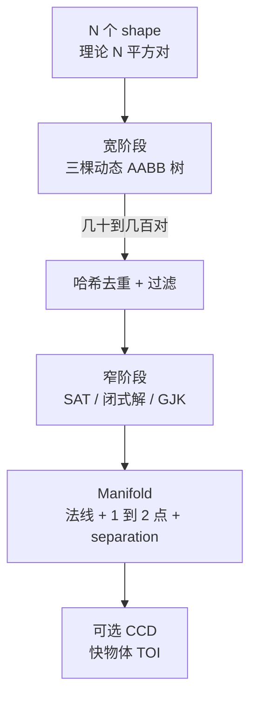
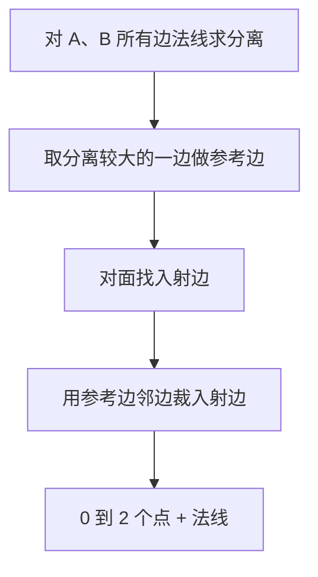
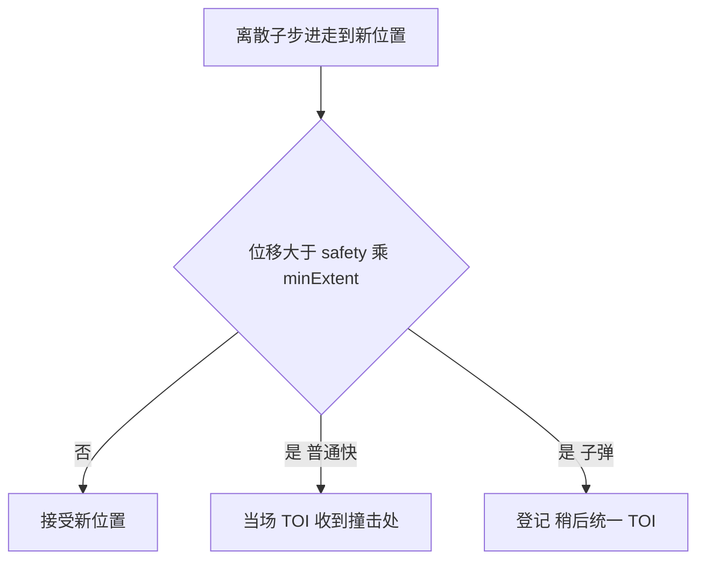

# 03 · 碰撞检测：从 AABB 到接触点

> 读完你能回答：一万个形状为什么不会比成五千万对？SAT 怎么找出两个接触点？`separation > 0` 为什么合法？子弹隧穿时 TOI 在算什么？

碰撞是漏斗：先用便宜的框扔掉不可能的对，再对剩下的做几何。求解器只吃漏斗最底下那 1～2 个点。

---

## 〇、三级漏斗



数量级直觉：10000 个形状，两两是 5×10⁷ 对。树查询大约 `k · log N`，`k` 是真正靠近的对数。游戏里通常只剩几十到几百对进入窄阶段。

---

## 一、AABB 是什么，为什么要「胖」

**AABB**（Axis-Aligned Bounding Box）= 轴对齐包围盒。不管形状怎么转，都用水平/竖直边框住。

```
旋转 30° 的盒子              它的 AABB
    /\                       +--------+
   /  \                      |   /\   |
  /    \                     |  /  \  |
  \    /                     |  \  /  |
   \  /                      |   \/   |
    \/                       +--------+
```

相交判断只要四次比较：`a.max.x >= b.min.x && ...`。旋转后 AABB 会变大，这是用「便宜」换「宽松」：漏报为零，误报靠窄阶段杀掉。

形状还存一份 **fat AABB**：比紧 AABB 再胀一圈。物体在圈里挪，树节点不用改。常量：

- `B2_MAX_AABB_MARGIN = 5cm` 上限
- 小物体：`margin ≤ 0.125 × maxExtent`，避免蚂蚁被套进一栋楼那么大的盒子

这叫迟滞（hysteresis）：用一点点多余查询，换来少得多的树旋转。

---

## 二、宽阶段：三棵动态 AABB 树

[`src/broad_phase.h`](../src/broad_phase.h)：`trees[static / kinematic / dynamic]`。

为什么拆开：

- 静态对静态永不查询
- 动态物体移动时，只去另外两棵树里问「谁跟我的 fat AABB 重叠」
- 运动学物体数量通常少，单独一棵避免和海量静态叶子挤在一起

`proxyKey` 把类型编码在低 2 位：`B2_PROXY_KEY(id, type)`。一个整数就能知道去哪棵树。

### 动态树在干什么

[`src/dynamic_tree.c`](../src/dynamic_tree.c) 是二叉包围体层次（BVH）：

- 叶子 = 一个 shape 的 fat AABB
- 内部节点 = 两个孩子 AABB 的并
- 查询从根往下走，和当前节点不相交就整枝剪掉

插入时选「并起来面积增加最少」的兄弟，必要时旋转（和 AVL 类似）保持扁。树不平衡时查询退化成链表，所以有重建。读代码时把旋转想成「让爸爸的盒子更紧」，不必先背所有 case。

树节点用下标不用指针，和世界其他部分同一套「可搬家」哲学。这份树也可以脱离物理单独用（射线、房间查询）。

### 配对流程

[`b2UpdateBroadPhasePairs`](../src/broad_phase.c)：


过滤会丢掉：

- 同一刚体上的两个形状
- `categoryBits / maskBits` 对不上
- `groupIndex` 同号互斥或异号（符号约定见官方文档）
- 已经有接触的对（哈希命中）

新接触此时 **还没 touching**。只表示「AABB 重叠，下一阶段再量」。AABB 不再重叠则销毁接触。

`moveArray` 的顺序是确定性的：并行查出的对，按这份顺序串行建接触，回放才一致。

---

## 三、窄阶段：形状对调度表

[`src/contact.c`](../src/contact.c) 一张 `s_registers[typeA][typeB]`，指向 `manifold.c` 里的函数。若登记时 `primary == false`，会交换 A/B 再调用，保证每个函数都假设「A 是某种固定类型」。

| 对 | 算法 | 函数 |
|---|---|---|
| 圆 vs 圆 | 闭式：圆心距 − 半径和 | `b2CollideCircles` |
| 胶囊 vs 圆 | 点到线段距离 | `b2CollideCapsuleAndCircle` |
| 多边形 vs 圆 | 圆变到多边形局部，找最近边/顶点 | `b2CollidePolygonAndCircle` |
| 多边形 vs 多边形 | SAT + 边裁剪 | `b2CollidePolygons` |
| 胶囊 vs 胶囊 / 多边形 | 胶囊先升成圆角多边形或走线段 | `b2CollideCapsules` 等 |
| 链段 vs 圆角多边形 | GJK | `b2CollideChainSegmentAndPolygon` |

线段经常先「胀成半径为 0 或很小的胶囊」，复用胶囊路径。

输出先是 `b2LocalManifold`（A 的局部系），再变到世界，填进 `b2Manifold`：

```
normal          从 A 指向 B
points[2]
  anchorA/B     接触点相对各自质心（求解器用这个当 r）
  separation    负 = 穿透，正 = 还没碰上（推测）
  id            顶点/边编号打包，用来复用冲量
  normalImpulse / tangentImpulse   上一帧留下的热启动
pointCount      0、1 或 2
```

2D 里一个刚体对最多两个点：边对边是两点（能抗转动），顶点对边是一点。

---

## 四、SAT + 边裁剪（多边形的灵魂）

**分离轴定理（SAT）**：两个凸形不相交 ⇔ 存在一条轴，投影区间不重叠。2D 凸多边形，候选轴就是各边法线。

对每条法线 `n`，算：

```
separation = min_B( dot(vB, n) ) - max_A( dot(vA, n) )
```

（代码里是「A 的一条边」对 B 所有顶点的最小有符号距离，见 `b2FindMaxSeparation`。）

- 某个 separation > 推测距离 + 半径和 → 不可能碰上，空 manifold
- 否则取 **分离最大** 的那条边当参考边（最浅穿透 / 最接近的缝）
- 对面找入射边：法线和参考法线点积最小的边（最平行、最「拍」过来的那条）

然后 **Sutherland–Hodgman 式裁剪**：入射边被参考边两侧的邻边各切一刀，留下最多两个点。每个点的 `separation = dot(point - refVertex, refNormal) - radius`。



`b2CollidePolygons` 还有两处工程细节：

1. **先把 B 变到 A 局部，再把 A 的顶点 0 移到原点**。远离世界原点时，减法在「盒子自己的坐标系」里做，少丢精度。
2. **顶点对顶点** 时两边几乎不相交，裁剪出的点分离可能比「两段最近点」还大。这时改用法线 = 两点连线，只留一个点（`b2SegmentDistance`）。

### 手算：斜盒子落在地面

地面当一个很扁的盒子，上边法线 `(0, 1)`。斜着的 1×1 盒子，底边两个顶点世界坐标大约 `(−0.2, −0.05)`、`(0.7, 0.15)`（单位米，地面 y=0）。

```
        盒子
       /    \
      /      \
     *--------*      两个候选接触
==================== 地面
```

1. 地面上边法线 `(0,1)` 上的分离：两个底顶点的 y 分别是 −0.05 和 +0.15。最小分离 −0.05（已穿透 5cm）。
2. 盒子四条边的分离：侧边几乎是斜的，投影缝更大（更「分开」）。所以参考边 = 地面上边。
3. 入射边 = 盒子底边（最朝下）。
4. 裁剪：底边两端都在地面邻边（左、右无限远）之内，留下两点。
5. 点 0：`separation = −0.05`；点 1：`separation = +0.15`（还在地面上方，但是推测点）。

求解器两个点都收：左边已经穿了，往上推；右边还没到，用 `s/h` 限制「别在这一步踩进去」。盒子因此获得正确的反转矩，不会单点支撑那样打转。

自己写引擎时，用纸画出「参考边 + 入射边 + 两刀」比看公式快。

---

## 五、圆、胶囊：闭式解

圆 vs 圆（`b2CollideCircles`）：

```
d = centerB - centerA          在相对变换下
dist = |d|
separation = dist - (rA + rB)
若 separation > speculativeDistance → 空
normal = d / dist              dist≈0 时随便给一个单位向量
point 在两圆周之间
```

一个点就够。穿透深度就是负的 `separation`。

胶囊 vs 圆：把圆心里到胶囊轴段上，得到线段上最近点，然后退化成「圆 vs 圆」。

多边形 vs 圆：圆心跳到多边形局部。若圆心在某条边外且最近的是边，法线就是边法线；若最近的是顶点，法线指向圆心。圆角多边形把半径算进分离。

这些函数短，建议作为读 `manifold.c` 的入口，再去碰 SAT。

---

## 六、GJK、ShapeCast、TOI

链段和圆角多边形没有简单的「边对边」，走 [`b2ShapeDistance`](../src/distance.c)（GJK）。

### GJK 直觉

两个凸形的距离 = 它们 ** Minkowski 差 ** `A − B` 到原点的距离。

支撑函数：给定方向 `d`，返回形状上「最往 `d` 那边」的点。差集的支撑 = `supportA(d) - supportB(−d)`。

算法维护一个单纯形（1、2 或 3 个点），反复：

1. 看原点到当前单纯形的最近特征，得到新方向
2. 沿该方向取支撑点
3. 若支撑点不能更靠近原点，结束；三点围住原点则相交

最多约 20 次迭代。`b2SimplexCache` 记下上次用了哪几个顶点下标，下一帧热启动，通常 1～2 次就收敛。

Erin Catto 的 GDC 2010 讲义是这份代码的说明书：<https://box2d.org/files/ErinCatto_GJK_GDC2010.pdf>

### ShapeCast

`b2ShapeCast`：凸形 A 沿向量 `translation` 扫过去，问何时碰上 B。GJK 的亲戚（有时叫 Conservative Advancement / GJK ray cast）：在分离轴上估一个前进上限，再收紧。给角色控制器、扫描查询用，也给连续碰撞当砖块。

### TOI

`b2TimeOfImpact`：两个 sweep（质心从 `c1` 到 `c2`，旋转从 `q1` 到 `q2`）在时间 `[0,1]` 上何时首次距离 ≤ 目标。旋转用 `c、s` 线性插值再归一化——所以单步转角不能太大（`B2_MAX_ROTATION`）。

输出一个分数 `t`。`t = 1` 表示这一步内碰不上。

---

## 七、推测接触与接触复用

### 推测

窄阶段的通过线不是 `separation ≤ 0`，而是：

```
separation ≤ B2_SPECULATIVE_DISTANCE + radius
```

大约 2cm 以内的「快碰上」也会生成点。求解器在 [04](./04-约束与接触求解.md) 里用 `bias = s / h`（`s > 0`）让相对速度在步末刚好把缝填上，而不是等穿透再弹。

这就是 manifold 里 `separation` 写着 *May be positive or negative* 的原因。

### 复用

同一对形状连续多帧接触，点的几何 id（哪条边、哪个顶点）若还在，并且：

- 世界距离变化 < `B2_CONTACT_RECYCLE_DISTANCE`（5cm）
- 法线夹角余弦 > `0.98`（约 11.5°）

就把旧的 `normalImpulse` / `tangentImpulse` 拷到新点上。热启动靠它：堆叠盒子每一帧几乎同一组接触，冲量从上帧接着用，不必从 0 收敛。

快物体（`b2_isFast`）往往关掉复用，因为位移太大，旧冲量是错的。

---

## 八、CCD：离散步走完再补一刀

默认是离散碰撞：先走到新位置，再看重叠。子弹、细杆、高速小球会 **隧穿**——这一步起点和终点都在墙的两边，中间没被采样到。

Finalize 里（[`b2FinalizeBodiesTask`](../src/solver.c)）用：

```
maxMotion = max(本步位移, |v|·dt)   再考虑旋转用 maxExtent
if (maxMotion > safetyFactor * minExtent)  标成 fast
```

- 普通快物体：马上 `b2SolveContinuous`，对静态/运动学/动态做 TOI，把位置收到首次撞击处，并可能削速度。
- **子弹**（`b2_isBullet`）：先登记，树更新之后再统一扫。子弹对所有类型做最终 TOI，**子弹和子弹不对打**（注释写明），避免 N² 连续对。
- 传感器：连续阶段最多记 8 个 hit，供「飞过传感器也要触发」的游戏逻辑。

`enableContinuous == false` 可关。自己写引擎时，先把离散做稳；真有穿墙再加「对静态几何做一次射线/TOI」。



---

## 九、传感器不是接触

传感器进同一套宽阶段树，但 `b2CreateContact` 不会为它们建约束。帧末 `b2OverlapSensors` 用当前变换做重叠查询，写 begin/end。它们忽略刚体类型和睡眠：睡着的箱子仍能挡住光束。

角色移动另有 `b2CollideMover`（胶囊 vs 世界），输出平面，给运动学角色用，不进冲量求解器。那是游戏层，不是刚体层。

---

## 源码索引

| 主题 | 函数 / 文件 |
|---|---|
| 三棵树、配对 | `b2UpdateBroadPhasePairs`、`b2BroadPhase` |
| 树本身 | [`src/dynamic_tree.c`](../src/dynamic_tree.c) |
| 形状对跳转表 | [`src/contact.c`](../src/contact.c) `s_registers` |
| SAT、裁剪 | `b2CollidePolygons`、`b2FindMaxSeparation`、`b2ClipPolygons` |
| 圆 / 胶囊 | `b2CollideCircles`、`b2CollideCapsuleAndCircle` |
| GJK | `b2ShapeDistance` |
| 扫掠 / TOI | `b2ShapeCast`、`b2TimeOfImpact` |
| 快物体 / 子弹 | `b2FinalizeBodiesTask`、`b2SolveContinuous` |
| manifold 字段 | [`include/box2d/collision.h`](../include/box2d/collision.h) |

---

## 自己写引擎时的最小集

1. 双重循环 + 紧 AABB，重叠再细测。
2. 先做圆 vs 圆、圆 vs 平面，能落地。
3. 再做盒子 vs 平面：写死「地面是参考边」，裁出两点。
4. 通用 SAT 放到 M3。GJK / 树 / CCD 放到物体过百或出现穿墙再抄。

下一章 → [04-约束与接触求解](./04-约束与接触求解.md)
