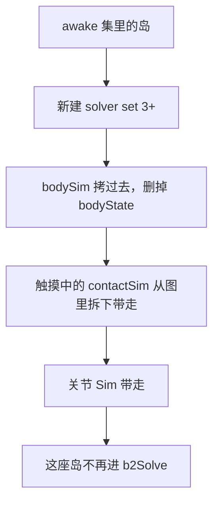

# 05 · 关节与并行

> 读完你能回答：距离关节的 `J` 怎么写？旋转铰去掉了哪两个自由度？同色约束为什么能并行写速度？一座岛睡着时内存里发生了什么？

接触是「不要穿模」。关节是「还要按设计连在一起」。求解器眼里它们是同一种东西：`J · V + bias = 0`，三板斧 Prepare / WarmStart / Solve。

---

## 一、关节的统一骨架

冷数据 `b2Joint`：id、类型、两条 `b2JointEdge`（挂到两个 body）、`islandId`、`colorIndex`、`collideConnected`。

热数据 `b2JointSim`：两边的 `invMass`、局部坐标系 `localFrameA/B`、以及按类型塞进 union 的状态。

每个大步、每种关节都做同一件事：


和接触的差别：

- 关节锚点 **每个子步按 `deltaRotation` 转一下**。注释写：关节转锚点会稳很多，接触转锚点反而抖。
- 弹簧、限位、马达往往叠在同一条轴上，冲量要加在一起再打（见旋转铰的 `axialImpulse`）。
- `filter` 关节：`b2GetJointConstraintForce` 直接返回 0，不进求解。它只在创建接触时说「这两人不许碰」。

分发在 [`src/joint.c`](../src/joint.c) 的 `switch (type)`。读一种关节，按 `b2PrepareX` → `b2WarmStartX` → `b2SolveX` 三个函数往下看即可。

---

## 二、教学关节：距离约束

[`src/distance_joint.c`](../src/distance_joint.c)。绳子、弹簧、滑轮的一维亲戚。

### 物理

两点 `pA`、`pB`（锚点世界坐标），当前长度 `L = |pB - pA|`，单位方向 `u = (pB-pA) / L`。

- 硬距离：`L = L0` → 相对速度沿 `u` 为 0
- 软弹簧：像一根 Hertz/ζ 的弹簧，休息长度 `L0`
- 限位：`L` 不得小于 `min`、不得大于 `max`（两条不等式）
- 马达：沿 `u` 的相对速度追 `motorSpeed`

```
J = [ -u.x, -u.y, -cross(rA, u),   u.x, u.y, cross(rB, u) ]
J · V = dot(u, v_rel) = Ċ   （长度的变化率）
```

有效质量：

```
crA = cross(rA, u)
K = invMassA + invMassB + invIA·crA² + invIB·crB²
axialMass = 1/K
```

和接触法向是同一个 K，只是 `n` 换成了 `u`。

### Prepare 在算什么

```c
anchorA = rotate(qA, localAnchorA - localCenter)
anchorB = rotate(qB, localAnchorB - localCenter)
deltaCenter = centerB - centerA
axis = normalize(anchorB - anchorA + deltaCenter)
axialMass = 1/K
distanceSoftness = b2MakeSoft(hertz, dampingRatio, h)
```

子步里当前轴：

```
rA = rotate(deltaRotationA, anchorA)
separation = deltaCenter + (deltaPosB - deltaPosA) + (rB - rA)
axis = normalize(separation)
length = |separation|
```

### Solve 弹簧枝

```c
cdot = dot(axis, v_rel)
c    = length - restLength
bias = softness.biasRate * c
λ    = -softness.massScale * axialMass * (cdot + bias)
     - softness.impulseScale * λ_old
λ    钳到 [lowerSpringForce * h, upperSpringForce * h]
```

限位枝把 `c = length - minLength`（或 `maxLength - length`）当成不等式，累积冲量 ≥ 0，和接触法向同一套钳制。

马达枝没有位置 bias：`λ = axialMass * (motorSpeed - cdot)`，钳到 `maxMotorForce * h`。

四条冲量最后都沿 **当前** `axis` 打。轴在子步内会转，所以 Prepare 只算初始几何，Solve 每步重归一化。

```
        A *--------* B
            axis u
          弹簧想保持 L0
          限位像两堵墙
          马达沿 u 拉/推
```

自己写引擎时：**先实现硬距离（Hertz=0 的限位等式）**，两个球用一根无质量杆连着转。再给 Hertz，它就变成弹簧。

---

## 三、旋转铰：钉在一起，还能转

[`src/revolute_joint.c`](../src/revolute_joint.c)。门轴、轮子轴、机械臂关节。

2D 刚体 3 个自由度。铰链钉住两个锚点重合，去掉 2 个平动，留下 1 个相对转动。

### 平动部分（2 行）

锚点重合：`pB - pA = 0`。相对速度是向量，不是标量：

```
J_lin 是 2×6
J_lin · V = vB + wB×rB - vA - wA×rA
```

有效质量是 2×2 矩阵（平移 + 转动耦合）。代码用 `linearImpulse` 当二维 `λ`，解一个小线性系统（或近似逐轴）。`useBias` 时 bias 指向「当前锚点分离」，软度来自 `constraintSoftness`（关节基础刚度，不是用户那根可选弹簧）。

### 转动部分（可选三根轴叠在一起）

相对角速度 `wB - wA`：

| 功能 | 约束 | 冲量名字 |
|---|---|---|
| 角度弹簧 | 相对角靠近目标 | `springImpulse` |
| 马达 | `wB - wA → motorSpeed` | `motorImpulse` |
| 下限 | 相对角 ≥ lower | `lowerImpulse ≥ 0` |
| 上限 | 相对角 ≤ upper | `upperImpulse ≥ 0` |

`axialMass = 1 / (invIA + invIB)`。WarmStart 里合成：

```
axialImpulse = spring + motor + lower - upper
```

一次加到两个 `w` 上。符号约定：下限往「打开」打，上限往「关回去」打，所以相减。

```
    A 质心
      \
       * 铰链锚点     两点钉死（2 个约束）
      /
    B 质心            相对角可加弹簧 / 马达 / 限位
```

车辆的轮子常用：旋转铰（或轮关节）+ 马达当驱动，限位不用。门用限位。

---

## 四、其余关节对照表

自由度按「还剩什么」记，比背源码快。

| 类型 | 去掉什么 | 弹簧 | 限位 | 马达 | 文件 |
|---|---|---|---|---|---|
| `distance` | 沿连线的 1 维长度（可选软） | 有 | 有 | 沿轴力 | `distance_joint.c` |
| `revolute` | 2 个平动 | 角度 | 角度 | 角速度 | `revolute_joint.c` |
| `prismatic` | 2 个：垂直滑轴的平动 + 相对转动 | 沿轴 | 沿轴位移 | 沿轴速度 | `prismatic_joint.c` |
| `wheel` | 1 个：垂直悬挂轴的平动（轮可转、可沿轴弹） | 悬挂 | 悬挂行程 | 轮转 | `wheel_joint.c` |
| `weld` | 3 个全钉死 | 线/角可软 | — | — | `weld_joint.c` |
| `motor` | 不钉位置；追目标速度/位姿 | 线/角 | 力距上限 | 本身就是马达 | `motor_joint.c` |
| `pogo` | 沿给定法线的弹簧腿（接触和关节的杂交） | 有 | 拉力/压力上限 | — | `pogo_joint.c` |
| `mover` | 给角色/运动学移动器用的平面约束 | 视实现 | — | — | `mover_joint.c` |
| `filter` | **不产生力**，只禁止两 body 生成接触 | — | — | — | `joint.c` |

读法建议：

1. 距离 — 一维，公式最干净
2. 旋转铰 — 二维平动 + 一维转动
3. 棱柱 — 旋转铰的「转动锁死、沿轴滑动」版本
4. 轮 — 棱柱 + 旋转的游戏向打包，做车悬挂
5. 焊接 — 两个软约束，Hertz=0 即刚焊
6. 其余当「同一三板斧的皮肤」

`collideConnected == false` 时，宽阶段不会为这两刚体建接触（关节自己连着，通常不希望锚点附近再撞）。`filter` 是「永远不撞、也没有关节力」的专用类型。

---

## 五、图着色：同色才能一起写

约束图：刚体是点，接触/关节是边。两条边共享一个 **可写** 刚体，就不能同时改它的速度。

染色：同色的边互不共享动态刚体 → 同色可并行。

```
颜色 0:  A—B    C—D    E—F     三线程同时算
颜色 1:    B—C    D—E
颜色 2:  A———————E
溢出:    X—Y1  X—Y2  X—Y3 …   X 度数太高，染不上
```

[`b2AddContactToGraph`](../src/constraint_graph.c)：

- 动态-动态：从颜色 0 向右找，最多用 `B2_DYNAMIC_COLOR_COUNT`（20）色。两人都不能已在该色 `bodySet` 里。
- 动态-静态（或运动学）：从颜色 22 向左找。静态不占 bit。
- 找不到 → `B2_OVERFLOW_INDEX`（23），单线程标量 Overflow。

为什么静态接触从后面染：求解按颜色 0、1、2… 往下走。后面的颜色最后写入速度，等效 **优先级更高**。一堆箱子挤地面时，和地面的约束后算，减少「动态之间先吵完，把人推进地板」。

运动学物体必须当动态一样占颜色：它们有 State，SIMD scatter 若多线程写同一地址，即使数值不变也会把缓存打爆。写回仍靠 `b2_dynamicFlag` 挡住。

论文出处写在文件头：*High-Performance Physical Simulations on Next-Generation Architecture with Many Cores*。

### 调度里你还会看到的细节

[`b2Solve`](../src/solver.c)：

- 每色接触先收成 wide 槽（`count` 向上取整到 SIMD 宽）。
- Prepare/Store 可以跨颜色摊成一段 flat parallel-for（只读各自 contact，不写共享速度）。
- WarmStart / Solve / Relax **必须按颜色同步**：`atomicSyncBits` 单调增加，迟到的 worker 不会重做已完成的 stage（防 ABA）。
- 调用 `b2World_Step` 的线程会再进 `b2SolverTask` 抢 orchestrator。任务系统若把 worker 0 排到很晚，主线程也能往前推 stage，避免死等。

自己写引擎：单线程按「先所有接触、再所有关节」扫就行。物体过千且你真有空核，再抄染色。溢出槽永远留着当退路。

---

## 六、岛与睡眠

岛 = 被接触和关节连起来的 awake 刚体集合。v3 **不用岛来划分求解**，只用它决定「谁一起睡觉」。

Finalize 时每个刚体算 `sleepVelocity`（真速度 + 打折的位置修正）。低于 `sleepThreshold` 就累加 `sleepTime`；岛内任何一个还醒着，整岛都不能睡（bitset `awakeIslandBitSet`）。

全员安静满 `B2_TIME_TO_SLEEP`（0.5s）→ [`b2TrySleepIsland`](../src/solver_set.c)：



唤醒是反向：State 按当前 `bodySim` 的速度重建（通常是 0），接触重新染色。所以唤醒一座岛是 O(岛大小)，不是 O(世界)。

若岛上刚去掉很多约束（`constraintRemoveCount > 0`），可能已经裂成两摊，却还挂在同一座岛上。这时先拆岛再睡——否则一摊醒着一摊想睡，会把醒着的也带走。拆岛任务塞在 `b2Solve` 前半，避开和 Finalize 抢数组。

未触摸的接触不属于岛：两座睡眠岛之间飘着的「AABB 重叠但没碰上」的接触，会放到 disabled 集，避免所有权打架。

---

## 七、和接触求解放在一起看

一张子步里，关节和接触按 **颜色** 交织，不是「先全部关节再全部接触」。`b2SolverTask` 的顺序是：

```
先单线程 Overflow（关节再接触）——优先级最低，多半是挤在一起的动态对
再对每个颜色（0, 1, 2, …）:
    该色的关节块 + 接触块（wide）并行
```

后面的颜色最后写入速度，优先级更高。同色内关节和接触仍不共享刚体，所以块之间仍可并行。不同色之间有 barrier。

这解释了为什么「一个轮子铰链 + 两个轮胎接触」会被染成不同颜色：它们共享轮子刚体。

---

## 源码索引

| 主题 | 去哪 |
|---|---|
| 类型枚举 | `b2JointType`（[`types.h`](../include/box2d/types.h)） |
| 三板斧分发 | [`src/joint.c`](../src/joint.c) |
| 距离（先读这个） | `b2PrepareDistanceJoint` / `b2SolveDistanceJoint` |
| 旋转铰 | `b2PrepareRevoluteJoint` / `b2SolveRevoluteJoint` |
| 染色 | `b2AddContactToGraph` / `b2AddJointToGraph` |
| 颜色常量 | `B2_GRAPH_COLOR_COUNT`、`B2_OVERFLOW_INDEX`、`B2_DYNAMIC_COLOR_COUNT` |
| 睡眠搬家 | `b2TrySleepIsland` / `b2WakeSolverSet` |
| 调度与 CAS | `b2Solve`、`b2SolverTask` |

---

## 自己写引擎时的最小集

M5 只做两样：

1. **硬距离**：一个标量 `λ`，沿 `u` 打，目标 `length = L0`。
2. **硬铰链平动**：二维冲量让两锚点相对速度为 0，bias 修分离。

车：两个圆当轮，用铰链钉在车身上，给铰链加马达。悬挂（wheel joint）可以后做。图着色、睡眠、SIMD 全部可选。

下一章 → [06-从零打造2D物理引擎](./06-从零打造2D物理引擎.md)
