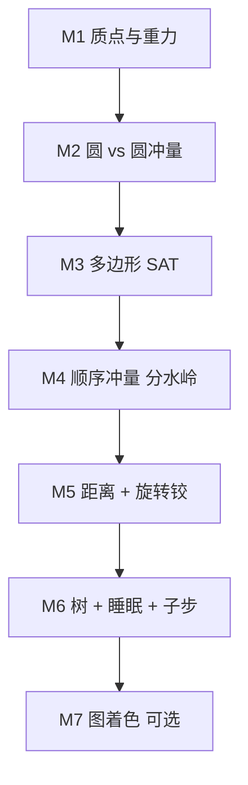

# 06 · 从零打造 2D 物理引擎

> 读完你能回答：最小可运行骨架长什么样？哪一步是分水岭？抖动、陷地、堆叠倒塌分别该回到前面哪一章？

这一章是练习册。伪代码贴近 Box2D 的 C 风格，可直接改成 C/C++/Rust/C#。每步只加一样新东西。对照源码用「对应函数」，不要一上来复制整个 `b2World`。

---

## 里程碑总览



| 步 | 行数量级 | 验收 | 过不了回看 |
|---|---|---|---|
| M1 | ~80 | 自由落体 1 秒后位置对得上 | [02](./02-物理定律与数值积分.md) |
| M2 | ~200 | 两球对撞动量守恒；落地能停 | [04](./04-约束与接触求解.md) |
| M3 | ~500 | 斜盒子两个接触点、不穿地 | [03](./03-碰撞检测.md) |
| **M4** | ~800 | **10 盒堆叠不塌** | [04](./04-约束与接触求解.md) |
| M5 | ~1200 | 一辆能开的车 | [05](./05-关节与并行.md) |
| M6 | ~2500 | 几千物体仍可点着玩 | [01](./01-物理世界框架.md)、[03](./03-碰撞检测.md) |
| M7 | — | 理解即可，不强制写 SIMD | [05](./05-关节与并行.md) |

---

## M1 · 质点与重力

**目标**：一个球自由落体。先不管碰撞，掉到 `y = 0` 就把 `y` 钳住、`vy` 清零（占位，M2 换冲量）。

**对应**：`b2IntegrateVelocitiesTask`、`b2IntegratePositionsTask`（去掉阻尼和钳速）。

```c
typedef struct { float x, y; } Vec2;

typedef struct Body {
    Vec2  position;
    Vec2  velocity;
    Vec2  force;
    float invMass;     // 0 = 静态
    float radius;
} Body;

void Step(Body* bodies, int count, float dt)
{
    Vec2 gravity = { 0.0f, -10.0f };

    for (int i = 0; i < count; ++i) {
        Body* b = bodies + i;
        if (b->invMass == 0.0f) continue;
        b->velocity.x += dt * (b->invMass * b->force.x + gravity.x);
        b->velocity.y += dt * (b->invMass * b->force.y + gravity.y);
        b->force.x = b->force.y = 0.0f;
    }

    for (int i = 0; i < count; ++i) {
        Body* b = bodies + i;
        if (b->invMass == 0.0f) continue;
        b->position.x += dt * b->velocity.x;   // 必须用新速度
        b->position.y += dt * b->velocity.y;
        if (b->position.y < b->radius) {       // 占位地面
            b->position.y = b->radius;
            b->velocity.y = 0.0f;
        }
    }
}
```

**验收**：`y0=10`，`v0=0`，`g=-10`，`dt=1/60`，走 60 步。`v.y` 应精确为 `-10`；`y` 略低于 5（半隐式多走半步），大约 `4.9xx`。若 `y` 仍是 10，你先改了位置再改速度——那是显式欧拉。

---

## M2 · 圆 vs 圆，一次法向冲量

**目标**：去掉钳位置。地面做成 `invMass=0` 的大圆或半平面。两球对撞后分开，动量守恒。

**对应**：`b2CollideCircles` + `b2SolveContacts_Overflow` 的无旋转、无软约束子集。

```c
void ResolveCirclePair(Body* a, Body* b, float e)
{
    Vec2 n = { b->position.x - a->position.x,
               b->position.y - a->position.y };
    float dist = sqrtf(n.x * n.x + n.y * n.y);
    float minDist = a->radius + b->radius;
    if (dist <= 0.0f || dist > minDist) return;

    n.x /= dist; n.y /= dist;
    float vn = (b->velocity.x - a->velocity.x) * n.x
             + (b->velocity.y - a->velocity.y) * n.y;
    if (vn > 0.0f) return;                 // 已经在离开

    float k = a->invMass + b->invMass;
    float p = -(1.0f + e) * vn / k;
    a->velocity.x -= a->invMass * p * n.x;
    a->velocity.y -= a->invMass * p * n.y;
    b->velocity.x += b->invMass * p * n.x;
    b->velocity.y += b->invMass * p * n.y;
}
```

位置仍可能重叠。可以在冲量之后沿法线各退一半（按 `invMass` 比例）。这是临时的位置修正；M4 要用 bias 取代它。

**验收**：

- 等质量对心碰撞、`e=1`：交换速度。
- 等质量、`e=0`：贴在一起以平均速度走。
- 球落到静态地面、`e=0`：`vy` 变成 0，不再往下穿。若每帧弹跳，你在 `vn>0` 时仍加了冲量，或位置修正和冲量对着干。

---

## M3 · 多边形 + SAT

**目标**：一个盒子斜落地面，两个接触点，不绕单点打转。

**对应**：`b2CollidePolygons` 的简化版——地面写死为参考边，或完整 SAT。

最小可用路径：

1. 盒子 4 个顶点变到世界。
2. 地面法线 `(0,1)`。每个顶点 `s = y - groundY`。`s` 最小的两个点，若 `s < speculative` 则收进 manifold。
3. 斜盒子会得到两点，分离可正可负。

通用 SAT 按 [03](./03-碰撞检测.md)：「最大分离边 = 参考边 → 入射边 → 裁两刀」。先把地面特例做对，再抽象。

接触点结构：

```c
typedef struct ContactPoint {
    Vec2  rA, rB;       // 相对质心
    Vec2  normal;
    float separation;
    float accPn, accPt; // 热启动，M4 用
} ContactPoint;
```

**验收**：盒子绕 Z 转 20° 放下。应看到两个点，落地后顶面保持倾斜不再转成「单角着地蹦」。只有一个点 → 裁剪丢了入射边，或你过早用了「只留最深顶点」。

---

## M4 · 顺序冲量（分水岭）

**目标**：10 个盒子叠成塔，静止后不塌、不抖、不沉进地面。

**对应**：`b2PrepareContacts_Overflow` + `b2SolveContacts_Overflow` + 热启动。这是整份教程的心脏。

每个大步：

```
收集所有接触点（窄阶段）
复用旧点的 accPn / accPt（距离和法线变化不大时）
重复 N 次:          // 先 N=8，有子步后再改成 4×(1+1)
    对每个点:
        做法向冲量，accPn >= 0
        立刻改两个 body 的 v、w
    对每个点:
        做切向摩擦，|accPt| <= mu * accPn
        立刻改 v、w
积分位置
```

法向增量（先硬约束，bias 用 Baumgarte 或 `s/h`）：

```c
float vn = relVelAlong(n);
float bias = (s < 0.0f) ? slopBaumgarte * s * invDt : s * invDt; // 推测
float dPn = -normalMass * (vn + bias);
float Pn  = maxf(cp->accPn + dPn, 0.0f);
dPn = Pn - cp->accPn;
cp->accPn = Pn;
applyImpulse(a, b, cp, n, dPn);
```

`normalMass` 含 `invI * cross(r,n)²`。漏掉转动项，斜盒子会转着陷进去。

**验收（必须同时满足）**：

1. 单盒落地面，1 秒内 `vy` 和穿透都接近 0。
2. 10 盒对齐叠放，5 秒后塔还在，顶层位移 < 几厘米。
3. 关掉热启动（每帧 `accPn=0`）塔应明显更软或倒塌——说明你确实在用累积冲量。

| 失败 | 回到哪 |
|---|---|
| 整塔上下抖 | [04](./04-约束与接触求解.md) 推测 / bias 过大；[02](./02-物理定律与数值积分.md) 恢复不该在 Solve |
| 慢慢沉进地面 | 和静态接触太软；或位置积分用了旧速度 |
| 塔向一边倒 | 只有一个接触点（回 M3）；或摩擦用了 `dPn` 而不是 `accPn` |
| 第一帧炸开 | `invDt * s` 太大，加上 `contactSpeed` 钳制 |

过了 M4，你已经有一个能用的 2D 刚体核。后面都是功能和性能。

---

## M5 · 关节：距离 + 旋转铰

**目标**：车身一个盒子，两个圆轮，铰链钉在车身上，马达驱动。

**对应**：`b2SolveDistanceJoint`、`b2SolveRevoluteJoint` 的硬约束子集。

先做硬距离（两个锚点保持 `L0`），用 [05](./05-关节与并行.md) 的标量 `λ` 沿 `u` 打，和接触同一循环里扫。

再做铰链平动：二维相对速度 → 二维冲量。角度马达：

```c
float cdot = wB - wA;
float dP = axialMass * (motorSpeed - cdot);
// 钳到 maxTorque * dt
wA -= invIA * dP;
wB += invIB * dP;
```

求解顺序：每个迭代里先关节后接触（或反过来，保持稳定即可）。共享刚体时顺序冲量会吵架，迭代次数够就能收敛。

**验收**：马达打开后车往前开，轮子会转，车身被铰链拖着走。关掉重力，两刚体用距离关节应像哑铃一样转，长度不变。长度慢慢飘 → bias 太弱或 `u` 没每步重归一化。

---

## M6 · 工程化：树、睡眠、子步进

**目标**：场景里扔 2000 个盒子，60Hz 仍能交互，静止的堆自动睡着。

三件套，可分开做：

1. **子步进**（先做，稳）。`h = dt/4`，每个小步：积分速度 → 热启动 → 求解 1 次 → 积分位置 → 松弛 1 次。`ITERATIONS=1` 的含义见 [02](./02-物理定律与数值积分.md)。把 M4 的「8 次迭代」换成「4 个子步」。
2. **AABB 树**（慢了再做）。先用均匀网格也能过关。树的插入/查询抄 [`dynamic_tree.c`](../src/dynamic_tree.c) 的思路即可，不必一次抄旋转。
3. **睡眠**。速度低于阈值累加时间，0.5s 后从求解列表摘掉；有接触或关节碰到醒着的物体再塞回去。第一版可以「按刚体睡」，不建岛；岛是「一堆连着的别误睡」的升级，见 [01](./01-物理世界框架.md)。

**验收**：堆叠塔睡着后 CPU 接近空转；推一下底层，整塔醒。2000 个分散盒子，窄阶段对数应远小于 `n²`。

可选：抄 `b2MakeSoft`，接触 Hertz=30、ζ=10。堆叠会从「硬邦邦」变成「略软但不弹」。

---

## M7 · 图着色（可选）

单线程已经正确时，才值得做。

- 把接触当边、刚体当点，贪心染 8～24 色。
- 同色并行求 `λ`、写速度。
- 染不上的进溢出，走你的标量求解。
- SIMD 是锦上添花：同一公式，4 个接触一包。

**验收**：结果和单线程在确定性模式下一致（允许溢出顺序不同带来的微小差异）。官方也不保证 overflow 与着色顺序得到 bit 级相同的世界。

---

## 调优清单（抄 Box2D 的手性）

| 参数 | 建议起点 | 乱调的后果 |
|---|---|---|
| `dt` | 1/60 | 太大则穿模 |
| 子步 | 4 | 1 时堆叠更容易塌 |
| `linearSlop` | 0.5cm | 太小数值抖，太大物体悬空 |
| 推测距离 | 2cm | 太小抖，太大到处是假接触 |
| 接触 Hertz / ζ | 30 / 10 | ζ<1 会当弹簧床 |
| 恢复阈值 | 1 m/s | 太低，静止也会自己跳 |
| 摩擦 | 0.6 | 按手感 |
| 多边形顶点 | ≤8 | 再多 SAT 变慢 |

单位用米、千克、秒。盒子 1m 见方、密度 1，手感和 Box2D 样品接近。不要用「像素当单位」却把重力设成 -10，除非你同时改 slop。

---

## 一张图：你的引擎和 Box2D 差在哪


不要为了「像官方」一上来就三分数据和 24 色。先让 10 个盒子站住。那一步过了，再读 Box2D 会快一个数量级——因为你已经知道每一行在救哪种失败。

---

## 源码索引（按里程碑）

| 里程碑 | 打开这些 |
|---|---|
| M1 | `b2IntegrateVelocitiesTask`、`b2IntegratePositionsTask` |
| M2 | `b2CollideCircles`、`b2SolveContacts_Overflow` 法向循环 |
| M3 | `b2CollidePolygons`、`b2ClipPolygons` |
| M4 | Overflow 的 Prepare / WarmStart / Solve 全文 |
| M5 | `b2SolveDistanceJoint`、`b2SolveRevoluteJoint` |
| M6 | `b2World_Step` 里的 `h`、`b2UpdateBroadPhasePairs`、`b2TrySleepIsland` |
| M7 | `b2AddContactToGraph`、`b2Solve` 的 stage 表 |

---

回到目录 → [README](./README.md)
