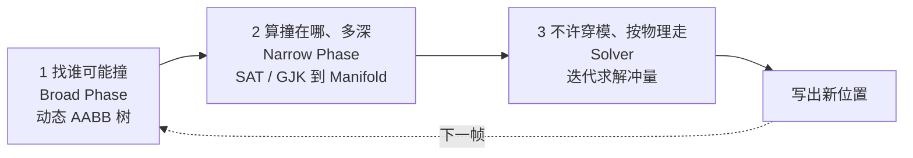

# Box2D v3 实现原理（Grok 版）

> 目标：用通俗语言 + 图，把当前 master 的 Box2D **读通到能自己写一个 2D 刚体引擎**。
> 代码基线：本仓库 `src/` + `include/box2d/`（C17，数据导向，冲量求解）。
> 官方 API 手册在 [`docs/`](../docs/overview.md)，那是「怎么用」；这里是「它为什么这样写」。

---

## 读完你能回答什么

1. 一个 `b2World_Step` 里，数据经过哪些结构、按什么顺序被改写？
2. Box2D 真正用了哪些物理定律？哪些其实是工程近似？
3. 碰撞从 AABB 树到接触点，每一步算的是什么？
4. 接触和关节如何统一成「冲量」，源码里那 180 行在干什么？
5. 若从零写引擎，最小路径是什么，哪一步是分水岭？

---

## 怎么读

按「先见森林，再见树木，最后自己种树」：

| 序号 | 文件 | 回答哪类问题 |
|---|---|---|
| 00 | [00-学习路线图](./00-学习路线图.md) | 先建立 5 个心智模型，再决定速通还是深挖 |
| 01 | [01-物理世界框架](./01-物理世界框架.md) | World / Body / Shape / Contact / Joint / SolverSet / Graph 怎么分工 |
| 02 | [02-物理定律与数值积分](./02-物理定律与数值积分.md) | 牛顿定律如何被离散成「先改速度、再改位置」 |
| 03 | [03-碰撞检测](./03-碰撞检测.md) | 谁可能撞、撞在哪、撞多深 |
| 04 | [04-约束与接触求解](./04-约束与接触求解.md) | 接触约束的数学 + `b2SolveContacts_Overflow` 精读 |
| 05 | [05-关节与并行](./05-关节与并行.md) | 关节三板斧、图着色、睡眠 |
| 06 | [06-从零打造2D物理引擎](./06-从零打造2D物理引擎.md) | 7 个可执行里程碑 |

**建议**：第一遍只看图和小标题；第二遍打开源码，按每章末尾的「源码索引」对照函数。

---

## 30 秒版本：Box2D 到底在干什么

一帧（一次 `b2World_Step`）里，引擎只做三件事：



一句话：

> **Box2D 不求解「力」，它求解「冲量」。**
> 每一帧它问的是：为了让接触点的相对法向速度不再把物体往里推，需要往每个接触点打多大的一脚？
> 这是带不等式的线性互补问题（LCP）。Box2D 用 **顺序冲量（Sequential Impulses）** 一轮一轮逼近。

冲量 `P` 的单位是 `N·s`。动量定理：`Δv = P / m`。碰撞时间极短、力极大，用 `F = ma` 积分会炸；改成「踹一脚改速度」就稳了。接触、关节、马达、限位，最终都翻译成同一句话：**往某个方向踹多大**。

---

## 必须先建立的直觉（后文会反复用到）

### 1. 求解的是速度，位置是积分出来的

约束写在速度上：`J · V + bias = 0`。位置误差不靠「硬掰坐标」一次修完，而是变成速度上的 bias，让下一小步自己走回去。

### 2. 一个刚体被拆成三份

```
b2Body        冷数据：id、名字、userData、链表头     用户 API，很少改
b2BodySim     温数据：transform、力、invMass         每帧读写几次
b2BodyState   热数据：v、w、Δx、Δq（32 字节）        求解器每个子步读写 N 次
```

这是数据导向设计：热数据挤在一起，才能 SIMD gather/scatter。详见 [01 章](./01-物理世界框架.md)。

### 3. 推测性接触（speculative contact）

还差约 2cm（`B2_SPECULATIVE_DISTANCE`）没碰上，就先建接触点，约束「这一小步结束时距离 ≥ 0」。所以 manifold 的 `separation` **可以为正**。这是「不抖」的关键之一。

### 4. 子步进，不是「一大步 + 很多次迭代」

`b2World_Step(dt, 4)` 内部跑 4 个小步，每小步 `h = dt/4`。源码里 `ITERATIONS` 和 `RELAX_ITERATIONS` 都是 **1**。质量来自「每小步都积分位置」，误差不会攒一大坨再硬修。

---

## 源码地图：70 个文件，其实 6 类

打星的 6 个文件吃透了，引擎就吃透了大约 80%。

```
src/
├── 世界与主循环
│   ├── physics_world.c / .h     ★★★  b2World_Step
│   └── solver.c / .h            ★★★  子步进、积分、CCD、并行调度
│
├── 对象模型
│   ├── body.c / body.h          刚体三件套
│   ├── shape.c / shape.h        形状与质量
│   ├── contact.c / .h           接触（冷/热分离）
│   ├── joint.c / .h             关节分发
│   └── sensor.c / .h            传感器（不进求解器）
│
├── 碰撞检测
│   ├── broad_phase.c / .h       ★★   三棵 AABB 树 + 配对
│   ├── dynamic_tree.c           ★★   插入 / 删除 / 旋转 / 查询
│   ├── manifold.c               ★★★  窄阶段，所有形状对
│   ├── distance.c               ★★   GJK / ShapeCast / TOI
│   ├── geometry.c               质量、凸包辅助
│   └── hull.c                   Andrew 单调链凸包
│
├── 约束求解
│   ├── contact_solver.c / .h    ★★★  接触：标量 + SIMD 宽版本
│   ├── constraint_graph.c / .h  ★★   图着色
│   ├── distance_joint.c         教学关节
│   ├── revolute_joint.c         旋转铰
│   ├── prismatic / wheel / weld / motor / pogo / mover
│   └── filter 关节              只过滤碰撞，不产生约束力
│
├── 调度与内存
│   ├── island.c                 岛（主要用于睡眠）
│   ├── solver_set.c             static / awake / disabled / sleeping
│   ├── scheduler.c / parallel_for.c
│   └── arena_allocator.c        栈式分配，每帧 O(1) 回收
│
└── 工具
    ├── math_functions.h         向量、旋转、软约束系数
    ├── constants.h              手性数字
    ├── id.h / id_pool.c         id + generation
    └── table.c / bitset.c / aabb.c
```

---

## 关键常量（改错一个，世界就会「手感不对」）

来自 [`include/box2d/constants.h`](../include/box2d/constants.h)：

| 常量 | 默认值 | 含义 |
|---|---|---|
| `B2_LINEAR_SLOP` | 0.005 m | 线性容差。允许的视觉可忽略穿透 |
| `B2_SPECULATIVE_DISTANCE` | 4 × slop = 0.02 m | 推测接触距离 |
| `B2_CONTACT_RECYCLE_DISTANCE` | 10 × slop = 0.05 m | 接触点复用距离 |
| `B2_CONTACT_RECYCLE_COS_ANGLE` | 0.98（约 11.5°） | 接触点复用角度 |
| `B2_MAX_AABB_MARGIN` | 0.05 m | AABB 胖边，减少树更新 |
| `B2_AABB_MARGIN_FRACTION` | 0.125 | 小物体 margin 上限比例 |
| `B2_MAX_ROTATION` | 0.25π rad / 大步 | 单帧最大转角；再大 CCD 会坏 |
| `B2_GRAPH_COLOR_COUNT` | 24 | 约束图颜色（最后一格是溢出） |
| `B2_TIME_TO_SLEEP` | 0.5 s | 静止多久后整岛睡眠 |
| `B2_MAX_POLYGON_VERTICES` | 8 | 凸多边形顶点数上限 |

世界默认值见 [`src/types.c`](../src/types.c) 的 `b2DefaultWorldDef`：

```
gravity              = (0, -10) m/s²
restitutionThreshold = 1.0 m/s     低于此相对速度不弹
hitEventThreshold    = 1.0 m/s
contactHertz         = 30 Hz       重叠恢复「弹簧」频率
contactDampingRatio  = 10          严重过阻尼，宁可慢推开也不弹
contactSpeed         = 3.0 m/s     重叠恢复速度上限
maximumLinearSpeed   = 400 m/s
```

`contactDampingRatio = 10` 是刻意的：接触恢复要稳，不要像弹簧床。

---

## 一句话预告每一章

1. **框架** — 世界是厂房，刚体是工件，求解集是传送带，约束图是工位，岛是「这批活可以下班」。
2. **定律** — 牛顿第二定律 + 冲量 + 库仑摩擦；其余是数值技巧（半隐式欧拉、Pade 阻尼、软约束）。
3. **碰撞** — 胖 AABB 树筛候选，SAT/GJK 出 1～2 个点，推测距离提前介入。
4. **接触约束** — 一切写成 `J·V + bias = 0`，顺序冲量 + 热启动 + 软约束。
5. **关节与并行** — 距离关节是教学模板；同色约束不共享刚体，所以能并行。
6. **从零实现** — 堆叠稳定是分水岭；过不了这一关，后面加关节都是沙上建塔。

开始 → [00-学习路线图](./00-学习路线图.md)
